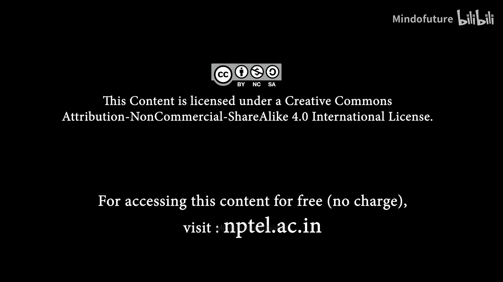
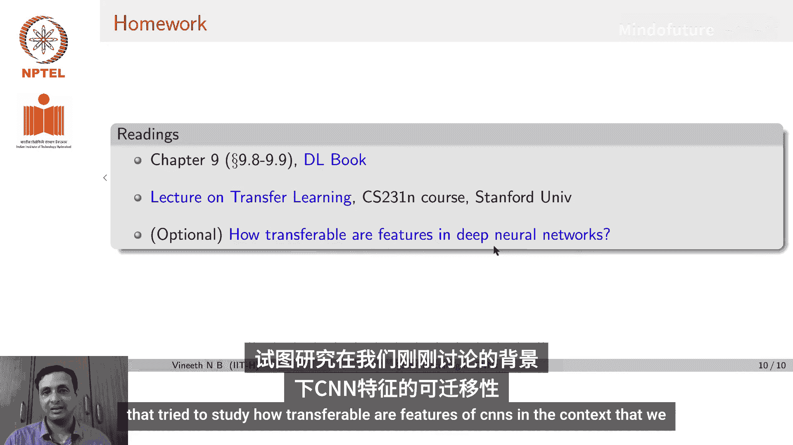

# 深度学习计算机视觉：P37：CNN中的微调

在本节课中，我们将要学习卷积神经网络（CNN）中的一个重要概念——微调。我们将探讨如何利用在一个任务上训练好的模型，来帮助我们在另一个新任务或新领域上更快、更好地训练模型。这涉及到迁移学习的思想，以及如何根据数据大小和任务相似性来选择合适的微调策略。

## CNN的局限性

上一节我们介绍了多种CNN架构的变体。本节中，我们来看看CNN本身存在的一些根本性问题。

首先，优化这些深度模型中的权重参数通常很困难。这需要合适的权重初始化方法和大量的超参数调优。

其次，CNN容易过拟合。因为训练样本的数量通常远少于被训练的参数数量。例如，AlexNet有6000万个参数，VGG有1.38亿个参数。因此，训练这些网络需要很长时间和大量的计算资源。

当需要为一个新领域设计架构时，这一切会变得更加困难。你需要设计架构，运行数天甚至数周来观察效果，然后调整超参数再重新训练。这种方法难以扩展。

## 迁移学习与特征层次

那么，我们如何为新任务和新领域设计模型呢？一个关键的观察是：CNN学习到的特征具有层次性。

*   **早期层**：学习捕捉**低级特征**，如定向边缘、颜色斑点等。
*   **中间层**：学习捕捉**中级特征**，如特定纹理，这是低级特征的组合。
*   **后期层**：学习捕捉**高级特征**，如物体的抽象表示。

这种层次化的特征学习启发了我们：能否利用在一个任务上学习到的特征知识，来帮助另一个任务？答案是肯定的，这被称为**迁移学习**。

在迁移学习中，我们有一个或多个**源任务**（已训练好的模型，如在ImageNet上训练的AlexNet）和一个**目标任务**（我们想解决的新问题）。目标是利用源任务的知识和目标任务的数据，来学习一个适用于目标任务的模型。

## 微调策略

基于CNN特征的层次性和迁移学习思想，我们可以采用**微调**策略。微调是指使用预训练模型的权重来初始化新任务的网络，然后根据新数据对部分或全部网络权重进行更新。

具体采用哪种微调策略，主要取决于两个因素：**目标任务数据量的大小**和**目标任务与源任务的相似度**。

以下是几种常见的情况及对应的策略：

**情况一：数据量小，任务相似度高**

在这种情况下，由于数据量有限，且两个任务相似，我们认为预训练模型提取的通用特征和专用特征都很有用。
*   **策略**：冻结预训练模型的所有层（保持权重不变），只随机初始化并训练最后的**分类层**。
*   **原因**：数据少，重新训练特征提取层可能导致过拟合；任务相似，预训练的特征可以直接使用。

**情况二：数据量小，任务相似度低**

此时，两个任务差异较大，预训练模型后期学到的专用特征可能不适用，但早期学到的通用特征（如边缘检测）可能仍有帮助。
*   **策略**：将预训练模型（通常是去掉最后分类层的部分）作为一个固定的**特征提取器**。用它对目标任务数据提取特征，然后在这些特征上训练一个新的分类器（如SVM或一个小型神经网络）。
*   **原因**：避免在少量数据上调整深度网络参数；利用预训练模型的通用特征表示能力。

**情况三：数据量大，任务相似度高**

这是最理想的情况，我们有足够的数据来调整模型，使其更好地适应新任务。
*   **策略**：将整个预训练模型作为初始化，然后在目标任务数据上**微调所有层**。通常，可以设置一个较低的**学习率**，使权重缓慢更新，避免破坏从源任务中学到的有用特征。
*   **公式**：权重更新公式为 `W_new = W_old - η * ∇L`，其中 `η`（学习率）设置得较小。

**情况四：数据量大，任务相似度低**

如果数据量足够大，且任务完全不同，预训练模型可能提供的帮助有限。
*   **策略**：可以考虑**从头开始训练**一个新的网络，使用标准的初始化方法（如He初始化）。或者，也可以尝试使用**迁移学习**中的高级方法（如传递式迁移学习），但微调预训练模型仍然可能是一个不错的起点。

## 总结

本节课中，我们一起学习了CNN中的微调技术。我们首先回顾了CNN训练面临的挑战，如优化困难和需要大量数据。接着，我们了解了CNN学习特征的层次性（低级、中级、高级），这为迁移学习奠定了基础。然后，我们详细探讨了**微调**的核心思想，即利用预训练模型来加速和改善新任务的训练。最后，我们根据**数据量大小**和**任务相似度**这两个关键维度，分析了四种不同的微调策略及其适用场景。掌握微调技术，能让我们有效地将现有强大的CNN模型应用到新的视觉任务中，而无需每次都从头开始设计和训练。

---

**扩展阅读建议**：
*   《深度学习》一书第9章。
*   CS231N课程中关于迁移学习的讲座。
*   早期研究CNN特征可迁移性的相关论文。

