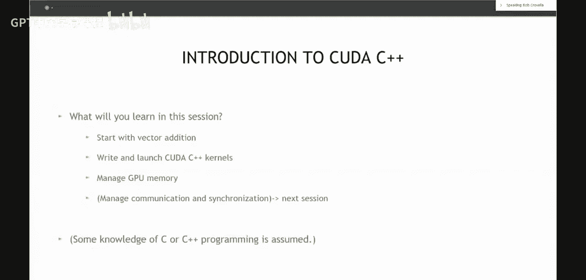

# 【Nvidia官方课程】CUDA入门课【中英字幕】 p01 01 CUDA C Basics [BV1JJ4m1P7xW_p1]

Hi everyone， this is Bob Corvello with NviIDdia， I'd like to introduce myself。

 I'm a solution architect that NVDA solution architects our technical resource at NviIDdia that we use basically to make the connection with our customers。

 and I'm joined by two of my colleagues at Robbie Srs at Oak Ridge and Max Cats who's helping out at Nurse or Berkeley Lab。

So that too is the Nvidia compliment on the call today， and I'd like to。

Thank both Oak Ridge and nurseurse for hosting this event inviting us and hosting the event and providing all of the necessary mechanics to get this done as Tom mentioned this will be an ongoing series。

 it looks right now like we have nine modules basically nine hour long presentations or roughly an hour long presentation and each one of them has let me just refer to it as homework exercises that can be done to reinforce the material。

So I'd like to give a brief overview of what we're going to be accomplishing over those nine。😡。

Obviously， we're only presenting one of those today。

 the first one and I'll talk about that in a moment， but I'd like to start by saying that。

The objective here is to give you a fairly broad based introduction to KUDa programming。

C to programming is one of the ways that we can access the GPUs for general purpose computation or acceleration of your codes of your workflow。

In order to learn Ka， I'm going to claim right up front that this one hour session that you're presented today。

 although you may think at the end of it， I now know Kuta， it's really not a complete introduction。

 I'm going to suggest that the complete introduction really constitutes the first three modules at a minimum。

 So the first three modules that we're going to present are going to cover both the。

Necessary syntax and understanding so that you can write syntactically correct coUDA programs that give you the correct answer。

 that'll be the first two modules。And then the third module is going to simultaneously expose you to GPU architecture at a fairly high level。

 in other words， the design of a GPU what makes it tick。And from that。

 we're going to extract the motivation， the understanding for our two most important concepts for optimization or understanding how to make codes that will run predictably fast on the GPU。

 give you attractive， desirable performance。😡，That's something that we're going to all of that together we will accomplish in the first three sessions。

 which will be roughly speaking January， February， March。And for the remainder of the sessions。

 they will be more topical， they will cover specific topics that expand your capabilities as a CUDA programmer。

😡，So I hope， of course， that you'll join me for all of the sessions that will be unfolding roughly speaking over the course or duration of this year。

😡，And of course， if you can attend the first three sessions， that will give you the most。

Sort of coordinated or coherent introduction to coa programming so I would strongly encourage you to do that and I believe as Tom mentioned Oak Ridge is going to be making these materials available。

 so we appreciate O Ridge for not only hosting us and inviting us to do this series but also as I mentioned the mechanics and logistics and providing the recording and making that available to the community we appreciate that and that will be your ability to cover if you will a missed session so if you miss a session but you'd like to continue on with the series you'll be able to access those recordings after the fact and that will allow you to。

Cover any missed material as well as if you'd like to do the homework The homework isn't intended to be the homework will be available for each session。

 so each session will have approximately three assignments for you to do the homework is designed to take roughly one hour it might be more or less than that but that's kind of the target is basically it's an hour' worth of work and it's work that you would would or should be able to do on GPU accelerated clusters at either oakak Rige or nurse or Berkeley lab so we believe that you will have the resources needed to do the homework and the homework is designed to reinforce first of all to reinforce the material for the session so today's homework will reinforce the concepts we learned today but in many cases the homework will also。

Add to or extend to your knowledge or your learning so let me just give you an example from today today's homework will reinforce the concepts that you learned today。

 but will also introduce a couple new concepts one of those new concepts will be coUa error checking error checking is a very important part of any journey in learning coUDa programming because it's frequently overlooked but the coUa runtime will often give you important error clues that can be used to quickly narrow down your debug efforts。

😡，And so error checking is a very important part or discipline for any coUDA programr and it's especially important when you're starting out learning KUDA and so that's something you'll get some exposure to during the homework and we won't really be spending during this first session。

 we won't be spending really any time at all talking about error checking during the lecture。😡。

Another example of something that you'll learn is a little bit less obvious。

 but coUDa has multidimensional capability during the session today we'll be talking primarily in one dimension of processing。

 but the homework will will extend some of those concepts to two dimensions so you'll learn you'll augment your knowledge that way if you decide to do the homework so I encourage you to do the homework and both O Riage and N have。

😡，Plans to enable you to do that and the homework will be available on a GiHub site it is already available for session one on the GitHub site so you should have everything you need to do the homework and I encourage you to do that。

During the session today， if you have questions you're welcome to use the resources that Tom already indicated I will so that would be a microphone in the room at Oak Ridge if you're at Oak Ridge for example。

 I will also be trying to pay attention to the chat and I will briefly pause at several points during the presentation today to look at what has been entered into the chat and see if there are any questions that I can answer there if I don't answer your question I apologize but we have additional resources both at Oak Ridge that's Robert Crs and supporting us at。

Berkeley or at N is Max Cats and so those folks should be able to help you with any questions that I miss or fail to answer。

Okay， so with that preamble， let's dive in today， as I mentioned。

 the objective is to start the process of being able to teach you。😡。

How to write syntactically correct KUDA programs that give you the correct answer I claim that that's the first step in any sort of programming exercises to get the right answer。

😡，After that， we can tackle performance。Doesn't make a whole lot of sense in my mind to try and focus on performance before we understand how to make sure that we're writing our code correctly so that it will give us the correct answer。

😡，So we're going to introduce KUa programming today with that in mind with the idea that we're going to start relatively simply learning syntax and learning how to write syntactically correct programs。

😡，So coud is a bit of an overloaded term。😡，On the Nvidia side we use it in a lot of different ways It can be used to refer to the architecture KUa actually stands for compute unified device architecture was a term that we coined when we introduced KUuda when we introduced programmable general purposepose programmable GPU capability to the world back in the 2006 and 2007 timeframe are architecture we called then was Kuta and we made an important decision at that point which was to standardize on the architecture and to essentially require all GPUus from that point forward。

 all GPs that we developed and manufactured from that point forward to use the exact same programmability architecture to deliver general purposese computation capability in a GPU accelerated environment so the coUa architecture is something that we really standardized on of course we extend it but nevertheless the basic architecture was standardized back then and continues to this day under the moniker Kuta we also use CUa to refer to the programming environment so and other things as well like the Kuda toolkit。

 which is a software blogb。That you can download to get your machine set up to do coUDa programming。

 for example or to run KUDa programs KUa C and C++ are the languages that we're going to be focusing on today really at C++ but C+ plus as you all know incorporates a lot of aspects of C as well and so there's considerable overlap between those two languages nevertheless CUa formally claims compliance。

To a C plus plus standard， which is documented。However。

 in your GPU journeys you may run into other things like you might hear people talk about coa Fortran Kuta Python and other types of what i'm going to refer to as language binding so this is not the only way to。

😡，Dive into GPU programming you could just as easily start if you wanted to。

From a standpoint of Python or Fortran or some other language binding， however。

 the first language binding that came out was the C or C++ binding and it's still the core of the way that we expose GPU programmability to the world and many other language findings are essentially built on top of the architecture and the pipeline。

 the plumbing that we built for kUicey and C++ so the concepts that you'll learn today are applicable relevant。

They will be useful， even if you decide that your journey from here on out needs to be in Python or Fortran or some other language。

😡，So we will introduce today K to C++。

