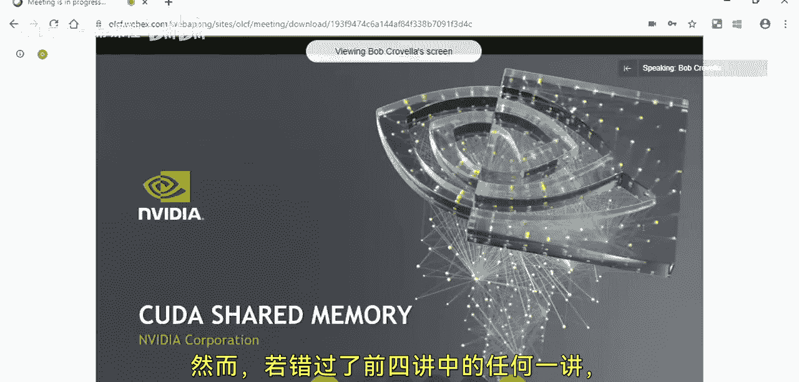
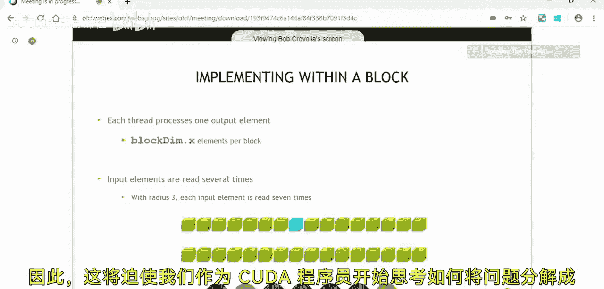

# 【Nvidia官方课程】CUDA入门课【中英字幕】 p02 02 CUDA Shared Memory [BV1JJ4m1P7xW_p2]

Okay， welcome everyone。 My name is Tom Papicuttor with ULCF。 Today。

 we're joined by Bob Corbella Vdia。He's going to give a presentation。

This is part two of the nine part through the training series the YoB percentage。那个谁。喂。

So there are folks here in the room at Oak Ridge， as well as folks who are in person at N participating。

Californialifornia and folks listen totally on Webex as well， so I bring that up so get。

Iues if you ask questions。O好可以。SheCl Bobbs， since Bob。And also。

 if you are presenting for participating remotely， ask questions。Webeex's。

And Bob will stop periodically。It's very question。啊。Right， so after the presentation。

 we'll move into a hands on session。嗯。For the in person participants。

 we have folks on site to help if you have questions with the example programs。

 we'll also keep the Webex up for anybody。某鬼。The exercises will be using today。

On the event page where you registered， there's a tab there that says。

You'll see a link down there where you can。Perhaps exercises。And also the slides that Bob will be。

Ourre。Also on that event page， you can find them。Bring the hands off。啊。Okay， and so with that。

 I'll hand things over to Bob and let。Dicated that is available online already。Because of that。

 I'd like to skip most of the preamble that I gave during that session。

 however I'd like to thank my colleagues who are helping me。

 and I'd also like to thank Oak Ridge and NurRS for all of the support and logistics and the invitation to do this series as well。

If you listened to the series last month or the episode last month。

You know that I had indicated there。That the first several sessions of this training sequence。

 in my opinion， go together， that is。I'm recommending。

 if at all possible that you follow along with the first three or four sessions after that the remaining five or so sessions become more topical。

 however， if you miss one of the first four sessions in my opinion。

 you're missing an important chunk of what provides the basic groundwork for coUDA programming。

So I hopefully you have had a chance to listen to session one from last month。

If you did listen to session one from last month， you know that we introduced a basic programming。

Example problem。Called vector Edition。And we use that example to introduce a variety of concepts。

We learned about the terminology called host and device。We learned about the global keyword。

 so the host in device terminology as we know， is actually present in the CUDIS syntax。

 it appears in the CUDIS syntax， and those two terms are used generically to refer to activities that are taking place on the host system。

 in other words on the CPUU or the device system， in other words on the GPU。The global keyword。

Identifies。A kernel， it identifies a kernel definition。

 and we learned that a kernel is the way that we have as a coUDA programmer to write code that will run on the GPU and to launch that code so that it runs on the GPU。

We also learned about how to pass parameters to。The kernels that are running and we learned in particular how to do memory management on the GPU。

 we learned how to allocate pointers in GPU memory。

 how to free those pointers and how to copy data to and from。Those pointers from CPU memory。

 from host memory using the KutaM copy API。We also explored。Launching parallel kernels。

 And we explored launching those using both blocks and threads individually and then combining blocks and threads together。

During that session last month， I suggested that there was more to learn， of course。

 and one of the next topics that we want to tackle is。Thread， cooperation and communication。

 And I mentioned at that point that we will need a new motivating example。

 So that's what we're going to introduce now。We're going to introduce our next。

Problem that we'll focus on for the next for today's session。

And this problem will help us to unpack and explore some new KUDa syntax and new KUDa capabilities。

Before we dive into this， I'd like to mention that this will probably be quite a bit shorter session this month。

And so we will have， I expect that we will have more time for questions。 So if you have。

Questions that perhaps were prompted from your review of the session last month or perhaps from the homework that you did。

 this is certainly today would certainly be a good time to ask us questions and I are one of my colleagues will certainly try and answer those questions as Tom mentioned you can pose those in the chat at any time I will pause maybe once or twice during this to the look at the chat and I expect that there will be quite a bit of time available in the second half of this hour for questions from the audience if there are any so feel free to be thinking about that while we're working through the material this month because I'm expecting this to be a shorter sequence。

 a shorter session this month。So the motivating example that we're going to introduce。

 I mentioned the name for it last month is called a 1D stencil。

 The idea behind a stencil operation is that a stencil reflects a window or a range of data and that window or range of data is applied successively to a data set。

In order to produce a result。And then we call that a stencil operation。

 and so we'll see an example of a 1D stencil as we work through this。

So in order to apply a 1D stencil to a 1D array of elements。

 we first have to understand some characteristics of the stencil itself。

Stencil is going to have a width。😡，The width is the overall width of the window or the width of the underlying data that will be used to make the pointwise calculation。

In this case， we're imagining a stencil of width7 and we can also define a term called the radius and the radius is nothing more than the data that exists to the left of the stencil center point or to the right of the stencil center point in this case the radius is three and that gives us an overall width of7 normally when we're working on stencil operations。

 we do have the concept or an idea of the center of stencil。

 and so when we're talking about stencil dimensions。

 it's very often the case that for a 1D stencil the width would be odd numbered。

Or if we have a 2D scil， which you could also call a windowing operation。

We might have two dimensions that are both odd and that would give us a very clearly defined center point and a kind of symmetry in terms of the calculations。

 the calculations that we would perform to the left and right of the center or to the top and the bottom of the center In this case we have a 1D stencil。

 so we're really just looking at the calculations across a 1D operation， a 1D scil， a 1D window。

And those calculations in this case will have as their focus。7even elements。

Of the underlying data set， we imagine that the underlying data set is much longer than 7 elements。

So here's an example of what could be considered a longer data set。In this case。

 we could imagine that these green blocks， I probably will refer to them as pixels。

 just bear with me if I say that， but it's easier for me to say that than green blocks。😡。

So let's just imagine their pixels or their data that is associated with a one dimensional array。

And this green data is imagined to be existing both in an input and an output array。

 and so we have a 1D operation， we have a set of data that we're going to transform from input to output and the input and output sizes are the same or roughly the same。

We're going to apply a stencil operation to this data set to produce the output data set。

 and we'll see exactly what that means in just a moment。

So we could also imagine that what we're depicting on this slide。

 this set of green pixels or green blocks is really just a subset of my overall data set。

 Remember in Kuta， we have this idea of the hierarchical breakdown of workers and the first level of hierarchy was。

The block。 And so we can imagine a kernel launch consisting of a very large set of threads。

 and those threads are grouped into blocks。And as we'll see in a moment。

 we're going to be focusing on block level behavior during this session， especially。

Because the concepts that we're about to introduce。

 namely communication and synchronization work at the block level。

 And so this will force us as coupa programmers。

To start thinking about problems decomposed into blocks with the set of threat。

