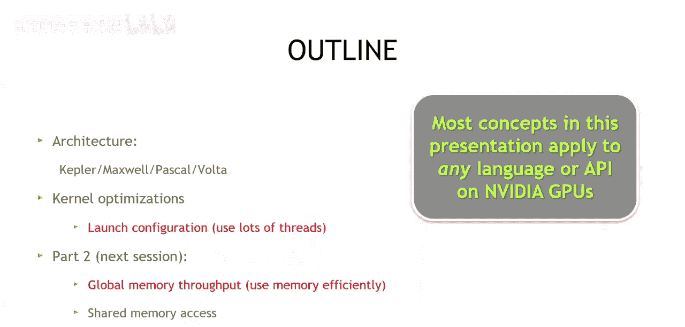
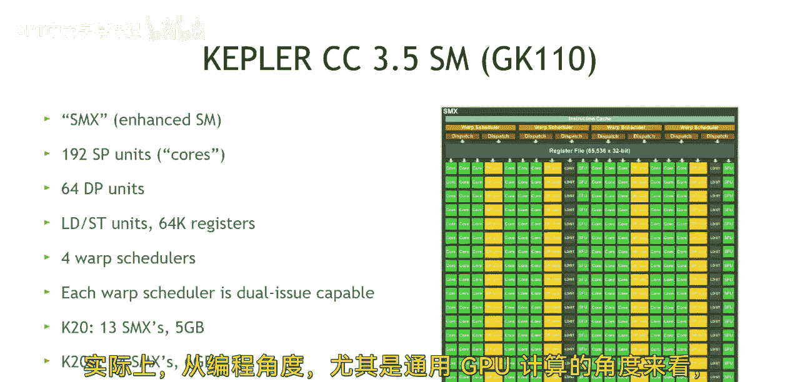

# 【Nvidia官方课程】CUDA入门课【中英字幕】 p03 03 CUDA Fundamental Optimization Part 1 [BV1JJ4m1P7xW_p3]

I'd like to start by once again thanking the folks at Oak Ridge and also NE and Berkeley Lab。

For hosting this session and basically providing all of the mechanics that are needed to get this going。

 So I appreciate that on behalf of Nvidia。My name is Bob Corvla。

 I'm on the solution architecture team at NviIDdia， and this is a continuing。

Session in our ongoing series on Kupa training。I'd like to pause for just a second to find out is it Helen is it possible to start the recording now or have you done that already I already started Bob。

 great， thank you。So。What we're going to be doing today。😡。

Is shifting gears a little bit in the past two sessions。We have。Looked at， as I like to say。

 what is needed to write syntactically correct CUuda code that gives the correct answer。

So we were looking at。Cuta C+ plus， primarily from a language perspective。

 from a hello world perspective， what are the basic syntactical elements and how do you write a complete program and so forth。

We weren't spending that much time yet。Thinking about performance。 But， of course。

 the reason that people use GPus is all about performance。

 That's why GPU computing is interesting is because it has the opportunity。

 offers the opportunity to make your codes run faster。Now， when it comes to performance。

A pretty common。Suggestion or advice that you will hear is to use a profiler。 In fact。

 we're going to be in a later session， we're going to be talking about a methodical approach to performance analysis and optimization for Cupa codes。

And we're gonna to。Promote at a high level， we're going to promote the basic idea of analysis driven optimization。

 which uses a profiler in a cyclical process to Pareto performance limiters to your code and then sequentially address those performance limiters in order to improve the performance of your code。

So that's a fairly methodical approach， it uses a profiler。

 and it has a variety of techniques associated with it。However。If you only use that methodology。

To address performance issues in your code。You might be making the same mistakes over and over again。

 There's a tradeoff between what level of performance knowledge do you want to have in your head as a coa programmer and what level of performance optimization do you want to refer to a later process In other words。

 after the code is written then start to address performance issues What I'm going to suggest in these next two sessions。

Is that there is a certain amount of architectural knowledge of the GPU。

 which will assist you to inherently write code on the GPU that is performant。

There's a tradeoff here because we could address any number of topics that might make your code more performant and try and put a huge amount of emphasis on the learning side of the equation as opposed to the analysis side of the equation for performance improvement。

And so I'm sort of arbitrarily drawing a line for now and saying in the next two sessions。

 we're going to address the two most important。Concepts。For。

 for delivering predictably good performance in a coa code。

 the two most important optimization priorities。For any coUDA programmer。

 and I'm going to suggest that these are things that are appropriate for a coUDA programmer to have lodged in their memory bank so that as they write code。

 they know how to write code that's going to run predictably fast。

Now this doesn't address every possible performance scenario， but it makes sense， I think。

 to take the two most important objectives and get those into your process of writing code as opposed to deferring the responsibility for performance。

😡，To a later time， in other words， analysis driven optimization。

 So that's the approach that we're going to take in order to do that in order to expose those to。

Most important objectives for any coUA programmer from a performance standpoint。

We're going to take a look at GP architecture。 whenever it is time to optimize a code。

It is very often the case in computer science that。

The architecture of the machine you're running on matters。

We haven't spent much time talking about the architecture of the machine so far in the GPU。

 We've talked about a few architectural concepts like the fact that the GPU is an appendage to the machine and we have to manage data movement to and from the machine。

 But from a performance perspective， we really haven't paid attention to architecture at all。

 Now we're going to take a look at performance， and in order to do so。

 we're going to start with a brief treatment of GPU architecture。

 and we're going to look at the architectural motivation。

 why these two performance objectives matter， how they come about as a result of GPU architecture。

And what we can learn from the architectural behavior in order to drive our understanding of how to write predictably fast code。

So we're going to do that over the next two sessions and in the first session today in the performance or the coUDa optimization part one。

 we're going to take a look first of all， at GPU architecture。

 it's not going to be a terribly in- depthth treatment of GPU architecture。

 but it will be enough to set up the concepts that we want to learn。And in this first session today。

 we're going to be focusing on the first of the two performance objectives。

 which is to expose enough parallelism。Now， exposing enough parallelism is a。

Concept that doesn't immediately lend。Understanding。

 it doesn't immediately convey understanding because we have to understand what it means to talk about parallelism in the confines of a GPR architecture。

However， from a programming perspective， we can translate。That。

Statement that our objective is to expose enough parallelism for the machine to be able to run efficiently。

 We can translate that to a much more simple and direct statement， which is understandable。

 presumably。For people who have gone through the first two sessions， the last two sessions。

And that translation of the statement I'm going to make for you is。

Instead of saying we want to expose enough perism， we want to do that。

 but in a way that should be palatable and understandable for people who have just the syntactical knowledge of KUDa that we've acquired in the last two sessions。

 I'm going to translate that and say we want to have a lot of threads。

So if you don't take anything else away from this next hour。

If you take away the idea that when you write coUDA programs。

 you want to write algorithms that can make use of and in fact， run a lot of threads。

You will have absorbed more than 50% of what I'm going to try and convey in this session。

But we want to give you a little bit better understanding of why that is， and in order to do that。

 we want to start with GPU architecture。So in this session we're going to be exposing some concepts of GPU architecture。

 we will briefly touch on the Kepler Max well Pacal and Volta architectures。

For the purposes of the folks on this call， I assume that the only architecture that's really very important is Volta because that is the architecture that's present in the Oak Ridge machine and Summit。

But if you're working on a different machine， there may be another architecture and some of these concepts may vary slightly。

 but in general， the concept of exposing enough。Parallelism。

 which is what we're going to cover today。And making efficient use of the memory subsystems。

 which is what we're going to cover in the next session。Is applicable across GPU architectures。

's not it doesn't vary that much when we talk about Kepler versus Maxwell versus Pascal versus Volta。

 so the differences in architecture aren't terribly important。

 but we will also be talking about the architecture from the standpoint of operation。

 how does the machine operate that will be the second half of our architectural discussion and we'll need that to set up a very clear understanding of why it's important to have lots of threads。

So our first kernel optimization that we're going to be focusing on is launch configuration。

 which is to use a lot of threads， and in the next session we will extend our GPU architectural knowledge to understand how the memory subsystems work and what our takeaways are for efficient use of those subsystems as a coUDA programr。

The entire session， the entire sequence of sessions that we're presenting in this series is of course focused on KUa C++。

 but if you are using another variant， another language binding for KUDa like KUDa Python or something else。

 KUa4ran， most of these concepts are going to apply in a very， very similar fashion。

 you'll want to have lots of threads， however you manage that and your binding in your language binding。

 and you'll want to make efficient use of the memory subsystems。

 however that's managed in your language binding。So those are things that are going to be useful for a wide range of language implementations。

We'll start with the Kepler architecture， so when we build a GPU。It's not a huge。😡。

Spaghetti meth of logic。 In fact， a GPU， especially from a programming standpoint， from a GPU。

