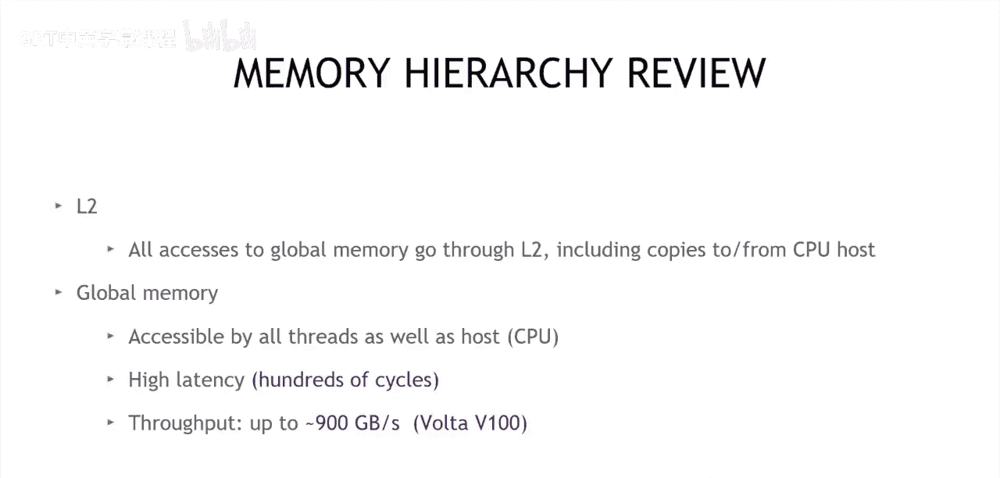

# 【Nvidia官方课程】CUDA入门课【中英字幕】 p04 04 CUDA Fundamental Optimization Part 2 [BV1JJ4m1P7xW_p4]

So I wanted to thank everyone for joining us for part four of the CoUa Training series。

 my name is Tom Papa Theodore from the OLCF。Also on the call we have Helen He and Kevin Got。

 they're the organizers from the N LBL side， today's topic is Fundal Kupa Ops part two。嗯。

And we're joined again by our friends from NviDdia， so Bob Corbella， Robbie Cyrs and Max Catts。

Bob will start off by giving a presentation for about the first hour， and then Robbie will follow up。

By walking through the example program that we have for you today。

And those slides and examples are available now for you on the event page， if you'd like them。

 they're under the presentations and exercises tabs respectively。嗯。Great。

 and so if you have questions during the presentation， please ask them in the Zoom chat。

And then Bob will periodically stop and answer them。嗯。And I guess that's all I have from my site。

 so I'll go ahead and pass things off to Bob， welcome Bob。Thanks Tom， hi everyone。

 this is Bob Carbella with NVIDdia Corporation。And I'd like to once again thank the folks at Oak Ridge and Berkeley Lab for providing all of the support and enabling to make this possible。

This month we are in our fourth installment of our CUDA training series。

 our COUDA programming Traing series。In the first two installments， we。

Visited some of the basic concepts。That are associated with， as I like to describe it。

 writing a syntactically correct program in CUa that gives you the correct answer。 That's， of course。

 the first task of any coUa programmer until we're getting the right answer。

We need not proceed further。However。Immediately， we are addressed with the issue of performance。

 once we have code that is working correctly and gives us the right answer。

 we may ask questions like is it performing as fast as it possibly could or on the other end of the spectrum。

 why is it running so slow。In the last month session and in this month's session。

We are going to address basically the first two topics in terms of optimization。

 And if you were with us last month， you know that the topic that we focused on there was execution behavior。

 So we took a look at the architecture。and the execution behavior of GPU code and then from there we observed some basic principles to achieve high performance and the most important basic principle that we want to take away from last month's session was to expose a lot of parallelism and if we translate that even more simply we could say run a lot of threads and we delvet into that topic with a little bit more detail in last month's session so that was our first coup to optimization priority。

And this month we want to talk about our second KUDa optimization priority。

 which in a nutshell is to make efficient use of the memory subsystems。

One point that I made last month， which I'd like to state again this month。

 is this idea of training for optimization。Is something that has a dual nature to it。In other words。

 we could simply write correct code and then immediately switch to an analysis driven optimization process and tackle performance that way。

However， the suggestion I have in the way this series is organized is to tackle certain high priority essential concepts for optimization。

 for writing code that will run quickly， and actually build them into your DNA as a CUDA programmer so that when you write code。

 you can immediately identify correct patterns。Now this doesn't address every possible optimization topic。

 it's just too out of many。😡，ButMy suggestion is that these are the two most important ones to achieve performance。

 so that's the idea last month and this month we want to give you two of the most important ideas to achieve high performance in your CUDa code and roughly speaking。

 we're going to relegate most of the rest of the optimization concepts。

To a later session where we'll talk about analysis driven optimization。

So let's dive into looking at the memory subsystem。This month。

 our focus will be on global memory throughput and also efficient use of shared memory。

So as I mentioned， this is the second of our two most important training concepts for basic optimization skill。

 being actually able to write code that runs fast without having to turn to the profiler。是是。

So we'll start with global memories。We'll start with global memory throughput。And once again。

 we want to start with an understanding as we did last month。

 of some aspects of the machine behavior， and we're going to derive from those aspects of the machine behavior。

 some important principles for arranging our accesses to global memory。

So we're going to start with reviewing what the memory hierarchy of a GPU looks like。

 and we're starting hierarchically at the type of storage that is the closest to the processing activity。

 and we call this local storage。Each thread has its own logical， local storage space。

And the most important resource there is registers。

Registers are high speed memory storage within the GPU itself， and they are。

Both the source and the destination of nearly all low level machine instructions。

 So nearly all low level machine instructions that do any sort of calculation， arithmetic。

Will take their input from registers and place their output in registers。 And So we want， of course。

 this。This resource to be the fastest， and it is the fastest resource。

Register usage is really managed by the compiler so from time to time questions come up about register usage and can I manually assign things to registers and could I do a better job of choosing which registers to store which data in and so forth generally the answer to all that is no。

You should write code the way you would as a C programmer or as a C++ programmer。

 and for the most part you want to let the compiler manage that and really you have no exposed controls for explicit usage of registers。

 so even though registers are an important resource，They're mostly managed by the compiler。

 And at this level of instruction， we're really not going to be spending any attention trying to think about or optimize usage of registers。

The next level in the memory hierarchy would be the shared memory and the L1 these are also both on chip resources so they're part of the GPU die itself。

 they don't exist off chip。We already have a basic idea of what shared memory is。

 it's a local memory array that can be allocated explicitly by the programmer and used for temporary storage of data。

 and as we alluded to in the past because it's on chip。

 it also happens to be a fast source of memory， a fast source of data。

There is some programmable or configurable characteristic to this。

 so we won't spend much time on that。But it is something to be aware of and it varies based on the GPU architecture。

 the characteristics of programmability， all GPUs will have a minimum of 48 kbytes of shared memory that can be used per thread block。

 some GPUs give you the option to actually use more and if you're going to use more than 48K。

 you will have to use specific methods to achieve that additional storage capacity。

 64K per thread blocklock or in some cases， 96 kbytes per thread block。

The other resource that we're talking about here is the L1 cache。

That's what L1 means and L1 Ca is again not a user explicitly managed resource。

 it's mostly invisible to the programmer。But it is like all other caches。

 it's designed to improve the performance by retaining recently used data in the hopes that it will be used again。

 and if it is， it can be retrieved from the L1 as opposed to going out to global memory or wherever that data was。

Both of these are。😡，High throughput and relatively low latency resources。

 because both of them physically are backed by resources that are on the GPU die itself。

 And so we'll have typically for both the L1 cash and shared memory。

 we have aggregate throughputs that are much higher than what is available from global memory。

As we move down the memory hierarchy， the next item that we'll hit。

 I'm going to have a diagram of this shortly， so hopefully that will help a little bit。

 but the next item that will hit in the memory hierarchy is the L2 cache。The L2 cache。

Is similar to the L1 in that it is a cash， and it is designed to provide performance benefit for recently accessed data。

There are some differences with the L2， the L2 is a device wide resource。

 whereas the L1 is a per thread block resource or a per SM resource is a more accurate way to state it。

So for the L2， it's a device wide resource， which means all data goes through the L2 before it gets to global memory。

 and so the L2 is a device wide resource in that respect。

When we get to the bottom of the hierarchy and this is really going to be our first focus for this session。

 we are now talking about global memory。 That's the most distant。

