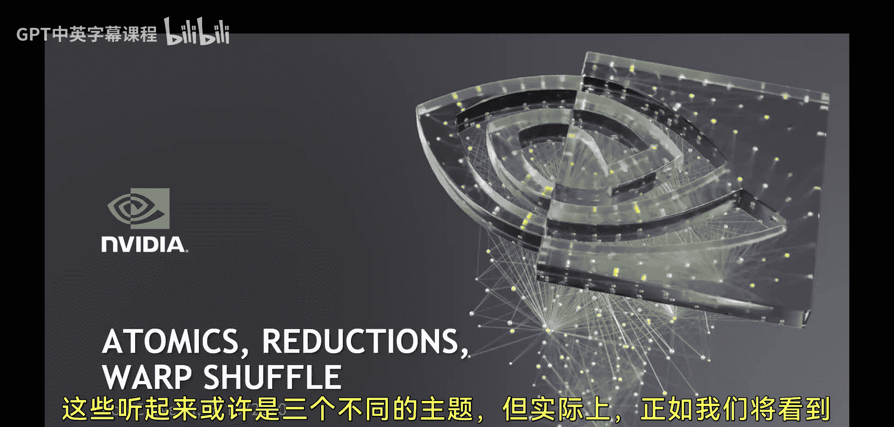
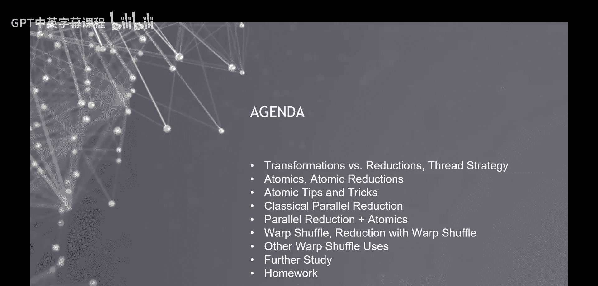
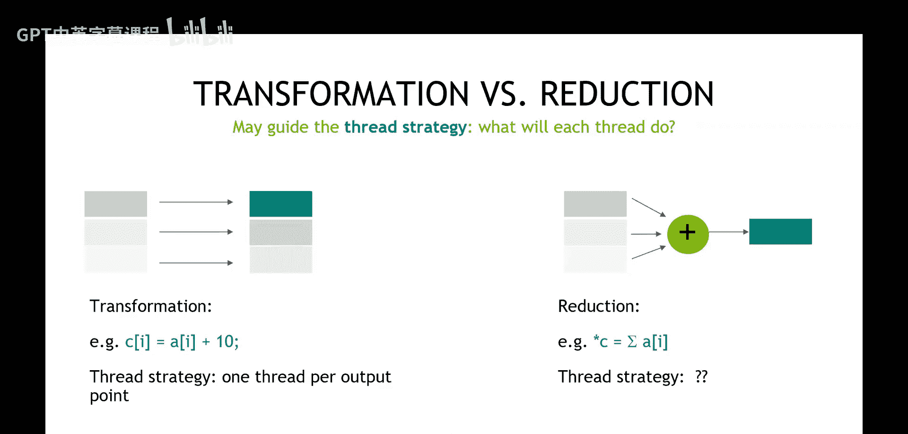

# 【Nvidia官方课程】CUDA入门课【中英字幕】 p05 05 Atomics Reductions Warp Shuffle [BV1JJ4m1P7xW_p5]

My name is Helen He from Nsk， welcome everyone to join today's KUa training session number five。

 our usual organizer and host。Tom Papa Sior is occupied at a GPU hackckon。 he's not here today。

On the nurse side， we also have Kevin Got and also speakers and presenters and helpers from NVDdia。

 the great team。Bob Corvella and Robbie Sers and Max Cats online and。

So thanks for just everything becoming on remote and for the speakers and the attendees to be still able to join us and organize this event。

 keep this ongoing。So just the reminder people the nurse side， if you want to follow any exercises。

 we do have a。Reservation， God code the training， I'll put some commands on in the chat room so you can follow Otherwise。

 let's start with Was。Usual excellent presentation on atomics reduction and Wp shuffle。Thanks， Helen。

Do you have the recording started？Yes。Okay， good， thanks。Welcome everyone， my name is Bob Carbella。

 I'm a solution architect at NVIDA， I'm joined by a couple of my colleagues。

 Max and Robbie who Helen has already introduced。And this month。

This is our fifth installment of CoUDa training series。

 I want to thank the various folks at Oak Ridge and NurE and Berkeley Lab。

 Helen and Tom and others who have facilitated this and made this possible。

And today we're going to be covering a topic called Atomics Reds and Warp shuffle。This。

 in my mind is a little bit of a departure。In past four sessions。

My opinion is that that is what I would call foundational material if anyone was wanting to do some serious coup to development effort。

 I would want them to have at least that level of training， those several hours， let's say。

 of training under their belt。Before they embarked on some serious coup to development work。

 what we're going to be doing for the remaining five sessions in this series over the next roughly speaking five months。

Will be to look at specific topical areas I'm calling this material now no longer foundational obviously that's a matter of judgment after you get the end of this session today。

 for example， you might consider this to be fairly foundational material。

 but nevertheless we're going through a transition now from what I would call foundational material in the first four or five sessions to what I'm going to refer to as topical material over the remaining four or five sessions。

So this month， we're going to be looking at atomics reductions in warp shuffle。

 Those sound may be like three different topics， but actually， as we'll see。

There's a lot of interrelation between those topics and they can all be used actually to solve the same kinds of programming problems and so that is our motivation this is a little bit more detail of what we're going to be covering today。

 one of the things that I'd like to point out also from a procedural standpoint is that we're choosing to work a little bit differently today and I'll try and explain that。

We're going to have roughly the same format for the session。

 the online session that we have today for you。 So roughly speaking the first hour。

Will be presentation material， And the second hour will be available。

 available for questions and answers and。In particular。

 any questions that there may be about the homework， however。

If you've perhaps taken a look at the homework。You may have noticed that it's a little bit more involved than the previous homework sessions。

And so there's more activity in the homework and there may be more areas where questions may arise as you're working on the homework。

So what we in light of this， what we decided to do on the NVIDI side is we decided to offer a special additional session。

The idea is that we'd like to not spend a lot of time going through the homework in detail today。

 instead based on the material that you learned today or receive today。

 what we'd like to do is give you the opportunity to do the homework on your own。😡。

And then what we'd like to do is have a special additional session。嗯。That would cover。

The homework in much more detail than what we plan to do today we're certainly available for questions。

 any questions that you may have we'll try to address those today。

 but we want to have an organized session where we go through the homework in some level of detail just from a logistic standpoint what I'd like to do is point out where that is。

So if you go to， I think I'm probably， okay， Helen has actually put it in the chat window。

If you go to the。Resource page that Oak Ridge hosts for this event。

 you'll find a new tab that details or has the details for this additional moduleule 5 exercise walkthrough。

That is to the right of the tabs where you would find， for example。

 the homework and the presentations。So there's an additional new tab on this page and the new tab has the information that Helen has placed already in the chat。

 so I just want to point out that we have a little bit of a different structure for what we're going to try and do today just be aware of that it'll become more evident when we get to the end of the presentation material I'll turn it over to Robbie at that point。

Okay。So let's dive in。

The first thing that we're going to do is atomics， we're going to talk about what atomics are and why they might be interesting and useful。

 in order to set that up， I would like to give you a motivating example， and this is。

 I believe an important area to spend some time thinking about and talking about。😡。

If you look at most of the work and most of the homework assignments we've done so far in this series。

 they fall into a particular category of problems that I'm going to be discussing on the next slide。

 I'm going to refer to those problems typically as transformations。

 and as we'll see on the next slide， transformations have a characteristic from an algorithm standpoint where they take a data set of a particular size and generally speaking produce a data set of approximately the same size as the output。

😡，The output data set size is comparable to the input data set size however let's take a look at the code that I have depicted here。

 this is just C code， this isn't co to code at this point。

 but I have a an array or yeah let's call it an array called a of size 100，000。And。

What I'd like to do fundamentally is get the sum of all the elements in that array so I initialize that array of length size with particular set of values and then I have run a variable where I'm going to capture the running sum and I'm calling that variable sum and I'm initializing it to zero and then I'm using a four loop to iterate over the elements of the array A and add each element to the running sum。

 this would be a very straightforward， very obvious way for a typical C programmer to realize a piece of code that would provide the running sum of that array or the complete the entire sum of that array。

This particular problem we'll notice right off the bat。

 is a little bit different from the transformations that I've described。😡。

Because although it has a fairly large input data set of size 100，000。

 the output data set is actually just a single。And that's what's contained in the variable sum。

 And so this looks a little bit different than some of the problems that we've dealt with in the past。

 In fact， many of the problems that we've dealt with in the past。

 I would put into the category of transformational problems。

 which I'm describing on the left hand side of this slide。

 a transformation according to my definition is characterized by the fact that the output data set size in this case。

 The C。Is roughly the same size as the input data size， in this case， roughly the array A。

When we have a problem of that type。😡，We very often find that it's relatively easy and straightforward to write the CUDa code to perform that operation in parallel。

😡，And I'm going to introduce a new piece of terminology which is really just something I cooked up。

 you're not going to find this canonically in coUDa programming literature。

 but I think it's a useful way to summarize a particular idea and that idea is the thread strategy in other words what should each thread do。

 what should each thread be responsible for any coUa programmer that sits down to write a brand new coUa kernel is immediately faced with this question and it's part of the process of understanding the parallel decomposition of the work that you're trying to accomplish？

And so initially when you set out to write a coUta kernel， whether you know it or not。

 you are thinking about the question， what should I have each thread do。

 because I know from what we've learned already that when I write a coUta kernel。

 I'm roughly speaking writing a single thread code。

 I'm writing the code from the perspective of a single thread and that code defines what that thread will do。

😡，And the coUDa parallelization process， the kernel launch and the current and the grid dimensions and all the mechanics associated with that will parallelize that thread code across a large number of threads。

 and in so doing I accomplish my work in parallel。And so when I sit down to write a new coupDa kernel。

 I'm faced with this question， what should each thread do because that's going to direct my code writing efforts。

And so when I have a transformation。