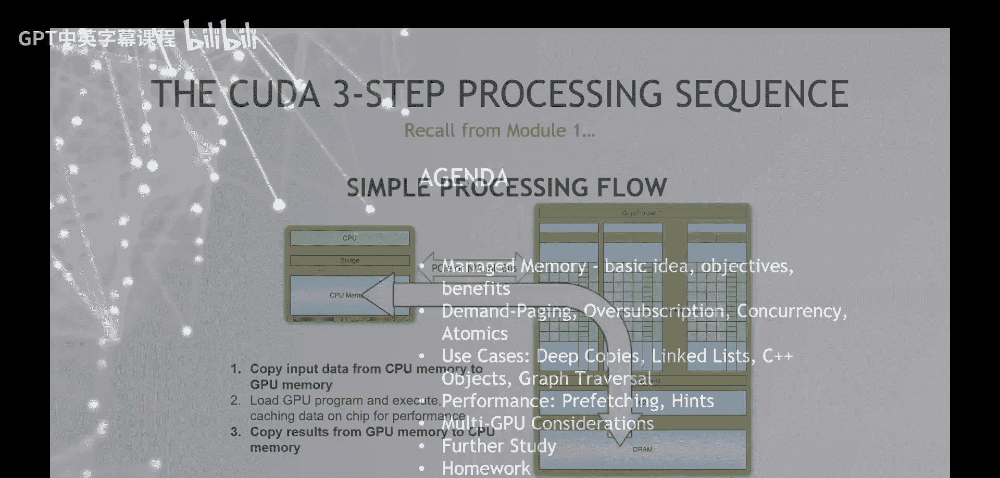
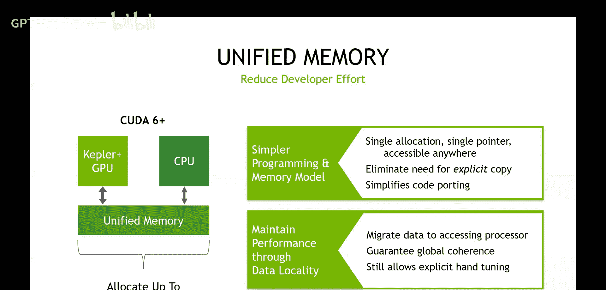

# 【Nvidia官方课程】CUDA入门课【中英字幕】 p06 06 Managed Memory [BV1JJ4m1P7xW_p6]

Can you guys still see my screen am I still sharing？Yep， I can see it。对。Okay。

 so we can go ahead get started thanks everyone for joining us for the sixth module in our nine part coUDA training series。

My name is Tom Papppa Theodore from the OLCF。Also on the line we have Helen Hee and Kevin Gott from the N LBL side of the organizing today we are joined by Bob Corvella Robbie Cyrils and Max Catt from Nvidia today。

Bob will start off by talking giving a presentation on Kupa managed memory。

 and then Robbie will follow up with an example exercise where you can try to work through some of the ideas that Bob has mentioned at the presentation。

So Bob will be presenting for about the first hour and then Robbie will take over for the second hour in our hands on。

嗯。If you have questions during the presentation， we ask that you please ask them in the Zoom chat since we're going to record this and you'll have it for later viewing for yourselves or other folks we want to make sure to get in recording so please ask those questions in chat and then Bob will tackle them when he sees the opportunity and then afterward if you have questions at the end or during the handson you're free to just unmute yourself and ask them。

Okay， with that， I'll go ahead and hand the mic off to Bob。Okay。Thanks Tom。

 this is Bob Corvello with NviIDdia， I'm on the So Archecture team at NVIDI。

 and I'm joined by my colleagues， Max and Robbie who were mentioned already there're on the solution architecture team as well。

I'd like to start by thanking。The folks at。Oak Ridge and the folks at NRSC for providing all the assistance to make this possible。

So as Tom mentioned today， we're going to be talking about something called Kupa manage memory。

 It's also called Kuta Unified memory。 So if you look in the programming guide。

 it'll be referred to as unified memory， but it's essentially a synonym to call it managed memory。

I'd like to start with basically a caveat。That as we'll see。

 KUa Unified memory can simplify the task of programming GPUs， of getting your work done on a GPU。

However， I'd like to caution everyone that unified memory is not necessarily a technique to achieve higher performance with your code。

 Many new developers will approach this subject thinking K to unified memory or manage memory is a way to make my code run faster。

 That's generally not what the purpose of it is。 And I think by the end of this presentation。

 you'll have a good idea of that。So what is？Kud to unified memory and all about。

 We're going to talk about that in just a moment。 We will cover the basics of managed memory。

 We will talk about。Some specific features of it， like demand paging over subscription and some other features。

We will talk about some use cases， typical ways that people might use manage memory to perhaps simplify a programming task。

And we will pretty much finish our discussion talking about performance。

 This will be an extended discussion of performance。

 talking about the basic performance of unified memory。

 as well as some API level techniques and methods that are provided within Ca。

To allow you to sort of optimize the performance of unified memory。And as we finish， we will。

As usual， have suggestions for further study and the homework。

 And towards the end of this presentation， as Tom mentioned。

When we get to the end of the prepared material， I will pause and make sure that I have caught up on any questions that are in the chat and we'll also open the mic up at that point for spoken questions and once we see that the questions have died down。

 then I will turn it over to Robbie Srs and Robbie will have some exercises to walk through from the homework。

So I will also be stopping at points， or at least maybe one point during the presentation to catch up on questions that may be in the chat at that point。

So what is the idea behind unified memory， I'd like to start with a motivation。

 an idea that we're trying to achieve。

And so you may remember。From our very first session。

That essentially any program that uses the GPU for computational tasks。

Has a three step sequence embedded somewhere in it。 The first step is to copy the data to the GPU。

 The second step is to run your program， yourcc kernel on the GPU to process that data。

 And the third step is to copy the results back from the GP to the CPU。

This is pretty much true no matter how you're using a GPU if you're using it for computation tasks。

That's always going to be present。As a coUDA programmer。

 you know that this three step sequence is something that's visible that's evident in source code。

 you're going to write source code that is going to perform the tasks necessary for step one。

 source code for task two and source code for task three。😡，However。

 task one and task three as depicted on this slide。

 are not things that you might typically see embedded in an ordinary。😡。

C or C++ program if that program is designed to run on the CPU on the host。

And so these become extras that you have to learn about and deploy as a coUDA programmer。

 it's boilerplate if I can use that word that you have to add to your coUA program to make the GPU a usable processor。

😡，And so wouldn't it be nice？😡，If we had a way。To essentially eliminate or try to eliminate the boilerplate associated with steps one and three。

 wouldn't it be nice if we just simply didn't have to write code for steps1 and three when we have our data ready。

 we just launch our kernel and we're off。That is the motivating and fundamental idea behind unified memory or managed memory and as we see。

 unified memory and manage memory we will see is not something that was present in the coUDA programming model from day one now we've run into this idea before the coUDA programming model evolves over time and in our last session we saw that。

 for example， Warp shuffle was a methodology that was not present in the CUDA programming model from day one。

 it was something that was added roughly speaking in the 2012 timeframe。

With the introduction of Kepler GPUs。Unified memory is also one of those things that was not present in the original KUa design and was added to the COUDa programming model。

 actually in about the same time frame。So in that timeframe and roughly the 2012 or 2013 timeframe。

Approximately in the era of KUa 6， approximately in the era when Kepler GPUs were first introduced。

The unified memory model was introduced to the programmer。 It was available。

 The API was developed to support it， and that model had some goals which are depicted on the right hand side of the slide。

 First of all， we want to simplify the programme model and in particular， simplify the memory model。

 As you know from our previous sessions， the coUa programmer， based on what we've learned so far。

Needs to essentially create two copies of each data that's going to be used on the GPU。

 you'll have a copy on the host and a copy on the device。

 at least with respect to steps one and three for any input data that flows to the device and any output data that comes from the device back to the host。

 you've essentially got two parallel copies of that data， one existing and host memory。

 one existing and device memory， and there is API calls to manage all that additional allocation calls and copying calls。

So unified memory simplifies all that by the simplifying idea is that instead of having to have these two parallel pointers。

 let's refer to one as the hostt pointer and the other as the device pointer。

 but essentially referring to the same data。Now we're just going to have one pointer。😡。

And somehow that one pointer is going to be usable。

 whether I'm using it in host code or whether I'm using it in device code。

 and as a result of that simplification， I now essentially from the programmer's perspective。

 have only one copy of the data to think about and to manage。😡。

And so because we only have one pointer， there's no copying needed。

 this also as we'll see can simplify code porting I'm going to come back to that once or twice。

 so for now let's just latch onto that idea that this。

