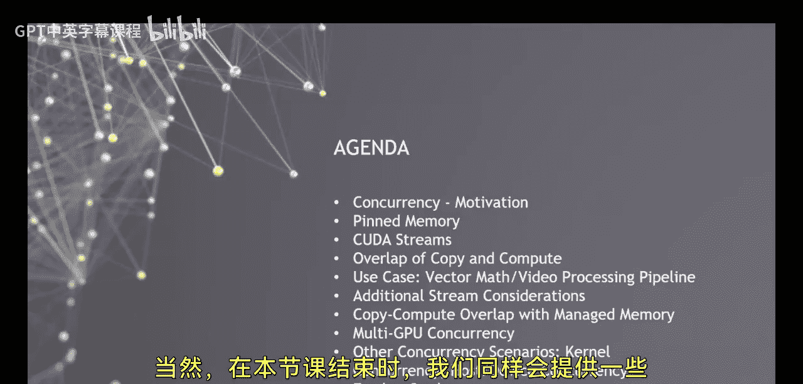
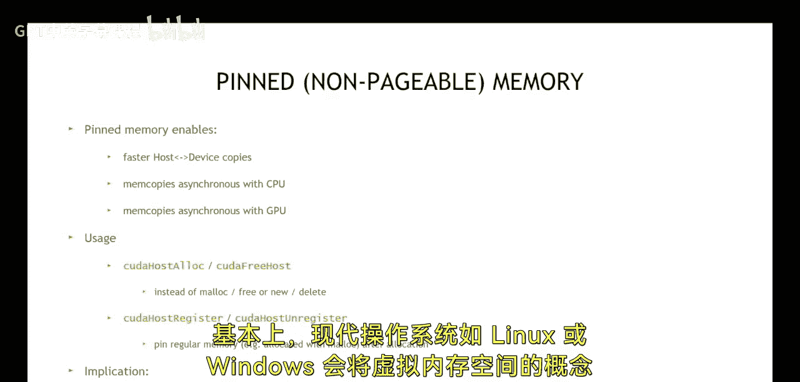

# 【Nvidia官方课程】CUDA入门课【中英字幕】 p07 07 Concurrency [BV1JJ4m1P7xW_p7]

Okay， welcome everyone， thanks for joining us for moduled 7 in our nine part couda trainingin series My name is Tom Papa Theodore I'm with the OLCF also on the call we have Helen He and Kevin Gott from Nurse。

 they're the organizers on that end。Today we're joined by Bob Corvella， Max Cattz。

 Robbie Cyrils from NviIDdia。And Bob will be giving a talk today on K to concurrency。

 as the name of the training event suggests。So that'll be a presentation for about the first hour。

 and then Max Katz will follow up afterward by walking through an example program that will sort of bring together some of the ideas that Bob had covered in the talk。

嗯。So today sumummit is down for maintenance along with our other internal systems that have the same architecture。

 so Max is going to walk through this example program on Corey GPU at NC instead of on Summit like we typically do so unfortunately this does mean that the folks who might have wanted to work through the example problem and only have access to summit won't be able to do that today。

 but Max will walk through the example and I'll get the recording up quickly afterward so that if you want to walk through it on your own following along with the recording of Max doing it afterward you'll be able to do that。

U。So okay， if you have questions during this talk， feel free to drop those questions into the Zoom chat and Bob will tackle those when he sees the opportunity。

And then afterward， you can ask questions during the hands on。

 or maybe we should just call it demonstration session。

 you can ask those just by unmuting yourself if you want to。

But stay muted for the presentation itself as we're recording this and we want to get a clean recording。

嗯。Okay， as always， you can go to the event page and get the presentation。

 so a PDF of the presentation and find the homework link there already。All right， and with that。

 I will hand things off to Bob if you are ready to go。Thanks， Tom。

 I think you've covered all the logistics on behalf of NviDdia。 I'd like to thank。

The folks at Oak Ridge and Nrsk， including Tom and Helen and others who have invited us to do this and provided all the logistics。

 and I think Tom has covered。The logistics really well。 So I'm just going to thank my colleagues。

 Max and Robbie， for joining me， and we will。Get started。So if you're。

 if you've been following along this series， then I would like to say kudos to you。

 because we are now on。Session 7 of 9。And。We've covered。

All of the basic logistics of how to program in Kuta already， actually， some time ago。

 And as you know， after around the fourth or fifth session， we transitioned into some。

Toopal areas for investigation。 This is another topical area that we'd like to investigate。

And concurrency is actually a really important part of KUDA because what you will discover as you do more and more coUDA programming is that there are substantial optimization opportunities。

By leveraging concurrency， really concurrency doesn't do much of anything in terms of unlocking new calculation abilities or new algorithm solution technique。

What concurrency really is largely about is taking advantage of the opportunities that exist。

When you have multiple processors in a system to leverage all of those processors to their maximum ability。

And we're going to study a number of different concurrency scenarios that are enabled within KUDA that allow you to do exactly that。

So we'll start with a slide on motivation。 We're going to start， I think。

 in a place that's very recognizable to all of you。

 we're going to need to do a brief aside on something called pin memory。

 And then for the bulk of the presentation， we'll be covering the。

Mechanics and the different use cases or scenarios where concurrency may be used。And of course。

 at the end of this session， we'll have some suggestions for further study and there is a homework as well。

 just like we've done with all of the other sessions。

So first of all what I'd like to do is take us back to session one and in session one we learned that the basic coUDa programming model is what I refer to as a three step sequence。

 you copy data to the GPU， you run or execute your coUa program we learned that's called a kernel。

 you run or execute your kernel， and then you copy the results back to the host。

 and of course there's variations on this theme， but nevertheless every single coUDa compute program that exists on the planet follows this threestep sequence in one form or another。

And we learned that even things like managed memory don't really substantially alter the fact that each one of these three operations is necessary in some fashion for a properly functioning。

 useful couda program。If we。Write our couda code the way we've learned to do it up until now。

Where we write a coupaM copy from the host to the device， and then we launch a kernel。

 and then we write a KupaM copy operation。From device to host。

What we're going to observe in a profile if we run that code and then observe what's going on when and we could think of that as a timeline view as we proceed through the execution time in our program。

 what is happening at each point in time， if we imagine that we have a profile of it's giving us a timeline of our execution behavior。

 we would see something that looks like what you see on the top half the slide。

 we would execute our first Q toM copy operation and then for a period of time that would occupy our timeline。

And during that period of our timeline， the QUAM copy operation is running。

 data is moving from host to device。When all of the data has moved from the host of the device。

 the KupaM copy operation completes， and then our kernel launches。

And we see our kernel launch in blue on the timeline。

 and then we have our kamM copy after the end of the kernel。

 and so one of the observed observations we can make is that things tend to serialize the kernel execution doesn't begin until the previous operation is complete and so on。

This results， of course， in a duration， the total execution time of our program。

 which is basically the sum of the first KtoM copy operation， the kernel duration。

 and the second KM copy operation。And they're all serialized， so that's just adding them together。

The motivation that I want to plant and that we're going to explore during this session is to say。

 wouldnn't it be nice if there was a way to overlap these operations and what would be required to do that and what kind of mechanics in coUDA are we going to need to arrange that if such a thing is sensible and possible？

😡，Now the motivation hopefully should be clear because it's printed out on this slide。

 ultimately what we're after here 99 times out of 100 is we are after an improvement in the duration。

 a shortening of the duration， therefore an improvement in the overall execution time of our code。😡。

Remember。The only reason that people use coudDs to make their code run faster。

 and so if I can teach you a way to make your code run 2 x faster or 3x faster。

 that can be very significant。 That could be a very， very。

 very important optimization for you to consider。In your coUa programming， experience and exercises。

In fact， many folks would say this is。At the top level of Kupa optimization tactics that you should be familiar with and ready to deploy。

 So if we go back several sessions， we learned about two top level Ka optimization。

Objectives that primarily applied at the coding level within the kernel。This optimization objective。

 concurrency， especially the way I've depicted it here on this slide。

 is something that you should always be familiar with because it's low hanging fruit。

 and it's a fairly mechanical process。To achieve this kind of concurrency。So let's drill into this。

In order to drill into this， we're going to have to do a brief aside on something called pin memory。

 we're going to be building up the bits and pieces， the blocks。

 the capabilities that we need in order to create concurrency in order to have concurrency occur the way we want it to occur。

😡，Within Kuda executing on a GPU。 And so the first topic that we're going to need to unpack is something called pinned memory。

A modern operating system like Linux or Windows。Has underneath of it。

A memory subsystem that has a certain level of complexity to it that may not be evident to the programmer。

Basically， the idea is that。A modern operating system like Linux or Windows will separate the idea of a virtual memory space from physical memory。

 the RA， the system。

