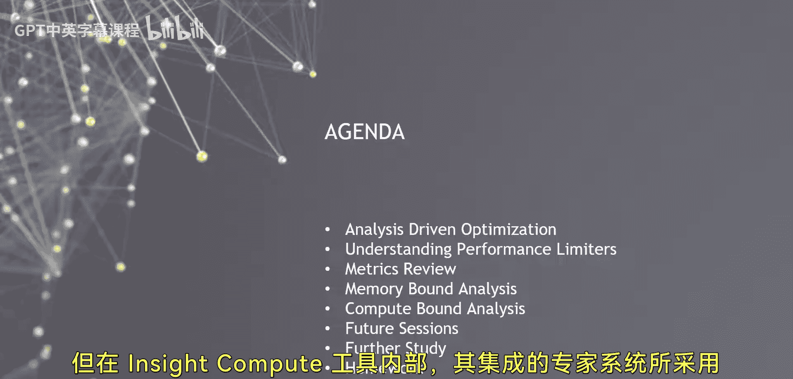

# 【Nvidia官方课程】CUDA入门课【中英字幕】 p08 08 GPU Performance Analysis [BV1JJ4m1P7xW_p8]

All right， it is one o'clock， so we'll go ahead and get started while handful。

More people probably trickle in I'll go ahead and give some introductions。

 so thanks for joining us today for part8 in our nine part Kuta training series。

 My name is Tom Papa Theodore with the OLCF。Also on the call we have Helen He and Kevin Gott from NurRS LBL。

 they're the organizers on that side of the event。And today we're joined by Bob Corvella。

 Robbie Cyrils and Max Cattz from NviDdia， as always。

 they'll be giving the presentation and examples today， so thanks as always to them。

Bob will start off giving the presentation on GPU performance analysis that'll be for roughly the first hour of the event。

 and then Robbie and Max will follow up afterward with an example exercise' walk through practice。上没。

Use their microphone。A。Right， and so if you have questions during the presentation that Bob's giving go ahead and just drop those questions in the Zoom chat and then Bob will get to those sort of periodically throughout the talk afterward when he's done we'll open up the floor for more questions at that point and on through the example exercises I think it's fine if you go ahead and just unmute yourself and ask questions that way but for the presentation that Bob gives let's try to do everything through chat。

嗯。Okay， and with that， I think I can hand things off to Bob and he will take it from there。Thanks。

 Tom。Hi， everyone。 This is Bob Corvla with NviDdia， and I'm joined by Max and Robbie。

 and I'd like to thank on behalf of NviIDdia， I'd like to thank the folks at Oak Ridge and。嗯。Nursk。

 who have made this possible， provided all the logistics and set this up。 I appreciate that。

 So we are actually getting close to the end of our series and this。

Week or today what we want to cover is。It seems like theres some noise in the background Could if you're not speaking。

 could you mute， please。Okay， this week， what we'd like to cover is。GPU performance analysis。

And you've had a little bit of exposure to this already if you've done the homeworks you've used actually。

 by now we've actually introduced both both profilers in the homework。

 I'll be talking more about that。 we'll actually be demonstrating that again today。

And you've also used the。Tools and the instructions that we've given to do sort of what I would call basic performance analysis。

 like how long does it take for this kernel to run and did these changes that I make？

Make any improvements， which is great。 That's a good thing to do。 It's， first of all。

 the only reason that we write GPU code that I know of is to make things run faster。

 So performance matters。 And secondly， it's a good way to learn。

It's very important to test your work to see if it did what you wanted to do and the very top level thing that we want our work to do is to make our code run faster。

However。What we've been accomplishing so far in the homework has been， in my opinion。

 fairly rudimentary， and so what we'd like to do today is take a little bit of a deeper look at this idea of how do I analyze my code using profilers。

And importantly， how do I analyze it in a methodical fashion， what is a sensible approach？

To being able to。Analyze my code， improve the performance of my code。

And do it in an understandable way using a methodology that I can repeat over and over again and expect to get good results。

That's primarily what we're focused on today。 that's the important nugget that I would like you to take away from the session today。

 and I'm going to refer to that topic generally as analysis driven optimization。And I'll define。

In just a moment， what I mean by that。So analysis driven optimization to me is one of the most important learnings。

 we're actually going to spend probably the majority of our time looking at tools and using the tools to highlight the steps in the process that you use。

For analysis driven optimization， but I'd like to encourage you to try and never lose sight of the idea。

That underneath all of the tools and all of the data and all of the noise that goes on while you're trying to analyze your performance。

😡，And improve things there's a methodology don't lose sight of the methodology and when you sit down to analyze or try to improve performance of the code。

 try and remember the methodology， try and use a orderly process。

Very often I see people latch onto specific very， very， very specific ideas。And say。

 I'm trying to fix this in my code。 Like one of the most common ones you'll see on formss is divergence。

 People get it in their head that one of the ways to improve the performance of my code。

Is to aggressively get rid of any possibility of warp divergence。😡。

And while there may be situations where that's true。

 it's by no means the most common reason for a lack of performance in your code， and furthermore。

 for a specific code， it may have no bearing or relevance at all。😡。

And so what we want to do is get away from this idea of latching onto ideas and trying to iron them out without knowing whether it's a problem or not。

 and the way to understand whether it's a problem or not is to use a methodical process to use a profiler driven process and to let the profiler tell you what to work on。

😡，Rather than trying to come up with ideas yourself， that is the gist the nugget。

 the core of analysis driven optimization， and it's really what I'd like to take you what I'd like everyone to take away from this session more than anything else because the tools will change your code will change and many other things will change。

 but the methodology is something that has been hammered out over time and has proven itself to be effective and reliable。

Okay。So today， we're going to primarily， we're going to start trying to flesh out this idea of analysis driven optimization。

 What does it mean From there， we're going to observe that there's some key avenues that we we might proceed down based on our initial。

Round of analysis driven optimization。 There's key avenues that we might proceed down。

 and those avenues will be general areas of analysis and code refactoring for improvement。

 And as we proceed down those avenues， we want to understand what the definition of performance limiters may be in each of those avenues。

 And when we start to talk about performance limiters， we're going to introduce metrics to measure。

And determine which things might be a performance limiter。

The avenues that I have in mind are avenues that I will call memory Bo or Comp Bo。

 we're also going to introduce an idea called latency Bo。

But these avenues will may govern your thinking about。Detailed experiments， metrics。

 and the type of analysis that you want to do depending on which avenue you are proceeding down。

And as usual， we'll have。Notes for further study in a homework session。

Now this session that I'm going to cover today is going to look， I think。

 quite a bit different from the previous sessions because my goal is to actually only spend about 15 minutes on the slides。

 so I'm going to be moving through the next round of slides quite quickly and what I'd like to do is spend about 45 minutes with you actually using the tools to demonstrate the methods and the ideas。

That we're going to bring out in slides。One last point， and that is。

You could imagine that a very intelligent tool might be able to do all this work for you。

 or most of it anyway， maybe not the code refactoring， but most of the work an intelligent tool。😡。

Might be able to encapsulate all of the learnings that experts have about how to do this kind of work and give you the most。

😡，Instructive and most useful guidelines for how to improve your code， where to look。

 what to focus on how to improve your code。At NVIDA our tools。

 I believe our tools are getting better all the time， and as I mentioned。

 the two key profiler tools that we'll be looking at are Insight systems and Insight compute。

 which are both relatively new in the last couple of years。And they the tools。

 Ensight systems and Ensight compute have incorporated a lot of the knowledge and intelligence and good ideas that we have accumulated in our developer community over the years to provide a really。

Focused and accurate and instructive approach。When you depend heavily on the tool we can put a lot of the concepts aside and that's actually what I'm going to do towards the end of this presentation。

 we're simply going to follow the trail of breadcrumbs that the tool gives us and we're going to demonstrate how to use that as an approach。

 but underneath the hood， the expert system built into the Insight compute tool is using something like the methodology that I'm going to be trying to expose you to in slide。

