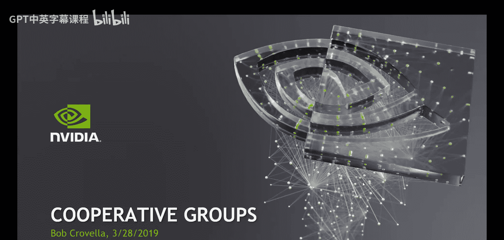
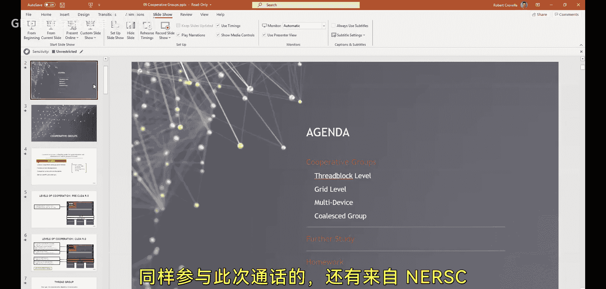
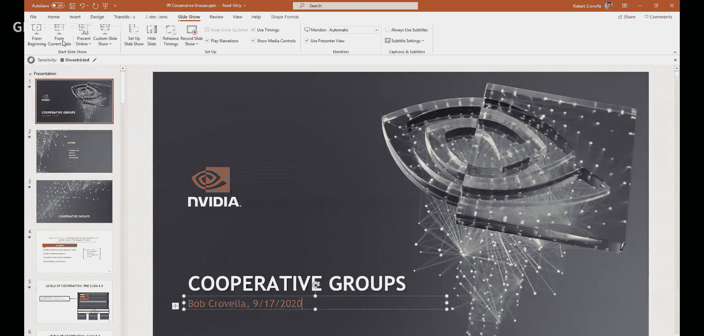
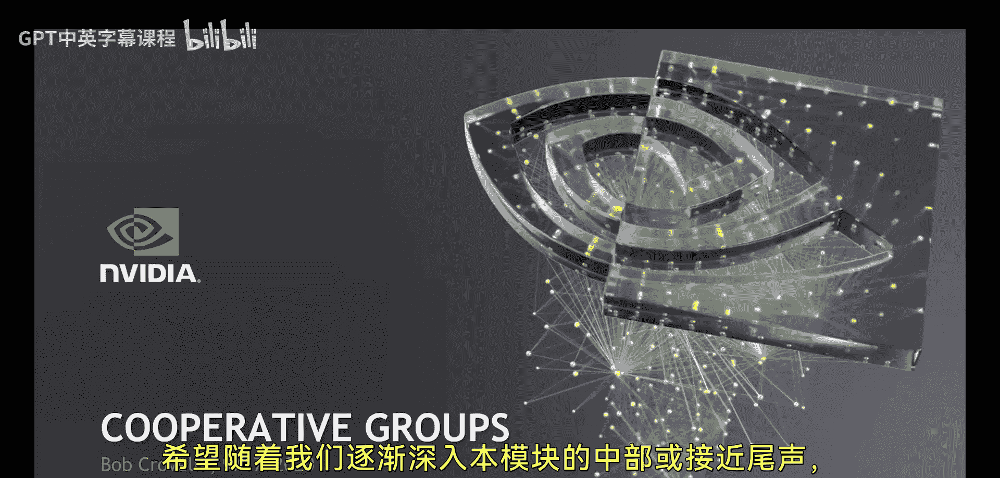
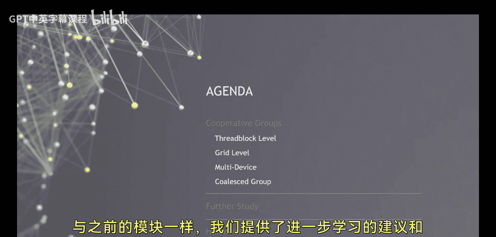
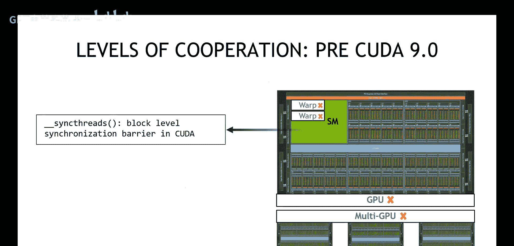

# 【Nvidia官方课程】CUDA入门课【中英字幕】 p09 09 Cooperative Groups [BV1JJ4m1P7xW_p9]

All right， I think we can ahead and go ahead and get started。

 welcome everyone and thanks for joining us for the final module in ourUA training series。

My name is Tom Papa Theodore， I'm with Theo Wilsia。

Also on the call， we have Helen He and Kevin Gott from the N LBL side of the organizing。

Today， as always， we're joined by Bob Corvla， Robbie Cyrilles and Max Cats from NviIDdia。

 they'll be presenting on cooperative groups today。

Bob will start off giving a presentation and then Robbie and Max will follow up with a demonstration as a hands on component if you wanted to follow along to。

Solidify some of the things you learned in Bob's talk。If you want to ask questions during the talk。

 please do so in the Zoom chat and then Bob will handle those either during or after the talk after the talk。

 if you want to ask just unmute yourself and ask questions。At that point， ordering the hands on。

 that's fine as well。So before before handing things off today。

 I would like to just take the opportunity to thank。Bob。

 Robbie and Max for putting this series together。You know。

 this is something that the training materials， the slides， the recordings。

 the exercises will be available for your use after this event is over。And also。

 you know it's something that'll be available for future OLCF and N users as well as just the general public right who ends up finding this site。

 so we really appreciate our friends at NVDA putting together such an excellent training series。

All right， and with that， I think I can pass things off to Bob and let them get started。Okay， thanks。

 Tom， can you hear me okay？Yep， I can hear you。Great。😊，Thanks。

 this is Bob Corvla with NviIDdia Corporation。 I'd like to thank my colleagues。

 Max and Robbie for their efforts today and throughout the series， I'd also like to thank the。

Folks said。Oak Ridge and the folks at Nrsk， especially Tom and Helen， who have。

Provided all the logistics necessary to make this series a reality。

 so we appreciate that as Tom mentioned this is actually the last episode。

 This is the final module in this couda training series。

 so I also want to thank everyone who has joined me throughout the series and perhaps stuck through or stuck with me all the way to the end here and I'll just say kudos for that。

So this is our last module and as I've mentioned previously。

After around the first four or five modules in this series， we started to get fairly topical。

 looking at things that were not necessarily foundational to COUDA programming。

 but exploring areas that extended theUDA programming model in one way or another or extended your skills as a coUDA programr in one way or another。

 and that's true of this topic here today as well， cooperative groups is something that was instituted or added to the CUA programming model。

In the Kuda 9 timeframe， we're now in what I would call the KUa 11 timeframe。

 so Kuda 9 was several years ago， but nevertheless。

This is not something that was part of the Ka programming model from day one。

 And it's something that has been added and。The addition， I would say。

 at least partly is motivated by the idea that we're addressing。What we could。

Call or perceive as a gap。In the coa programming model， something that prevented。

Complete flexibility as a programmer and hopefully as we get towards the middle of this or towards the end of this module。

 you'll see what I mean and perhaps agree with me。

So we're going to be talking about cooperative groups and we can break those。😡。

We can break this module up into several pieces。 There's going to be an underlying threat or commonality amongst all of these。

Topics here， the thread block level grid level multidevice and CoLS group there's definitely a lot of commonality。

 however， they each are a little bit different syntactically and they each have functional and serve different purposes as well。

Just like in the previous modules， we have suggestions for further study and the homework and I'll probably try and refer to each of those as I go through the module at certain points。

So let's get started with cooperative groups。😡，And I want to start with a little bit of motivation。

 I'll try to give you motivation at various points along the way during this module。

 but we're going to start out by declaring that this cooperative groups。

System or set of functionality is。Aimed at providing exactly what the name suggests。

 It's basically cooperation amongst。If you're not。Intending to speak， Could you go on mute。

 Thank you。嗯。This。Subsystem， this cooperative group's functionality is intended to provide primarily for cooperation amongst groups of threads and we've actually in our second module I believe。

 in this series， we looked at what is the meaning of thread cooperation。

 and we studied ideas like sync threads and eventually shared memory and we talked about those two basic ideas。

 a cooperation amongst threads in our massively thread parallel programming environment called KUDA。

Largely boils down to two basic ideas， and that is synchronization or execution control。

 And we can think of things like execution barriers here。as well as interthread communication。

 being able to share data from one thread to another in some fashion。

 that's basically what if we decompose what do we mean by cooperation， those are the basic ideas。

 the building blocks that we will use to build lots of cooperative algorithms。

We're also going to look at being able to generate flexible parallel decompositions。

 so being able to take larger groups and subdivide them into smaller groups。And this also。

Ties into the next topic， as we。Think about the idea that we have varying sized groups。

Of threads for purposes of cooperation or collaboration。

We also want to be able to design algorithms that。Allow us to handle those flexible。

 flexibly sized groups。And we want to be able to。Compposed software as we get out to a macro level。

 we want to be able to compose software that works across。

The software boundaries that are implied both by these groups and maybe the software boundaries。

That we have come to know previously， and I'll talk about those with respect to Kuta。

One of the things that I want to call out immediately。On this slide。At the beginning。

Is the idea of a grid wide sink。 This is a concept that is perhaps the most radical in terms of all of the ideas that we're going to present。

And it may not be immediately obvious why that's radical。

 you really have to drill into the coUa execution model to understand what were some of the。

Hazards associated with trying to do this previously if you didn't have this methodology。

 and so the gridwide S is something that is very useful。

 I believe for a lot of different kinds of problems and I'll spend a little bit of time hopefully talking about motivation for gridwide S towards the middle or the second half of this presentation。

But I believe that if I were to just pick one thing out of this presentation to be the most interesting or revolutionary or something that you might want to tuck away in your coUDA programming toolkit。

 it might be the idea of a gridwide Snc because I think as you get to be an adeptUA program where you will start to take on challenges coUDA programming challenges where you will immediately recognize the need and the benefit for having a grid wide S。

 which was mostly absent as we'll see from the CUDA programming model with one exception。So this。

Methoddology or these methodologies。Creation of groups。

 creation of flexible algorithms that work with groups。嗯。It should be widely applicable， I believe。

 and we'll talk about a couple examples of this as we get through the various phases of our presentation today I'm listing a few examples there on the right hand side。

嗯。And we'll see examples of those as we work through the presentation。So just to level set。

Where have we been up until now， we haven't really been exposed to the idea of cooperative groups in this。

Sequence or in this series so far， and so what the mechanisms instance or the methodologies available to us as KUDa program are up to now up to let's say the introduction of KUa 9。

Were somewhat limited and really the one that we'll focus on here is the idea that。

