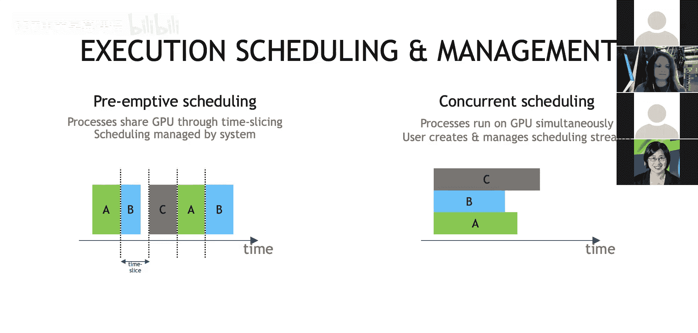
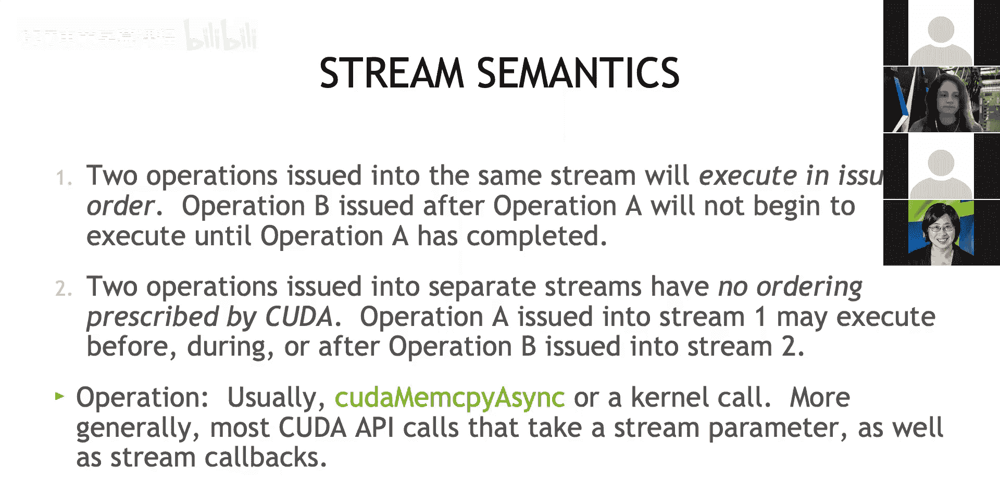
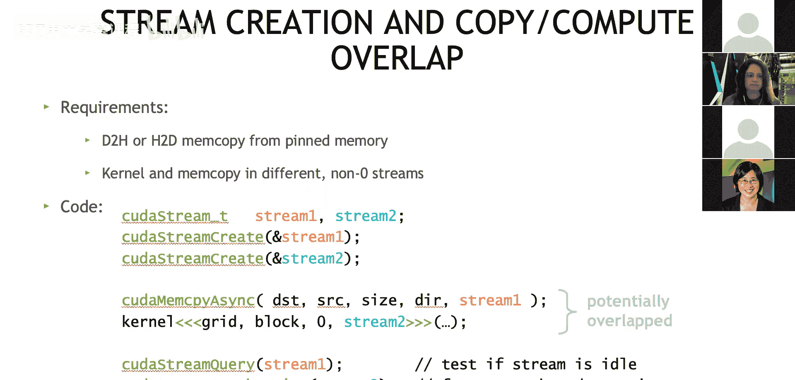
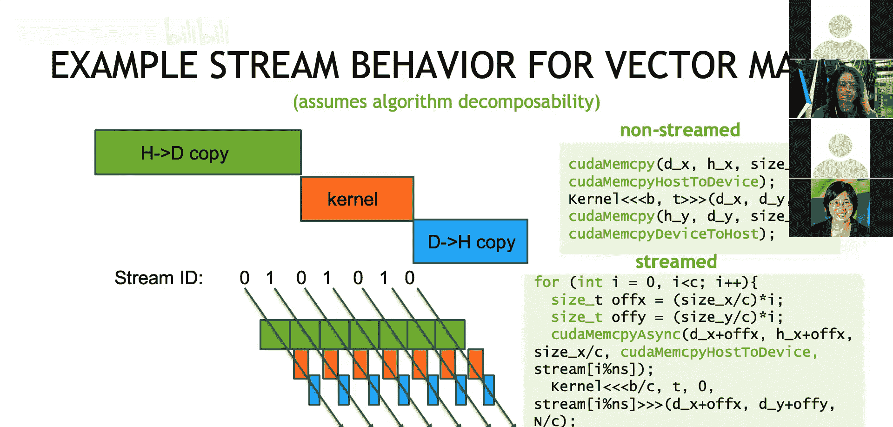
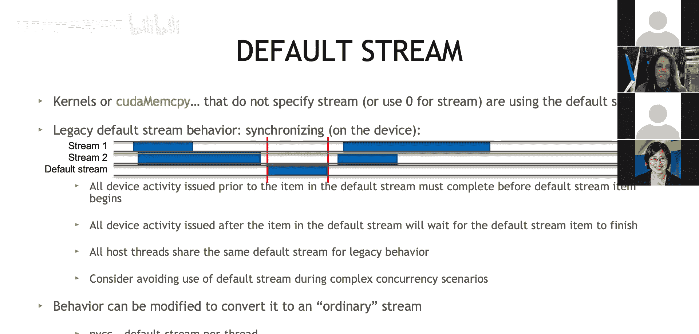
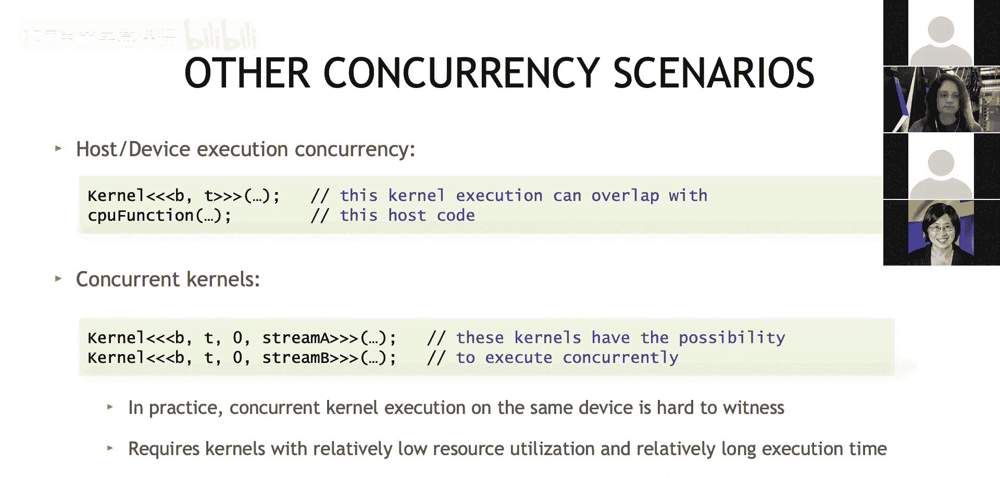

# 【Nvidia官方课程】CUDA入门课【中英字幕】 p10 10 Multithreading and CUDA Concurrency [BV1JJ4m1P7xW_p10]

Sounds good。All right。All right hello everyone for those of you who don't know me my name is Robbie I'm a solutions architect with NviIDdia today we're going to be talking about concurrency with multithreading this is a question that I get asked a lot by popular demand we're going to dive into it today。

So。It's important to note that we't just define our terms upfront when I talk about concurrent scheduling。

 I'm talking about processes running on the GPU simultaneously the onus is on the user to create and manage scheduling streams the default scheduling behavior on a GPU if you have multiple processes submitting kernels to a GPU is that the processes will share the GPU through time slicing and the scheduling is managed by the system you can control that time slice with our NVDdiaA SMI tool but this is sort of not our goal today today we want to be executing concurrently so when I talk about concurrent scheduling this is what I'm referring to。

And I wanted to give a brief sort of。Review of Kuta streams。

 so if you were with us for the coa training series last year。Module。

 I think it was seven talked about just how to use kuda streams generally。

 so this will be a little bit of a review， but for those of you who were not with us for that I figured I'd go over the basics of kuda streams and then we can talk about how Kuda streams behave in a multithed context。

So some basic semantics of couda streams， two operations issued in the same stream are going to execute in issue orders。

 so what that means is if I have two operations Op A and operation B。

 Op B issued after Op A into that stream will not begin to execute until Op A has completed。However。

 if we issue these operations into separate streams。

 there's no notion of ordering prescribed by KUDA， so it's possible that Op A may execute before during or after Op B。

 as long as they are issued in different streams。Typically。

 what is an operation an operation is usually either some kind of memory mem copypy operation or it's a kernel call。

嗯m。More generally， there are coUD API calls that take a stream parameter as well as stream callbacks。

 and there is an optional stream parameter for any kernel call for a kernel that you've written yourself。

And just to give an example of what that would look like。This is a basic。

Sort of stream creation and compute copy overlap so we have streams one and two that we've created。

And we have a mem copypy async operation here， so we're going to copy some data over to the GPU on stream one。

 and then we have a kernel that we are launching on stream two。

And then we have if you see that this coup to stream synchronize on stream2。

 basically what we're saying is we want our CPU thread to wait on whatever instructions were issued into stream2 in this case it's a single kernel call。

 but kernel calls are nonblocking with respect to the CPU thread。

 so it's just important to note that it's also worth noting that because there's no notion of ordering for this mem copy call and this kernel call。

 you would not want to do this if if any of the memory being copied over in this mem copy call is required for the kernel computation。

 this is something where。These two things in theory， are completely divorced from one another。

A more concrete example of this would be a vector math operation。

 so this is actually kind of similar to our homework code。

 which is based off of the solution from homework 7。

 which basically takes a vector math operation where we have an array and we have some vector math kernel that we launch on that array。

下。And we chunk it up。 And basically， we want to overlap some of the。

Host a device mem copying with our。With our actual vector math computation so we don't have to wait for the entire the entire array to be copied over to the GPU in order to begin our kernel execution so in this case。

 in this example we just have two streams that were sort of oscillating back and forth between and on each stream we're doing our hosted device copy followed by a kernel call for that particular chunk of memory and then our device to host copy for the results and the way this would execute。

Is basically you have on stream zero， your first hosted device copy。

 your first kernel call and your first device to host copy for your results， and on stream one。

 you have your next chunk of the array host a device copy kernel and device to host copy and within each stream these operations will execute in in issue order。

 but stream zero and stream stream zero and stream one do not have any sort of notion of ordering。

So it's just important to make sure that within each stream。

 you're copying the corresponding chunk of the array over to the GPU before you actually begin processing that particular chunk of the array。

And， you know， this is。Kind of just a small exercise example。

 but there are plenty of code bases where you have maybe not a chunked array necessarily。

 but just two entirely different arrays and you're already performing computation on one of those arrays and you want to sort of get the next array ready for the next kernel that you have to launch you can use streams to do that sort of thing。

If you don't specify a stream， however， things will launch in the default stream。

 so for anyone who's never used streams before， you've probably been using the default stream the whole time。

 kernels or cotoM copy calls that don't specify a stream。

Use the default stream so the legacy default stream behavior is that it actually blocks on the entire device。

 the whole GPU so even if you had stuff running in other streams。

 if you then submit work to the default stream it's going to actually block it's going to wait on all of the other streams to complete execution。

 it's going to then execute whatever you submitted to the default stream and then anything that was issued into other streams in the meantime during that default stream execution will still be blocked from beginning execution until whatever the work item from the default stream is complete。

IfThat makes sense， so all host threads share the same default stream on a GPU。Um。

And basically we just want to avoid using this during complex concurrency scenarios。

 but this sometimes can become a point of confusion where you launch one work item and then for your second work item you create a stream thinking well like okay。

 the first one by default will execute in a different stream right it's like well actually know that that'll execute in the default stream and you won't get any concurrency there so if you want concurrently executing work items on the GPU。

 you will have to create a stream for each one。This behavior can be modified to convert it to an ordinary stream so without this special behavior by using the dash dash default stream per thread。

Flag when you compile your application with MBCC。And in that case。

 each host thread will get its own ordinary default stream。That won't block on the entire device。

So other use cases for concurrency host device execution concurrency。

 so if we have a kernel and we don't want to block on that kernel。

 we just want our CPU host code to continue execution because presumably at that point in time。

 we don't yet need the result of that kernel。Um。We can do that or we can launch concurrent kernels so we can have two different streams and instead of using a coupa memcopy operation and a kernel we can just use two kernel one in stream A and one in stream B in in this case and the reason that you'll see all of my slides throughout this presentation say these kernels have the possibility to execute concurrently if they they won't necessarily execute concurrently one won't necessarily execute before or after the other one it's actually pretty hard to witness concurrent kernel execution on the same device because it requires kernels with low resource utilization but long execution time in that limited amount of。

Hardware resource utilization。So what that means basically is if I have two pretty big kernels that do a good job saturating the GPU on their own and I launch them in different streams。

 they have the possibility to execute concurrently， but what what will happen in practice is。

One of them most likely will begin execution and suck up a bunch of the GPU hardware resources so that there are none free for the second kernel and as it completes execution。

 the first kernel completes execution and starts freeing up those resources you'll see a little bit of overlap where the second kernel will come in if you look at your profile or output you'll see a little bit of overlap toward the end。

 but you might be thinking to yourselfm shoot like I thought that these we're going execute at the same time and it doesn't look like they're doing that it looks like they're doing that only for sort of a split second or so and that's normal it's because one of your kernels。

