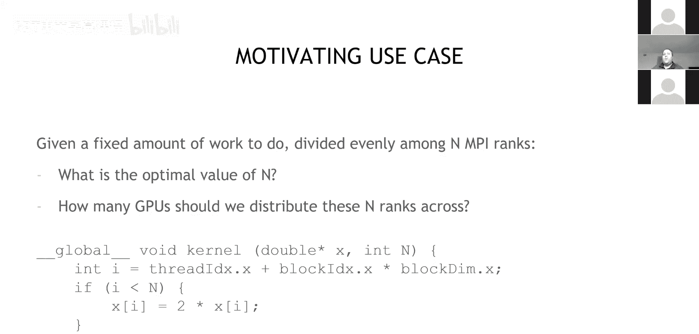
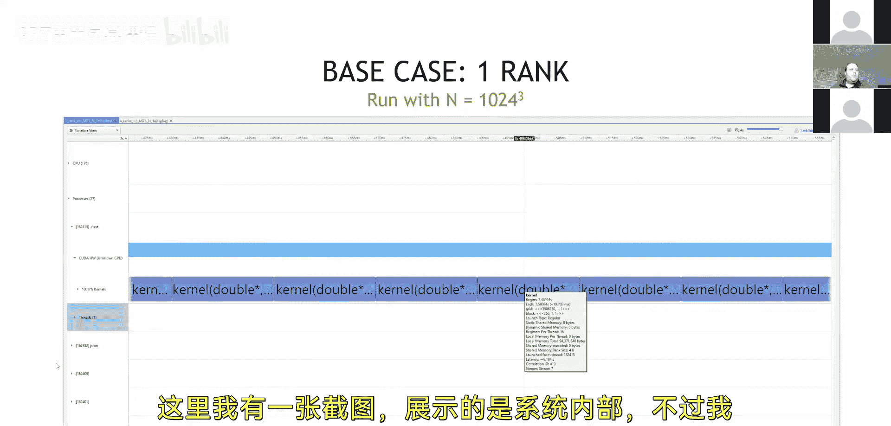
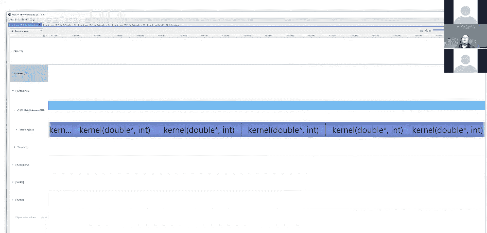
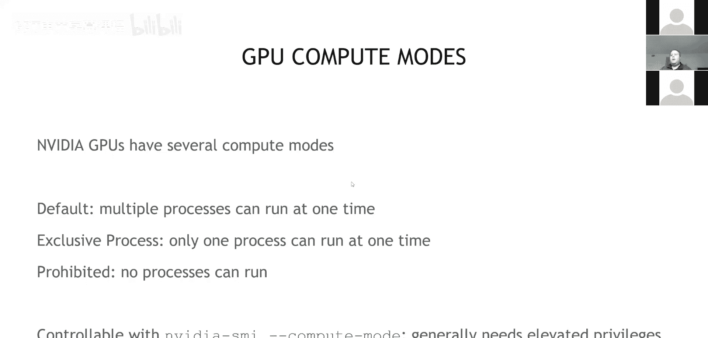
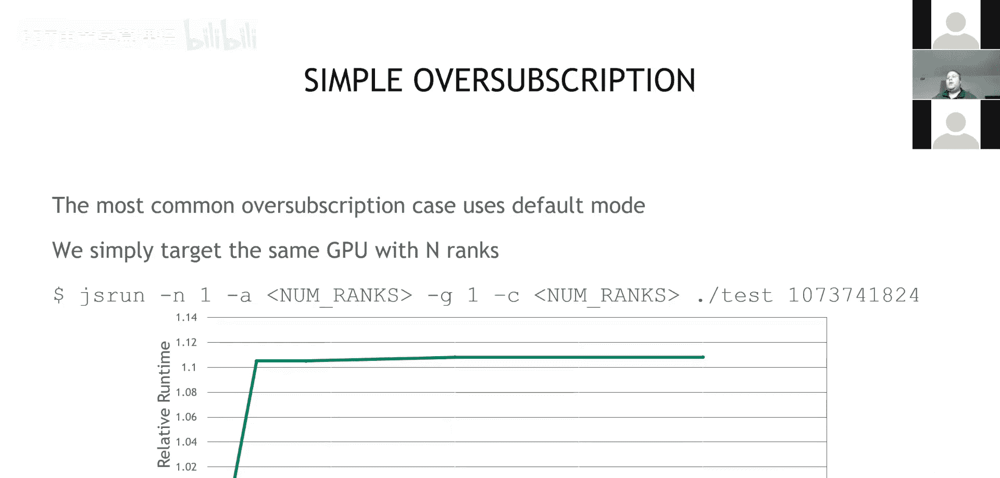

# 【Nvidia官方课程】CUDA入门课【中英字幕】 p11 11 CUDA Multi Process Service [bC6CxPW0-1c] [BV1JJ4m1P7xW_p11]

So today's topic is the Multiprocess Service in KUDa， but before I talk about what that is。

 I want to provide a motivating use case for what problem myself am I trying to solve by introducing this topic for today。

So the question that I want to think about， and this is a pretty common topic in high performance computing is。

Suppose I have some amount of work to do and I can choose to distribute that work among N MPI ranks for NS some variable number of ranks。

And so I have a couple questions that I want I could potentially answer given that framing one question is what is the optimal value event right given this fixed amount of work to do。

 how do I distribute how many ranks should I distribute this across and then similarly how many GPUs should I distribute these N ranks across but once I've chosen a good value event and typically these two things are analyzed together。

There are。Cases where you will just go with the kind of obvious thing or a thing that is the most natural to do。

 which is to choose one GPU per rank and then you basically pick as many ranks as you can either to optimize like a weakcaling efficiency and so you're basically just fitting as large of a problem per GPDU as you can or optimal time to like fast a time to solution。

 maybe you're the thing that's driving you and so then you just keep adding GPUs to your problem until you're not getting any faster so you strong scale to the maximum level。

Those are both possible ways distribute work among ranks and across GPUs。

 but let's just ask this question in the abstract and then talk about how I would think about this。

In a simple case and so for the simple case i'm just going to write a very simple kuta seat kernel and I've written the kernel here on。

The slide so all i'm going to do is take an array and double it right so this is just a simple memory bound workload the actual contents of the workload are not important what matters is that the size of the workload scales with the the size of the array which i've unfortunately also chosen to call n in this case。

So we have some array of length end and we want to decide how many ranks of megas attribute that across。

And so let's think about what this problem。

Looks like I'm a GPU。So if I have a screenshot here of insideside systems but I'm just going to actually show you an example of profile of this problem live and you can only just refer to the slide later if you want to but this is a profile of co to C code that basically solves this problem and this this is the same code that I have listed in the exercise section so get a chance to look at it but all it does is launched the same kernel budget times in a row so it's an extremely simple code all it does is just launch this kernel that does doubles an array and it does it a thousand times in a row so that's all it does trivial trivial piece of code。

If I zoom in to the enzyme systemss profile and I look at how long each individual kernel invocation takes to run。

 then I get a sense of how long it takes to do to solve this problem on one GPU and for this case I chose a problem size of 1024 cubed。

So that's about a billion array elements if you know that a double precision number is8 byte then you also know that the size of this array in memory would be8 gigaby and so that is already a pretty hefty fraction of the available GPU memory on a modern GPU and so that seemed like a reasonable place to start right this is a problem that basically fills GPU memory or approximately does to within the right word magnitude and I just want to know how long does it take to solve this problem。

So processing an array of length 1 billion takes about 19。

7 milliseconds thats so that's how long this one took this one is another 19。

7 milliseconds so that's a pretty pretty consistent right if I look at any one of these takes about 19。

7 milliseconds to process。So the question I want to ask is。

Can I make this faster by using more MPI ranks？And you all know。

 I'm sure that if you were to distribute this across multiple GPUs。

 then probably you would make it faster， right， that you would just basically take the first half of your array and do it on GPU0 and you take the second half of your array and do it on GPU1。

And then there would probably be some overhead to that associated with message passing。

 but as long as the array length is sufficiently large。

 then you would expect about a 2xB by doing that eventually you would distribute it across so many GPUs that you。

The message passing overhead became the dominant factor because the compute would just be so short in relative terms。

 but just for a couple of GPUs or a couple of ranks。

 you would expect to see pretty good linear speed up。But the question I want to ask today is。

 what if I'm doing this on only one GPU and I asked the question。

 can I solve this problem faster by using multiple MPR ranks in the same GPU？

So I have not increased the amount of compute capacity available to me I'm just distributing the problem across multiple MP ranks on the same GPU。

Now， so let's ask the question then what happens when I have multiple MPR ranks targeting the same GPU？

Nvidia GPUs have several compute modes， and these modes determine how the GPU interacts with multiple processes running at the same time。

The default mode that NVDdia's GPUs come with when they ship to you is called default and it allows multiple processes to run at one time。

 but we also have a mode called exclusive process where only one process can run at a time and this is useful in like shared environments where you might have multiple people on the same workstation and you want to ensure that they don't step on each other so in exclusive process if you。

If you try to run multiple processes on the same GP at the same time it will fail and if like the second process to run will get an error message saying that GP is busy please try again later and the application will have to exit but the default mode where you just don't change anything and the default mode multiple processes can run at one time and I made this point explicitly because I think。

This is actually a point of confusion in the community in some cases that I've seen where people have the incorrect assumption that modern NviDdia GPUs cannot do that well in fact they can you know the thing that I've going introduced m does not introduce any new functionality you can already today use multiple ranks on the same GPU and that just works MP which I would discuss a little bit is a way of enhancing the performance of this scenario but it's not really about adding new functionality with some minor caveat that i'll explain later。

Now the reason I call this out that we have multiple compute nodes and that this is a thing you should know about is that different people might choose different modes for how they deploy so in particular on sumummit that I know about the actual the thing that is given to you when you get a GPU is exclusive process mode and not default and so it is a thing you have to opt into on summit in particular with an aLc flags option to beub。

But in general， this is something that OLC have opted into in general。

 if you just got a GPU from the factory floor'll be running on default mode to start with and then you could run multiple processes at a single time。

You can change this with if you have root privileges on a server and so that's why you can change this with a flag to BL。

 you couldn't change this once you've already got an allocation。

 but there is a job flag in summit to help you do this and then there are could potentially be other similar things at other centers。

Now。Let's then answer the question， if I take this problem。

And I just distributed across some number of ranks。What happens？

So I've given an example of how they might do this in the summit， I would do JS run one resource set。

 some number of ranks and then some number， same number of CPUU cores。

 and then I would distribute all these ranks on a single GPU and then this test code that I have in the repo just basically divides this problem size which is 1024 cubed by the number of ranks and then distributes that fraction of this total problem size to each of the ranks。

And so then I can ask the question。Compared to the one rank case what is the relative runtime of the multira case so I have a plot here of my measurements of that scenario for this problem the vertical axis is the relative runtime relative to the single rank case and then the horizontal axis is the number of ranks and so higher is worse because this is the relative runtime and like seconds and so basically for any number of ranks that is larger than one。

We get about a 10 to 12% hit in additional runtime， but once I go above two ranks。

 I don't really change the scenario much up to about 20 ranks for this problem I can keep on adding ranks and I get the problem solved in about the same amount of time。

So why would I do this right if if I'm not making the problem any faster why would I even want to consider this scenario where there are multiple ranks decomposing this problem and the answer is that often you have like a legacy application that is not fully ported to run on GPUs and you have some portion of the application that's running on CPUUs and so you want to distribute that CPU only part among as many MC ranks as possible while not while still taking full advantage of the GPU and so what this is saying is that by default this is possible with a。

