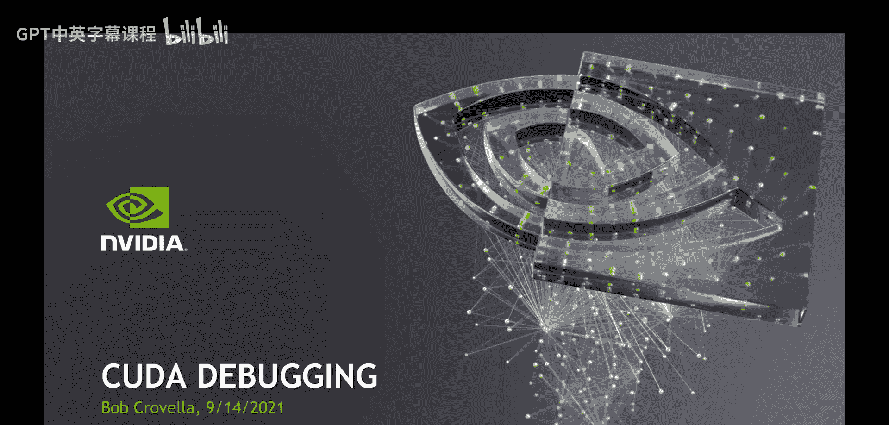
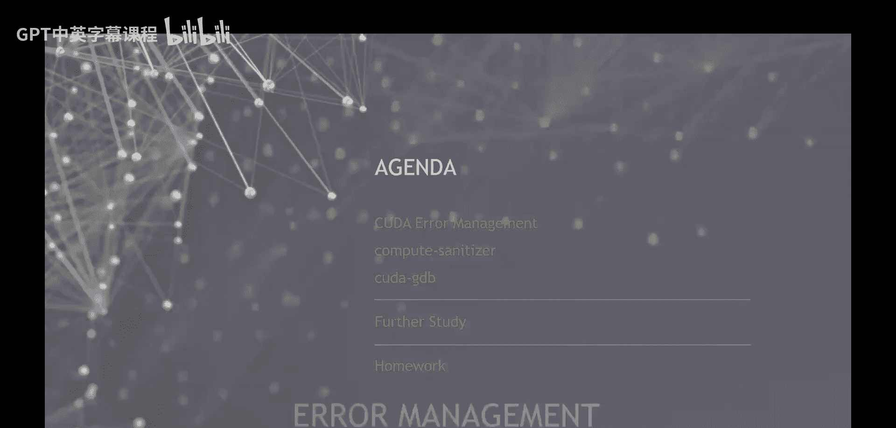
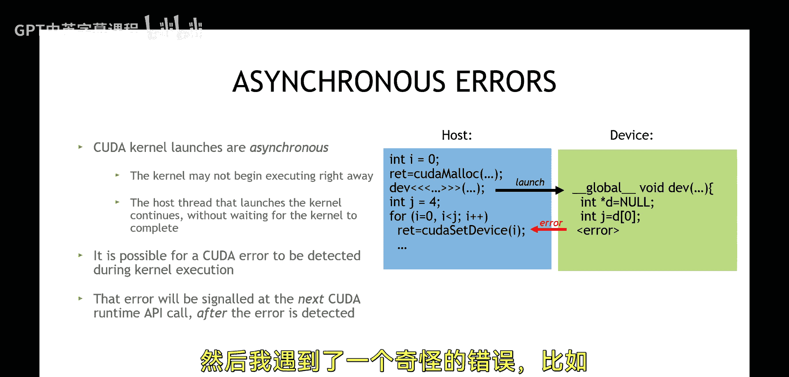

# 【Nvidia官方课程】CUDA入门课【中英字幕】 p12 12 CUDA Debugging [BV1JJ4m1P7xW_p12]

Okay thank you， this is Bob Corvello with NviDdia Corporation。

 I'm on the solution architecture team and this is part of a continuing series of coUDa training topics。

On behalf of Nvidia， I'd like to thank the organizations at。啊。

Oak Riage and other organizations like Nurse who have made this possible and provided all the logistics for us to do this we're very appreciative of that I hope you will find this session useful you're welcome to ask questions on chat and I will also pause probably at two or three points during the presentation to see if there are questions that people have if they wish to come off mute and i'll probably take a quick look at chat at that point。

This presentation today is。

Probably going to be a little bit longer perhaps than some of the ones that we have done in the past。

 so i'm anticipating we will definitely take more than an hour and probably could very well be 90 minutes one of the things that is going to make this a bit of a longer presentation today is that we're going to cover three topics coUa error management compute sanitizer which is a tool and then coUa GDP which is another tool during the coUD to GDP session i'm going to do an extended demonstration or walkthrough of how to debug applications。

Using couda GDP so there will be a live demonstration and that takes a fair amount of time to cover all of the topics that are really needed so that you are enabled or able to use couta GDPb。

With enough capability to be able to debug applications。

 so that's going to make this session a little bit longer。As a result of that。

 we do have homework prepared for you it's available now on the GitHub site。However。

 I don't think we're going to have time to walk through the homework we've done that a couple times in the past for certain sessions。

 but I don't think we're going to have time to do that today。

 I'd also like to introduce some of my colleagues they may or may not have joined yet one of them is Max cats。

Another is Robvi Srs and the third one is Matt Stack they are all on the solution architecture team as well and they have all contributed to this training series as well。

 so I appreciate their participation。

So we're going to start out with error management and the idea the overall idea of this presentation today is to make you a better coupa programmer in the sense of being able to sort out problems that exist after your application is already written so it's not really teaching you how to program today what we're teaching you how to do is once you've got your program written and you're running it and perhaps let's say you're not getting the right results or you're witnessing strange behavior we want to give you the tools and knowledge necessary to be able to sort that out and understand what's going on。

😡，So in that vein， I believe the right place to start is actually a fairly mundane topic。

 which is I would refer to this as proper coupa error checking， we'll call it error management。😡。

And the basic idea here is that all coUa runtime API calls return an error code so what is a coa runtime API call it's what it's an example of one is what you see here kuta set device in other words any。

Library call that begins with the letters CUDA that you're using without providing a prototype for。

 in other words， this is not a function that you wrote。😡。

Almost certainly that's part of the coUa runtime API and there's plenty of these that you've run into already if you are a coUDa programmer or if you've been following along in this series kuda set device is just one of them。

 but there's plenty others kuda。😡，Stream C， for example。

 is another one that has to do with stream creation。

And there's plenty of these every single one of these API calls returns an error code that is of a particular enum type。

An enumerated type called coupa error underscore T。

And unfortunately what we witness in this development arena is that many times people simply ignore that。

 in other words， they say coa set device just as you see written here without capturing the error code in a return variable。

 and that is we could say it's kind of a lazy practice or a sloppy practice。

 I'm not going to try and get into really any judgment of it， however。

 I will say that if you are having trouble with a coUa code。

This is the place to start if you have not done rigorous proper error checking rigorous means that you're capturing every single one of these on every couda runtime API call and handling it appropriately printing it out if it's not a no error indication or whatever the case may be however you'd like to handle it if you're not doing something explicit when this return error code is not of the anum type or the anum token couda success。

 then you're really not doing rigorous。😡，Proper couda error checking and the first suggestion that I'm going to have for every couda programmer who is having trouble with a couda code of any sort is to make sure that you are doing rigorous means every single opportunity。

Proper capturing the error code and doing something appropriate with it Kuda error checking。Um。

There's obviously other types of inum return types there's literally hundreds of them we're not going to cover them all by any means。

 for example another anum token is coupa error memory allocation and so if this was for example a call to couta Malik and the couda Malik call was successful you'd expect to see the coUa success token returned in the error return variable but if it was unsuccess let's say you were out of memory and you didn't have enough space to allocate what you're requesting then you'd expect a return token like Kuda error memory allocation Of course the token is really something like just a number underneath the hood aumum type is basically just a list of numbers ultimately underneath the hood at least in CC+ plus and so we don't want to just print out a numerical error code and even something like coUa error memory allocation might not be that as useful as we'd like it to be and so we have a built-in coUa runtime API function called coUa get error string which。

Takes a coupaert inumum type。Value and converts it into text， English text， human readable string。

 And so this is strongly encouraged as well at a minimum。

 if you get something other than k to success。Make some notification of that right that's a minimum that's the minimum necessary behavior that we would expect for anyone who's having trouble with a coUDa code but beyond that just to help yourself and help others it's not a bad idea to wash that so to speak through co to get airstring and print that out instead。

😡，And so I can't overemphasize this， the best practice is to always check these codes and handle appropriately。

 just do it。😡，We'll kick off our next section by noting that at least in the coUDa runtime API。

 when we do a kernel launch and there's an example of the kernel launch syntax there at the bottom of the slide。

😡，That doesn't appear to be aa runtime API call it doesn't start with CD in fact I can name kernel name anything I want and in fact that by itself as it stands is not a coupa runtime API call okay so that doesn't return an error code and we know that kernels by definition anything decorated with the global keyword returns avoid type so we're not going to get an error simply by trying to capture the return code of this that's not the right way to do it so we need to talk about we need to talk about kernel error checking and how that happens and how we should do it。

So before we dive into kernel error checking， we have to remind ourselves that KUDa kernel launches are asynchronous。

 this means that they're launched from the host thread from the CPU code。

And then they begin to execute essentially concurrently with whatever the CPU thread is doing at that point。

😡，嗯。We don't have any strong indication automatically in our CPU thread of when the kernel is complete and furthermore。

 if the kernel were to hit an error that was the result of kernel code execution。

 that error would happen at some， let me just refer to as random point subsequent in our CPU code。😡。

And so what you could have happen is。😡，As we see on the right hand side。

 you could have host code that launches a kernel called dev and on the right hand side we sort of pictorially indicated what that kernel might be looking like and let's say that kernel hits an error。

 an execution error okay in other words， an error that occurred as a result of the device code in the kernel that's actually running at that time。

😡，是。Well that error， even if we were to signal it back to the host code。

 that error would be signal at some point in the host code。

 which is sort of non deterministic or nonspecific because of this asynchronous nature of couta kernelel launches and so what can happen and what often does happen is it will do some other innocuous。

😡，Cuda runtime API call like KUa set device here， something that we would basically never expect to fail。

Like if I have four devices I might have a loop to set it amongst the four devices and I expect that to be setting devices0。

1， two or three there's really no reason I can't think of a reason why that would fail and yet at some point during the runtime。

😡，I execute this co a set device and I checked the return code because I was told to do that。😡。

And I get a strange error like error coupa misaligned address or error， illegal address。

 something like that。

And so this is part and parcel of the fact that kernelel on。

