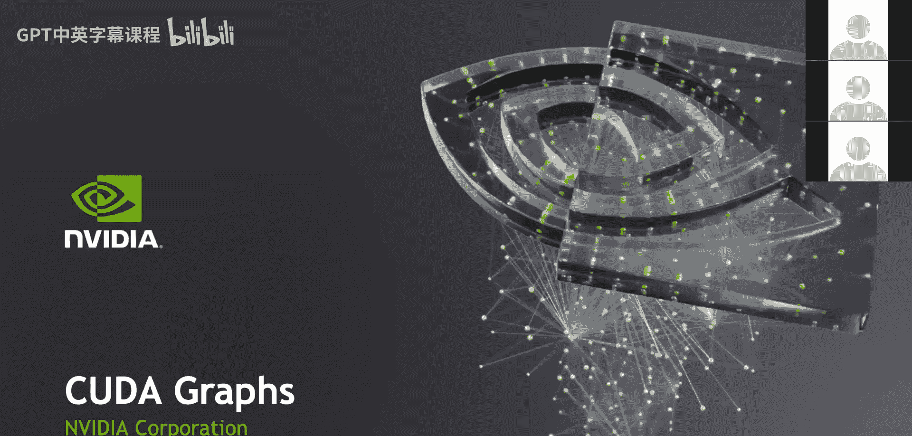
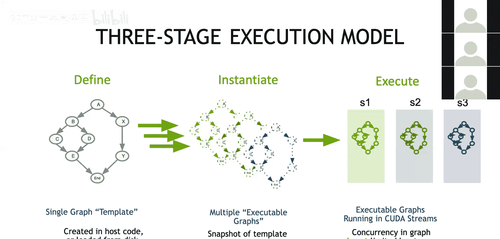

# 【Nvidia官方课程】CUDA入门课【中英字幕】 p13 13 CUDA Graphs [BV1JJ4m1P7xW_p13]

Welcome to the Ka Gs tutorial in the Ka training series today's presentation will be given by Matt Staack from NVIDdia。

So welcome to all the users from Oak Ridge and Argonne and Nrsk。So it's going to same as before。

 is going to be an hour long or hourish long presentation followed by a set of hands on exercises based on the topic。

If anybody does not have an account， we do have the ability to set up a training account but I believe that everybody here should have one or should have been emailed instructions for how to set up an account。

嗯。So yeah， that Matts， I'll just end the introductions here and I'll pass it on to Matt。Yes。Awesome。

 sounds good。Hello， my name is Mast and I'm a solutions architect at NVIDdia。

And today we are going to talk about Kutagraphs， which is a performance enhancement feature in KUa。

 and we will be focused on the basics。This talk will hopefully be beneficial to anyone who has not experimented with kgraphs yet。

Or maybe if you heard about it back when I was introduced in Kuda 10 and would like a refresher。

And before we begin just to note that this is a relatively advanced kuda topic。

 so we are really going to focus on the core idea and introduce the graph way of thinking about coUDa operations rather than trying to jam it all with the newest features。

And please feel free to utilize the chat and ask questions as we go along。

 we have Max and Robbie here with me from NVDdia to help answer questions as they come up and we can address some at the end as well。

Today we would like to ask the question， what is Cagraphs and how can they be a useful tool in the toolbox of a CUDa programmer？

And to set the stage a bit。Kuda kernels over the years have been faster and faster。

 thanks to newer hardware and improved software。And launching any coUa operation from the CPU incurs what is commonly known as the launch latency overhead and the launch waittency overhead can be defined in a number of ways。

 but the one I like to use is the time between the start of the launch API call and the start of the kernel and the GPU。

While kernels have been getting faster， it's possible now more than ever to have kernels that run the same amount of time as the actual overhead itself。

And when you have these kernels with runtime， that is sufficiently short。

If they are around the same time or less than the launch overhead。

This launch overhead will actually dominate the overall time of launching and running。

And this pattern can be improved by usingccgraphs。嗯。Okay。

 a graph is a series of operations connected by dependencies that is defined separately from its execution。

And all kudo work creates a graph。In the traditional sense。Say with a really basic kuda code。

 you have three kernel launches into the default stream。

 that is three nodes connected by the implicit dependency of the stream ordering almost down in a line。

And we can see from the left that using kudDa streamams creates this directed acyclic graph of execution that is perfect to visualize how a kagraph is formed and that the execution capabilities are the same。

Andands。Yeah， from left to right， we are converting this kooterwork into a graph that has nodes dependencies and we will talk about that through this presentation。

The nodes that make up a kgraph are any asynchronous kuda operation。Um。

 it is important to note that these operations don't have to all just be kernels。

 they can feed mem copies and meets or see the callback functions or anything you could put into a stream。

嗯。This is deviating a bit from the intro level material but you can use the new stream ordered memory allocators with kgraphs and in the end of the slides there's a link to learn more about that if you're interested we're not going to touch on that in this presentation。

And looking at the dependencies between nodes。Just going back for one second。

 they can be either implicitly ordered by the。Sequential execution of the operations in a stream or there can be explicit dependencies from coup to weight and signal events。

 as you can see it maps from left to right。And you can also have subgraphs which we will talk about。

In a few slides。Going back to the idea that kgraphs can be generated once and then launched repeatedly thanks to it being defined separately from its execution。

 this repeated execution is the big deal here。We are allowed to pay the setup cost of the graph。

 which we will talk about in a few more slides。Only at once and a single execute operation to start the whole graph off。

 which can be very complex。This is just a few nodes here on the slide， but it could be。哎你。

Number of nodes， I don't think it's an unlimited amount of nodes。

 but a very large amount of nodes and it can be very complex with its dependencies。

And when we were looking at the corresponding stream work from before。

 the big difference is that launching was more piecemeal。

 which is one at a time and then only runs once。The stream and its work were consumed and to be reissued。

In its entirety， if you。Wish to relaunch it。嗯。And latency hiding here is the key point。

 as with all GPU computing and relaunching the graph many。

 many times is where you will start collecting very useful CPU time back。

Here we can see on the bottom how launching a graph with a single operation implicitly kicks off a number of operations that we created when。

That we created while allowing the CPU to remain open for other work， you can see the CPU is idle。U。

😊，And contrasted to the stream example above where the KUuda kernel launches are more piecemeal and the CPU can be quite busy actually launching the work。

嗯。This example is not to any particular scale and shows that if your kernel execution time is。

Longer than the launch overhead by a bit。You can still benefit from the freed CPU resources。

And here we see a similar example， again， not to any particular scale。

 that I like to think highlights the other case where your kernels are very small。

 smaller than the launch overhead， and we have the GPU actually waiting idle for the CPU to launch the work。

They will each have to wait for the CPU to finish that previous launch before they themselves can get launched resulting in this spaced pattern you can see。

In Ens systems， if you are proing and that is letting the GPU be idle for that time。

And as mentioned before， when the kernel runtime is short， the execution。

 the total execution time is dominated by the CPU launch overhead。

And launch overhead is generally a few microseconds and I personally wouldn't worry explicitly if the kernel times are exactly equal or exactly less than just because it could be a number of。

It could be a number of microseconds or it could be a dozen， depending on what you're launching。嗯。

But these kernels we are talking about are generally in the range of a few microseconds。

And also just noting that graphs using kgraphs doesn't actually affect the pure runtime performance of a kernel once it's on the GPU。

We're more targeting the。Combined launch cost for a program and how that decreases。

Kuttographs has a three stage execution model where we define， instantiate。

 and then execute into a stream。And on the left， the defined stage is what we will see in the coming slides with examples where we tell Kuda。

 okay， these are the nodes。The parameters， the dependencies， which GPU to target。

 which stream to launch to and so forth。

And we are really defining the structure。