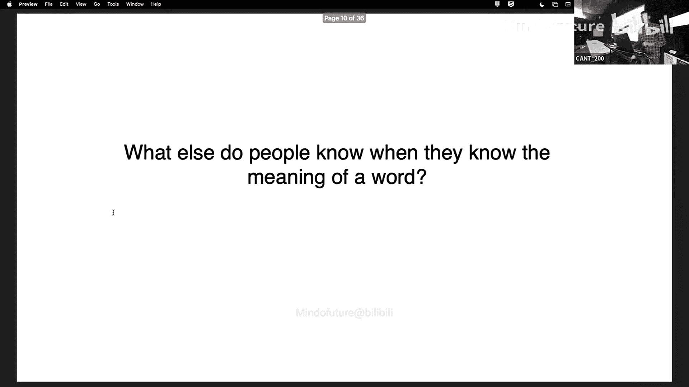
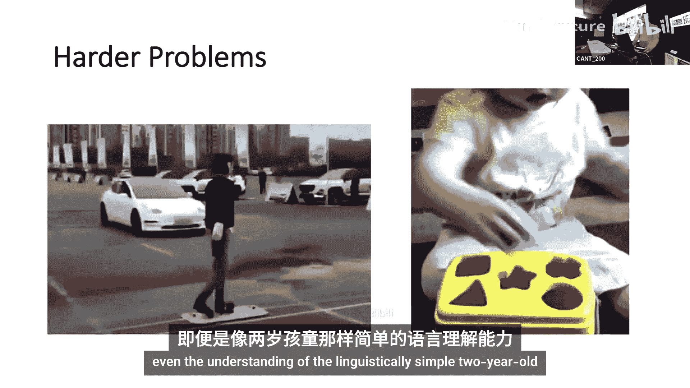
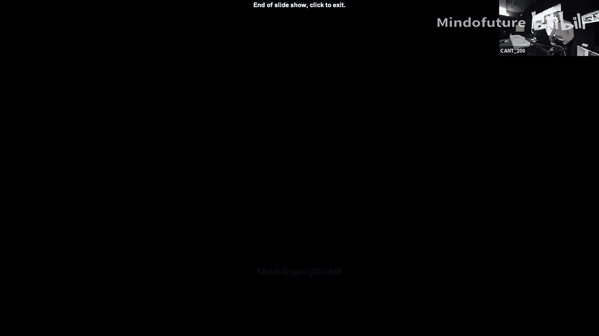
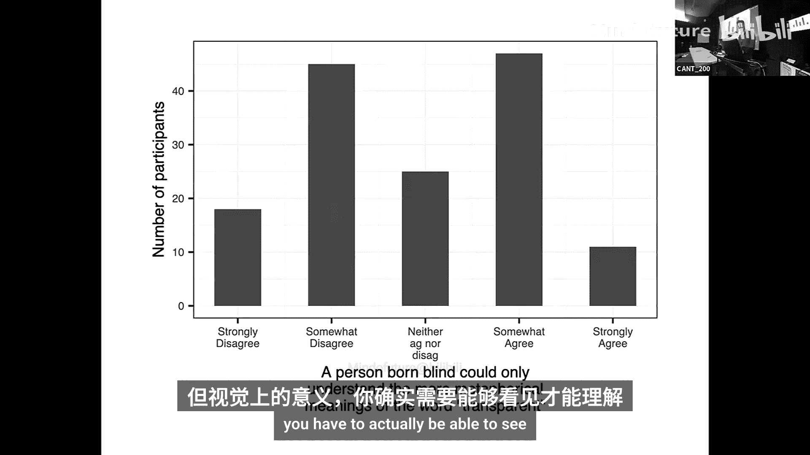
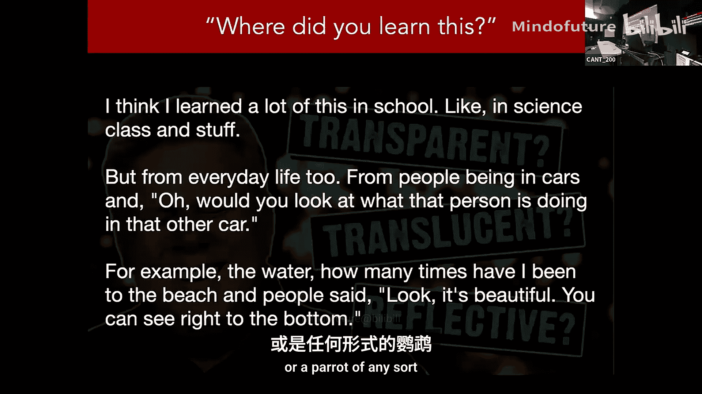
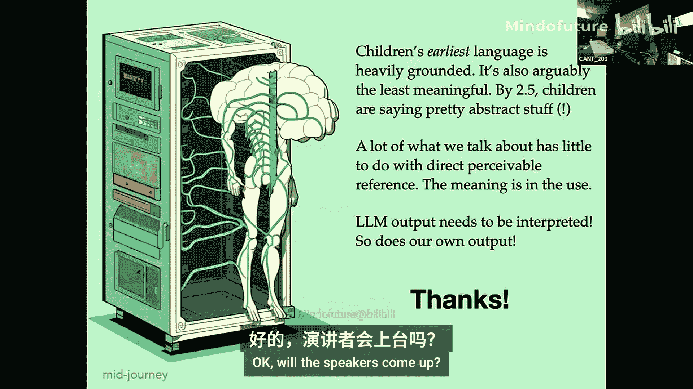

# 001：语言模型是否需要感官基础以获得意义和理解

## 概述

在本节课中，我们将探讨一个核心辩论：**语言模型是否需要感官基础（例如视觉、听觉、触觉等）才能获得真正的意义和理解**。我们将跟随六位专家的观点，他们分为“需要”（Yes）和“不需要”（No）两方，从技术、认知科学和哲学的角度展开深入讨论。

---

## 辩论背景与议题

本次辩论的议题是：语言模型是否需要感官基础以获得意义和理解？我们有三名“需要”方和三名“不需要”方。

*   **需要方（Yes）**：Yann LeCun（杨立昆，纽约大学）、Brendan Lake（纽约大学）、Jacob Browning（纽约大学）。
*   **不需要方（No）**：Ellie Pavlick（布朗大学）、David Chalmers（大卫·查默斯，纽约大学）、Gary Lupyan（威斯康星大学）。

发言顺序将交替进行：先是一位需要方，然后是一位不需要方，以此类推。

组织者指出，议题实际上包含两个层面：
1.  **行为推理层面**：是否需要感官和运动连接来完成某些类型的推理行为。
2.  **抽象内容层面**：是否存在一种不需要这些感官和运动基元的抽象内容。

---

## 第一节：需要感官基础（Yann LeCun）

### 当前AI系统的局限性

上一节我们介绍了辩论的背景，本节中我们来看看“需要”方的核心论点。Yann LeCun首先指出，当前基于机器学习的AI系统与人类和动物在学习能力上存在巨大差距。

以下是当前AI系统的主要局限：
*   **监督学习**需要大量标注样本。
*   **强化学习**需要海量的试错。
*   我们仍然没有普及的家用机器人和完全自动驾驶汽车，这表明我们缺失了某些关键要素。

相比之下，动物和人类可以：
*   依靠关于世界如何运作的背景知识，极其快速地学习新任务。
*   理解世界，拥有相当复杂的世界模型，能够推理、规划并具备常识。

### 自监督学习与语言模型的成功与缺陷

自监督学习（SSL）近年来取得了巨大成功，其核心思想是训练系统预测缺失的信息。在文本领域，这表现为**掩码语言建模**：取一段文本，以某种方式破坏它（如删除或替换单词），然后训练一个巨大的神经网络来预测缺失的单词。在这个过程中，系统学习了包含语义、语法和句法的语言表示。

一个特例是**自回归生成模型**，例如大型语言模型（LLM）。它们被训练来预测文本窗口中的下一个词（或标记），然后通过反复生成和注入下一个词来生成连续文本。其核心公式可以简化为基于上下文预测下一个标记的概率：`P(token_t | token_1, token_2, ..., token_{t-1})`。

尽管LLM在许多方面令人惊叹，但Yann认为它们远未达到人类水平的智能。它们存在以下根本缺陷：
*   **缺乏对现实世界的知识**：它们纯粹从文本中训练，没有关于我们共享的底层现实的知识。
*   **自回归的固有缺陷**：它们一次只产生一个标记，不进行规划或推理。假设产生一个错误标记的平均概率是 `e`，那么生成一个长度为 `n` 的正确序列的概率是 `(1 - e)^n`。这是一个**指数衰减**的过程，意味着随着生成序列变长，模型几乎必然会产生无意义的输出。
*   **不可控性**：很难控制其输出，例如避免毒性内容。

因此，Yann预测，**五年后，自回归LLM将被淘汰**。我们需要能够理解世界如何运作的系统，这就是**基础（Grounding）** 的意义所在。

### 通向人类级AI的路径：世界模型

婴儿在生命的最初几个月，在没有语言参与的情况下，就能学习关于世界本质的极其复杂的概念（如直观物理学、重力、稳定性、有生命与无生命物体的区别）。这种积累的知识构成了我们常识和快速学习能力的基础。

Yann倡导的解决方案是构建围绕**世界模型**的认知架构。系统拥有一个世界模型，可以预测其行动将导致的世界状态变化。在推理模式下，它可以想象一系列行动可能导致的世界状态序列，然后优化行动序列以最小化特定目标（成本函数）。这类似于最优控制中的**模型预测控制**，但需要使用学习到的复杂世界模型和可能的分层推理过程。

他提出了一个具体的架构建议，包括：
*   **放弃生成模型**：对于视频等复杂数据，预测每一个细节是不现实的，应采用**联合嵌入预测架构**。
*   **最小化强化学习**。
*   系统需要**内在的成本和目标函数**，这使其可控，并提供了类似“情感”的功能（即对结果的预期）。

**总结**：Yann LeCun认为，当前纯文本的LLM存在根本缺陷，无法实现真正的理解和推理。要迈向人类级AI，必须让系统通过感官基础学习世界模型，并具备规划和推理能力。

---

## 第二节：不需要感官基础（Ellie Pavlick）

### 基于实证数据的论点

上一节Yann指出了LLM的理论缺陷，本节Ellie Pavlick将从实证角度提出反驳。她的核心论点是：**根据当前已有的经验数据，答案显然是“不需要”**。

首先，存在许多“原则上”的论证，说明我们不一定需要基础来获得意义，例如：
*   **内在主义论证**：拥有意义意味着在头脑中拥有概念和词汇之间的正确关联，我们没有充分理由认为语言模型不能学习人类拥有的同类关联。
*   **继承的基础**：人类也通过从其他有基础的人那里学习来继承许多有基础的意义（例如，许多人能使用“橡树”和“榆树”这两个词，却无法在现实中区分它们）。

Ellie选择聚焦于具体的模型，并审视经验数据。

### 论点一：添加感官基础并未带来改进

如果感官基础对意义至关重要，那么添加了感官输入的多模态模型应该在相关任务上表现更好。但实证研究表明并非如此。

她和同事进行了一项严格控制的研究，比较了**纯文本模型**和**具有相同架构、相同数据量但添加了视觉输入的模型**。他们在多个任务上进行了测试：
*   **物理常识推理任务**：设计初衷是为了证明LLM需要感官基础，但添加基础后模型并未表现得更好。
*   **语义探测任务**：如语义角色、共指消解。
*   **形容词-名词关联任务**：如模型是否知道“苹果”是切开的还是完整的。

**结果**：在所有任务和指标上，两个模型的性能**极其相似**。添加感官数据并没有改善模型对意义的表示。

### 论点二：语言模型的表征已接近感官基础下的表征

我们可以进一步检查语言模型内部学习到的表征结构。研究发现，这些表征与通过感官基础获得的意义表征非常相似。

例如，在**颜色**领域：
1.  语言模型在文本空间中学习了一个概念几何结构（例如，知道“深”这个方向能将“蓝色”映射到“深蓝”，将“绿色”映射到“深绿”）。
2.  通过向模型展示少量基础示例（如“这是蓝色”、“这是深蓝色”），它可以学习将文本空间中的“深”方向映射到感知空间，并推断出“深绿色”应该对应哪种颜色。
3.  实验表明，即使在最具挑战性的设置下（训练数据只来自颜色空间的某个子空间），模型在原始世界和“旋转”后的世界中，性能都显著高于随机基线。这表明模型内部发生了正确的映射推理过程。

为了回应“RGB代码本身已是符号表示”的质疑，后续研究使用了**原始图像编码**（像素）作为输入。他们冻结了预训练的图像编码器和语言模型，只训练一个**线性投影层**，将图像表征映射到语言模型的输入空间。结果发现：
*   这种简单的“事后基础”方法，在图像描述和视觉问答任务上，与从头开始训练的多模态模型性能相当。
*   即使使用**完全没有语言参与训练的自监督视觉模型**（如通过填补图像块训练的模型），也有相当多的语义信息能够成功转移到语言模型。

**总结**：Ellie Pavlick认为，存在强有力的原则性论证反对“基础是意义的必要条件”。更重要的是，当前经验数据表明：（1）添加感知信息并未改善模型对意义的表示；（2）语言模型学习到的表征结构与通过感官基础获得的结构高度相似，并且可以很容易地在事后进行基础连接。

---

## 第三节：需要感官基础以像人一样理解词语（Brendan Lake）

### 人类理解词语的丰富性

上一节Ellie从模型行为角度论证了“不需要”，本节Brendan Lake将提出一个更具体的观点：**语言模型是否需要感官基础来像人一样理解词语？他的答案是肯定的。**

他承认今天的LLM非常惊人（例如GPT-4可以解读论文图像并总结），但问题在于“意义和理解”的含义。**未基础化的模型**确实学到了很多关于词语用法和关系的信息，但根据定义，它们与外部世界没有联系。传统的语言学观点认为，这种**指称外部世界**的联系对意义至关重要。

Brendan与同事Greg Murphy合著的论文指出，当一个人知道一个词（如“雨伞”）的意义时，他拥有一个**概念**（指向世界中某个类别的心理表征）。这个概念支持多种灵活的行为：
1.  **描述场景和理解描述**：可以识别各种场景中的雨伞并谈论它们。
2.  **根据指令和请求做出适当反应**：听到“递给我那把刀”，你会做出相应动作。
3.  **根据内部欲望、目标和计划选择词语**：你想表达“我想要一把黄油刀”。
4.  **根据语言输入改变对世界的信念**：听到“叉子放左边，刀子放右边”，你会更新关于餐具摆放的知识。

### 当前模型的不足

尽管具有视觉编码器的模型可以描述常见场景中的雨伞，但人类的概念要丰富和灵活得多。例如：
*   **临时雨伞测试**：动物在雨中会用大叶子或蘑菇遮雨，这体现了“雨伞”概念的类比延伸。而图像描述模型通常无法识别这些场景为“雨伞”。
*   **更抽象的用法**：如“美国的核保护伞”、“伞形组织”等，这需要更深层的概念理解。

Brendan提出了衡量人类词语理解的四个标准，并指出纯文本模型在多个方面存在不足：
*   **缺乏内部目标**：LLM被设计为基于文本模式做出反应，没有自己的欲望、目标或计划。
*   **对指令反应的局限性**：在网格世界实验中，模型难以学习“走”、“大/小”、“谨慎地”等词的抽象、灵活和关系性含义，泛化能力差。
*   **信念不一致**：早期模型（如BERT）对同一事实（如“海豚是哺乳动物吗？”）的回答会因提问措辞的微小变化而矛盾。虽然最新模型有改进，但距离人类稳定、一致的信念仍有差距。

**总结**：Brendan Lake认为，纯文本系统能做惊人的事，但要像人一样理解词语，其表征必须基于能与世界接触并用于谈论实际事物的信息。开发能够灵活支持上述四种行为标准的词语表征，是一项非平凡但极具价值的事业，尤其是如果我们想要真正理解我们并能与我们进行更有成果的交互的机器。

---

## 第四节：不需要感官基础——但情况复杂（David Chalmers）

### 哲学史上的争论

上一节Brendan强调了人类理解的丰富性，本节David Chalmers将从哲学史切入，提供一个更 nuanced（微妙）的视角。他的总体答案是“**不需要**”，但情况复杂。

历史上，关于思维是否需要感官基础一直存在争论：
*   **需要方**：13世纪的托马斯·阿奎那认为“心灵中的一切无不首先存在于感官之中”。现代的Emily Bender和Alexander Koller也认为LLM缺乏感官基础，没有意义或理解，只是“随机鹦鹉”。
*   **不需要方**：11世纪的阿维森纳提出了“漂浮的人”思想实验：一个突然出现、没有感官的人，仍然能意识到自己的存在。这表明，**原则上**，没有感官也能进行某些思考。

David认为，一个没有感官的系统（如阿维森纳的漂浮者）原则上可以：
*   思考自身、数学、逻辑、哲学。
*   对外部现实、其他心智、科学理论形成假设。
*   对感官事物（如红色）或具身技能（如骑自行车）拥有**部分的结构性理解**，尽管不是完整的体验性理解。

### 感官是否能将思维提升到新高度？

David将问题转向另一个层面：**感官是否能将语言模型的思维提升到一个无法通过纯文本达到的新高度？** 这需要比较纯语言模型和多模态模型。

十年前，人们普遍认为多模态系统在认知和推理任务上会远优于纯文本系统。但LLM的发展出乎意料：纯文本模型在许多非语言任务上表现出色，展现出通用智能的迹象。

关键问题是：**多模态模型在它们共享的领域（如纯文本任务）上是否显著优于纯语言模型？**
*   GPT-4的技术报告显示，带有视觉的版本和不带视觉的版本在大多数标准化考试上成绩**几乎相同**，视觉版偶尔只有微小提升。
*   他以一个需要空间推理的“齿轮转向”问题为例，GPT-3曾出错，但GPT-4（纯文本版）完美解决了。这虽然不能证明什么，但说明了纯文本模型能力的边界在不断扩展。

因此，他的结论是：虽然感知显然能提供额外数据（一图胜千言），但如果足够的对应文本数据能够匹配多模态模型的性能，那么**感官似乎并没有将思维提升到一个没有它就无法达到的新水平**。

### 理解的概念需要重新审视

最后，David指出，要回答“LLM是否真的理解”，我们可能需要进行**概念工程**，而不仅仅是软件工程。我们需要设计新的“理解”、“思考”、“意义”概念。例如，区分：
*   **P-理解**：表现得好像理解了。
*   **E-理解**：体验到好像理解了。

当前的语言模型可能在一定程度上达到了P-理解，但几乎肯定没有E-理解。

**总结**：David Chalmers的结论是：
1.  **语言模型是否需要感官基础来进行思考和理解？** 不需要（就某些思考而言）。
2.  **某些类型的思考和理解是否需要它？** 需要。
3.  **感官是否能为语言模型的思维提供无法通过其他方式获得的基础性提升？** 不会。
4.  **当前的语言模型是否真的理解？** 尚无定论。

---

## 第五节：需要感官基础——基于认知架构的论证（Jacob Browning）

### 从历史错误中学习：逻辑主义与认知

上一节David从哲学原则分析了可能性，本节Jacob Browning将从认知科学和AI历史的角度论证“需要”感官基础。

1966年MIT的“夏季视觉项目”失败，其背后的假设是：认知本质上是**语言性**的，而非语言过程（如感知、行动）则是非认知的且更容易解决。这种观点源于近代哲学和逻辑主义传统，他们认为：
*   所有思想都是命题性的。
*   所有知识都是语言性的。
*   世界可以通过逻辑句子完全数字化（如鲁道夫·卡尔纳普的《世界的逻辑构造》）。

这个项目失败的原因是，在可形式化的领域（如用三维空间定义颜色）的成功，与从像素值中识别人脸、理解其表情内容**毫无关系**。后者需要构建一个完整的视觉系统来进行解释。

### 三种表征格式及其局限性

Jacob指出，存在三种不同的表征格式，各有优劣：
1.  **语言表征**：擅长使用变量绑定、组合和离散符号来表示高度抽象的关系（如自然法则）。公式示例：`∀x (Mammal(x) → WarmBlooded(x))`。但无法表征具体、连续的感官细节。
2.  **图像表征**：通过同构性（相似性）来表征，能传达关于形状、大小、位置、运动等详细信息。但难以描绘“正义”、“自由”等抽象概念。
3.  **分布式表征**（如神经网络）：通过形成领域的统计模型来工作，擅长**技能性知识**，但难以处理严格的逻辑规则，在命题性知识上较弱。

逻辑主义计划高估了语言格式的普遍性，低估了其他两种格式的重要性，并忽视了动物和婴儿的认知、技能性知识以及情绪状态。

### 更合理的模型：实用主义与工程视角

Jacob提出了一个受达尔文进化论和实用主义启发的替代模型：
*   **认知的核心**是行动和预测，感知是对世界进行分类，并做出技能性反应以在环境中生存。
*   **语言**首先是一种**社会性技能**，是用于在主体间沟通的工具。沟通的有效性依赖于大量的背景知识、相似的具身经验、文化等。
*   语言后来才演变为脱离语境的媒介（如故事、写作），用于存储大量信息和复杂规则。

从这个“工程模型”来看，很多知识都蕴含在对图像表征的理解和具身技能中。这解释了：
*   为什么构建自动驾驶汽车和玩《我的世界》如此困难（需要广泛的非语言理解）。
*   为什么构建一个成功的聊天机器人主要是一个**缩放问题**（主要处理语言性任务）。
*   为什么LLM擅长写诗，却在儿童能轻松解决的简单工程问题上表现糟糕。

**总结**：Jacob Browning认为，语言理解是人类更广泛的、多模态的、直观的世界理解中的一个重要但有限的部分。在人类身上，语言理解**预设并依赖于**更古老的非语言理解。如果我们想要达到人类水平智能的机器，即使只是两岁孩子的智能，我们也应该超越大型语言模型，寻求更全面的认知架构。

---

## 第六节：不需要感官基础——语言本身的丰富性（Gary Lupyan）

### 抽象词语与感官基础

上一节Jacob强调了非语言理解的基础地位，本节Gary Lupyan将论证，**语言本身已经包含了丰富的、甚至抽象的意义，这些意义并不直接依赖于说话者个人的感官经验**。

他首先通过调查指出，对于“语言模型是否需要感官基础”这个问题，学界存在明显分歧。他澄清了辩论的核心：问题不在于模型是否通过我们（人类）间接地基础化，而在于**它们自身是否需要直接的感官基础**。

Gary指出，语言并非单一事物，词语在具体性上构成一个连续统。我们通常认为“自由”、“民主”很抽象，但许多更抽象的词（如“有趣”、“想法”、“麻烦”）在儿童语言中就已频繁使用。那么，“然而”的感官基础是什么？

他引用了一项广泛使用的**具体性规范**研究，受试者被要求根据词语是否“可以指向或演示”来评价其具体性。数据显示，英语中前8200个高频词里，有大量词比“自由”更抽象，而这些词早在幼儿时期就被使用。

### 语言模型对抽象概念和关系的把握

针对Brendan的“雨伞”例子，Gary测试了纯文本模型ChatGPT-3。他让模型想象自己是一只森林里的小虫子，下雨时可以用什么当雨伞。模型列举了蘑菇、叶子、草等，与人类扩展的“雨伞”概念高度吻合。这说明，**纯语言模型可以从语言中获取概念的核心关系信息**。

另一项研究批评LLM因缺乏基础而知识有限，但Gary指出，即使是模型不完美的回答，也蕴含了大量**隐含知识**，例如：屋顶在高处、沙发会变小、沙发通常无法穿过窗户。这些关于世界的知识是如何获得的？正是通过**未基础化的语言**间接嵌入的。

### 感官经验并非意义的唯一来源：以盲人为例

Gary进一步用先天盲人的例子来挑战感官基础的必要性。
*   研究表明，先天盲人与明眼人在词语语义判断上高度相关。
*   一位名叫Tommy Edison的先天盲人博主解释“透明”时，不仅能理解其隐喻义（“透明的政府”），还能通过学校教育和他人的语言描述，列举出玻璃、水等透明物体，并讨论其视觉特性（尽管他承认无法完全理解“看穿”的体验）。

这表明，通过语言交流，没有某种直接感官经验的人也能获得关于该感官领域概念的**深刻、有意义的理解**。

**总结**：Gary Lupyan认为，儿童最早的语言确实是高度基础化的，但随着他们开始产生更有意义的语言，语言迅速变得极其抽象。大量词语的核心意义并非关于对外部事物的指称，而是关于**关系**。先天盲人对视觉相关词语的理解表明，感官经验并非意义的唯一来源。语言本身就是一个丰富的信息源，能够传递关于世界的结构化知识。

---

## 小组讨论与观众问答精选

在随后的讨论中，几位讲者就一些核心问题进行了交锋：

1.  **规划与自回归的缺陷**：
    *   **Yann**：LLM逐词生成，计算量固定，无法进行长程规划以确保全局一致性，错误会指数累积。需要“系统2”式的推理架构。
    *   **Ellie等反驳**：LLM可以通过注意力机制在早期层为后期生成做准备，这是一种形式的规划。且人类思维也并非完全计划后执行，常是边做边调整。

2.  **“基础”的定义**：
    *   **David**：可分为感官基础、身体基础、外部基础。辩论多聚焦于感官基础。
    *   **Yann**：直接感官输入带宽高，信息丰富；语言是低带宽、离散化的近似。许多知识（如木工技能）从未被语言充分表达。

3.  **效率与最终状态**：
    *   **观众**：理论上，任何图像信息都可以用语言精确描述（如逐像素列出RGB值），因此多模态输入并非本质不同，只是数据形式。
    *   **Yann**：这涉及**效率**问题。用语言描述所有像素给Transformer，在原理上可行，但效率极低，不实用。
    *   **Ellie**：如果最终获得的知识表征相同，那么**效率低并不妨碍模型获得意义和理解**。关键在于过程差异是否导致最终状态的可衡量差异。

4.  **人类反馈强化学习的作用**：
    *   **观众**：当前LLM经过RLHF微调，以产生更真实、有用的输出，这是否让它们学习了更涉及世界的函数？
    *   **Yann**：RLHF有助于纠正常见问题的答案，但对于长尾的、未见过的提问类型无能为力，根本解决方案是改变模型架构，使其在推理时能够优化目标。
    *   **David**：RLHF可能影响模型是否拥有**知识**（倾向于说真话），但不一定影响其是否拥有**概念和意义**。

5.  **道德推理是否需要基础**：
    *   **David**：原则上，道德思考可能不需要感官基础。
    *   **Gary**：在完全不了解外部世界的情况下思考道德，令人不安。
    *   **Ellie**：感官有时会**损害**思维（如对可爱动物的偏爱影响道德判断）。语言对世界的分类和抽象，可能为某些推理提供了更“纯粹”的关系数据。

---

## 总结

本节课中，我们一起深入探讨了“语言模型是否需要感官基础以获得意义和理解”这一核心问题。

*   **需要方**（Yann, Brendan, Jacob）认为，当前纯文本LLM存在根本局限（缺乏世界模型、无法规划、难以泛化到具体和抽象场景），要获得人类般的丰富理解和灵活智能，必须让AI通过感官与真实世界互动，学习多层次的世界模型和具身技能。
*   **不需要方**（Ellie, David, Gary）则认为，从原则上看，意义不一定锚定于个人感官；从实证上看，当前LLM从纯文本中学习到的表征已显示出惊人的意义结构，与感官基础下的表征相似，且添加感官输入并未带来预期中的性能飞跃。语言本身就是一个蕴含世界知识的丰富系统。

辩论揭示了AI研究中的深刻张力：**是应该让AI模仿人类从具身经验中学习的高效路径，还是可以接受它们通过消化人类全部文本遗产这条“异化”但有效的路径来获得智能？** 双方都同意，当前LLM并非人类智能的完整形态，但对其缺陷的根源和未来发展方向提出了不同的诊断和处方。这场辩论不仅关乎技术路线，也促使我们重新思考“意义”、“理解”和“智能”这些基本概念本身。