# 002：温和经验主义与深度学习

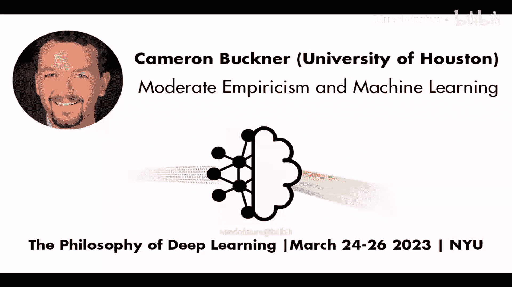

## 概述

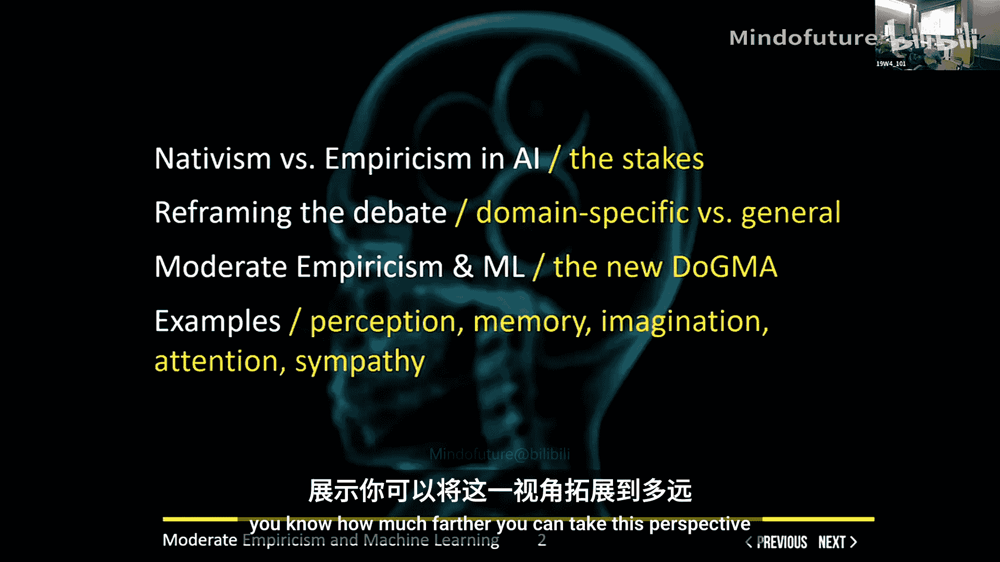

在本节课中，我们将探讨深度学习与哲学中经验主义传统的深刻联系。我们将看到，当前深度学习研究的主流方法，并非如一些批评者所言是简单的“行为主义”或“白板说”，而更接近于一种植根于哲学史的“温和经验主义”。这种观点认为，智能体通过内置的、领域通用的认知“官能”或架构，从丰富的感官经验中学习并提取出领域特定的抽象知识。

---

## 辩论的焦点：先天论 vs. 经验论

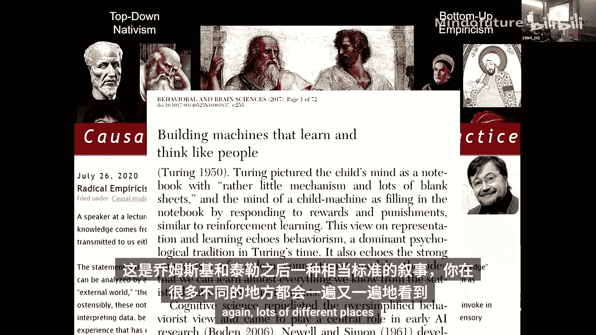

长久以来，关于人类知识来源的哲学辩论一直在“先天论”与“经验论”之间展开。先天论者认为，我们的大部分核心知识（如语言、物理直觉）是与生俱来的。经验论者则认为，知识主要来源于后天的感官经验。

在人工智能领域，这一古老的辩论以新的形式重现。例如，AlphaGo Zero论文中提到的“白板”（Tabula Rasa）概念，直接源自亚里士多德的经验论传统。批评者如Gary Marcus则针对这一观点，认为我们需要为AI系统预先构建更多核心知识。

这本质上是一个关于“我们应该在模型开始时内置多少知识”的方法论之争。

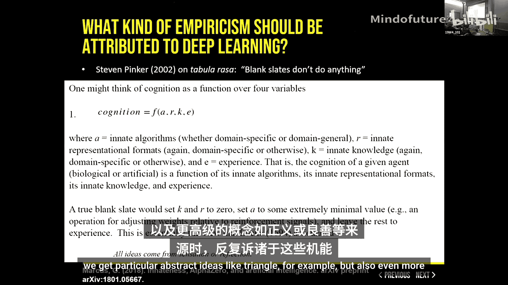

---

## 重新定义辩论：领域特定 vs. 领域通用

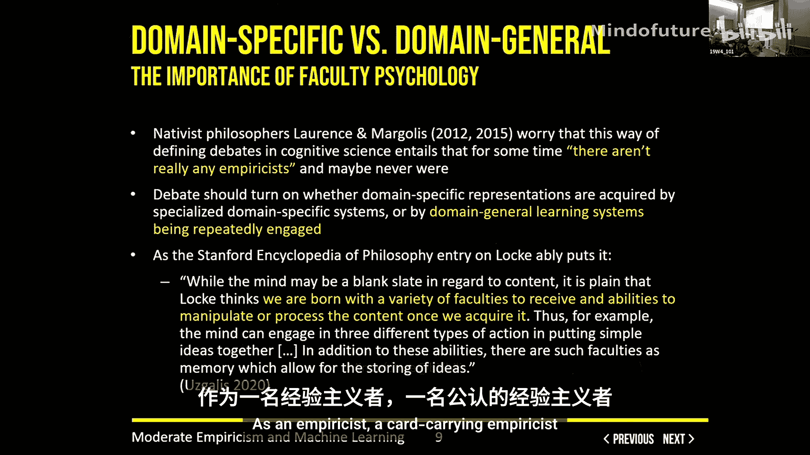

上一节我们介绍了这场辩论的宏观背景。本节中，我们来看看如何更有效地界定这场辩论。

我认为，将辩论简单地框定为“是否有任何东西是先天内置的”并不有益。一个更有用的框架是：**先天内置的知识或机制是“领域特定”的还是“领域通用”的？**

*   **领域特定**：指专门为处理某一类问题（如物理、语言、社会推理）而设计的、内置的知识或学习机制。
*   **领域通用**：指可以应用于多种不同领域和任务的内置机制或架构，如记忆、注意力、想象力。

历史上的主要经验主义者（如洛克、休谟）实际上都是“官能心理学家”。他们相信，心灵拥有一套领域通用的官能（如感知、记忆、想象、注意力），正是这些官能协作，从经验中提取出抽象概念。他们反对的是内置大量领域特定的“先天观念”，而非反对任何内置结构。

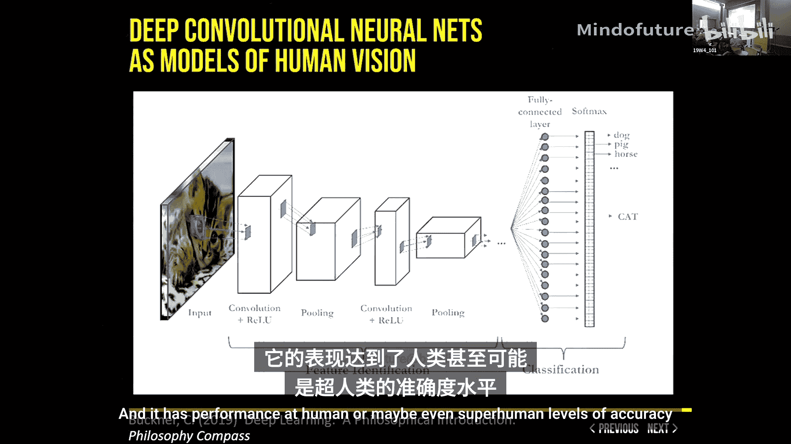

因此，当前深度学习的温和经验主义立场可以概括为：我们拥有由**领域通用的归纳偏置**所引导的**领域通用官能**（通过神经网络架构实现），这些官能足以从丰富的、结构化的环境输入中，提取出**领域特定的抽象知识**。

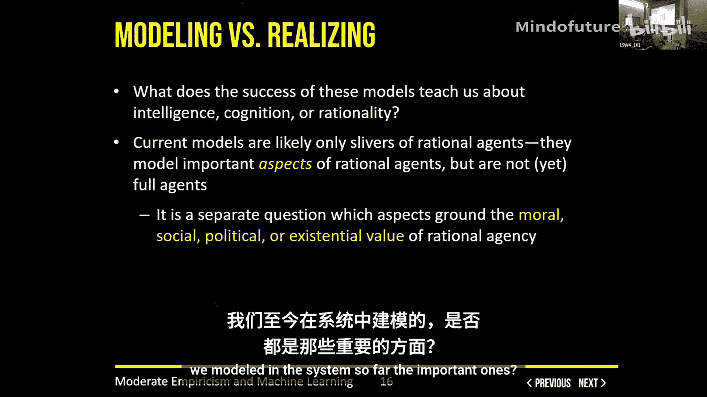

---

## 经验主义的核心：转换原则

那么，什么是温和经验主义的核心信条呢？许多人会引用休谟的“拷贝原则”：所有简单观念都源自与之对应的简单感觉印象。

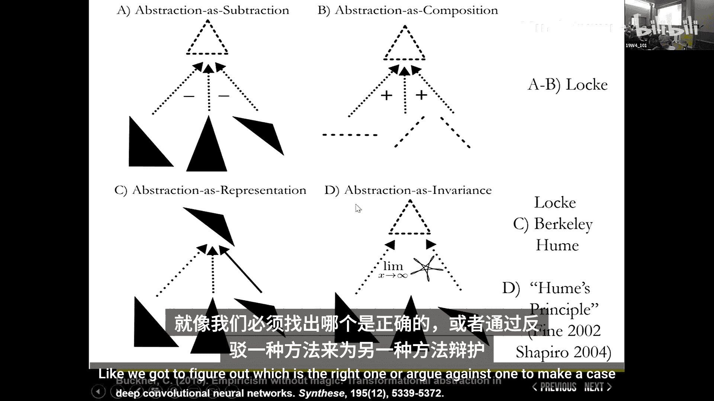

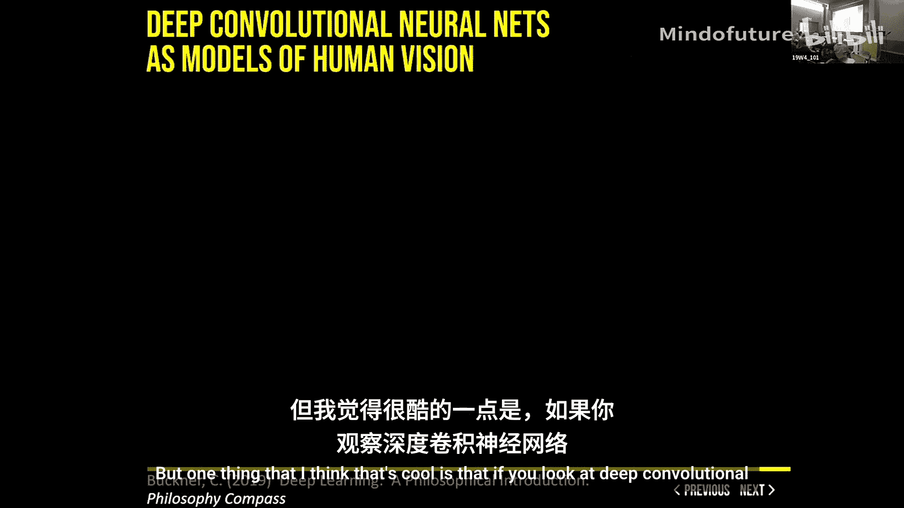

但这是一种过于简化的解读。休谟和其他经验主义者都允许心灵对感觉印象进行更复杂的操作。休谟曾写道：“没有什么比人类的想象力更自由的了……尽管它不能超越感官提供的原始观念储备，但它拥有无限的能力去混合、组合、分离和划分这些观念。”

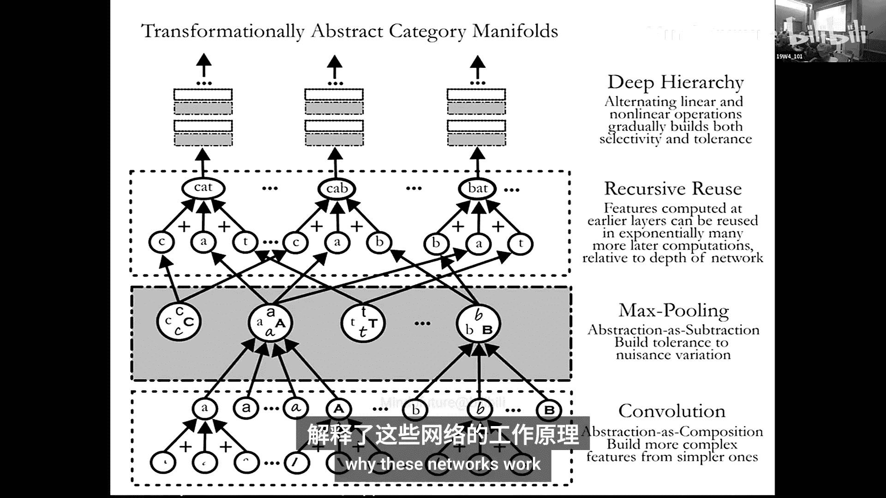

因此，我建议将经验主义的核心信条重新表述为 **“转换原则”**：
> 心灵的简单概念源于对感觉印象进行的、系统的、领域通用的转换。这些转换过程可以内置领域通用的归纳偏置。

深度学习模型，如卷积神经网络（CNN），正是这一原则的体现。它们通过卷积、池化等**领域通用的操作**，对原始感官输入（如图像像素）进行层层**转换**，最终形成能够识别物体（如“三角形”）的**抽象表征**。

---

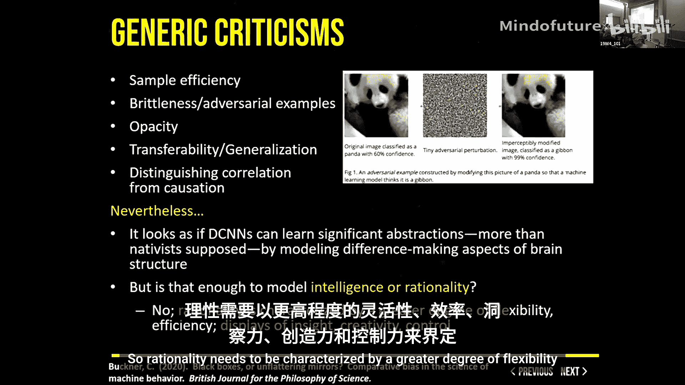

## 抽象的方法：从哲学到算法

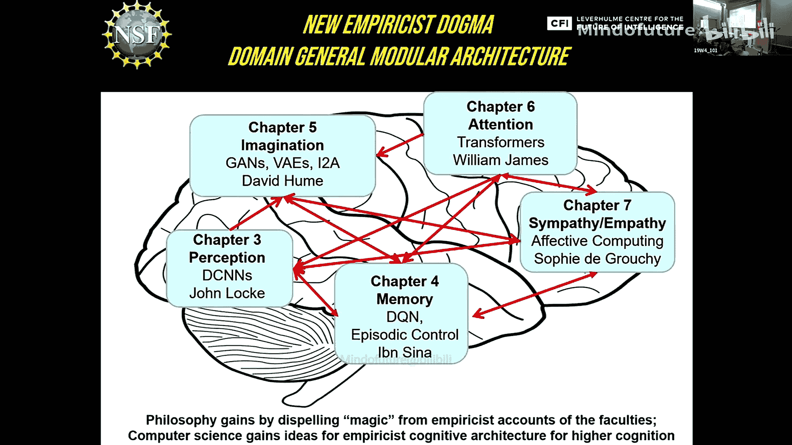

经验主义者不仅提出了抽象的必要性，还具体描述了抽象是如何发生的。有趣的是，这些哲学描述与深度学习中的操作有着惊人的对应。

以下是几种历史上提出的抽象方法及其在深度学习中的体现：

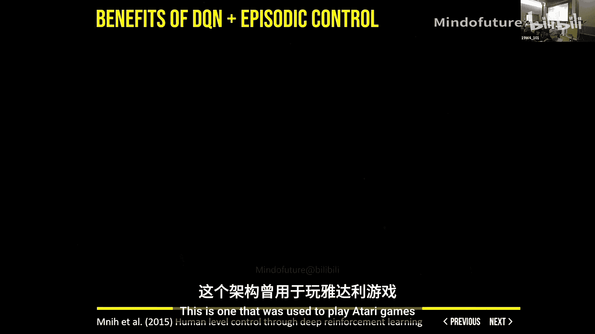

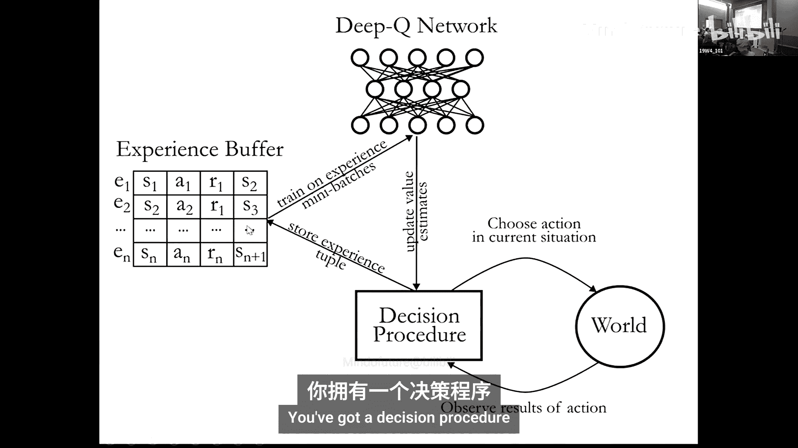

1.  **抽象即组合**：洛克认为，我们可以从简单的抽象组件（如“线”、“角”）组合成更复杂的概念（如“三角形”）。
    *   **深度学习对应**：卷积操作。它通过权重组合上一层的简单特征，来检测更复杂的特征。

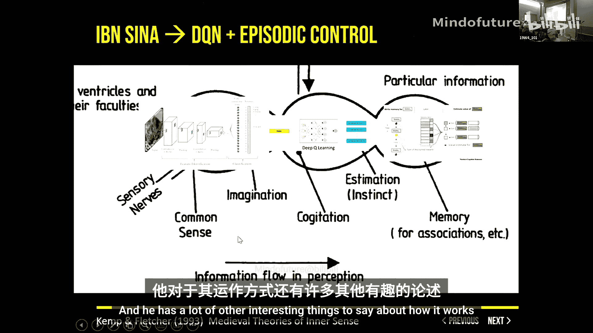

2.  **抽象即减除**：洛克提出，通过比较多个具体实例，减除它们之间的差异，保留共同点，从而得到抽象概念。
    *   **深度学习对应**：最大池化操作。它从同一特征的不同检测器中选取响应最强的，忽略具体的位置等细节变化，从而获得对特征更鲁棒的表示。

3.  **抽象即不变性**：休谟的方法，寻找在系统化变换下保持不变的性质。
    *   **深度学习对应**：深度层级本身。网络越深，其高层表征对输入的低层 nuisance variation（如位置、光照）就越不敏感，越接近于捕捉不变的本质特征。

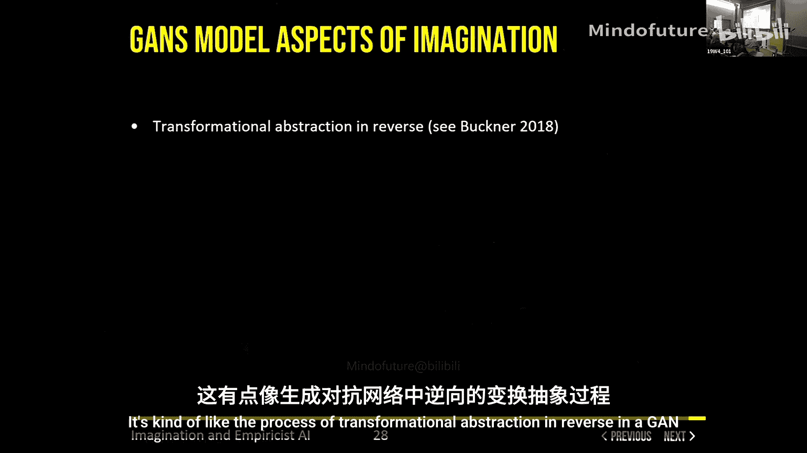

深度卷积神经网络的高效性，正源于它通过层级结构，连续地应用这些领域通用的操作，逐步构建出越来越抽象的表征。

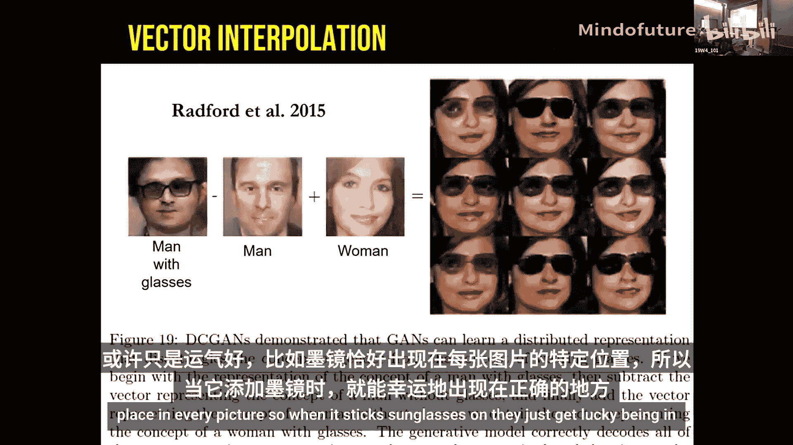

---

## 超越视觉：构建理性主体的认知架构

然而，仅凭视觉处理模型（如CNN）远不足以构成一个完整的理性主体。它们存在样本效率低、脆弱、难以进行因果推理等局限。

历史上的经验主义者同样担心这些问题，并提出了通过整合更多**领域通用官能**来构建完整认知架构的解决方案。这与我称之为 **“新经验主义信条”** 的策略不谋而合：**领域通用的模块化认知架构**。

其核心思想是：通过组合多个具有不同计算特性的、可训练的神经网络模块（每个模块对应一个领域通用官能），来弥补单个架构的不足，从而实现更灵活、高效、有洞察力的理性行为。

以下是几个官能如何帮助解决现有模型局限的例子：

*   **记忆**：存储成功的经验轨迹，用于离线学习和快速、情境敏感的决策。
*   **想象力**：组合新颖的想法，进行离线模拟学习，基于对未来或反事实可能性的想象做出选择。
*   **注意力**：实现更高效、有选择性的输入处理，将特征绑定为整体，近似变量绑定操作，协调跨模块的控制问题。

---

## 案例研究：记忆与想象力

让我们通过两个具体例子，看看如何将历史哲学思想与现代深度学习架构联系起来。

**阿维森纳的记忆与DQN**
中世纪哲学家阿维森纳发展了亚里士多德的抽象理论，他强调**记忆**不仅存储信息，还存储与之相关的情感价值（强化信号），这对于离线决策至关重要。这与DeepMind的DQN（深度Q网络）架构惊人地相似。DQN中的**经验回放缓冲区**存储了（状态，动作，奖励，新状态）这样的元组，使智能体能够通过离线回放进行更高效的学习，并避免灾难性遗忘。这正体现了阿维森纳所设想的、与情感价值绑定的记忆在理性选择中的作用。

**休谟的想象力与生成模型**
休谟面临一个挑战：我们如何形成从未经验过的概念（如“独角兽”）？他的答案是**想象力**——自由地组合和转换简单观念的能力。他认为想象力虽然自由，但依然遵循某些原则。今天，生成对抗网络和变分自编码器等**生成模型**，通过从抽象潜在空间反向解码，生成无数新颖、具体的图像，直观地展示了这种“逆向抽象”的过程。此外，通过向量插值（如 `[男人+眼镜] - [男人] + [女人] = [戴眼镜的女人]`）和结合Transformer来建模长程组合关系，现代模型正在实现休谟所设想的、更具组合性的想象力。

---

## 前沿与展望：注意力与社会认知

在某些方面，历史经验主义者的思考甚至走在了当前深度学习实践的前面，这为未来的研究提供了灵感。

**威廉·詹姆斯的注意力**
哲学家威廉·詹姆斯将注意力分为“有机调节”和“观念准备”。后者尤为有趣：它是由“与注意对象相关的观念中枢”发出的**预期性准备**。这本质上是一种**预测处理**观点：在注意焦点投向某物之前，想象力已经尝试猜测那里会有什么，并形成一个“心理模板”来接收外界印象。当前深度学习中的注意力机制（如Transformer的自注意力）主要关注重新加权现有信息。詹姆斯的观点提示我们，一个更完整的注意力模型应整合**由目标驱动的、基于世界模型的主动预测**，这可能通过将Transformer作为协调多模块的“内部独白”或“内心言语”来实现。

**亚当·斯密与德·古日希的道德情感**
在社交与道德认知方面，以亚当·斯密和索菲·德·古日希为代表的“情感主义”经验论者提供了富有洞见的路径。他们认为，道德推理的核心是一种从多视角进行的**同情共感模拟**，最终使人获得一种“公正的旁观者”视角。德·古日希特别强调，这种对他人的关怀始于婴儿与照料者之间最早的、前反思的情感互动。这启示我们，AI的社会认知研究不应过早聚焦于“错误信念 attribution”等复杂的心理理论任务，而应首先建立在**受控养育和课程学习**之上，让智能体像儿童一样，通过阶段性的社会互动，学习使情感反应对社会干扰变量保持鲁棒，逐步发展出社会性。

---

## 总结与启示

本节课中，我们一起学习了如何用“温和经验主义”的哲学框架来理解深度学习。

**核心总结如下：**

1.  **拒绝简单标签**：深度学习并非“新行为主义”或“极端经验主义”。主流研究体现的是一种承认内置**领域通用架构**的温和经验主义。
2.  **核心框架**：智能依赖于由领域通用归纳偏置引导的领域通用官能，从经验中提取领域特定知识。
3.  **历史是资源**：经验主义哲学家的细致工作（关于抽象、记忆、想象、注意力、社会情感的论述）能为AI架构设计提供丰富的灵感和概念框架。
4.  **未来路径**：实现更通用智能的关键，在于以**认知架构**的方式，系统性地整合多种实现不同官能的神经网络模块，并解决它们之间的协调与控制问题。

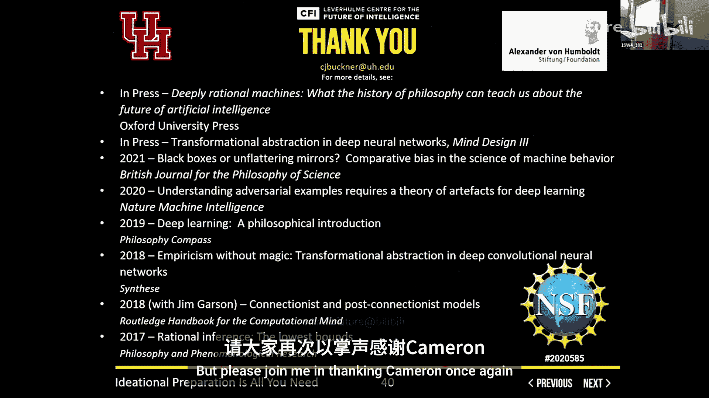

因此，当有人声称深度学习只是“斯金纳箱”的复刻时，我们可以更有底气地指出：它实际上延续并正在实现一个更为悠久、复杂且充满洞见的哲学传统——温和经验主义——的工程蓝图。对于AI研究者而言，主动深入地挖掘这份哲学遗产，或许能为构建更强大、更灵活的智能系统照亮前路。