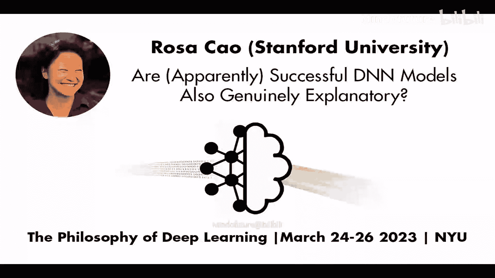
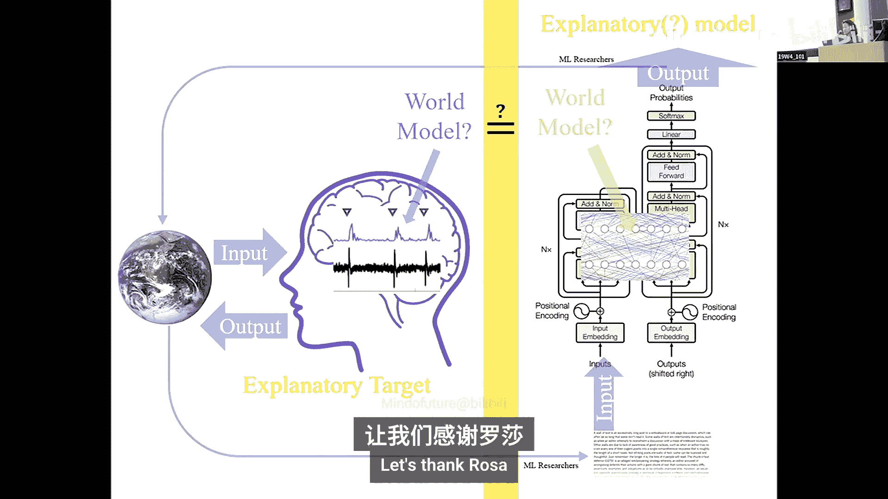

# 003：表面上成功的深度神经网络模型是否真正具有解释性？

在本节课中，我们将探讨一个核心问题：那些在行为上表现卓越的深度神经网络模型，其成功是否源于它们真正理解了世界，还是仅仅在模仿表面模式？我们将通过分析“内部表征”这一概念，来评估这些模型是否具有解释性。

## 概述：模型成功与解释性之谜

深度神经网络模型在许多任务上取得了显著成功。然而，这引发了一个哲学与科学交织的问题：它们的有效性是源于构建了关于世界的准确模型，还是仅仅在模仿某些不重要的方面？这个问题可以概括为：这些模型是“货真价实”的，还是在“假装”？

为了回答这个问题，一个自然的思路是借鉴我们理解人类心智的方式：检查其内部状态。如果深度神经网络拥有与我们相似、并扮演相似功能角色的内部状态，那么这至少是它们“货真价实”的初步证据。

## 模型与人类的相似性：以视觉和语言为例

上一节我们提出了通过内部表征来评估模型真实性的思路。本节中，我们来看看两个具体领域的例子。

### 卷积神经网络与人类视觉

卷积神经网络在图像分类任务上表现优异。研究发现，这些网络中间层的激活状态，可以很好地预测大脑中特定区域的神经活动。这令人惊讶，因为模型并未被训练去做神经预测。

**公式/代码示例**：假设一个CNN的某一层激活向量为 `A`，大脑视觉皮层的神经活动模式为 `B`。研究发现存在一个映射函数 `f`，使得 `f(A) ≈ B` 的预测精度很高。

这表明，在图像分类和产生与大脑相似的内部模式方面，CNN与人类“相关地相似”。然而，它们也未能解释许多人类视觉心理物理学的结果，说明这种相似性是局部的、不完整的。

### 大型语言模型与人类语言

这是昨天辩论的核心。我们可以从两个层面提问：
1.  **形式能力**：模型输出是否符合句法和语义约束？
2.  **功能能力**：模型输出是否尊重语用和情境约束？

答案通常是：有时符合，有时不符合。它们在形式能力上可能表现更好。因此，仅从行为看，语言模型与人类的相似性也是“部分是，部分不是”，并非简单的二元答案。

如果我们要问更深层的问题——它们是否像我们一样拥有**世界模型**来结构化其行为——就需要考察其内部表征。

## 解释性项目的框架：从目标到模型

为了系统性地评估模型的解释性，我们可以建立一个框架。

在框架的左侧，是我们的**解释目标**：人类接收感知输入，产生行为（包括语言），其大脑神经活动被认为是这些能力的基础，并且我们相信这些神经活动对应着某种**世界模型**。

在框架的右侧，是我们的**候选解释模型**：例如一个语言Transformer，它也有内部激活。我们要问的是：这些内部激活是否构成了它的某种世界模型？

如果答案是肯定的，并且两个系统的世界模型是相同的，那么这个人工智能模型就是解释目标的一个良好解释模型。如果世界模型不同，结论则需要更细致地分析。

## 表征的困境：我们如何知道某物拥有内部模型？

上一节我们建立了解释性评估的框架，其核心在于判断模型是否拥有“世界模型”。本节中，我们深入探讨这个核心概念本身：我们究竟如何断定一个系统（无论是人还是机器）拥有内部表征或世界模型？

一个直觉的回答是：观察其行为。例如，**规划行为**是拥有内部模型的一个强有力行为标志。在认知革命中，我们正是通过某些特征性行为来推断其他生物拥有内部模型的。

但这似乎陷入了循环：我们想用内部表征来判断模型是否“真”的理解，但判断内部表征是否存在却又回到了行为。行为更像是**诊断工具**，而非构成性条件。我们诉诸表征，是希望获得一种捷径，来预测系统在新情境下的行为，而不必穷尽所有行为测试。

那么，除了行为，我们还应该看什么？主要有两种进路：

1.  **应用自然化的表征理论**：例如，根据信息携带或功能角色来赋予内容。但这种方法常常无法给出确定的、公认的内容赋值。
2.  **考察科学实践**：看神经科学家和认知科学家在实际中如何为大脑状态分配表征内容。他们通常依赖两个标准：
    *   **可解码性**：能否从内部状态中解码出关于环境或任务的信息。
    *   **可操纵性**：能否通过操纵该内部状态，按照表征理论预测的方式改变系统的行为或输出。

## 科学实践中的表征：以探针为例

在神经科学实践中，“探针”是我们探测和解读内部状态的关键工具。

*   **早期**：使用钨丝电极，发现了初级视觉皮层中的“边缘检测器”。
*   **现代**：使用Neuropixels等多触点电极或fMRI，获取海量数据，再从中解码功能相关信息。
*   **人工智能**：在Transformer中，“探针”可以是一个需要单独训练的解码器，用于识别内部激活的模式与任务中有意义元素的对应关系。

这些例子表明，我们能从系统内部解码出的模式，**相对于我们所使用的探针**。更复杂的探针能发现简单探针无法发现的模式。但这也带来风险：过于复杂的探针可能“发明”出本不存在的模式。

因此，即使进行了严格的对照实验，也不存在完全独立于探针的、“客观”的模式存在事实。只有相对于我们所用工具的、对我们而言显著的模式。

## 表征的实用主义观点

鉴于上述事实，在将表征归属于某个系统时，我们必须考虑一些实用因素：

1.  **因果参与**：该活动模式必须与感兴趣的行为有因果关联。
2.  **表征层面的可操纵性**：应能通过操纵该活动模式来操纵其表征内容，并产生符合表征理论预测的结果。

结合“模式是相对于特定探针被发现”这一点，我们得出的结论是：**一个系统是否拥有表征、拥有何种内容的表征，是相对于所使用的探针以及我们寻找表征的“解释目的”而言的**。

这听起来有些“怎么都行”。为了收紧标准，我们可以限制允许使用的探针类型（例如只允许线性解码器），或进行严格的对照实验（例如确保探针无法从明确不具备该属性的网络中解码出信息）。一个有用的启发是：那些类似于大脑中**下游处理过程**的探针，对于解释行为更具科学意义。

无论是物理探针、机器解码器还是大脑的下游处理过程，其本质是相同的：**它们的目标都是将神经活动“解读”或“翻译”为具有表征意义的内容**。解读的成功与否，决定了相对于该解码器而言，表征是否“真实”存在。

这一观点使得表征看起来不如最初想象的那么“客观”和“实在”。它也可能削弱我们希望通过表征在不同系统间进行解释性概括的初衷——如果每个系统都需要完全不同的解码器才能发现“相同”的表征，那么这种概括的科学价值就会降低。

## 案例研究：奥赛罗游戏Transformer

尽管存在上述复杂性，该框架仍能给出有启发性的分析。以下是一个来自GPT类模型研究的具体案例。

研究人员训练了一个模型来预测奥赛罗游戏对局的文本续写。他们发现，当模型成功预测时，可以其内部状态中解码出对当前棋盘状态的表征。

**关键发现**：
1.  需要使用**非线性探针**才能较好解码，线性探针效果不佳。
2.  与随机网络相比，训练好的网络能用非线性探针解码出更准确的棋盘状态，这构成了一个有效对照。
3.  他们**操纵**了这些被认为是棋盘表征的内部状态，发现模型对下一步落子位置的预测也随之改变，满足了可操纵性标准。

这个案例支持了一种观点：模型在变得足够擅长预测任务的过程中，**免费地**获得了对世界的表征。成功并非凭空而来，其内部必然有追踪任务关键信息的状态。

## 成功 vs. 真实：一个古老的哲学争论

上一节的案例似乎支持“成功蕴含真实”的观点。本节中，我们将其置于更广阔的哲学背景下来看。

对深度模型的质疑（如“随机鹦鹉”、“只是下一个词预测”、“只是曲线拟合”）让人联想到科学哲学中的古老争论：

*   **工具主义 vs. 实在论**：理论的成功是否意味着它为真？
*   **现象模型 vs. 解释模型**：模型是仅仅重述数据，还是揭示了产生现象的机制？
*   **行为主义 vs. 认知主义**：行为背后是否真的有内部认知状态？
*   **基于模型的强化学习 vs. 无模型强化学习**：智能体内部是否有可独立操作的世界模型？
*   **作弊 vs. 真正理解**：在考试中，背诵所有答案与真正理解知识有何区别？

我认为，在这些对比中，**界限并非泾渭分明**。如果你“作弊”得足够好——记住了所有可能的考题答案——你实际上已经拥有了与“理解”所赋予的同等事实性能力。同样，通过无模型强化学习穷尽所有状态-行动组合所获得的策略，在行为上与拥有完整世界模型的智能体等效。原则上，你也可以从其内部状态中解码出环境信息。

关键在于效率、可更新性以及内部状态的**形式**。拥有清晰、优雅结构的内部模型通常更高效、更具概括性，但行为上的成功本身并不绝对地区分这两种情况。

## 重新审视问题：从二元对立到连续谱

让我们回到最初的框架：聊天机器人是人类语言使用者的良好解释模型吗？

与其在“是”（真正具有解释性）和“否”（完全不像）之间做二元选择，不如将其视为一个**连续谱**。正确的回答通常是：它们在**某些方面**是相似的，解释了**某些部分**。

我们应该问更细致的问题：
*   **哪些方面相似？** 两个系统的内部状态共享哪些功能角色？
*   **哪些内容共享？** 它们的世界模型是否相同？是否都为真？
*   **模型对其自身任务是否良好？** 它的世界模型是否支撑了其在训练任务（如词语预测）上的成功？
*   **模型的目的与我们的目的是否一致？** 我们说话的目的不仅仅是预测下一个词。

因此，我们可以有意义地将世界模型归属于人工智能系统，理由与我们将其归属于动物或自身相同（基于行为及与行为系统相关的内部状态模式）。但这不意味着它的世界模型与我们相同，或它的词语意义与我们完全一致。正如维特根斯坦所说，如果狮子会说话，我们也无法理解。一个具有不同兴趣、以不同方式划分世界的系统，即使用着我们的词语，也可能在以迥异的方式使用它们。

## 我们应该问什么？替代性问题总结

本节课中，我们一起探讨了深度神经网络模型的解释性问题。我们绕过了“它们是否真正理解？”这种二元问题，转而支持一系列更富成果的替代性问题：

1.  **模型捕捉了解释目标的哪些方面？** （例如，CNN捕捉了人类视觉能力的一小部分但很重要的方面。）
2.  **模型在多大程度上捕捉了这些方面？** 它对试图解释的数据的方差解释度如何？
3.  **在何种假设下（包括关于何为表征的假设）？**
4.  **模型的稳健性、泛化能力和效率如何？**

这些问题本身在评估一个模型**作为模型**（而非作为对人类威胁或复制品）的价值时，就具有独立的科学意义。

---

