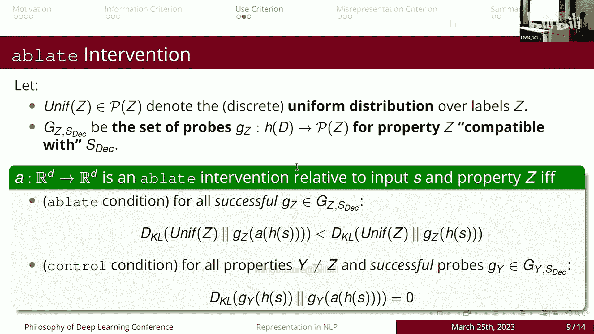
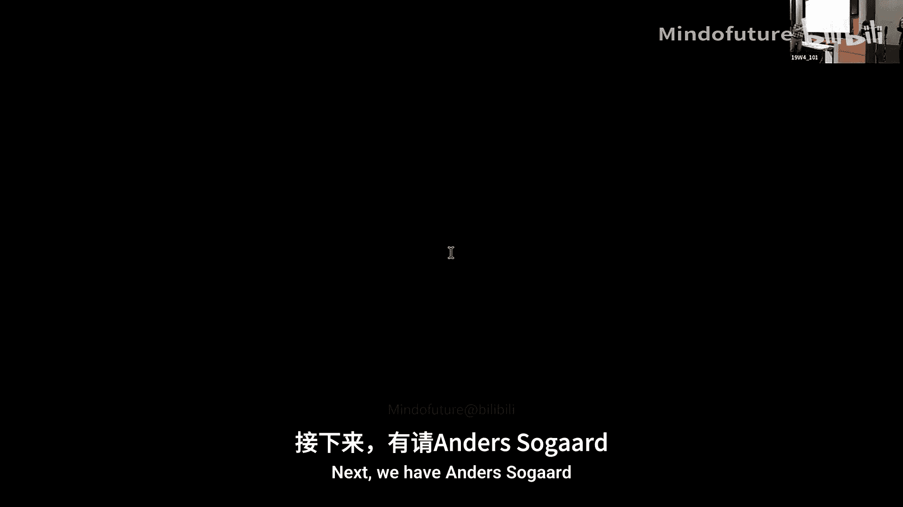
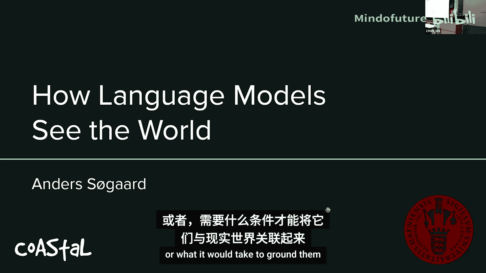
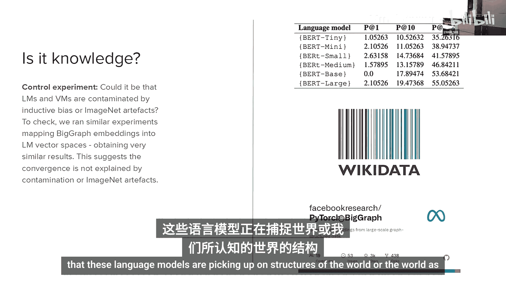
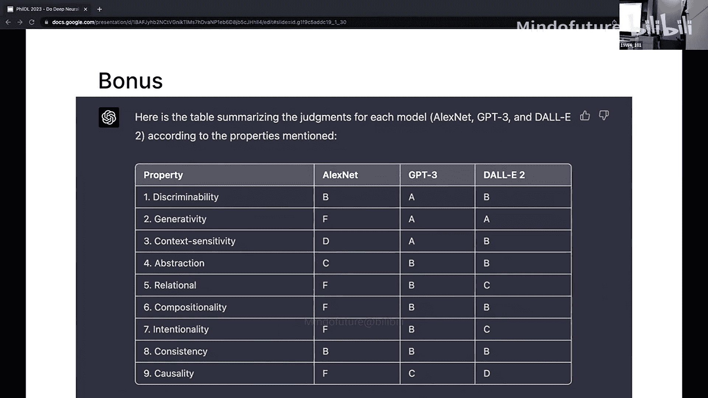

# 004：深度学习系统中的表征

## 概述
在本节课中，我们将探讨深度学习系统中的表征问题。我们将从最简单的词嵌入模型（如Word2Vec）入手，逐步分析如何为神经网络构建一个关于表征的理论。我们将讨论目的语义学在理解神经网络表征中的应用，探索如何通过干预和探测来验证表征的存在与内容，并思考深度学习模型是否拥有概念。通过本次课程，我们希望为理解复杂深度学习系统的内部表征提供一个初步的、可操作的理论框架。

## 1. 目的语义学与词嵌入模型

上一节我们概述了课程目标，本节中我们来看看如何为最简单的神经网络模型——Word2Vec——构建一个基于目的语义学的表征理论。

我们的第一位演讲者是来自奥斯陆大学的芬顿·马洛里。他通过Zoom远程参会，演讲主题是“神经词嵌入的目的语义学”。

首先需要明确的是，Word2Vec只有三层，并非一个真正的“深度”学习系统。但本次演讲旨在为一种方法论上的渐进主义辩护：我们尝试为最简单的系统发展理论，然后逐步扩展以处理更复杂的表征。这有助于我们理解更复杂计算设备带来的新功能，也有助于理解该领域的历史，因为许多近期神经语言建模工作都始于Word2Vec。

那么，为深度神经网络（特别是大语言模型）构建表征理论意味着什么？我们假设网络表征的内容存在客观事实，这正是我们想要研究和理解的对象。对此感兴趣有几个原因：如果你关注通用人工智能，就需要某种标准来区分人工智能真正的原始意向性与我们仅仅归因于它或误解的内容；如果你认为某种形式的语义内在论是正确的，并认为我们对大语言模型生成文本内容的解释应受模型内部表征的约束，那么你就需要为这些内部表征建立一个理论。

关于表征理论，我们大致可以提出三个要求：第一，它能够解释表征在系统操作中所扮演的角色；第二，它能够约束我们归因于模型的表征内容，避免过度解读；第三，它能够统一当前文献中存在的各种探测方法，如完形填空、探测分类器、彩票假设和注意力头剪枝等。这些方法都试图探究系统内部的表征，而表征理论应能说明这些方法如何共同揭示同一事物。

接下来，我将假设一种最小形式的目的语义学。如果你不喜欢目的语义学，或者认为它不适合理解人类认知或中枢神经系统的表征，这没关系。我首先将为目的语义学在简单神经网络中的应用进行辩护。其次，我不会声称目的语义学为人类或任何机器的语言输出提供了正确的解释，但我认为它可以阐明Word2Vec中的一些现象。我不会拘泥于目的语义学传统中的任何特定发展，而是尽量保持这些主张的普适性和广泛性。

我将提出一个主要基于消费者的目的语义学解释。但如果你喜欢尼克·希尔的非常目的语义学或卡伦·尼安德的信息目的语义学，那也很好。该领域的多样性正是将其作为理解这些系统表征框架的一个优点，因为目前尚不清楚一个框架能否捕捉我们拥有的每一个可能的语言模型。

为了本次演讲，我将把目的语义学简化为三个一般性主张（G1-G3），以及一个与Word2Vec特别相关的具体主张。

以下是三个一般性主张：
*   **G1**：系统包含产生和消费表征的机制。
*   **G2**：这些表征的内容至少部分地由这些机制的功能决定。
*   **G3**：此处的“功能”需要在某种广义的进化意义上理解，即存在一个随时间进行选择的过程。

我认为与Word2Vec特别相关且略有争议的具体主张是：一些简单系统拥有一种鲁斯·米利肯称之为“推拉式表征”的形式。对于这种表征，我们的描述性内容和指令性内容概念并非真正可分离。指令性内容指的是发送给消费者系统的指令或命令信号，如蓝图；描述性内容指的是该指令或命令成功的条件。文献中的经典例子是海鸥的叫声，既表示“过来”也表示“这里有食物”，它将指令和描述融入了同一内容。米利肯的一个有趣建议是，只有在更复杂的系统中，我们才能真正将这两者分开，拥有纯粹描述性的表征。我希望在演讲结束时，能指出当前深度学习研究如何阐明这一点。

现在转向Word2Vec。我需要首先明确我们试图回答的问题：什么是产生和消费这些表征的机制？我们希望目的语义学能阐明这一点。这些机制的功能是什么？我们能否诉诸这些功能来描述对系统所表征内容的约束？该框架能否解释关于系统的任何进一步语义主张？这最后一个问题更接近我的核心关切。所谓“进一步语义主张”，我指的是在马尔的框架中，计算层面解释的“为什么”部分。即，在我们确定了网络正在计算的数学函数之后，我们能否说明为什么计算的是那个函数？这就是我所说的进一步语义主张。

现在来看Word2Vec。最简单的Word2Vec设置是一个连续词袋模型，它接收一个单词输入，任务是在数据集中预测下一个单词。Word2Vec有三层：输入层接收来自词汇表的一个独热编码向量；然后通过第一个权重矩阵M处理，产生一个嵌入向量，投射到隐藏层；这个单词嵌入随后被馈送到我们的消费者系统M‘，M’在应用softmax函数后输出一个概率分布。

这里需要指出两点语义主张。首先，我们有两个机制：生产者M和消费者M‘。我们需要理解它们的演化。其次，将softmax的输出称为概率分布本身就是一个语义主张，是关于输出如何指涉世界的主张。许多东西加起来等于1，但这并不意味着我们应该将所有这些东西都解释为概率分布。Softmax如今在机器学习中无处不在，但我们通常不称其输出为概率分布。这个进一步的主张需要被证明，我认为表征理论应该在解释如何证明这一点上发挥作用。

其次，梯度下降实际上满足了目的语义学对复制过程的标准条件：在每一阶段，反向传播过程中改变的权重与之前相似，它们反事实地依赖于之前的状态，并且更新以目的论的方式根据自然法则（或本例中的更新函数）发生。

在反向传播过程中，这个输出（概率分布）与真实数据进行比较，计算两者之间的距离，反馈回来，系统中的权重被改变。结果，M和M‘改变了它们的内部结构，以便能够更有效地执行其工作。因此，我们有两个机制正在经历一个进化过程，以产生能让消费者机制更有效执行其任务的表征。

关于最终得到的嵌入空间，我们可以提出许多表征主张。以下是五种常见的类型，它们似乎对应于不同层次的数学复杂性或抽象性：
*   **单词嵌入**：最终得到一组向量，似乎对应于词汇表中的项目。可以计算这些向量之间的余弦相似度，这似乎类似于语义相似性。这也是该系统最初被开发的原因。
*   **向量运算**：Mikolov在最初的Word2Vec论文中发现，这些向量可以进行加减运算。经典例子是，取“国王”的向量，减去“男人”的向量，加上“女人”的向量，最终得到的位置类似于“女王”的向量。因此，可以说它在另一个层面上表征了它未被训练去发现的概念关系。
*   **尺度表征**：可以使用线性变换来捕捉尺度。例如，可以找到反义词在嵌入空间中的超平面，并找到一个线性变换将向量空间中的实体映射到该线上，从而似乎表明系统也在表征尺度。
*   **PCA映射**：可以将这些向量（例如300维）通过主成分分析降维到二维。例如，询问欧洲城市在这个二维向量空间中的位置，会得到类似欧洲地图的结果。我们是否想说词嵌入模型表征了这一点？表征理论应该给我们答案。
*   **线性探测**：可以在这些向量上运行线性探测器，看看它们是否跟踪诸如数字性之类的属性。

这些都是我们可能在Word2Vec中发现的不同类型的表征内容。接下来，我们需要问：根据目的语义学这样的系统，这些是意向性表征吗？什么是给出系统的目的语义学分析？我们将从进化角度考虑它，并问：什么被产生了？为什么被产生？谁产生的？

我们从输出层开始，像消费者目的语义学家那样。在输出层，机制M‘生成一个概率分布。这就是我们之前关于softmax问题的答案：凭什么我们可以说它是一个概率分布？我们可以说它是一个概率分布，因为机制M‘已经进化（或被改变）以产生概率分布，而这正是在反向传播过程中它所被评估的对象。知道了这一点，我们就达到了有趣的“推拉式”层面。单词嵌入本身似乎同时具有指令性和描述性内容。在指令性层面，单词嵌入似乎为我们的消费者机制M‘提供了生成概率分布的指令或蓝图。这就是指令性内容，它告诉后续系统要做什么。但它也具有描述性内容，因为最终在整个过程中，机制M已经进化，以产生能更好地与数据中实际分布相符的分布。因此，它具有跟踪数据中分布的描述性内容。至于独热编码层，我认为这是一个我们很少问的愚蠢问题：我们为什么不说词嵌入表征了它们的独热编码？深层原因在于，词嵌入像德里茨基多年前强调的许多表征一样，超越了这些最接近的刺激，以锁定它们在世界中所表征的东西。我认为这是一个经验性问题，但在某种意义上它们是否表征那个编码层，我们没有理由相信它们确实如此，这也给了我们更多理由相信它们表征了更远端的东西。

如果这是正确的，那么我给出了一个非常保守的结果。我列出了五种我们可能归因于像Word2Vec这样的系统的表征内容，然后我说，实际上所有被表征的只是数据中的分布，至少目的语义学框架似乎向我们暗示了这一点。在隐藏层，我们有我们的词嵌入，它们是指令，用于产生我们的那种表征。因此，它们也拥有某种描述性内容，即数据中的实际分布。

这个结果相当保守，但我认为它开启了一个过程。我们可以开始进一步追问：一个语言模型需要具备什么条件才能拥有纯粹描述性的表征？哲学家提出猜想时大家总是喜欢的，我想以一个猜想结束：系统在什么时候从仅仅表征数据中的分布，转变为表征我在前两种可能的表征类型（即余弦相似性和内部概念结构）中提到的关系？我认为，当系统拥有像注意力头这样的东西时，它就从拥有纯粹表征分布结构的推拉式表征，转变为表征更丰富的结构。是否正是因为有了注意力头，才使得表征中存在的进一步结构变得可利用？

## 2. 探测、使用与错误表征

上一节我们探讨了如何用目的语义学分析简单模型，本节中我们来看看如何通过探测和干预来更具体地验证和操作化神经网络中的表征主张。

我是斯坦福大学符号系统专业的二年级博士生。今天我将展示一个更大项目的一小部分，这无疑是对更大项目的有损压缩。该项目的目标基本上是提出一些（希望是）合理的标准，用于评估自然语言处理中的表征主张，然后朝着操作化这些标准迈出第一步。这是一种哲学家的操作化，因此仍然非常理想化。

首先需要澄清，这里存在一种在自然语言处理中无处不在的、更“薄”的表征意义，即模型的任何中间状态都算作表征。我使用的不是这个意义，而是哲学和认知科学中使用的意义，仍然相当“薄”，属于亚个人层面的表征。

假设我们正在一个语法可接受性任务上测试一个模型。模型接收句子作为输入，输出它是否合乎语法。假设模型正在处理以下输入：“John dances waltzes across the room.” 这是合乎语法的。我们可以想象两种情况：一种是模型判断正确，另一种是模型判断错误。当代模型可能会判断正确。如果它判断正确，我们可能想解释为什么它正确，我们会说类似“它表征了输入句子的依存结构”这样的话。如果它判断错误，我们可能会思考为什么人类会判断错误，我们会说：“它错误地表征了单词‘waltzes’的词性，它以为‘waltzes’是动词，但在这里实际上是名词。” 关键不在于这些解释是否真实甚至可能真实，而在于它们预设了一种表征概念。因此，我关注的问题是：模型的某个组件表征输入的一个属性，这意味着什么？

我考虑的一般设置如下：我们有一个系统S执行任务D。为简单起见，我将任务视为一组输入及其相关的输出优劣度量（例如损失函数）。抽象图景如下：输入被编码为中间激活（我称之为D维向量），然后由下游系统S_dec映射到输出。更具体地说，系统可以是Transformer，输入可以是令牌ID列表，中间激活可以是残差流在某一层和上下文窗口中某一位置的值，输出可以是令牌的概率分布。

关于术语的两个说明：当我们处理构成任务的输入时，我们会得到每个输入的中间激活，这将导致跨任务的一个激活模式，我记为H_D。我们对属性感兴趣，我将属性视为一个有限的标签集合。属性的例子可以是词性标签、依存头、句子级属性（如句子的主语是单数还是复数），甚至是更高级的语义属性（如句子主语的性别）。我假设每个输入都与一个关于属性标签的黄金标签分布相关联。

我将假设，在这种设置下，表征主张的自然载体是激活模式H_D。我将简要给出三个标准，这些标准似乎与评估该领域的表征主张相关。我打算让这些标准能够以多种不同的方式充实表征，但它们确实具有一种广义的目的语义学色彩。

以下是三个标准：
*   **信息标准**：激活模式应承载关于该属性的信息。
*   **使用标准**：它所承载的关于该属性的信息应被下游系统用来执行任务。
*   **错误表征标准**：这种解释应允许激活相对于某个输入错误地表征该属性。正如我们想用表征来解释成功，我们也想用错误表征来解释失败。

现在简要介绍探测范式。设置如下：输入映射到激活，再映射到输出，输入还与属性标签的黄金标签分布相关联。探测时，我们尝试训练一个有监督的分类器，直接从中间激活预测黄金标签分布。我们使用标记对来完成此操作。分类器接收一个激活并预测标签上的分布。如果分类器在某个测试集上实现了较低的交叉熵损失，我们就说它是成功的。这自然提出了一种操作化信息标准的方法：我们可以训练一个针对该属性的成功探测器。这是一种相当廉价的成功标准。我们可以用互信息之类的东西使其更正式。

接下来，思考如何理解“使用”和“错误表征”要困难得多。我想说的是，理解它们的正确方式是从因果角度思考。我们想思考，如果我们能对激活进行正确类型的干预，并测量其对下游系统的影响，这将是一种测试使用主张的方法。那么，正确类型的干预是什么？直觉是：我们想对具有某个输入的激活进行干预，以剥离它所承载的关于该属性的信息，同时固定下游系统使用该信息的方式，但希望在其他方面保持不变，相对于下游系统如何整体解码激活模式。如果我们进行了这种干预，并且系统确实在使用该信息，我们预计它在任务上的性能会下降。当然，这个图景的问题在于，下游系统根本没有明确解码激活模式中的信息。它是在隐式地与信息交互。我们很希望能将下游系统写成类似探测器和其他模型的组合，但事实并非如此。在某种意义上，这正是整个探测范式的动机：我们使用探测器作为下游系统可能对信息所做事情的代理。

我们可以利用这一见解来操作化手头的干预。使用探测。一些术语：集合G_Z,S将是与下游系统兼容的、针对某个属性的探测器集合。这有点模糊，我设想的是类似下游系统可以实现这些探测器的东西。为了更具体，如果下游系统是线性的，我们希望这个集合只包含线性探测器，我们不希望它们有非线性，因为那样下游系统就无法做它们所做的事情。

干预只是一个在R^D上的函数。我说它必须满足两个条件：第一，相对于任何与下游系统兼容的解码信息的成功方式，这个干预应该将这些解码器（探测器）的预测推向属性上的均匀分布。第二，它应该保留其他属性其他解码器的预测。这个“保留”我们可以用KL散度来操作化。

定义了这种干预后，我们可以给出使用标准的一个自然操作化：我们有一个这种类型的干预，将其应用于激活，如果下游系统确实在使用关于该属性的信息，那么它的输出相对于任务应该会下降。

如何理解错误表征？我想以与“使用”非常相似的方式来理解这一点。我们通过对激活应用正确类型的干预，然后检查它们对整个系统行为的影响，来测试关于错误表征的主张。直觉上，在错误表征的情况下，下游系统看到激活并将其解释为关于属性标签分布的错误信息。因此，理论上，如果我们能进行干预，使下游系统相信关于属性标签分布的真实情况，那么这将提高它在任务上的性能。当然，这只是一个直觉，因为下游系统根本不做类似这样的事情。但也许我们可以使用探测器作为下游系统可能与信息交互方式的代理。

我们再次有这个真实标签分布，然后可以定义我称之为“纠正干预”的东西。纠正干预基本上与“混淆干预”相同，只是我们不满足将成功探测器的预测推向均匀分布的混淆条件，而是希望将预测推向真实标签分布。同样，我们希望控制其他属性和其他探测器。显然，以这种方式控制是极其困难的。

这样，就提出了错误表征标准的一个实际操作化：我们进行这种纠正干预，将其应用于激活，然后观察系统性能是否相对于任务有所改善。想法是，如果确实改善了，这就提供了证据，表明系统（具体来说是组件H_S）错误地表征了该属性。

总结一下：我们可以通过能否训练一个成功的探测器来思考表征；我们可以应用正确类型的干预来测试使用；我们可以应用正确类型的干预来测试错误表征。我提出的这个解释存在一些明显问题：首先，我们应如何理解与下游系统兼容的探测器集合？这里有一篇关于探测器选择的大量文献。其次，主要问题与控制各种属性有关。我们可以讨论如何开始思考这个问题。我认为文献中有一些例子近似于我建议的解释。

## 3. 语言模型与视觉模型的表征对齐

上一节我们讨论了如何验证神经网络内部的表征，本节中我们来看看不同模态的模型（如语言和视觉）是否学习了关于世界的相同结构，以及我们如何通过对齐它们的表征空间来探索这一点。

本次演讲是对Bender和Koller一篇论文中思想实验的直接回应。在他们的思想实验中，主人公是一只章鱼，它通过水下电缆监听两个荒岛上两个人的对话。这只章鱼拥有一个完美的语言模型，正在监听并训练以模拟其中一人。在某个时刻，电缆被切断，章鱼开始扮演其中一个人。Bender和Koller感兴趣的是，这在极限情况下是否可能，以及如果可能，是否构成理解。

我不打算讨论论文的那部分，因为那个思想实验存在很多问题。我将讨论该论文中第二个更具体的思想实验。Bender和Koller写道：想象训练一个语言模型只使用文本（没有相关的说话者意图指示），并想象该系统还提供了大量未标记数据，你可以单独训练这些数据，但文本和图像之间没有联系。对于图像数据，训练任务可以是任何只涉及图像的任务。然后他们想象在测试时，我们向系统呈现带有照片的文本，问题是关于图像的，例如“图片中有多少只狗在跳？”或“图片中有多少只狗？”。他们说这显然不可能，因为模型从未见过文本和图像之间的联系。我想说，这是一个经验性问题。从这两者被单独训练的事实，并不必然得出能够回答这类问题的结论。我想提出一个实验，有充分理由相信在不久的将来我们就能做到这一点。目前还不能完全无监督地做到，但只需极少的监督就可以，而且应该很快就能实现。

我的灵感来自无监督机器翻译领域的工作。通常，当你进行机器翻译时，你尝试学习从一种语言到另一种语言的函数，并使用人类翻译的监督。但在无监督机器翻译中，你尝试在没有人类翻译参与的情况下做到这一点，即在德语和英语之间没有链接的情况下。那么，这怎么可能呢？人们做的是查看语言模型的词嵌入。你训练一个德语语言模型和一个英语语言模型，然后查看词嵌入空间的几何形状。基本上，你将词汇表绘制为点集或点云，并观察它们的形状。因为事实证明，至少对于最近相关的语言，词汇表具有相似的形状。你可以将这些视为漂浮在空间中的云，它们具有几何形状。现在你可以缩放、旋转和平移这些云，使它们以最佳方式对齐，就像在计算机视觉中进行点集配准一样。事实证明，如果你这样做，那么至少对于相关语言，对齐非常精确，你可以从这些对齐中提取双语词典。因此，在经验上，大约四分之三的单词会紧挨着它的翻译等价词。

我想将这一想法转移到Bender和Koller的例子中：在栅栏的一边有一个语言模型，另一边有一个计算机视觉模型，并询问是否可以对语言模型和计算机视觉模型做同样的事情。为了启动翻译，你需要更多一点，因为此时你只有逐词翻译。你需要让语言模型重新参与进来，在两个方向上进行共同训练以使事情启动，但我们可以忽略这一点，因为我们目前只需要建立链接。

无监督机器翻译文献中有一个重要的教训：使用生成对抗网络等算法以无监督方式进行对齐是可能的，前提是空间或几何形状非常相似。这意味着，如果我们能做到让超过一半的单词最终紧挨着它们的翻译等价词，无监督算法往往能成功；否则，它们往往会失败。这是因为如果对齐问题没有明显的解决方案，你只会陷入许多局部最优解。但似乎存在一个阈值，大约一半的单词与它们的翻译等价词对齐，然后无监督算法就能达到与有监督或最小监督解决方案一样好的效果。

基本上，我们按照Bender和Koller的指示去做：我们有一堆图像和一堆文本，假设我们有一个视觉编码器和一个文本编码器，两者之间没有交互。我们得到图像嵌入和词嵌入，查看空间，然后基于最小监督进行对齐（例如，可能100个单词）。然后我们在保留数据上评估我们是否从这种对齐中挑选出了正确的东西。这是一种用于双语词典归纳的最小监督设置，只不过我们谈论的是图像和单词。

我们对许多不同的模型进行了这些实验。对于最好的模型（如GPT-2 Large尺寸的模型），大约10%的单词（或图像）最终紧挨着恰好是图像网络数据中标签的单词。如果我们评估更宽松一些，只问单词是否在10个邻居内（这大致对应于一个同义词类，例如对于“car”，可能是“car”、“automobile”、“vehicle”等），大约30%的单词能做到。如果我们更宽松，只问正确的单词是否在100个邻居内（这大致对应于细粒度语义类别），我们看到大约60%的单词能做到。因此，对于60%的单词，我们可以用极少的监督判断图像的语义类别。

这些图表中最重要的现象是我们看到了收敛：模型越大，结果越好；视觉编码器越大，结果越好；语言模型越好，结果越好。与无监督机器翻译中的断点（精确度@1得分约为0.5）相比，目前仍有差距（0.1），但肯定在向那个方向收敛。即使我们不能以无监督方式做到这一点，这仍然表明这些模型正在学习相同的结构。只是目前我们还不能进行映射。

当然，你可以对这样的实验进行大量错误分析。显然，一些单词是多义的，这会影响性能。单义词（只有一个意义）更容易进行这种映射。此外，图像中的离散度也是一个因素。如果离散度低，我们做得更好。这很自然，因为我们基本上是从语言模型中提取静态嵌入，没有捕捉任何上下文。

所有这些都使得结果更加有趣，因为刚才的结果是全面的。现在，你可能会问是否有偏见渗入，或者算法归纳偏置的形式，或者我们是在ImageNet上评估的这一事实。我们可以用其他目标库或源库做同样的实验。例如，用BERT系列模型做同样的实验，然后映射到BigGraph空间（BigGraph是Wikidata的图嵌入）。我们看到了完全相同的收敛现象。我认为所有这些都在说明：我们能够对齐语言模型和视觉模型的概念层面表征，是因为它们关于同一事物，即我们也放入Wikidata中的知识。在某种意义上，这个结果已经包含在我首先谈到的无监督机器翻译中：为什么英语语言模型和德语语言模型会以完全相同的方式表征概念？如果不是因为英语和德语的使用者谈论的是同一事物（即世界），那又会是什么？在某种意义上，这至少暗示了这些语言模型已经捕捉到了世界的结构或我们所认为的世界。

## 4. 深度神经网络是否拥有概念？

上一节我们探讨了跨模态的表征对齐，本节中我们回到一个更根本的问题：深度神经网络是否拥有概念？我们将尝试提出一个概念系统应满足的属性列表，并探讨如何在神经网络中形式化这些属性。

我们是MIT EECS的一年级研究生小组。今天我们将讨论深度神经网络是否有概念。作为一年级研究生，我们显然对领域全景有不完整的看法，或者也许应该说，作为一年级学生，我们显然知道关于概念的一切，实际上也许你们应该坐下来让我们告诉你们所有答案。

在许多方面，本次演讲的结构和目标与我们处理这些问题的方式相似。我们四人都对概念之类的东西感兴趣，但我们来自相当不同的背景，如计算神经科学、计算认知科学和哲学。因此，当我们开始讨论这些话题时，我们经常发现需要一个共享的语言或共同点作为起点。

鉴于围绕ChatGPT和其他通过人类反馈训练的大语言模型的迅速成功和兴奋，许多人开始问GPT是否像智能体，是否在思考。很自然地，首先会问这些系统是否有概念，特别是考虑到概念在认知科学和哲学中长期被视为思维的基本构建块。

也许当我们问这个问题时，最好从一个更简单、可能更容易理解的系统开始：一个像AlexNet这样的视觉分类器和模式识别系统。我们可以问：AlexNet有概念吗？要知道这一点，我们需要一个能够形式化神经网络中概念是什么的工作框架，并且我们可以通过经验验证。

这激发了我们的起点：我们将概念视为神经潜在空间中的流形。为了阐述的目的，我将使用视觉，但这种方法可以扩展到其他模态，如语言和文本。形式上，流形被定义为这些局部同胚于欧几里得空间的对象，但为了我们的目的，我们基本上将它们视为具有某种粗略拓扑结构的点云。例如，你可以拍一张狗的照片，它会映射到神经网络中间或隐藏空间中的一个特定点。一张不同品种狗的不同图像可能映射到不同的点，但它仍然是一张狗的图像。因此，所有对应狗图像的点集形成了这个“狗流形”，你可以将其视为“狗”这个概念的一个非常外延的表征。

我们将要求这些流形彼此可分离，即狗的流形与猫的流形是可分离的。这是一个允许成功分类的关键属性。这是一个非常常见的观点，在神经科学和深度学习中有时被持有。这部分是因为这个框架在神经网络中非常直接适用且易于形式化，而且神经科学和深度学习某些部分关于概念学习或概念的工作通常主要关注更容易在这种范式中形式化的非常具体和感知的概念。

在这个框架下，我们可能会说AlexNet可能有概念，但这主要是因为这种“概念即流形”的框架主要关注区分作为其相关的行为属性。众所周知，神经网络非常擅长这一点。

但人类的观念系统远比AlexNet这样的CNN丰富得多。它们可以表现出更广泛的行为，如类比推理、想象和规划。更重要的是，我们的概念系统通常包含更抽象的概念，如“有趣”、“好”、“信念”和“九”（借用昨晚辩论中的几个例子）。我们如何将这些更抽象的概念形式化为流形，或者它们是否具有流形结构，这并非先验明显的。因此，对于那些概念，我们在这里没有太多要说的。最后，可能我要指出的另一点是，直觉上这显然不够。GPT-3优于GPT-2或GPT-4优于GPT-3的原因，可能主要不是因为它的概念流形在高维中更线性可分，这似乎不太对。

因此，在演讲的剩余部分，我们将利用这个动机，朝着两个目标迈出第一步：首先，我们将借鉴心理学和哲学中一些来之不易的见解，列举几个我们当前框架缺失但应该捕捉的属性。其中一些属性将是概念系统整体的全局属性，另一些将是该系统内大多数或所有概念的属性。重要的是，我们要强调，我们并非在此提出一个新的概念理论，我们也承认这个列表在许多方面未能体现人类概念系统的全部丰富性。对我们来说，这只是制定一个共同基础的一种方式，任何对神经网络中概念系统的表征都应旨在捕捉这个基础。

本着这种精神，我们的第二个初步步骤将是提出几种基本方式，使这种“概念即流形”的观点能够开始解释其中一些属性。显然需要提醒的是，这是非常初步的工作，许多（也许所有）这些形式化在许多方面可能都不充分。

首先，一个概念系统应该是生成性的，它应该允许对概念实例进行采样。以“狗”为例，我可以想象一只狗的心理图像，想象它的吠叫声，或者想象它的皮毛在我皮肤下的感觉。虽然“概念即流形”主要关注可分离性和区分性，但我们可以通过指定一种从概念流形中采样的方式来轻松扩展它以包含生成性。这可能涉及在该流形上放置概率分布，或者只是某种在流形上平滑遍历并停留在其上的方式。变分自编码器在MNIST数字上的训练就是一个清晰的例证：数字通常在潜在空间中形成可分离的流形，你可以遍历这些流形来采样数字实例。

下一个属性是上下文敏感性。我们希望概念是灵活的而非僵化的。例如，如果我赢了1000美元或100万美元，我可能会说“我很有钱”，这取决于我想要这笔钱的上下文。再举一个辩论中的例子，大多数时候我可能认为那片叶子是一片叶子，但在某些上下文中，我可能把它看作一把伞，比如下雨的时候。我们开始时将流形呈现为静态的东西，但这不允许上下文敏感性。因此，我们真正想要的是，当我们将输入投射到潜在空间（流形空间）时，我们应该允许投射是输入本身及其周围上下文的函数。这可以是周围的单词，或者以某个目标为条件，等等。在现代大语言模型中，这通常是架构的固有结果。

现在我将转向一些更难定义的概念属性。第一个是抽象性。一个概念应该是抽象的、鲁棒的和通用的。直觉上，这意味着概念表征应从外观中提取某种本质。例如，我们都能认出左边的所有图像都是狗。我们也知道右边的关系应该成立，无论它接受什么类型的参数。这种不变性对于抽象非常重要。我们如何在“概念即流形”的观点中形式化这一点？我们建议，流形应该在某种不相关的变换下是封闭的，例如旋转、视角变化、噪声和不相关的上下文。也就是说，如果我们拍一张狗的照片然后旋转它，它应该停留在流形上而不是离开它。如图所示，反复旋转图像可能会改变表征（输入），但绝不会以不再是流形中的方式改变。

接下来，我们考虑概念应该是关系性的这一属性。一个概念系统应该捕捉概念之间的关系。这里有两个这种关系的例子：左边，正如内特在他关于概念角色语义学的著名工作中讨论的，“力”现在是根据质量和加速度来定义的，方程F=ma是一个指定力、质量和加速度之间关系的方程。右边，某些概念自然形成层次结构，例如猫是一种动物。在层次结构中，我们也可以谈论相似性，例如猫通常被认为比鸟更类似于狗。为了将关系性引入“概念即流形”，我们需要施加一些流形间的结构，以指定不同概念如何相互关联。这可以通过在整个空间上施加相似性函数或距离度量来完成，这在某种意义上指定了两个概念之间的语义相似性。

此外，概念系统中应该具有组合性。概念应该能够与其他概念组合。此外，组合概念的意义应由其组成部分的意义决定。例如，概念“红”和“狗”可以组合形成“红狗”，我们可以对命题应用否定运算符以形成新命题。在流形观点的背景下考虑组合性，我们特别考虑布尔运算符的组合性。在这种观点下，布尔运算对应于流形的集合运算。也就是说，“红狗”的流形就是“红”和“狗”的流形的交集。虽然最初“概念即流形”观点认为流形是可分离的，但我们在此明确撤销这一假设以允许组合。但同样，这是一种初步的组合性概念，并未捕捉其丰富性。

最后，这里还有一些哲学家和认知科学家长期讨论的、对概念系统重要的其他特征，但目前我们也不确定“概念即流形”究竟如何或是否应该解释这些特征。意向性是指概念系统应该关于世界中的事物，有时也称为“关于性”。它还应具有内部一致性，这可以说是当今GPT类系统真正需要改进的地方。一个概念系统应具有丰富的因果结构，可以支持鲁棒的假设和反事实推理。一个重要的问题是我们如何在神经系统中形式化这些属性。

总结一下，如果我们对神经网络是否有概念感兴趣，仅仅能够区分或解码信息是不够的。我们需要一个可以经验验证的形式化表征。我们提出了一个非穷尽的属性列表，任何概念系统都应满足，并初步尝试了如何部分地操作化其中一些属性。其中一些属性极其重要，具有哲学和心理学意义，但目前尚不清楚如何形式化它们。

鉴于我们还没有一个完整的理论，我们也询问了GPT-4对这些问题的看法。具体来说，我们问GPT-4，它认为像AlexNet、GPT-3和DALL-E 2这样的深度学习模型在多大程度上满足我们这里讨论的属性列表，并要求它为每个模型给出类似A/B/C/D的字母等级。这是它给出的答案。我们认为这相当令人印象深刻，并想邀请大家思考：你会如何判断这些系统？你认为人们在哪些方面分歧最大？这些属性中是否有些可以用其他属性来定义？还有哪些属性缺失？或者，这甚至是思考神经网络中概念的正确框架吗？归根结底，我们希望有一个令人满意的理论，来解释这些系统在多大程度上拥有概念，以及它们的概念系统是什么样的。

## 总结
在本节课中，我们一起学习了深度学习系统中的表征问题。我们从目的语义学角度分析了简单词嵌入模型Word2Vec，探讨了其表征的“推拉式”特性。接着，我们讨论了如何通过探测和因果干预来操作化地表征的“信息”、“使用”和“错误表征”标准，为验证神经网络内部表征提供了方法论思路。然后，我们通过跨模态对齐实验，展示了语言模型和视觉模型可能学习了关于世界的相同结构，暗示了其表征的“关于性”。最后，我们尝试构建一个评估神经网络是否拥有概念的理论框架，提出了概念系统应具备的生成性、上下文敏感性、抽象性、关系性、组合性等属性，并初步探讨了如何在“概念即流形”的视角下形式化部分属性。尽管这些探索是初步的，但它们为理解深度学习系统复杂而丰富的内部世界迈出了重要的第一步。