# 005：小组讨论 - 深度学习与认知科学的相互启示 🧠🤖

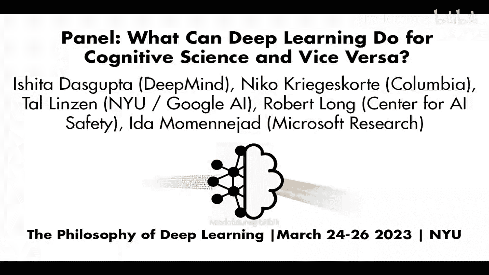

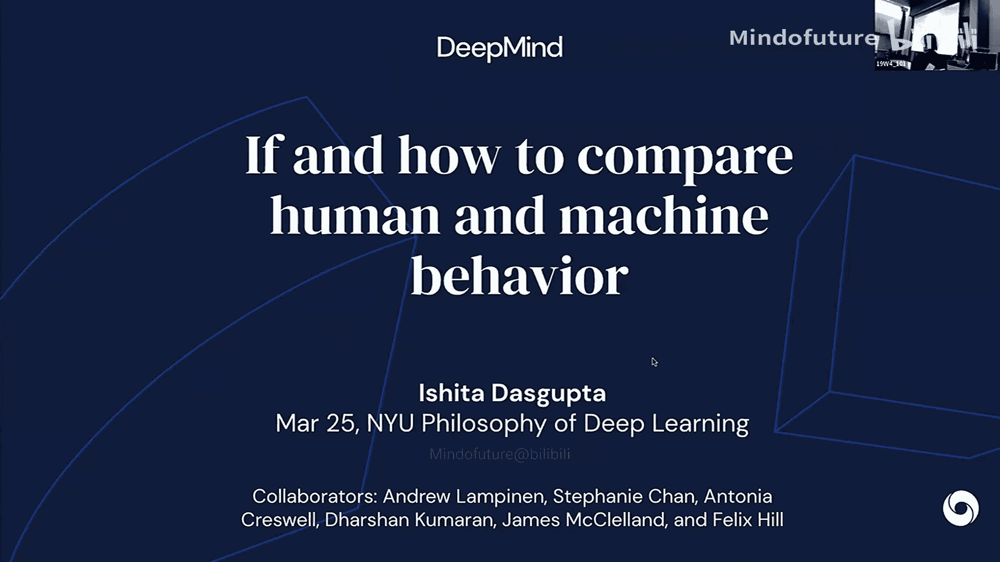

在本节课中，我们将探讨一个核心议题：深度学习与认知科学能相互学习什么？我们将通过一场小组讨论，深入分析如何比较人类与机器的行为、神经网络作为大脑信息处理的机制解释、大语言模型对人类语言习得的启示、认知科学对AI发展的实际贡献，以及构建类人智能体的评估框架。我们将看到，这两个领域之间的对话既充满挑战，也蕴含着巨大的机遇。

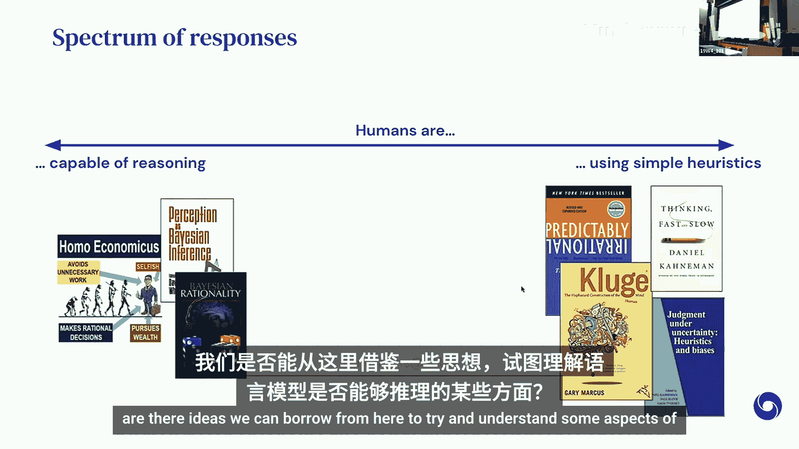

---

## 深度学习哲学：P05.1：如何比较人类与机器的行为？ 🔍

上一节我们概述了本次讨论的主题。本节中，我们来看看如何具体地比较人类与机器的行为。Ishita Dasgupta的演讲聚焦于评估语言模型的“推理”能力，并将其与人类推理进行对比。

“推理”一词在认知科学和机器学习文献中被广泛使用，但其定义往往模糊。一个常见的初步定义涉及逻辑和人类独有的能力。在语言模型领域，关于它们是否能进行所谓“推理”的观点存在一个光谱：一端认为模型具备推理能力，特定干预措施能帮助它们做得更好；另一端则认为模型主要使用简单的启发式方法，无法真正推理。

有趣的是，关于人类推理能力的争论同样存在一个类似的光谱。一些学者认为人类是完美的理性推理者，而另一些（如行为经济学家）则认为人类主要依赖可能无法泛化的简单启发式方法。这场辩论已持续了50多年。

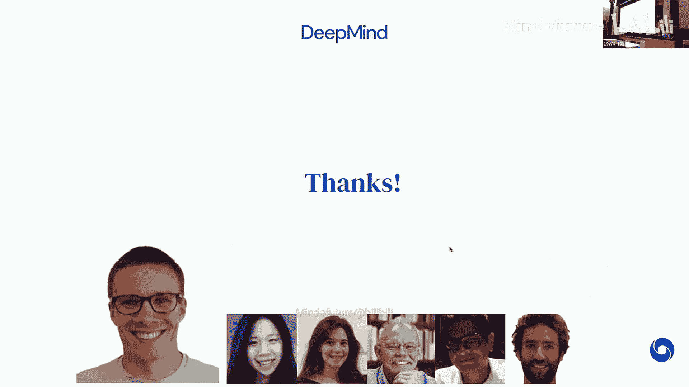

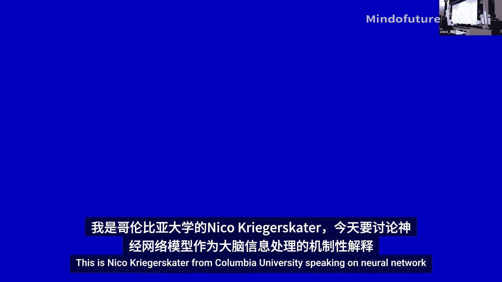

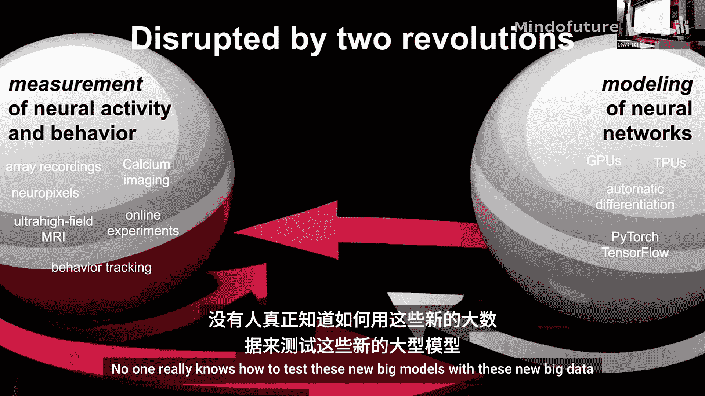

那么，我们能否从这场关于人类的长期辩论中汲取思想，来理解语言模型的推理呢？

以下是我们可以借鉴的一些关键思路：

*   **内容效应**：人类的逻辑推理能力强烈依赖于推理内容的具体性。经典的“沃森选择任务”表明，当逻辑规则置于熟悉的社会情境中时，人们的推理表现会大幅提升。语言模型同样拥有关于现实世界的“信念”（即对语言的预期），这些预期反映了人类的知识。研究表明，语言模型在推理时也表现出类似的“内容效应”：它们在处理符合现实世界信念的逻辑规则时，表现远好于处理抽象或违背常识的规则。
*   **分析层次**：在比较人类和机器行为时，我们需要明确是在哪个层次上进行类比。这至少包括三个层次：
    1.  **行为相似性**：外在表现是否相同。
    2.  **表征相似性**：支持行为的内在表征或算法是否相同。
    3.  **学习过程相似性**：获得这些表征的学习信号、数据量和优化目标是否相同。
*   **比较心理学的方法**：该领域已经发展出许多方法来公平地比较不同生物的能力（如区分能力的存在与熟练程度）。在比较机器时，我们需要思考一套新的考量因素，以确保比较的公平性。

总之，认知科学拥有成熟的词汇、历史和经验方法论，可以用来深入洞察当前的人工智能，特别是那些展现出类似认知能力的语言模型。理解它们对于其未来与人类的互动至关重要。

---

## 深度学习哲学：P05.2：神经网络作为大脑信息处理的机制解释 🧬

上一节我们探讨了行为层面的比较。本节中，我们深入一步，看看神经网络模型能否作为解释大脑信息处理机制的模型。Niko Kriegeskorte指出，认知科学正经历两场革命：神经活动与行为测量技术的革命，以及利用深度神经网络建模大脑信息处理的革命。

这带来了希望：神经网络模型最终可能作为大脑信息处理的**机制性解释**。然而，这一观点存在争议，主要有三种批评：
1.  模型过于简单（生物学保真度低）。
2.  模型过于复杂（难以直观解释）。
3.  模型仅仅是数据拟合。

为了应对这些挑战，特别是在大数据、大模型时代，我们需要新的方法论来检验和比较模型。

以下是两种关键的解决方案思路：

*   **基于推理的模型比较**：传统的做法是用世界数据（如图像）和行为数据（如人类标注）训练模型，然后用大脑数据（如神经活动）来裁决不同模型。这构成了一个分布外泛化挑战，使得结论更具推断性。模型比较推断必须避免对受试者或刺激的过拟合，并将两者都视为随机效应。
*   **优化实验设计**：我们可以设计能够对模型进行“严格检验”的实验。例如，“争议性刺激”方法：创建能引发不同模型做出截然不同预测的合成刺激。将这些刺激用于人类实验，可以有力地拒绝某些模型。这种方法在语言领域也被用于测试语言模型预测人类语言判断的极限。

因此，神经网络模型有潜力为大脑信息处理提供机制性解释，但理论进展需要新的方法论来比较高参数量的神经网络模型。基于推理的模型比较和利用争议性刺激的优化实验，是推动我们迈向更好模型和理论的重要途径。

---

## 深度学习哲学：P05.3：大语言模型能教会我们人类语言习得吗？ 📚

上一节我们讨论了用神经网络解释大脑机制。本节我们转向一个更具体的问题：大语言模型（LLMs）能否揭示人类如何习得语言？Tal Linzen的演讲探讨了深度学习作为研究语言习得理论假设的计算框架的潜力。

生成语言学的核心关注点是从有限数据到新结构的**泛化能力**。例如，英语疑问句构成规则可能基于句法结构（移动主要动词），也可能基于线性顺序（移动第一个动词）。儿童接触到的数据中，能区分这两种规则的例子极少，但他们总能学会正确的规则。这被用来论证儿童天生具有一种**句法结构偏向**。

神经网络可以作为计算框架来检验这类假设。基本逻辑是：构建一个计算学习者，给予它儿童可能接触到的数据，然后检查其泛化行为，并与人类的泛化行为进行比较。如果相似，则表明该计算学习者与儿童学到了相同的东西。

利用神经网络，我们可以：
*   **测试必要性**：如果一个没有内置特定语言偏向的网络，仅凭数据就能学会正确的规则，那么该偏向可能不是必要的。
*   **实施偏向**：我们可以给网络注入理论认为应有的归纳偏向（例如，构建类似树状的结构），观察这是否能产生更类人的泛化模式。

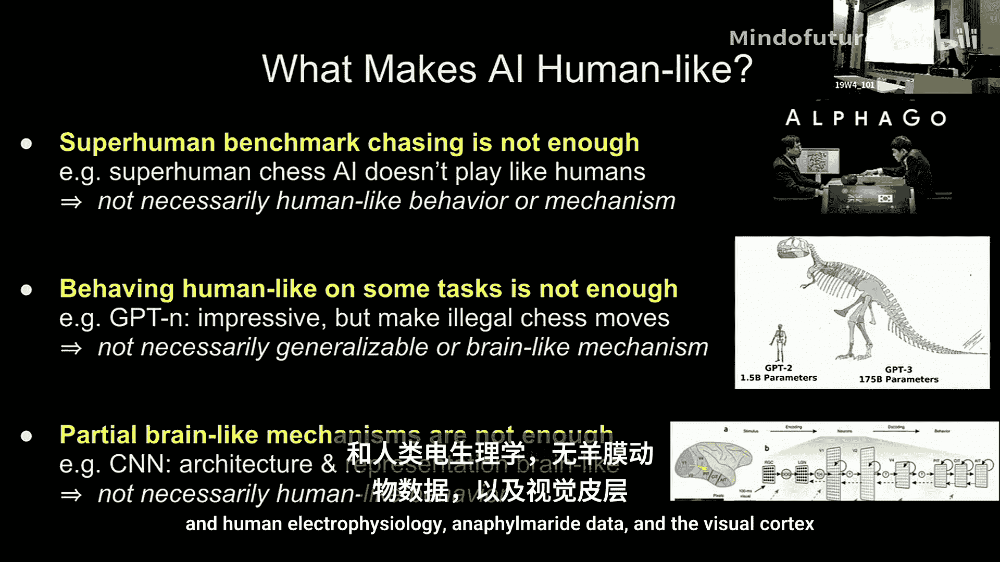

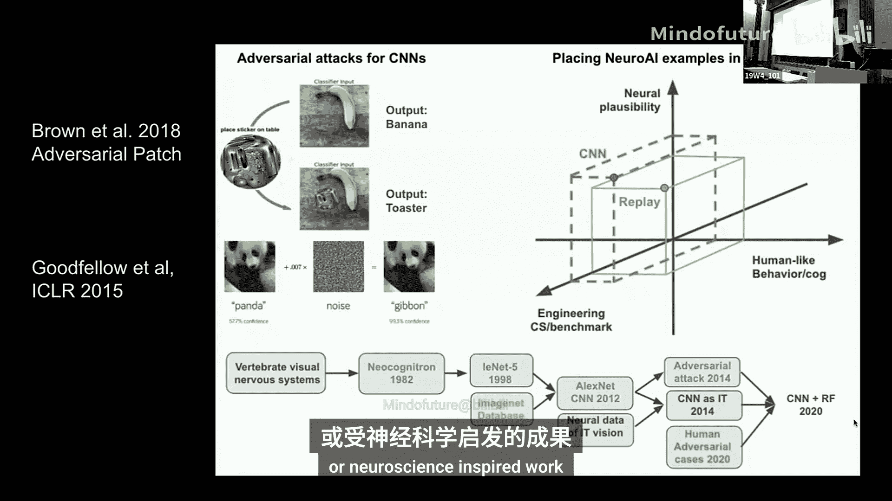

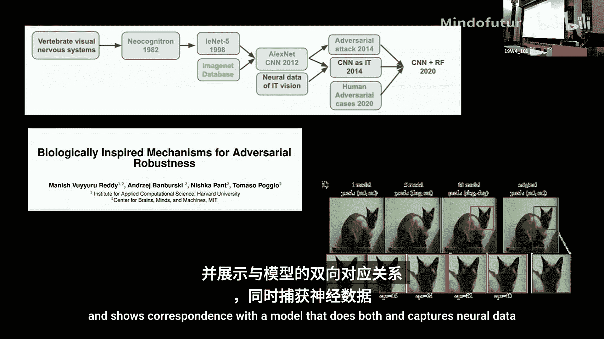

然而，Tal Linzen对当前流行的**超大语言模型**（如GPT系列）在语言习得研究中的直接相关性提出了强烈质疑。原因如下：
*   **数据量巨大**：它们通常在万亿级词符上训练，远超儿童接触的数据量。
*   **数据类型复杂**：训练数据包括数十种语言、数十亿行源代码、整个互联网（含语言教材、词典、语言学文章），这与婴儿的学习环境截然不同。
*   **资源不受限**：拥有数千词符的上下文窗口，远超人类工作记忆。
*   **预测背离人类**：最新LLMs在预测下一个词的能力上已远超人类，但其预测模式与人类阅读时的模式越来越不同。
*   **训练数据不透明**：最新的模型训练数据已成为商业机密。

因此，深度学习可以作为研究不同理论假设如何影响学习结果的有用基础设施。但要研究这些假设，我们需要在**与人类接触的数据相似、资源受人类类似限制**的模型上进行。目前商业公司开发的大模型正变得越来越不符合认知科学的研究需求。

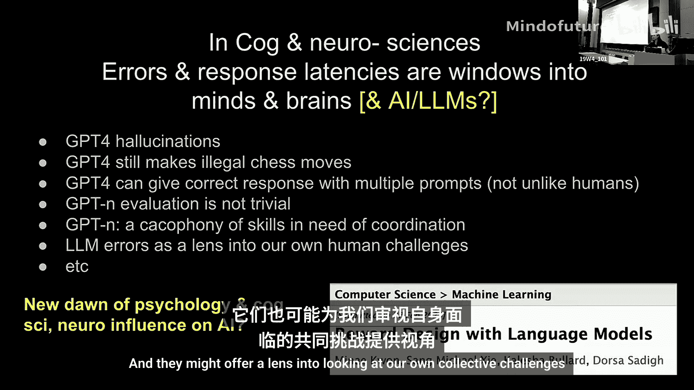

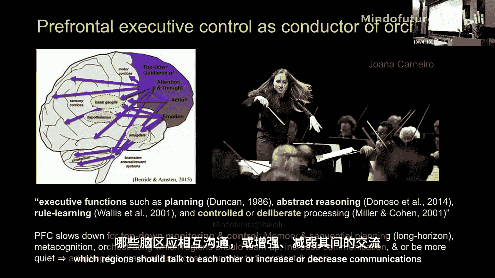

---

## 深度学习哲学：P05.4：认知科学为何无助于AI进展？ ⚠️

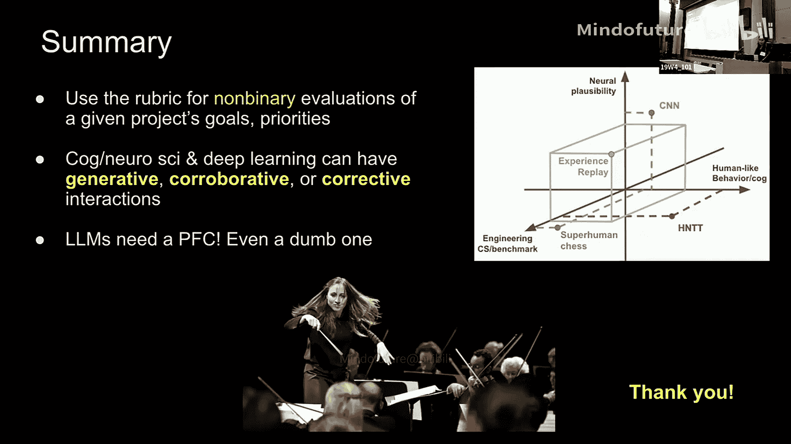

上一节我们探讨了AI对认知科学的潜在启示。本节我们反转视角，审视一个更具挑战性的论点：认知科学是否真的推动了AI的进步？Rob Long提出，尽管“认知科学启发AI”的观点听起来合理，但在实践中，尤其是在过去十年，它可能是错误的。

这个观点曾很吸引人：既然认知科学研究我们已知的唯一智能系统（人类），那么其发现应该能转化到AI中。然而，通过审视自然语言处理（NLP）近年来的关键进展，Rob Long认为驱动进步的核心见解**并非**来自对人类智能的研究。

例如，大语言模型的核心方法——**仅使用纯文本语料库和下一个词预测目标进行训练**——与人类语言习得方式（多模态、互动、数据量少）截然不同。许多语言学家曾认为这种方法注定失败，但它却取得了巨大成功。

他认为有两个根本原因：
1.  **认知科学不够成熟**：我们尚未能真正揭示人类行为背后复杂的计算基础，现有的认知模型过于脆弱，无法在AI中规模化应用。
2.  **AI系统不需要人类解决方案**：人类智能的解决方案是针对特定计算能力、数据量和学习速度优化的。AI系统在完全不同的资源和目标下学习，因此对人类解决方案的硬性约束可能反而有害，尤其是在规模扩大时。

Rob Long也回顾了一些看似来自认知科学的AI进展案例（如dropout、注意力机制、卷积网络），指出其中一些关联是事后建立的，且这种启发性影响随着时间推移正在减弱。他澄清，他的论点主要针对**将认知科学中具体、详细的计算机理直接迁移到AI以提升能力**的做法。他承认认知科学在理解、评估AI系统方面具有重要价值，但对其在驱动AI核心能力进步方面的作用持悲观态度。

---

## 深度学习哲学：P05.5：构建类人智能体的评估框架与LLMs的前额叶皮层 🎼

上一节我们听到了一个关于认知科学对AI贡献的批判性观点。本节中，Ida Momennejad提出了一个框架来厘清相关概念，并探讨了AI，特别是大语言模型，如何从神经科学中汲取灵感。

她指出，“类人智能”、“神经AI”、“脑启发AI”等术语常被混用，但它们的侧重点不同。为此，她提出了一个**评估框架**，包含三个主要维度：
1.  **表现出类人行为**
2.  **神经合理性**
3.  **解决工程/计算机科学问题**

成功实现其中一个或两个维度的目标，并不自动意味着在其他维度上也能成功。例如：
*   **卷积神经网络（CNNs）**：在神经表征相似性上得分高，但在对抗样本面前行为不像人类。
*   **超级国际象棋AI**：能力超群，但下棋序列不被人类认为是人类生成的。
*   **大语言模型**：在许多语言任务上表现惊人，但可能无法进行合法的象棋走子。

这个框架允许进行非二元评估，并有助于理解不同项目目标之间的生成性、相关性或修正性互动。

Ida Momennejad随后提出，**大语言模型需要一个“前额叶皮层（PFC）”**。人脑的前额叶皮层负责执行功能，如计划、抽象推理、规则学习和受控处理。它像一个**指挥家**，协调大脑不同区域，根据情境或目标放慢系统速度，进行自上而下的监控和控制。

当前的大语言模型就像一个拥有多种技能但缺乏协调的“嘈杂乐团”。它们可能知道某个回答有毒，但不会主动阻止自己生成它；它们可以在被提示后改进回答，但不会自我提示。因此，她建议为LLMs添加一个**“笨”PFC模块**。这个模块可以：
*   根据过去交互的历史数据，判断何时需要从快速生成模式切换到缓慢的、自我监控的控制模式。
*   决定何时需要查询互联网、获取真实信息或调用不同的内部技能。
*   针对不同应用（如游戏、办公软件）可以有不同的“物种”。

她认为，认知科学与深度学习之间可以存在生成性、相关性或修正性的互动。利用认知科学的方法（如分析错误和反应时间）可以洞察LLMs的内部运作，而LLMs的失败也可能折射出人类自身的认知挑战。为LLMs开发即使是很“笨”的PFC，也可能极大地改善其表现。

---

## 总结与展望 🌉

本节课中，我们一起深入探讨了深度学习与认知科学交叉领域的多个核心议题。我们了解到：

1.  **比较人类与机器**需要明确分析层次，并借鉴认知科学中关于内容效应和比较方法论的研究。
2.  **神经网络**有潜力解释大脑机制，但需要发展新的方法论（如基于推理的模型比较和争议性刺激实验）来验证高参数模型。
3.  **大语言模型**作为研究语言习得的工具具有潜力，但当前主流的超大商业模型因其训练数据和资源的“非人类”特性，直接相关性有限；更受控的、资源受限的模型更适合认知科学研究。
4.  **认知科学对AI能力进步的直接影响**可能被高估，过去十年的AI突破更多来自规模化和与人类学习方式迥异的方法；然而，认知科学在理解、评估和确保AI安全方面不可或缺。
5.  需要一个清晰的**评估框架**来区分类人行为、神经合理性和工程目标；同时，从神经科学中借鉴**前额叶皮层**的“指挥家”功能，可能为解决当前大语言模型在协调、自我监控和控制方面的不足提供灵感。

这场讨论揭示，两个领域的关系是复杂且动态的。认知科学为理解智能提供了丰富的视角和严谨的方法，而深度学习则开辟了实现智能的新路径。二者的对话未必是直接的“技术转移”，而更多是相互启发、相互检验和共同演进。未来，在追求更强大、更高效、更安全、也更可理解的智能系统的道路上，这种跨学科的对话必将持续深化，并可能催生出意想不到的突破。