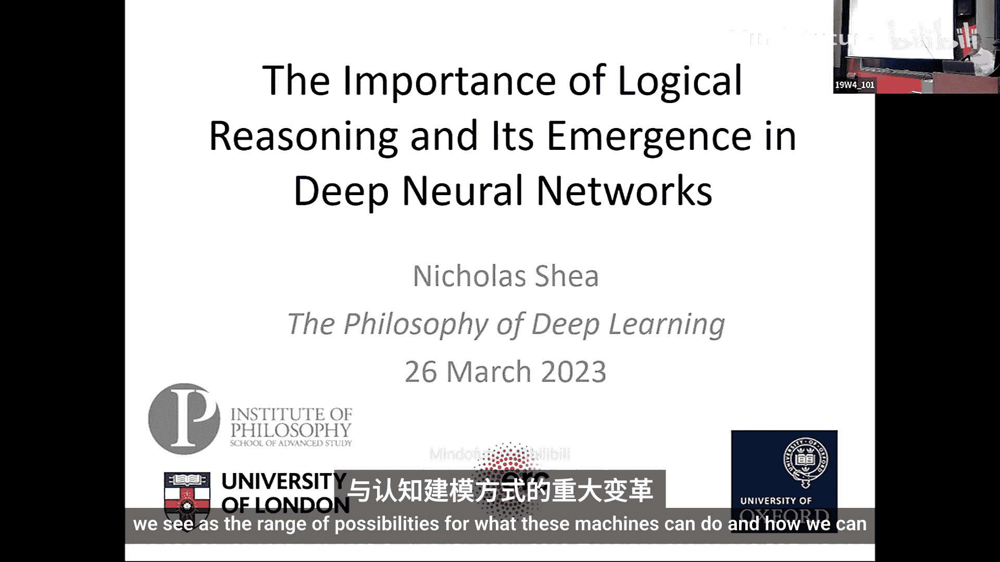
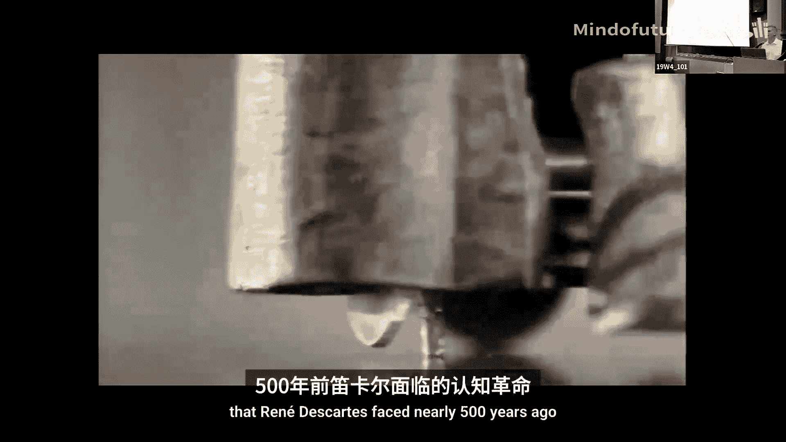
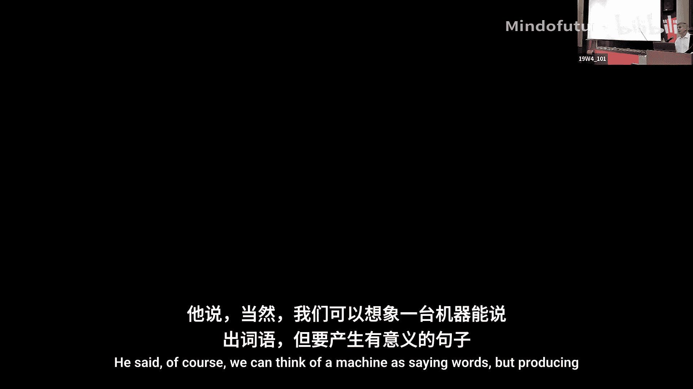
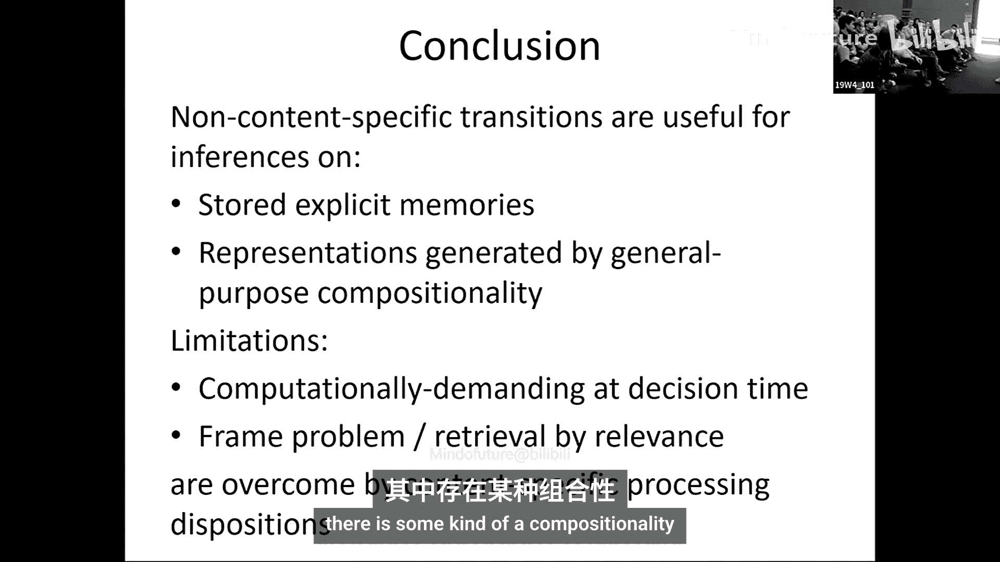
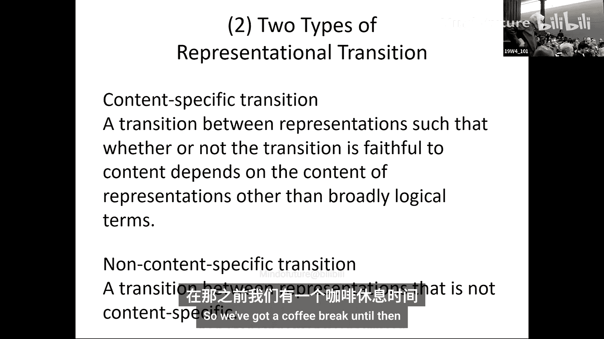

# 006：逻辑推理的重要性及其在深度神经网络中的涌现


在本节课中，我们将探讨逻辑推理在认知科学和人工智能中的核心地位，并分析其在深度神经网络中如何涌现。我们将对比两种不同的信息处理方式，理解它们各自的优势与局限，并探讨为何一个完整的认知模型需要整合这两种方式。

## 引言：从机械哲学到人工智能






首先，感谢Ned、Dave Chalmers和Raphael Millière的组织与邀请。作为一个跨学科哲学家，能与来自计算机科学和认知科学不同领域的学者交流，特别是与哲学家们对话，是一次非常宝贵的经历。特别感谢Raphael在过去两年里每周组织深度学习阅读小组，尤其是在新冠疫情初期无法旅行时，能与美国和欧洲的同行们每周讨论深度学习的最新进展，是我学习新知的重要途径。


本周末的讨论已经揭示，深度学习的一个哲学兴趣点在于它如何帮助我们建模人类心智。这正是我今天要聚焦的主题。



长期以来，我一直主张人工神经网络是建模某些认知方面的一种有趣且与众不同的方式。事实上，我在博士期间就开始研究它。因此，当深度学习在多年里没有实际应用时，不免有些失望。直到2012年，它们才开始真正发挥作用，这不仅是一个“我早就说过”的时刻，我认为我们正在经历某种范式转变，对于这些机器能做什么以及我们如何建模认知的可能性范围，正在发生重大转变。

## 历史的启示：笛卡尔的挑战与逻辑推理的诞生

这种转变有点像近500年前勒内·笛卡尔所面临的范式转变。上图展示了一个16世纪60年代制造的自动机，它能进行类似生物的运动。对于笛卡尔来说，这是一个启示：像这样能产生看似有目的运动的机器，挑战了当时认为只有动物才具备特殊生命力的观念，这启发了他提出整个机械哲学。

然而，笛卡尔 famously 认为，心灵是一个例外。最著名的是意识问题，他难以设想物理或机械过程如何产生意识，这留下了我们至今仍在努力解决的“难题”。但更相关的是，他认为语言也是如此。他写道，我们可以设想一台机器说出词语，但要产生有意义的句子，不仅不可能，甚至是不可想象的。

当然，现在我们看到这是可能的。在20世纪，我们通过经典计算机，利用**实现广义逻辑转换**的原则，已经在实现有意义的、智能的表征间转换方面取得了进展。

例如，关于“苏格拉底会死”的推理，在20世纪之前，只有人类（而且是聪明人）才能进行这种表征间的转换。20世纪的一个重大发现是，我们可以设置机器来做到这一点，以及许多其他类型的逻辑推理。方法是让机器根据表征的**形式**或**模式**，具有在不同表征间转换的倾向性。如果你设置一台机器，使其倾向于在符合以下形式的表征间转换：

```
如果 所有 A 是 B
并且 x 是 A
那么 x 是 B
```

那么最终你会得到一种能在表征间进行转换的东西。如果你输入真实的表征，它必然会输出真实的表征。这个原则后来成为我们仍在使用的几乎所有计算机的核心，被证明极其有用，不仅实用，也有助于理解心智的许多方面。

然而，这并没有完全达到笛卡尔认为不可想象的地步，即“对任何所说的话给出恰当而有意义的回答”。直到最近三年，我们才真正获得了能够做到这一点的机器，正如本周末我们已经看到的许多例子。

我认为，适应这一点是一种范式转变。它扩展了建模心智方面的现实可能性空间。它向我们表明，端到端地训练特定的倾向性，以特定类型的输出响应输入，其威力远超我们以往的想象。

## 核心对比：内容特定与非内容特定的计算

我今天的论点并非要在经典架构和联结主义架构之间做选择。实际上，两种方法具有互补的成本和收益。我们不应忽视**广义逻辑推理**的重要性，如果我们想要完整地描述人类认知，并超越“最迟钝的人”所能做的事。

今天，我想以一种特定的方式来描述这种差异，以展示所谓的**广义逻辑推理**所具有的特征性优势，如何与深度神经网络处理表征的特征性方式的成本与收益形成互补。

经典计算“包”是熟悉的，我将更具体地描述它，但你们已经看到了一个广义逻辑推理的例子。实现它的一种方式是通过**变量绑定**，对以显式记忆或存储知识形式存在的表征进行操作，并且这些表征表现出一种通用形式的**组合性**。

这与深度神经网络“包”形成对比。我想深入探讨一种特定的对比方式，以帮助我们理解为何存在互补的成本与收益。

我的计划是：首先简要说明我如何看待深度神经网络中的表征，为讨论奠定基础；然后，区分这两种广义的表征转换方式，即我所谓的**内容特定**方式和**非内容特定**方式；接着，我将论证（这是核心论点），在建模人类认知时，我们需要将其视为能够访问这两种表征处理风格，能够根据它们各自适用的领域和互补的成本与收益，灵活地在两者之间切换；最后，我会简要谈谈我们的AI系统是否也在发生类似的事情。

## 深度神经网络中的表征

为了快速理解深度神经网络中的表征，我将用一个非常简单的系统来说明。这是一个古老的三层神经网络，经过训练可以对一些刺激物（即物体）进行分类。你在输入层编码物体的属性，训练它在输出层将它们分为A类和B类。它找到的实现方法是，在中间层将物体分成不同的个体。因此，它在数据（也是世界）中发现了一种模式。中间层携带了关于该模式的信息，并利用这种分类来执行输出任务，区分A和B。

这样，我们就得到了构成隐藏层表征的要素：通过内容载体携带信息，以服务于执行某种功能（在本例中，功能来自系统的训练目标）。重要的是，我们在这里对表征持现实主义态度：由于表征的处理方式，我们获得了额外的解释性益处，即存在真实的表征载体。

载体可能是激活空间中的聚类（如左图所示），也可能是激活空间中的动态轨迹（如右图猴子记录数据所示），或者是多胞体或其他类型的流形。关键在于，表征内容是由网络活动处理过程中的真实特征所承载的。这意味着，即使你在描述处理动态时对内容或表征保持中立，这些特征仍然存在，它们不仅仅相对于表征解释而存在。这使其成为一种现实主义的表征解释形式。

尽管深度学习的大部分工作在于获得输出和技术解决方案，但正如我们昨天所见，也有一系列研究工作关注内层是否存在表征（有时称为内部表征）。例如，对包括GPT-2在内的自回归语言模型的研究。Men及其同事在这项研究中试图发现，是否存在内部处理的某些部分承载着对执行任务至关重要的表征内容（这里的任务只是预测下一个词）。例如，经过训练后，它可以完成句子“太空针塔在市中心___”，并正确地用“西雅图”补全。他们想知道，是否存在特定的处理部分对于执行该任务至关重要。

他们扰动输入，使输入降级，然后进行因果中介分析，以找出哪些特定的激活部分对于获得正确输出最为重要——如果固定这些部分，就能接近获得正确输出。他们发现，早期层中的一些激活模式很重要，此外还有一个后期组件。因此，他们的假设是：在看到句子的主语“太空针塔”后，系统学会了进入高维激活空间的一个特定区域，该区域表征着“西雅图”，然后这个嵌入就待在那里，准备在句子后面相关时被使用。后期的激活则是一个注意力头调用该信息，以便查找正确的词并输出“西雅图”。

如果这个假设正确，那么系统就学习了一种“关联”（他们称之为association），我们可以将其视为在两个激活空间的不同部分之间学习到的特定连接：左侧黄色的“太空针塔”嵌入空间部分，与浅绿色的“西雅图”嵌入空间部分相连接。这就是它学习到的、对回答这个特定句子至关重要的信息片段。

这是一种存储信息的有用方式，但它有局限性，因为“太空针塔在西雅图”这个信息只是存储在这种倾向性中。因此，它无法被普遍用于计算。它被设置在这种一种表征倾向性中。

相比之下，我们可以用句子“太空针塔在西雅图”做什么呢？我们可以重用这个句子，可以对它进行各种处理，可以在多种上下文中重用它。Meg及其同事在网络中发现的信息是以一种特定的意义**隐式**表征的。它是隐式的，因为内容存储在一种在当前表征（激活模式）之间移动的倾向性中。这意味着，该信息对后续处理的唯一影响，只能通过该倾向性所存在的那些表征来实现。

因此，这是对隐式表征信息所能做的事情的一种限制。

当然，这些网络也可以**显式**地表征信息。这里有一些其他研究，探讨另一个自回归语言模型如何表征信息。这个模型在大量语言上进行了训练，然后针对一系列特定任务进行了微调，这些任务涉及向烧杯中添加或减去水。在中间图中，你可以看到它可能给出的一个句子：“第三个烧杯里有四个单位”。它看到了更多关于蓝色的句子，然后最终“从第三个烧杯中排出两个单位”。因此，你应该预期第三个烧杯里现在有两个单位的液体。

对于所有那些可能的中介状态，他们进入网络，查看是否存在特别携带该信息且对执行任务至关重要的活动模式。这在方法上非常困难，我对此有一些方法上的担忧，但它触及了我正在谈论的问题：对一条信息（即“第三个烧杯有两个蓝色单位”这个临时事实）进行显式表征，然后这个显式表征可以在下游多个地方被使用。因此，与“太空针塔”案例不同，它是显式的。

但同样，它的使用方式取决于其非常具体的内容。它被设置为以一种依赖于特定主题的方式，与其他关于烧杯、液体及加减法的表征进行交互。这是一种从一个激活空间部分移动到另一个激活空间部分的倾向性，只适用于它被训练过的这个特定主题。

我认为这在深度神经网络中通常是正确的，或者可能是非常普遍正确的。

这里有一些早期关于卷积神经网络的研究，该网络经过训练进行图像分类。同样，从方法上弄清内部实际发生了什么非常困难，但有一些数据至少暗示了一种图景：在处理的早期层，它所做的类似于我们认为的人类腹侧流早期层所做的事情。也就是说，它从表征对比度和边缘等，到表征纹理，再到物体的部分，最终能够对物体进行分类。

因此，这些是一组很好的倾向性，用于在表征之间移动，例如从特定的对比度分布移动到表征边缘在某某位置的表征。它们在人类视觉环境的统计特性中运作良好，但它们并非普遍适用，它们只适用于那个主题。这些转换是忠于内容的，是一种保持正确性的转换，但它们是针对特定主题训练并适用于特定主题的。

## 定义非内容特定计算

这与我们开始时提到的苏格拉底推理形成对比，那是经典计算的核心。那种模式几乎适用于任何主题，你可以用其他事物替换苏格拉底、会死的和人类，你仍然会得到一个必然保真的转换。这就是我想要对比的。

让我再举几个例子。其他例子是逻辑和演绎有效的，比如“与消除”，它适用于任何命题大小的表征；或者使用“如果-那么”，同样非常普遍地适用于个体和属性的表征。

但这不仅仅依赖于演绎有效性。我们还能在其他类型的转换中获得这种非常普遍的适用能力，其中结论并不一定在前提为真的情况下为真，而只是很可能为真。例如，你可以设置一个系统（我们可能被设置成这样），从估计某事具有很高概率，直接转变为明确地表征它。这不是一个坏的倾向性，你很少会因这种倾向性而犯大错，而且它非常普遍适用。虽然比演绎有效的那些普遍性稍差，但仍然非常普遍。同样，从样本推广到总体或新实例也是如此。

因此，我们有一系列例子，与我认为人工神经网络中通常发生的情况形成对比：它们**普遍适用性更强**，并且**忠于内容**。大致来说，作为一种有用的表征转换方式，其设置并不依赖于正在表征的**特定内容**（或可称之为开放类概念）。

实现这一点的一种方式是通过拥有**图式**并使用**变量绑定**，但这并不是一个系统可以被恰当地描述为满足这些条件的唯一方式。也许满足使用“如果-那么”的倾向性，如果我写下的概括性描述恰当地描述了它的行为，那么它就可能满足条件。GPT-4的输出可能就属于这种情况，它可能被恰当地描述为在其表征之间满足使用“如果-那么”的条件，但在输出时并未使用变量。

这就是我想要对比的：**非内容特定转换**与**内容特定转换**。内容特定转换通常被训练到深度神经网络中，就像我给出的“太空针塔”例子，或者“第三个烧杯中的液体量”表征被处理的方式。

为了更精确，我将一种精确的说法呈现在屏幕上，以便有人以后想回顾时参考。这种转换的关键在于，表征间转换对内容的忠实性是否依赖于除逻辑项之外的任何东西。

对于那些类似逻辑推理的转换，它们忠于内容是因为“与”、“或”、“如果-那么”等术语的内容，而不依赖于所使用的其他表征。而对于内容特定的转换，它们可能是处理表征的好方法，但其“好”将取决于正在处理的**特定内容**。

当我谈论**广义逻辑推理**（或简称推理）时，我指的是那些被设置为能够进行这些非内容特定转换，并且正在这样做的系统。

## 非内容特定计算的优势

好的，以上就是区别。我认为这并不陌生，昨天在Ihita的演讲中，当她谈到推理时，她阐述的内容与此非常相似。我想说的是，这种思考表征间特殊转换能力的方式，向我们展示了为何以这种方式处理表征具有特定的优势。

首先，它赋予系统（思考者、个人）一种处理**远超出其训练经验**的表征的能力。

以科学史为例，我们可以想想阿尔伯特·爱因斯坦。他进行了大量关于空间和时间的逻辑推理和数学推理，然后在某个时刻构想出一个人骑在标枪上接近光速会是什么样子。这可能完全超出了他任何经过训练的信息处理倾向性的经验范围。然而，他可以对那个表征做一些事情，他可以在其上做逻辑推理。尽管从你内置的对表征的反应方式来看，它是全新的，但你可以通过对它进行一系列逻辑操作，到达新的领域。这是一种不依赖于从经验中概括的方式。

人们常评论说，组合性作为表征系统的一个特征是有用的，因为它允许人们思考新思想，或允许系统生成新可能性的表征。但较少被评论的是，在表征了一个新的可能性之后，你必须能够对它做些什么。非内容特定计算的能力赋予系统一种处理这些全新可能性表征的方式。

因此，我认为这里存在一个有用的“包”：一方面是**非常领域通用的组合性**能力（或以不依赖于特定内容的方式将现有表征以新方式组合在一起，这是语言和可能的概念思维的特征），另一方面是**非内容特定计算**能力。这两者自然结合，使得系统能够对这些新表征做一些有用的事情。

这是第一个优势。另一个优势与之相关，即**利用存储的显式记忆**做某事的能力。

深度神经网络有两种不同的处理过去的方式：它们进行**学习**，改变权重，这改变了处理未来输入的倾向性。因此，你通过改变整个处理系统的状态来从过去学习，使其倾向于在未来以不同方式处理输入。

当然，它们还有另一种处理过去的方式，这种方式已被证明非常强大：改变其激活状态，对你当前所处的状态进行瞬时改变。对于Transformer来说，这可以非常丰富和分支化，系统通过进入不同状态来响应的上下文现在可以长达数千个词。结合巧妙的提示工程，这已成为一种比任何人先前想象的都更实用的与世界互动的方式。

然而，这仍然是系统拥有一系列针对不同输入的、非常详细的输入-输出倾向性的问题。

考虑一个自然主义场景：我在外觅食，看到一棵树即将结果。这条信息可能会影响我第二天的选择——当我到达某个路口时，是左转还是右转，可能取决于这棵树是否在结果。我们可以将这两种不同的可能性视为长长的输入链：一组输入是我看到一棵不结果的树，发生了一系列事情，然后第二天我做出选择一；另一组输入是我看到一棵结果的树，同样的链条但输入不同，我应该产生输出二。我可以被设置为对这些两种不同的输入做出不同的反应。

但过去可能不止一天前，可能是一周前、一个月前，甚至是我去年看到的某件事。Randy Gallistel长期以来一直强调的一个观点是，通过**构建处理器的改变**来处理过去，在实践中存在局限性。因为你需要为可能遇到的所有不同路径投入处理资源，他称之为“可能的无限性”——有太多不同的可能性链条需要处理，最终你会投入大量处理能力来处理你可能看到的事情。

Gallistel认为这是一个实际限制，我们需要以不承诺于这个问题的方式来构建我们的实用计算机。他可能错了，我们此刻可能看到的是，对于我们想要的工程解决方案来说，这并非实际限制，我们可以用这种非常长的输入倾向性解决方案来处理。但我认为，当我们考虑到资源限制不同的人类时，有相当有力的证据表明我们使用了不同的解决方案：我们存储**显式记忆**。

因此，我们可以遇到一个情境，存储它的表征，而无需立即改变我们处理输入的倾向性，然后在决策时，如果相关，就利用它来计算该做什么。我们在一些深度神经网络模型中也看到了这一点，例如昨天看到的DQN示例，它被描述为使用情景记忆。但这涉及在不改变权重的情况下存储情境，然后利用这些情境在决策时决定做什么。这提供了一种灵活的一次性学习，因为如果你再次遇到相同的情境，你可以直接做同样的事情来获得奖励。

于是我们看到，处理过去有两种广义的解决方案：一种是深度神经网络解决方案，它改变其输入-输出倾向性，这需要大量学习和数据（尽管我昨天很惊讶地得知，训练一个Transformer所需的能量相当于往返月球两次，所以当我们说需要大量训练时，我们真的是在谈论**大量**训练）。然后，在决策时它的计算相对较轻，因为在某种程度上，该做什么已经被预先指定了，即使它可能需要处理很长的输入序列。

另一方面，我们有**使用显式记忆进行计算**，这类似于学习，允许一次性学习，但在决策时（当你需要计算出该做什么，或进行推理以得出新结论、弄清情况时）计算量很大。这也引发了“计算什么”的问题：如果你存储了所有这些丰富的记忆，在某一时刻我应该调用哪些记忆来计算出该做什么？这里我们看到了熟悉的（尽管已淡入背景的）**框架问题**，我稍后会再谈。

## 人类认知的混合模型

好的，以上就是拥有非内容特定计算能力的一些优势。现在我想论证的是，人类灵活地依赖于这两种处理方式。让我举一个日常例子。

假设我在外购物，考虑买家具，其中一件事是考虑买这把椅子或买哪把椅子。我可能会做一些逻辑推理：我可能看到两把规格完全相同的椅子，其中一把更便宜，我就会排除贵的。但我也可以依赖于训练到我专门系统中的信息，这些系统具有内容特定的倾向性。或者更通俗地说，如果我考虑“我今天能把椅子带回家吗？它能放进车里吗？”，我可以在脑海中旋转它，看看它是否看起来能放进车里。在这里，我所做的是依赖于训练到我感觉运动能力中的信息（在人类案例中，可能还带有相当多的进化禀赋，关于这些能力如何学习）。我拥有一套在与世界互动时使用的感觉运动倾向性，我可以离线运行这些倾向性进行模拟，从而利用其中的信息。

因此，我是在来回切换，或者同时使用我在这问题上的逻辑推理能力，以及训练到我领域特定系统中的信息。

我认为规划通常涉及这种混合。周五晚上我们看到Jan LeCun谈论规划，以及你需要一个可以计算可能性的世界模型。我认为重要的是要记住，这个世界模型可能不仅仅是一组你可以进行推理的显式表征情境，我们也可以使用这些训练好的、深度神经网络擅长建模的内容特定倾向性，通过离线运行模拟，将它们作为一种世界模型来使用。




因此，我认为人类两者兼用，并且有合理的证据表明我们不仅仅在做内容特定的事情，我们也在进行逻辑推理。就我的目的而言，我们是在仅用输出做，还是在内部做，并不重要。我认为有相当好的证据表明我们可以用输出做，而且我们可能借助语言做到这一点，然后在内部回收利用以进行逻辑推理。

实际上，有一系列证据表明，在非语言任务中，以及在不依赖我们语言能力的方式中，我们确实使用了类似内部逻辑引擎的东西来解决问题或决定在特定情况下该做什么。例如，来自Stanislas Dehaene实验室的一系列工作显示了非常具有启发性的结果，实际上Jake Quilty-Dunn及其同事最近在《行为与脑科学》的一篇目标文章中总结了该领域的一系列结果。

因此，我认为有合理的证据表明人类在运行一个逻辑引擎。但即使我们只是在使用输出，在正确的上下文中进行类似逻辑的输出并重复使用，我认为我们确实在这两种风格之间来回切换。部分原因在于我给出的理由：因为它为我们提供了一种思考**全新概念空间**的方式，因为我们可以对我们用通用组合性能力生成的完全新的可能性进行逻辑处理；同时也因为它为我们提供了对我们存储的所有显式记忆（当我们显式地表征我们遇到的情境时）做一些有意义的事情的方法。

## 深度神经网络的局限与AI的未来

好的，这就是在肯定深度神经网络惊人成果的同时，强调其局限性的方式。你可能会问，如果非内容特定计算这么好，为什么我们以前不能用经典计算风格解决所有这些问题呢？嗯，我认为部分原因在于我刚才提到的使用非内容特定计算的局限性。

一方面，我刚才顺便提到它计算量大，需要大量计算资源来弄清情况或决定该做什么。因此，如果你在一个能够获得大量经验的领域操作，那么训练一种专门的应对世界的方式并依赖它，可能是一种更高效的解决方案。

另一方面，我刚才顺便提到了“计算什么表征”的问题。我们拥有进行广义逻辑推理的强大能力，因为我们有一种以中立于其内容的方式转换表征的方法。但我们要用它来做什么呢？我们拥有所有我们表征的东西，所有我们知道和记住的东西，其中只有一些是相关的。框架问题就是如何找出哪些表征是相关的，以便开始对它们进行一些逻辑推理，以便做出决定。如果为了找出哪些是相关的，我需要检查所有表征，那么看起来我已经有了计算上难以处理的东西。实际上，目前至少我所知的、利用显式记忆的深度神经网络混合系统，确实会检查所有记忆，它们有一种检查所有记忆相关性的机制，只召回相关的那个。

我认为，这里又是混合系统发挥两种风格计算互补成本与收益的地方。深度神经网络为我们提供了一套基于相关性召回表征的选项，可能足够灵活，至少能在一定程度上帮助我们应对召回相关表征的问题。

我们昨天看到了这方面的证据。让我提醒你一下Grün及其同事的这项研究展示了什么。他们研究了一组概念在高维语义空间中的排列方式，既在神经网络中，也在人类中。你可以看到，这个空间为你提供了一种基于某种相似性来召回或检索表征的方式——也许与当前情境最相关的事物是那些相似的事物。

但他们展示的有趣之处在于，我们可以沿着不同的语义维度在这个空间中进行召回。例如，我们可以考虑沿大小维度的相关性或相似性，这会使某些事物靠得很近，另一些则很远；但我们可以单独选择另一个维度，比如某物是危险的还是安全的，并考虑沿该维度的相似性，然后你会得到相同项目完全不同的排序。以海豚和老虎为例，它们在危险性上相距甚远，但在大小上却被视为非常相似。

因此，如果我们依赖于在深度神经网络中训练的语义空间或表征相似性空间，它不仅仅为我们提供了一种基于相关性召回事物的方式，它还提供了一种非常灵活的、根据上下文进行不同类型相关性召回的方式，即沿着这些空间中的不同维度投射相关性。Grün及其同事表明，从训练好的语言模型中得到的不同的投射，与如果你要求人类给出沿不同维度的相似性判断时得到的结果非常相似。因此，我们似乎可以以多种不同的方式召回表征或记忆，我们可以考虑不同类型的相关性，以找出可能与推理相关的事物。

## 总结与展望

我希望我已经让你感受到，内容特定与非内容特定的区别向我们展示了为什么存在两种具有互补成本与收益的处理风格“包”。至少当涉及到建模人类认知时，我们需要考虑一种能够访问两者、对其适用领域有一定敏感性、并能灵活在两者之间切换的系统。

最后，我想谈谈AI模型，特别是大型语言模型中正在发生什么。

直到本周，或者说直到GPT-4出现之前，我本可以轻松地说，大型语言模型在推理任务上并不擅长，尤其是在分布外的情况下。我们昨天从Ida那里看到，他们有很好的工作表明这些模型具有类似人类的内容偏见，但它们可能并非以类人的方式进行推理。我们让它们进行推理，部分是通过对大量计算机代码行进行训练，部分是通过非常仔细的提示工程，提示它们以鼓励推理风格的方式输出内容特定的输出。

因此，尽管它们在输出中近似推理，但似乎不太可能通过内部的非内容特定转换来生成它。当然，这里的一切都非常不确定，因为很难知道内部发生了什么，而且只有少量研究关注这一点。但有一些提示性的证据线索：一是至少在GPT-4之前，当你给系统分布外示例时出现的错误模式；二是当你专门在大量逻辑上训练一个模型时会发生什么——它们似乎不太擅长掌握负责逻辑句子的逻辑操作（这是Ellie Pavlick实验室的Tramer及其同事的工作）。他们实际上有更新的研究，不是训练逻辑，而是训练物理情境，其中理解逻辑会非常有帮助，但同样，模型似乎没有掌握底层的逻辑。

那是上周之前的情况。现在对于GPT-4，我真的不知道该说什么，部分是因为我对它了解不够，部分是因为我们大家都不太了解它。但它似乎在推理任务上表现得更好。我认为最稳妥的说法是，我们需要等待和观察。但至少有一些迹象表明，它可能也没有在内部使用逻辑引擎，这既是因为它与早期模型的相似性，也是因为它仍然不擅长规划——如果我们认为它内部能访问非内容特定计算，它应该更擅长规划。

现在，当我们谈论技术解决方案时，这可能不是一个非常重要的限制。如果我是对的，拥有访问非内容特定计算的能力具有计算优势，但这不一定需要在内部处理中实现。我敢打赌，如果它有用，将其构建到大型语言模型的内部处理中可能不会有用——近年来得出的教训大概是，构建结构要么会被系统学会避免，要么会使其性能更差。但还有另一组使用它的方式，即利用输出的推理能力。最后我只想提两种方式：一是使用大型语言模型产生输出，通过正确的提示来近似推理；二是让大型语言模型产生内容特定的输出，利用其丰富的领域知识，然后与Python或某个专用逻辑引擎等推理引擎交互，以便能够对这些输出进行约束逻辑推理。我们已经看到了一些这方面的例子。

另一种我认为很迷人的方式，近似于同一件事，即**以两种不同模式使用同一个模型**，使用不同类型的提示。这是DeepMind的Creswell及其同事的工作。他们表明，你可以设置模型，使其在推理模式下（通过正确的提示）近似逻辑推理；但你也可以使用他们所谓的**选择模式**，在这种模式下，它更多地基于人们倾向于说什么以及环境中的统计数据，在句子之间进行内容特定的移动，类似于Ida昨天向我们展示的那种内容偏见。

他们表明，通过在这两种提示类型之间来回切换，你可以做一些聪明的事情：让它告诉你它所拥有的关于世界的丰富知识，然后提示它进行逻辑推理，接着它可以使用逻辑推理推理出一些新东西，然后再将其作为输入放回同一个模型，但现在是回到选择模式和内容特定模式。

这些只是可能的工程解决方案的提示，谁知道这些东西会走向何方。但我认为至少存在三种经验可能性：
1.  GPT-4或其继任者可能以端到端的方式处理一切，我所说的在人类系统中的优势，在资源限制不同的系统中可能并不需要。
2.  混合系统可能作为一种实用的工程解决方案被证明是有用的，也许是Creswell及其同事的方法，但添加这个功能并获得我所说的互补成本与收益，可能只是一个相对浅层的工程问题。
3.  也可能存在某种深层原因，使得建立一个能在两种计算风格之间灵活切换并以正确方式整合它们的系统变得困难。

因此，从经验上讲，我认为我们不知道，看看未来几年建模会带来什么可能性将会非常有趣。

## 最终总结

让我回到我的核心观点来总结。

我一直主张，这两种不同类型计算模型（经典的和人工神经网络）之间的核心区别，在于它们被设置为在表征之间进行转换的两种深层不同方式。这两种方式都符合更广泛的表征主义洞见：设置一个系统，使其能从一些正确的输入移动到正确的输出，或以忠于其内容的方式操纵表征，这是有用的。

但有两种截然不同的方式来实现这一点：**非内容特定方式**（这是我们首先作为工程解决方案发现的）和**内容特定方式**（在深度神经网络中被证明比人们想象的要强大得多）。

我认为这种划分方式（虽然与其他许多划分方式相关）使我们能够阐明为什么这两种方法具有互补的成本与收益“包”，以及为什么至少在人类案例中，我们需要用混合系统来建模它。

因此，尽管深度神经网络端到端训练一系列内容特定倾向性的方法，已被证明比人们预期的要强大得多，但它仍然存在一些局限性，而非内容特定计算提供了一个互补的“包”来应对这些局限。我特别指出了两点：
1.  对存储的显式记忆做有意义事情的能力，这些记忆可能超出了系统训练内容特定倾向性的经验范围。
2.  与此相关，对通过通用组合性能力生成的**全新可能性**做某事的能力。因此，系统可以思考完全新的东西，并且它也可以对这些思想进行处理，因为它可以对它们进行逻辑推理，即使它被训练来反应的任何东西都无法对它们进行任何合理的推理。

然而，这种计算风格也有熟悉的局限性：决策的计算成本和框架问题（检索什么的问题）。我认为，访问那些在某个领域受过训练、具有内容特定倾向性的专门系统，是应对这两类问题的有用方法。

这就是我的和平解决方案。围绕这两种不同计算风格的战争不需要持续下去。我希望各方都能实现和平，尽管我并不真的期待如此。我期待你们的问题。



在本节课中，我们一起探讨了逻辑推理在认知建模中的核心地位，对比了内容特定与非内容特定计算的根本区别及其互补优势。我们理解了为何一个完整的人类认知模型需要整合这两种处理风格，并初步探讨了当前AI系统（如大型语言模型）在这方面的现状与未来可能的发展方向。关键在于认识到，强大的智能很可能源于灵活、协同地运用多种计算范式。