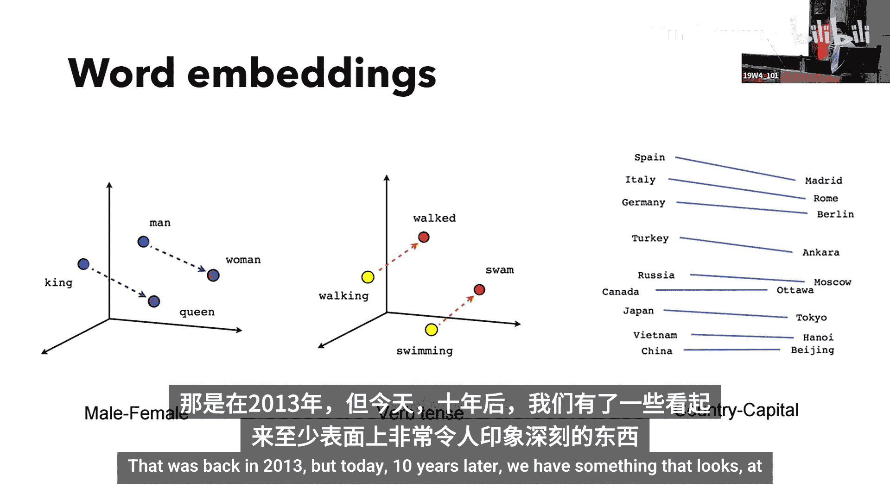
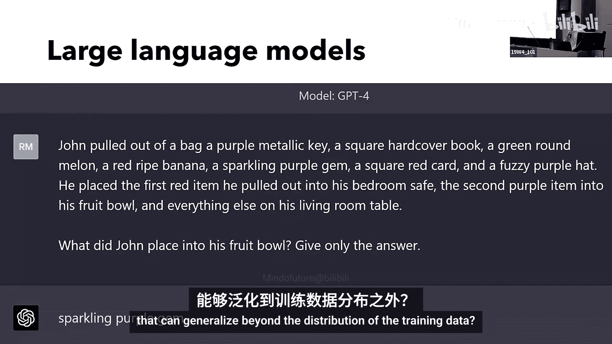
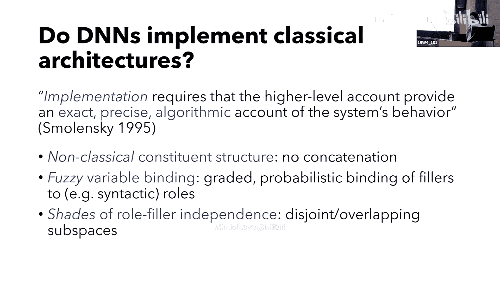
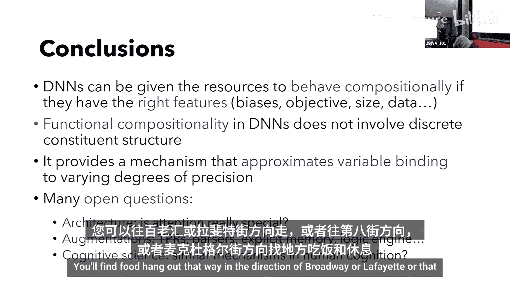

# 007：深度神经网络中的组合性

在本节课中，我们将探讨深度神经网络中的组合性。组合性是语言和认知的核心特征，它允许我们通过已知元素的灵活重组来理解和创造无限的新颖表达。我们将分析深度神经网络是否以及如何实现组合性行为，并探讨其背后的机制。

---

## 引言与致谢

我们的下一位演讲者无需介绍，至少对这个群体而言。他就是我们自己的Raphaël Millière。

Raphaël是哥伦比亚大学科学与社会中心2020年的Robert Abert总统学者，专攻神经科学与哲学。他确实是深度学习的专家，在哲学领域乃至其他领域都堪称权威。

Raphaël是本次会议构想的发起人，早在会议筹备初期就提出了这个想法，并为整个活动的顺利举办付出了巨大努力。我们非常期待听他讲述深度神经网络中的组合性。

在开始之前，我想感谢所有使这次活动成为可能的人，包括哥伦比亚大学和纽约大学的优秀同事、工作人员和学生。这次活动在后勤上充满挑战，我们确实发现哥伦比亚大学和纽约大学的联合力量不容小觑。感谢大家。

---

## 什么是组合性？

上一节我们介绍了本次演讲的背景。本节中，我们来看看组合性这一核心概念。

当我们谈论组合性时，通常指的是语言学中的一个经典原则，该原则旨在量化语言的表达。以下是B. Partee的经典表述：**整体的意义是其组成部分的意义及其句法组合方式的函数**。

因此，组合性的理念是，语言使用者可以通过灵活地重组已知元素来理解和产生潜在无限数量的新颖、合乎语法的语言表达。这被认为是人工语言、形式语言乃至自然语言的核心组成部分。

以句子“Gary dislikes deep learning”为例。这些单词组合成句子的方式至关重要。我们并非像处理词袋一样处理这个句子。如果你打乱单词顺序，变成“deep Gary dislike learning”，这仍然是一个合乎语法的句子，但意义却大不相同。

然而，如上所述的原则非常强，同时也相当不确定。什么构成了整体和部分？意义是否以这种方式组合？复杂表达式的意义是否被严格决定？这些都是可以提出的问题。有理由认为自然语言并非在这种意义上是强组合或严格组合的，但至少它似乎是弱组合的，即至少某些复杂表达式的意义至少部分地由词汇语义和句法的组合决定。

我们可以将这一思想推广到其他领域。这是一篇关于“思维语言”的PBS论文近期评论中的插图。视觉也被认为是组合性的，视觉输入中可能存在以组合方式结合的特性，例如骨架结构和逻辑关系等抽象概念。即使这些组件的某些内容不同，它们在组合结构方面似乎也有相似之处。

---

## 组合性行为与表征

上一节我们定义了组合性。本节中，我们探讨如何用组合性来刻画行为。

鉴于语言乃至其他领域具有组合性，我们希望构建的人工系统能够表现出组合性行为，即能够以正确的方式解析这些领域的组合结构，匹配我们人类的方式。

在语言领域，例如，如果我们构建一个聊天机器人，从文本输入到文本输出，我们希望聊天机器人能够组合性地解析输入，即使其含义可能非常离奇或令人惊讶。

这是一个来自“The man bit the dog that needs urgent care”的经典例子。如果我们仅依赖词袋方法来组合这些单词的意义，我们可能会依赖“man”和“urgent care”共现的常见统计模式，从而推断出“the man needs urgent care”。但如果我们正确地组合性解析输入，就能给出正确答案。

同样，在其他领域：
*   如果我们构建一个以文本为输入、生成图像为输出的图像生成模型，我们希望它能解析正确的组合结构。
*   反之，对于图像描述模型，从图像生成标题也是如此。
*   我们甚至可以将其视为纯粹的视觉领域，例如图像分割模型，它将图像分解为其组成部分的对象。

最后，当我们谈论组合性时，也常常涉及表征。

其理念是，使我们能够实现这种组合性行为的，是一种特定类型的表征格式、结构以及对表征的处理过程。

这是一个来自Lake等人经典BBS论文的近期例子：“组合性是一个经典思想，即新的表征可以通过现有表征的组合来构建。”

这里有两个相互关联的理念：一个涉及表征如何处理，另一个涉及它们如何结构化。其理念是，存在一个函数或过程，可以将表征组合成更复杂的表征，并且这些更复杂的表征具有某种结构。

---

## 经典架构与连接主义困境

上一节我们讨论了组合性行为与表征的关系。本节中，我们来看看关于如何实现组合性的经典观点及其对神经网络的挑战。

在经典的符号架构方法中，我们可以很容易地解释组合性。我们假设，实现这种组合的正确表征是符号表征，采用类似语言的格式，这就是经典的“思维语言”假说。我们拥有离散的组成部分，它们组合成复杂的分子式表征。

这里的理念是，正确的组合概念是我们可以称之为“连接性组合”的概念。其思想是，当我们将原子表征组合成复杂表征时，我们将原子表征的标记共同标记到复杂表征中。因此，我们将表达式的组成部分的标记保留在复杂表达式本身中。

实际上，几乎每一个标准的、熟悉的组合性表征方案在这种意义上都是连接性的，例如语言、形式语言和数理逻辑。

在这种模型中，还存在“角色-填充物独立性”的理念，即组成部分的句法角色与这些角色的填充物之间的独立性。例如，在“Kim thinks Ali”和“Ali thinks Kim”中，我们可以改变复杂表征的结构，而符号“Ali”和“Kim”在复杂表征中的表示方式相同。

经典方法的支持者对人工神经网络提出了一个经典的两难困境。其出发点是，人类语言和认知在很大程度上是组合性的。

这个两难困境如下：
1.  如果人工神经网络缺乏具有正确成分结构的组合性表征来支持这种连接性组合，那么它们就无法以正确的方式表现出组合性行为。在这种情况下，人工神经网络无法解释语言和思维的组合性。
2.  或者，如果它们确实具有正确成分结构的组合性表征，那么它们仅仅是实现了一个经典架构（如思维语言）。

以下是来自Fodor和McLaughlin的引述：“正是因为经典的心理表征具有经典成分和这种连接性组合模式，它们才为结构敏感的心理过程提供了领域。”

有趣的是，我们发现近年来这种两难困境被重新审视。一方面，像Gary Marcus这样的人认为这些系统始终无法处理组合性。另一方面，Jake Ctan等人在PBS论文中提出了更微妙版本的另一种观点，即深度神经网络可能通过实现思维语言的核心特征，在广泛领域和任务中模仿生物感知和认知的表现。

当然，还存在第三种可能性，早在80年代和90年代的旧辩论中就已探讨过：人工神经网络可能表现出组合性行为，拥有组合性结构的表征，但并未实现经典架构。

然而，问题在于，这如何可能？在经典架构中，拥有以正确方式组合的表征是直截了当的，但在深度神经网络或连接主义模型中则不那么直接。

---

## 从连续向量到组合性

上一节我们探讨了经典架构对神经网络的挑战。本节中，我们来看看神经网络如何利用连续向量实现组合性。

这是因为这些模型处理的是连续向量表征。如何从连续向量表征（而非离散符号表征）中获得组合性？

如果你考虑二维向量空间中的两个向量，组合它们的一种方法是简单地对这些向量求平均，从而得到第三个向量。但这似乎无法提供正确的结构。结果向量中肯定没有离散的成分结构，而且这是一个非常简单的操作，似乎无法提供组合性行为所需的任何东西。

我们昨天在Finten的演讲中讨论过浅层词嵌入，它将词汇表中的每个单词转换为一个唯一的向量。使用这种浅层词嵌入，你并没有一种原则性的方法来表示语言中复杂表达式的意义。你能做的是对向量求和，例如，将句子“Gary dislikes deep learning”中的所有单词像词袋方法一样求和，但这并不能真正提供表达式句法结构的正确表征。

那是2013年Word2Vec的时代。但十年后的今天，我们有了至少表面上看起来非常令人印象深刻的东西。这是一个来自GPT-4的例子。我给它一个改编自Gary Marcus例子的提示，该例子本应是组合性的失败案例。

> John pulled out of a bag a metallic purple key, a square hardcover book, a green round melon, a red ripe banana, a sparkling purple gem, a square red card, and a fuzzy purple hat. He placed the first item he pulled out into his bedroom safe, the second purple item into his football, and everything else on his living room table. Why did John place into his football?

它给出了正确答案。要给出正确答案，似乎必须以某种方式处理该句子的组合结构。如果你采用词袋方法，只是对输入向量求和，那可能无法提供实现这种行为所需的资源。

那么，这是如何可能的？这里的计划是将语言模型的性能与其底层能力分开，这也是Nick在本次会议中一直强调的问题。

具体来说，语言模型是仅仅记忆组合结构，还是依赖浅层的统计启发式方法，或者仅依赖内容特定的转换来近似组合性行为？抑或是它们做了更复杂的事情，学习了非平凡的、能够泛化到训练数据分布之外的组合函数？

---

## 评估组合性行为：概念组合

上一节我们提出了关于神经网络如何实现组合性的问题。本节中，我们首先从评估其行为开始。

让我们从组合性行为开始，可以从非常轻句法形式的组合开始，即我们昨天在概念讨论中谈到的概念组合。

人类非常擅长解析组合两个概念的短语名词，这需要将词汇语义与最简句法以及一些背景知识结合起来。这不是Partee意义上的严格组合，但句法确实重要。例如，“car factory”是工厂制造的汽车，而“factory car”不是汽车制造的工厂。因此，考虑概念组合的句法仍然很重要。

我与一些同事（Catherine Stinson也在现场）希望测试语言模型是否能做这种事情。因为Brennan和Gregory Murphy在他们昨天讨论的论文中认为，语言模型无法真正解析新颖的概念组合，特别是那些组合意义具有某些组成部分都不具备的新兴特征的新颖概念组合。

我们为此创建了一个基准测试任务。这是一个由Google Brain主导的名为Big Bench的大型基准测试项目，用于评估语言模型。我们提交了一个任务来尝试这一点。我们有几个子任务，以下是一些例子：

*   **示例1（实际词汇概念组合）**：概念是“wooden deer”。问题是“以下哪个句子最能描述wooden deer？”，然后有四个候选句子。我们可以使用似然度来评估模型认为哪个句子最适合该问题。这是一个使用训练数据中存在的概念或词汇的例子。
*   **示例2（元词汇）**：我们在提示中定义词汇。“pleater”意为通过拍打翅膀飞行的物体，“nif”意为没有羽毛的物体。问题是“以下哪个句子最能描述pleater nif？”
*   **示例3（矛盾组合）**：概念是“deadly caregiver”。问题是“以下哪个句子最能描述deadly caregiver？”，正确答案是“homicidal nurses are delicate caregivers”。

重要的是，我们在备选答案中包含了大量这类干扰项，以区分对浅层启发式方法的依赖和对新颖概念组合的实际解析。

当Google在许多模型上运行此任务时，我们对初步结果感到非常满意，因为该任务的目标是难度很高，即人类能做得好而语言模型做不好的任务。包含GPT-3的初步结果确实引人注目，事实上，这是所有提交的Big Bench任务中差异最大的之一。人类平均表现很好，最佳人类表现完美，而模型的表现基本上是随机的。

然后，Google训练了其内部语言模型PaLM，它比GPT-3更大（GPT-3有1700亿参数，PaLM有5400亿参数）。在零样本情况下，PaLM基本上达到了人类的平均水平。遗憾的是，GPT-4论文没有在Big Bench上评估模型，因为训练数据中存在一些污染，他们试图避免，但不知何故，Big Bench的一些任务泄露到了训练数据中，因此他们未进行评估。但你可以想象GPT-4的表现至少会和PaLM一样好。

---

## 评估组合性行为：句法泛化

上一节我们看了概念组合的例子。本节中，我们探讨更复杂的句法组合泛化。

我们想要的是能够以正确的组合方式泛化复杂输入的模型。这里的一个相关问题，正如Tal昨天讨论的，对于在大量人类数据上训练的大型语言模型，很难区分性能的哪部分归因于真正的泛化，哪部分仅仅归因于记忆训练数据中的某些特定结构。解决这个问题的一种方法是使用合成数据。你可以创建一个合成基准或合成数据集，使得学习正确的输入-输出映射并在测试集上泛化到训练数据之外，需要严格的组合性泛化。

多年来已经开发了许多这样的合成数据集。以下是来自Lake和Baroni的SCAN数据集的例子。其思想是将左侧的指令翻译成一个小代理可以在虚拟世界中执行的动作，这需要组合性地解析这些输入。例如，有“twice”这样的术语，要求你执行一个动作两次。为了在这个数据集的某些部分正确泛化，你必须进行组合性泛化。

多年来，这些合成数据集上的性能表现和改进模式相当有趣。我们看到类似的趋势，即性能显著提高。同样，这是针对在这些合成数据集上训练的模型。情况有点复杂，因为准确率取决于数据如何划分。关于这方面的研究很有趣。像SCAN这样的数据集基本上可以说已经解决了，有些模型具有完美或接近完美的性能。但对于其他数据集，例如更难的COGS，一些泛化仍然具有挑战性，例如递归似乎更具挑战性，而其他一些则似乎完全解决了。

当然，如果你用显式的组合性语义解析器来增强语言模型变换器，那么你实际上可以获得完美的性能。但问题是，你能否在没有将正确的句法先验构建到模型中的情况下做到这一点？

似乎有帮助的因素包括：
*   **架构调整**：例如，位置编码的一些修改，模型如何编码输入序列中标记的位置。
*   **学习策略**：如元学习或同时训练多个任务，以鼓励泛化的方式。
*   **数据增强策略**：自动重组训练实例以创建新的人工训练数据，直接帮助模型泛化。

我们可以讨论这些不同因素有多大帮助，以及在多大程度上改变模型会产生差异。尽管如此，你可以在这些基准上实现非常好的性能（虽然不是完美），而无需嵌入显式的句法解析器。因此，这些模型中无疑存在一些非平凡的、高度非平凡的组合性泛化量。

---

## 解释组合性：内部机制探索

上一节我们看到了神经网络在组合性任务上的表现。本节中，我们探讨如何解释这种能力，并开始形成关于其内部工作机制的假设。

Nick已经暗示过，会议中的许多人也都暗示过，有不同方法可以尝试打开这些模型的黑箱，尝试根据它们获得的表征以及处理这些表征的方式来推断内部发生了什么。

一种方法是探测，昨天在Jacqueline的演讲中详细讨论过，这里不再赘述。已有大量工作表明，如果你尝试使用分类器探针从模型的内部激活中预测输入的特定组合属性，你实际上可以恢复很多信息。例如，像BERT这样的模型（即使是与当今模型相比相对较小的模型）编码了关于词性、句法块、不同语义角色和句法角色的信息。也有证据表明，共享句法子树（如左图所示）的单词在模型的预测中彼此影响更大。

当然，正如昨天Rone Jacqueline的演讲中提到的，这最多只能揭示模型中存在可通过正确探针解码的信息。但这本身并不能告诉你模型是否在利用这些信息来产生输出，以及如果是，模型是如何利用这些信息的。

你可以通过各种方式超越这种探测方法，这可能在方法论上变得相当棘手和复杂，无法在此深入细节，但我想在专注于其中一种方法之前提及各种方法。

Tom McCoy等人进行了一项非常令人兴奋的工作，他们研究了不同的深度神经网络架构，并询问这些架构是否可以近似张量积表征。张量积表征是Paul Smolensky在关于组合性的连接主义与经典方法辩论的早期开发的一种巧妙策略。这种架构依赖于拥有在极限下正交的不同类型的向量。其中一些向量是填充物向量（如句子“Kim thinks Ali”中的Ali和Kim），另一些是角色向量，它们绑定到不同组成部分的角色（如该特定逻辑表达式的施事者或受事者）。你可以通过称为张量积运算的方式组合角色向量和填充物向量，这是一种可逆的运算，因此一旦你完成了张量积，就可以将得到的张量积表征分解为组成部分的角色和填充物向量。这是一种旨在实现这种角色-填充物绑定且具有角色-填充物独立性的表征，因为你可以以独立的方式表示角色和填充物。

但在这种架构开发的早期，存在一些问题，其中之一是角色向量（例如这些句法角色）在某种程度上是特设的，你必须将它们构建到模型中。当然，这不是当前模型的学习方式，也不是我们希望它们学习的方式。

但有趣的是，Tom McCoy和同事发现，循环神经网络和Transformer（还有尚未发表的工作）在简单的符号任务上训练时，可以被张量积表征以接近100%的准确率近似。这非常有趣。例如，对于RNN，它由编码器和解码器两部分组成，他们表明你可以用他们称为张量积分解网络的部分替换编码器部分，该网络以这样的方式设置张量积表征，然后解码器可以利用这个张量积网络的输出，基本上表现得一样好。

这非常有趣，它超越了这种探测方法，因为你可以替换网络的整个部分，并在输出中发现等价性或收敛性。这是在简单符号任务上训练的模型。同样，如前所述，还有正在进行的工作（尚未发表），来自Tom的问题，当你使用自然出现的句子而不是模板句子时，近似本身在像BERT这样的模型的较低层仍然非常强，但在较高层变得稍弱。这也很有趣，我们可以讨论其中的一些含义。但如果你使用符号任务或模板生成的句子，你会得到接近100%的准确率。

另一项有趣的工作来自Chris Manning的实验室，也非常新（可能仍在审稿中或已被ACL接受）。同样，由于他们所做的实际上相当复杂，我无法在此深入细节。这不是一项探测研究。他们在这里提出的问题是：Transformer模型实现的计算功能是否类似于自然语言的层次树状结构？

为此，他们发明了一种新方法，涉及掩码输入序列的一部分（如“red apples are delicious”），以查看模型为字符串的子部分编码了哪种表征，试图获得那种上下文无关的表征，然后获得相同元素在整个输入上下文中的表征。他们这样做是为了构建那个小表格，然后他们通过找到最佳匹配的二叉树（他们称之为树投影）以及相应的树分数，来找到最能近似该特定输入序列的Transformer的树结构循环神经网络，这种方式是完全无监督的。

他们发现的另一件我认为相当有趣的事情是，这不仅效果很好，而且他们测试的Transformer在训练过程中变得更加树状。他们发现了这种非常有趣的关系：越树状的模型在这些组合性泛化测试中泛化得越好，而那些不那么树状的模型则较差。这开始看起来像是对Transformer组合性泛化能力的一种解释，即其表征的树状结构。

---

## 机制可解释性与注意力机制

上一节我们探讨了几种研究神经网络内部表征的方法。本节中，我们重点介绍一种最令人兴奋的方法：机制可解释性。

这是一种主要由Anthropic的Chris Olah及其同事开创的方法，但现在许多人都在研究。它涉及尝试查看模型中的电路，即网络内的子网络或子图，你可以尝试逆向工程并解释该特定电路在信息处理方面的作用。

这更容易在小型模型中进行，在大型模型中变得困难得多。但这可以让我们深入了解网络中部分实现的实际计算类型，以及这与它们产生的输出有何关系。

我知道Cameron说过我们约定不解释Transformer架构和注意力，我将尊重部分约定，因为不会深入键、查询和值向量等内容。我认为机制可解释性人员以这种方式构建框架更有帮助和直观，即残差流的概念。

如果你取一个Transformer（这里不是真正的Transformer，因为没有显示所有层和高度非线性的多层感知机部分，只关注注意力机制这一架构的关键方面），将其视为一种残差流是有用的，这是处理输入序列中每个标记的流，从输入到输出跨越整个网络。

其中有不同的元素：输入标记（你输入到模型的内容）被嵌入为向量，这些向量最初是上下文无关的（只是词汇表中每个标记的唯一向量）。然后你进行一个小操作，添加一些关于标记在输入序列中位置的信息，称为位置编码（有各种方法，但我们不需要深入）。

我想关注的关键部分是多头注意力模块。你有多个这样的模块堆叠在多个层中，它们由不同的注意力头组成，每个头做一些我们稍后会讨论的事情。你进行这种加权求和，返回一些向量。因此，在嵌入阶段，我们有一些输入向量，然后在每一层应用多头注意力后，你得到修改后的向量。最后，在网络末端，你有解嵌入矩阵，从这些向量转到词汇表上的概率分布（logits），使你能够预测输入序列后应该出现的单词。

那么，这些注意力模块在做什么呢？我认为机制可解释性工作的真正有趣之处在于发现注意力选择性地和动态地路由信息。

*   **选择性**：因为每个注意力头在训练期间会逐渐对跟踪标记之间的某些依赖关系或关系更加敏感，这可以非常抽象。
*   **动态性**：因为注意力头编码和解码的信息可以被路由到网络的其他部分，供其他层或其他注意力头进行进一步处理。

再次以“Ali thanks Kim”为例。对于一个标记，你在嵌入阶段有一个向量。然后，在应用多头注意力之后，你有一个修改后的向量（例如，这里只有三个维度）。你的向量发生了变化，这是因为多头注意力模块中发生的事情。

但机制可解释性研究的关键发现之一是，这些不同的注意力头可以读写信息到主嵌入空间的子空间。主嵌入空间维度非常高（在GPT-3中超过12,000维），但这些注意力头通过将嵌入向量投影到非常小的子空间（相比之下）来工作。同样，为了直观表示，我展示了3D嵌入空间的二维投影中的子空间。

重要的是，注意力头读写信息的子空间可以是不相交的。由于有这么多可用的维度（如此高维的空间），并且初始嵌入并未使用所有这些维度，因此你可以读写信息到不相交、互不干扰的子空间。

因此，对于流中的每个标记，每个注意力头在做两件事：
1.  确定，根据其在训练期间获得的特定功能，它应该更多地关注输入中的哪些其他标记（包括源标记本身）。这就是为什么它被称为“注意力”。
2.  确定应该从它关注的标记中检索哪些信息，并将其移动到残差流中。这就是它读写信息到子空间的方式。

再次以句子“Ali thanks Kim”为例，使用一个非常玩具化的模型，你可能会认为有一个特定的注意力头（你会发现看起来非常像这样的东西）可能正在跟踪该句子中“感谢”关系的施事者是谁（是Ali而不是Kim）。当该注意力头将主嵌入投影到这个子空间时，可能是一个专门跟踪施事者角色的子空间。它会给予标记“thanks”与标记“Ali”（或代表Ali的标记）较高的注意力分数，因为Ali是这个特定句子的施事者。然后，它将从Ali的投影向量中检索信息，并将其向上游移动以供其他处理。

重要的是，这发生在多个层上，并且信息（如前所述，由于动态路由）可以从一层路由到另一层，跨越位置。因此，认为残差流和每个标记的嵌入只是关于该标记的信息，实际上并不那么有帮助，因为信息在移动。随着你在网络中处理信息，它变得高度组合，因为存在结构化的信息在子空间中被路由，不仅跨层，而且跨不同的流，这些信息被组合在一起，以执行开始看起来像更复杂算法的操作。

这是一个使用机制可解释性研究人员开发的小型网络（GPT-2 small）工具的例子，针对这个特定的句子。你可以看到，在某一层中有一个注意力头，对于标记“thanks”，它给予“Ali”较高的注意力分数，因此它在那里跟踪某种关系，可能由这个特定的注意力头跟踪。

但这里的重点是，由于注意力头可以在不相交的子空间上工作，这些子空间可以充当一种虚拟的内容可寻址存储器：你可以向其中写入信息，也可以从中读取信息。当子空间之间没有干扰时，这开始看起来有点像某种形式的可变绑定（我稍后会回到这一点），但肯定像Nick所说的非内容特定计算。

以下是具体的例子（我不会深入细节）。这是一个逆向工程特定操作的例子：当你在Python中定义一个函数时，你可以为该函数的文档提供一些参数，当你预置这个参数变量时，你希望模型预测下一个标记应该是“files”。他们逆向工程了执行该操作的注意力头算法，发现了一个在预Transformer模型或模型注意力中的电路。这个电路包括跨不同层的三个级别的组合，包括一个在提示的不同部分做不同事情的注意力头。

但我想在这里指出的是，这种组合方式可以实现本质上更抽象的角色与某些填充物之间的绑定。他们发现的算法类似于“预测定义中出现的参数，该参数在前一个文档行中见过”。它正在以这种方式移动信息。

这是另一个真实世界的例子，使用一个实际在上下文上训练的模型（GPT-2 small），这是识别间接宾语的电路逆向工程。如果你有句子“When Mary and John went to the store, John gave a drink to”，你希望模型预测“Mary”，以确定正确的间接宾语应该是什么。这里有一些工作展示了这是如何工作的。当然，当你看到这样的东西时，很容易觉得像是在广泛推测和解读茶叶，但这不仅仅是解读茶叶。实际上，你可以使用各种方法（如激活修补等）对这些电路的不同部分进行消融和因果干预，以验证你的假设。

---

## 深度神经网络是否实现了经典架构？

上一节我们深入探讨了Transformer内部的机制。本节中，我们回到最初的问题：具有这种结构的深度神经网络是否实现了经典架构？

根据Fodor的定义，实现要求高级描述为系统的行为提供精确的算法描述。如果你按照这样的定义，我认为不能说这里实现了类似经典架构的东西。

存在一种成分结构的形式，但它不是连接性的，不是经典意义上的。存在一种我倾向于称之为“模糊可变绑定”的东西，即填充物到角色（如句法角色）的渐变和概率性绑定，而不是严格的代数可变绑定。这也是我想在Nick的演讲基础上补充的：我认为内容特定和非内容特定计算之间的区别是程度性的。我们在这些模型中观察到的是，根据提示的偏差方面，你可以处于更内容特定的转换机制或非内容特定的机制中。

你在这里也有角色-填充物独立性的影子，但这也是渐变和概率性的。你有这些子空间，在极限情况下，当它们真正不相交时，会给你更多的角色和填充物之间的独立性；当它们部分重叠时，会产生干扰，并非完全分离。

我想用一个我认为在模型实际行为中能很好说明这一点的例子来结束。我使用GPT-4，并要求它表现得像一个Python解释器，只给我像Python shell那样的输出。我首先定义了一个带有一堆变量的函数，它按预期行为，像Python解释器那样重复该函数。然后我定义了另一个函数，实际上是返回斐波那契数列中的第n个数，但我用一种稍微复杂的方式来表述它，使其不那么容易识别它在做什么。它再次做到了。然后我要求它用三个不同的输入组合这两个函数，输出是正确的。我认为这是高度非平凡的。

你可以要求它解释答案，然后它会分解操作的不同部分，将变量绑定到值。但同样，你可以在没有这种分解的情况下进行零样本操作。这就是为什么我试图反驳它们只能在输出中进行非内容特定计算的观点。这也不仅仅是记忆，如果你要求它为“memory”做这件事，它会给出错误的答案，对于这个操作的第二部分给出了错误的答案。

正如Nick提到的，我认为经典架构的组合性有一些好处。但这里的区别是，我更倾向于认为这里存在某种形式的非内容特定计算，而不仅仅是在输出中完成。我认为其好处在于：
*   **非正式领域的灵活性**：离散的网格结构和代数规则通常过于僵化，无法很好地拟合数据。
*   **可处理性**：我们对计算复杂性爆炸有更多关注。
*   **这种计算的通用性和涌现性**：我没有讨论这一点，但关于grokking有非常有趣的工作，表明在模型训练过程中，存在从记忆到类似规则的通用计算的转变。我可以在问答环节回到这一点。

---

## 结论与开放问题

本节课中，我们一起学习了深度神经网络中的组合性。我们探讨了组合性的定义、评估神经网络组合性行为的方法，以及解释其内部机制的多种途径。

总结来说，我认为深度神经网络如果具有正确的特征，可以被赋予组合性行为和泛化的资源。这是一种功能性组合性，而非连接性组合性，不涉及离散的成分结构。

放弃那种严格代数约束的结构可以带来一些好处。这提供了一种机制，似乎能以不同程度的精度近似可变绑定，当然也有一个上限，限制了你可以用此做什么。

还有许多开放问题：
*   注意力机制在架构中真的特殊吗？
*   你是否需要将这种模型与其他东西（包括逻辑引擎）结合起来，才能真正在计算泛化方面表现得和人类一样好？
*   从这类研究中，我们可以为认知科学汲取哪些见解？

我已经讲得太久了，就到这里。谢谢。

---

**本节课总结**：在本节课中，我们一起学习了组合性在深度神经网络中的体现。我们从组合性的定义出发，探讨了神经网络在概念组合和句法泛化任务上的表现。通过介绍探测、张量积近似、树状结构分析和机制可解释性等方法，我们深入了解了神经网络内部可能实现组合性计算的机制。最后，我们讨论了这是否意味着神经网络实现了经典的“思维语言”架构，并得出结论：神经网络通过一种功能性的、非连接性的、基于模糊可变绑定的方式实现了组合性，这为其带来了灵活性和可处理性等优势，同时也留下了许多有待探索的开放问题。