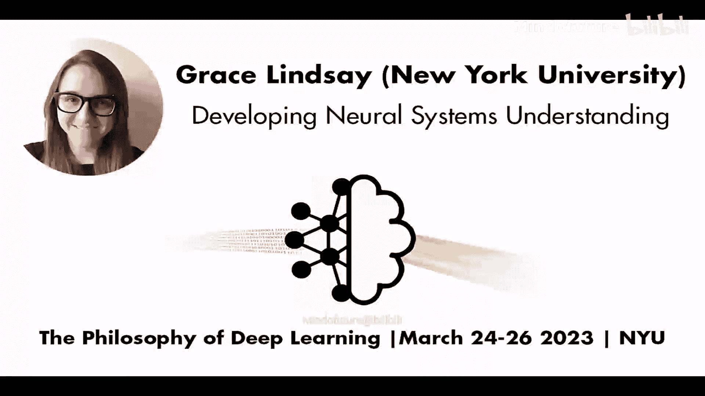
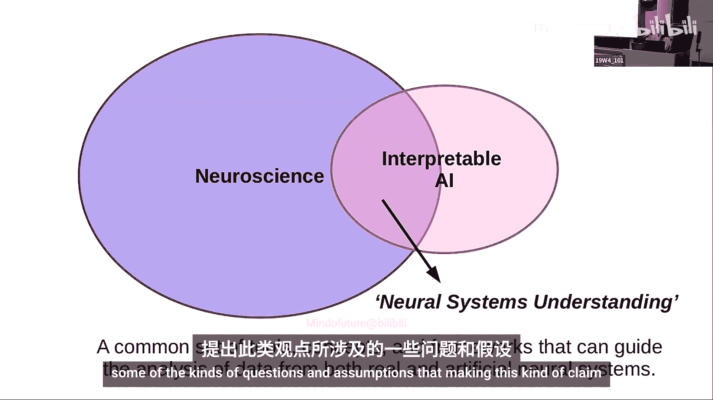
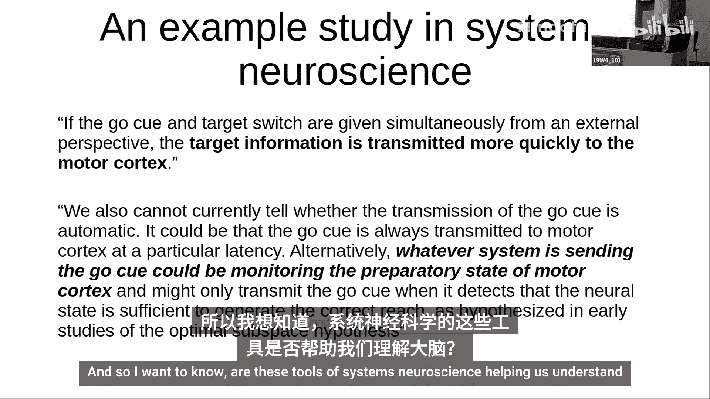
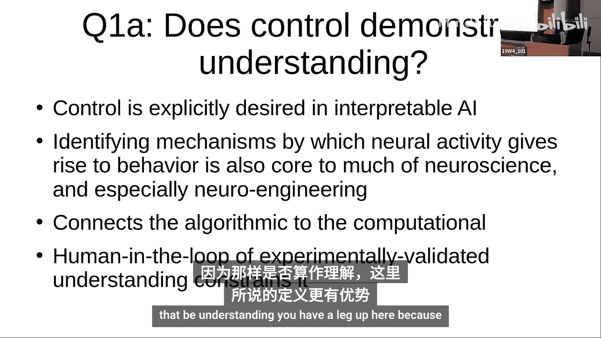
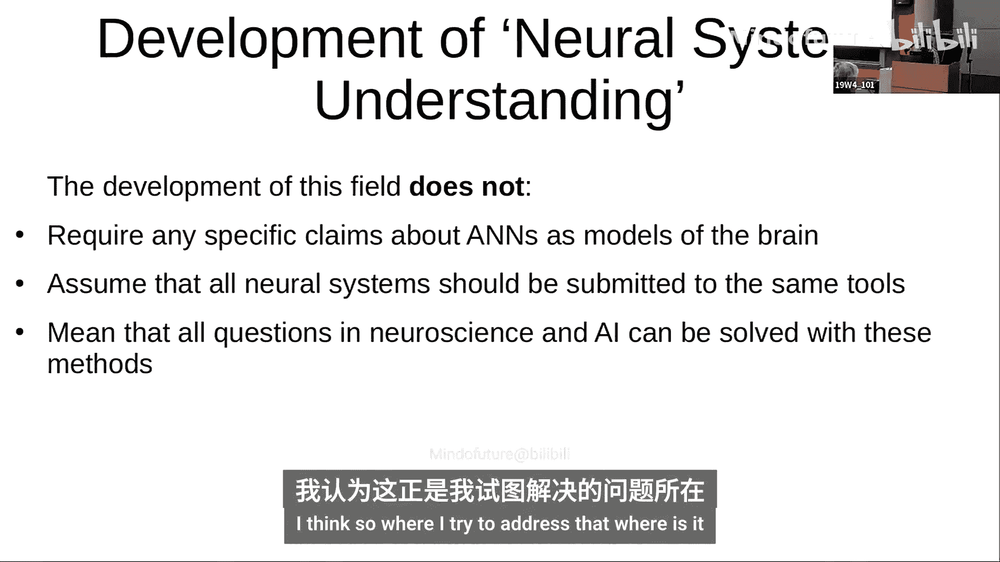
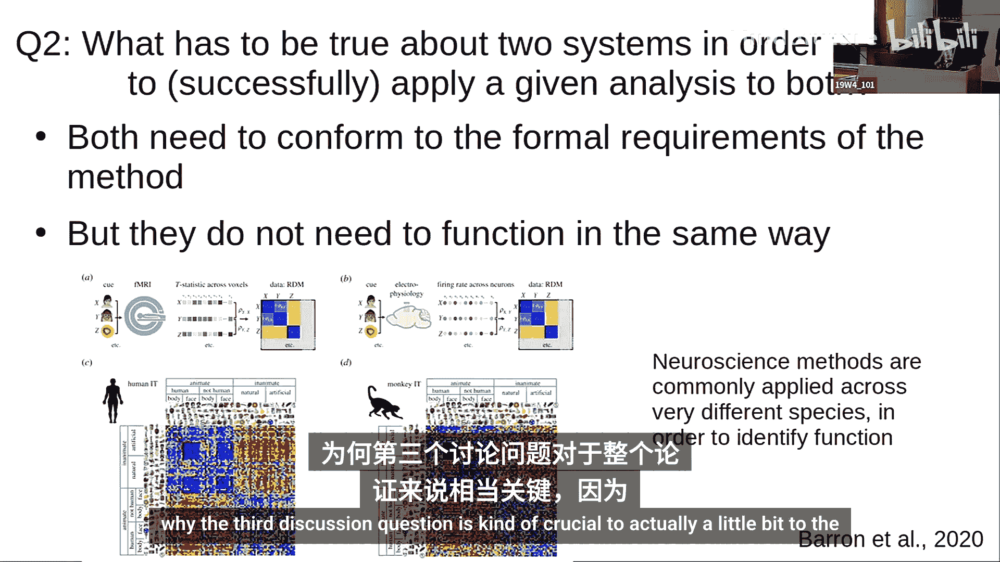
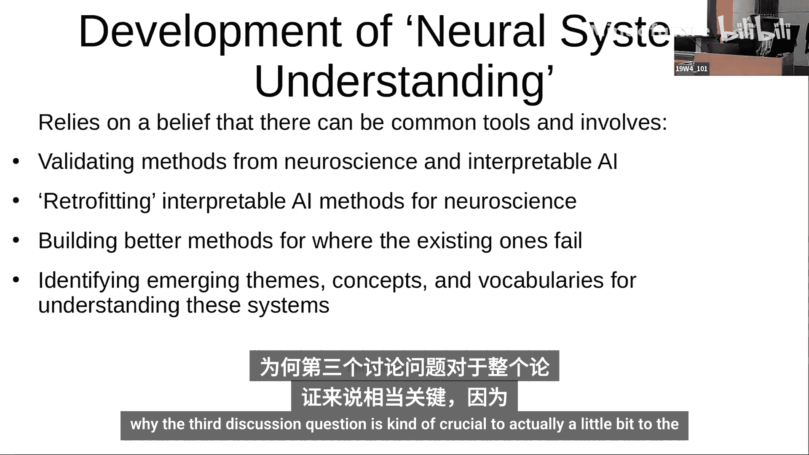
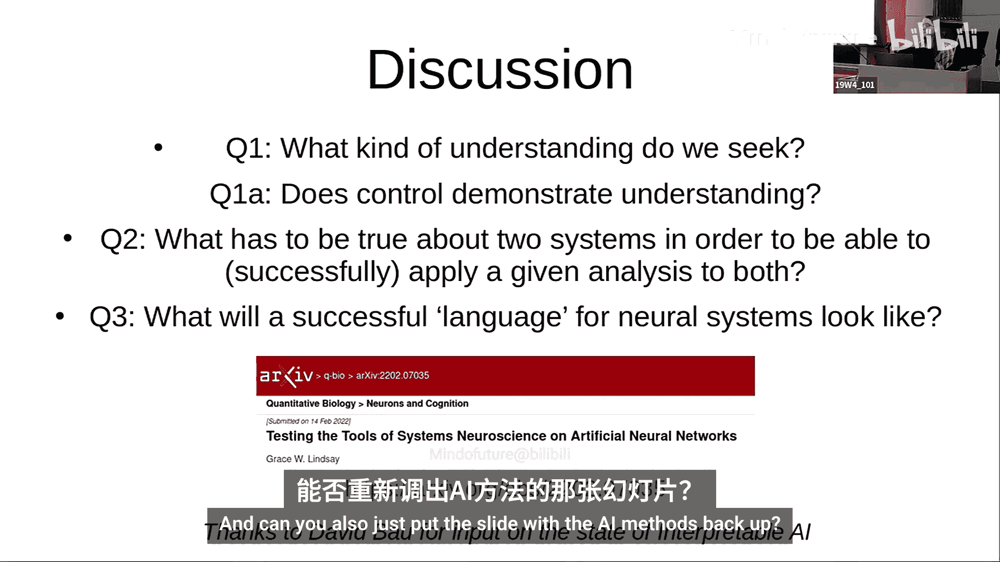
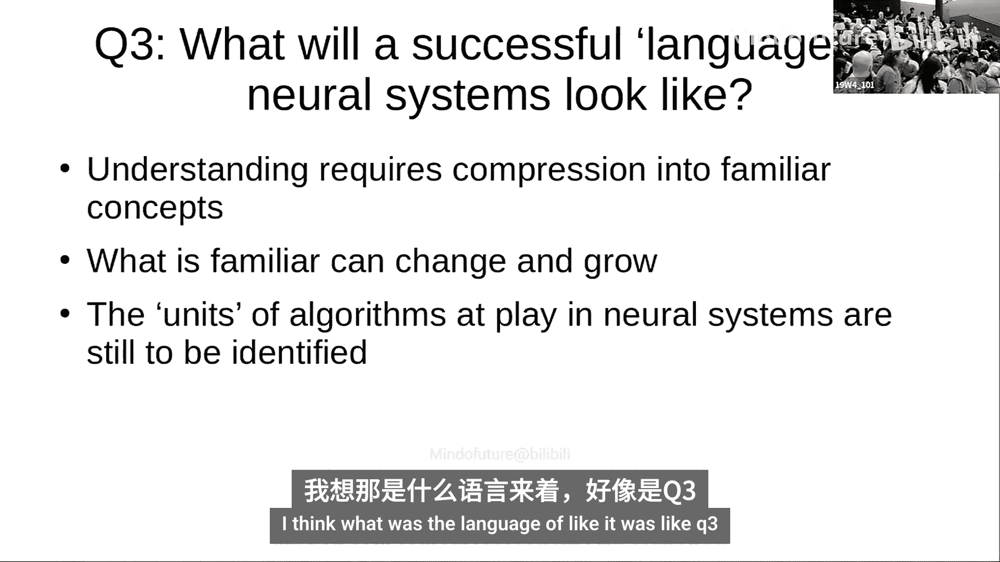
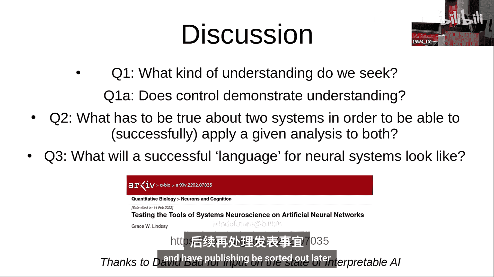

# 008：发展神经系统理解

## 概述

在本节课中，我们将探讨如何发展一个统一的“神经系统理解”领域。我们将回顾神经科学中分析复杂神经系统的常用方法，并论证将这些方法应用于人工神经网络进行验证和测试的必要性。核心目标是建立一个能够指导分析真实与人工神经系统的通用工具、概念和框架。

---

## 神经科学的分析方法

上一节我们介绍了课程背景，本节中我们来看看神经科学领域是如何分析神经系统的。神经科学已有超过百年的历史，其核心目标是理解神经系统如何产生行为。一个典型的例子是2014年一篇关于运动皮层的研究论文。

该研究的目标是观察在不同伸手条件下，运动皮层的活动如何变化。实验对象是一只经过训练的猕猴，它需要将手臂伸向不同方向。实验的基本流程是：猴子将手臂保持在中心位置，然后获得一个目标位置提示，接着经过一段延迟，最后获得“开始”信号以执行动作。还有一种变体是，在延迟后，目标位置可能发生改变，猴子需要重新准备并执行新的动作。

研究人员在实验过程中记录了运动皮层神经元的电活动。他们获得了单个神经元在整个实验过程中的响应数据，通常以神经元每秒发放的动作电位数量（即发放率）来表示。

神经科学家们花费了数十年时间，通过观察神经元对不同刺激或动物行为的响应图，试图理解神经元在做什么。他们尝试对神经元进行分类，并理解大脑如何处理输入或产生输出。

---

## 从单神经元到群体分析

然而，仅通过观察大量单个神经元随时间变化的活动来得出有用结论是相当困难的。近年来，随着记录神经元数量的技术提升，神经科学领域已转向使用降维方法来分析神经活动。

在上述研究中，研究人员对全部神经元的群体活动进行了主成分分析。这样，他们可以将成百上千维的神经活动空间，简化为三维空间进行可视化。

以下是该研究的主要发现：
*   在正常试验中，神经活动会从基线状态移动到与特定运动方向相关的“准备状态”，并在那里停留，直到“开始”信号出现，然后执行与运动相关的动态模式。
*   在目标切换试验中，如果“开始”信号与第二个目标提示同时出现，神经活动会完全跳过与第二个运动相关的准备状态，直接执行运动。

这项研究更新了人们对运动皮层动力学的理解模型。研究人员提出，运动皮层可能包含两个不同的动力学子系统：一个负责准备，一个负责运动生成，并且运动生成可以在没有准备系统的情况下发生。

此外，研究还发现了一个有趣的现象：即使实验者同时给出目标信息和“开始”信号，运动皮层的神经活动显示这两种信息并非同时出现。研究人员推测，可能存在另一个系统在监控运动皮层的活动，并选择恰当时机发出“开始”指令。

这个例子代表了神经科学论文中的常见模式：处理高维动态数据，使用降维等方法进行分析，根据结果构建或更新关于系统如何工作的“故事”，有时还需要借助实验未涉及的外部因素来解释某些现象。

---

## 什么是“理解”？

上一节我们看到了神经科学的分析方法，本节中我们来探讨一下，我们所说的“理解”一个神经系统究竟意味着什么。从神经科学的角度，我们常常借助**马尔层级**来思考这个问题。

*   **计算层级**：定义系统的目标，即系统试图做什么。例如，运动皮层的目标是产生伸手动作。
*   **算法层级**：实现目标所需的步骤或过程。这是一个简化的、有损的故事模型，但应具备一定的预测能力。
*   **实现层级**：执行算法的物理实体，例如特定的神经元和脑区。

神经科学，尤其是系统神经科学，主要追求的是算法层级的理解。这种理解应该是一个**有效且准确的模型**，意味着你能够用它来做一些事情。

为了更具体地定义“理解”，我们引入 **“实验验证的理解”** 这一概念。其核心思想是：
1.  对一个复杂神经系统应用某种分析方法，得到一个简化的理解（算法模型）。
2.  基于这个简化理解，设计一个后续实验。
3.  该实验的结果应能验证你的理解，特别是要能够**基于对系统的理解来控制其行为**。

例如，如果我们理解了运动皮层的活动如何编码伸手方向，我们就应该能够通过调制运动皮层的活动来改变伸手的动态。

---

## 为何需要人工神经网络？

你可能会问，控制行为就等同于理解吗？虽然训练一个大型神经网络来控制一个系统本身不代表理解，但“实验验证的理解”要求有一个“人类在环”的步骤：人类需要提出简化的故事并设计实验。这形成了一个压缩瓶颈，确保了理解不仅仅是黑箱控制。

然而，在真实的神经科学中，进行这种精确的、闭环的实验验证非常困难，因为技术限制使我们无法对大脑进行精细、可控的扰动。

因此，我们主张在**人工神经网络**上大规模测试神经科学的工具。具体计划如下：
1.  选取一种神经科学分析方法。
2.  将其应用于一系列不同架构、不同任务、不同训练方式的人工神经网络。
3.  基于分析方法得出的简化理解，设计实验来尝试控制该网络。
4.  通过在不同网络上重复此过程，评估该工具是否可靠地提供了我们期望的理解。

人工神经网络是进行此类测试的理想平台，原因如下：
*   **完全可扰动**：你可以进行几乎任何实验（改变神经元活动、连接、训练过程、输入数据等），没有技术限制。
*   **完全可观测**：所有数据都在模型中，如果无法解释，问题在于分析方法本身，而非数据缺失。
*   **答案未知**：与使用已知答案的模拟数据测试不同，我们对人工神经网络的算法层级理解尚不充分，这迫使我们必须明确定义“成功”的标准，避免了先验知识的干扰。

---

## 构建统一的领域

上一节我们论证了在人工神经网络上测试神经科学工具的价值，本节我们来看看如何构建一个统一的“神经系统理解”领域。这不仅仅是单向的测试。

首先，我们不仅应该验证来自神经科学的方法，也应该验证来自**可解释人工智能**的方法。许多可解释AI方法（如某些非线性探针）本身就包含了控制验证的思想，但并非全部。所有方法都需要通过相同的“实验验证”程序进行检验。

其次，为了真正统一领域，我们可能需要改造一些可解释AI的方法，使其能够应用于约束更多、更困难的神经数据。

最终，通过长期进行这种联合研究，我们有望识别出描述这些系统的共同主题、概念和词汇，这是我们目前所缺乏的。

需要明确的是，这项工作：
*   不要求对“人工神经网络是否是大脑的模型”做出特定断言。
*   不假定所有神经系统都应使用相同的工具，而是旨在识别特定工具在何种情况下有效。
*   不意味着能解答神经科学和AI中的所有问题（例如离子通道层面），而是针对算法层级的问题。

---

## 面临的挑战与未来方向

推动神经科学与可解释AI更紧密地结合，面临着概念上的挑战。我们目前缺乏描述高维、非线性、循环、分层、分布式神经系统的有效**词汇表**。

真正的理解需要压缩和抽象。数学史上，曾经只有顶尖学者能掌握的概念，如今已成为高中课程，并作为构建更复杂知识的基础。同样，我们需要为神经系统的算法开发新的抽象单元（例如，我们现在可以轻松地用“Transformer”这个模块来指代一个复杂结构）。目前，我们还没有这样的词汇表，这阻碍了进展。

有些人认为，理解神经网络的唯一方式就是了解其架构、目标函数、训练算法和训练数据，除此之外无法进行有意义的压缩。我们对此持乐观的反对态度。理论上，压缩是可能的；实践上，机器学习领域已有工作致力于压缩训练好的网络（如模型蒸馏）或提取其生成规则，这些都可以为我们如何理解系统提供灵感。

---

## 总结

本节课中我们一起学习了如何发展一个统一的“神经系统理解”领域。我们回顾了神经科学分析方法的实例，定义了“实验验证的理解”作为目标，并论证了在完全可观测、可扰动的人工神经网络上大规模测试这些工具的必要性。构建这一领域需要神经科学与可解释AI双向奔赴，共同验证方法、开发新工具，并最终建立描述复杂神经系统的共享概念框架。尽管面临定义抽象层级和开发新词汇的挑战，但这一努力对于深化我们对智能系统如何工作的理解至关重要。