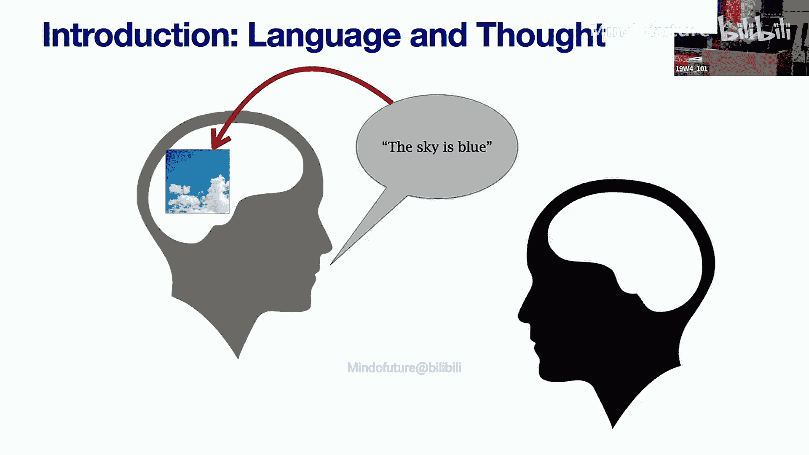
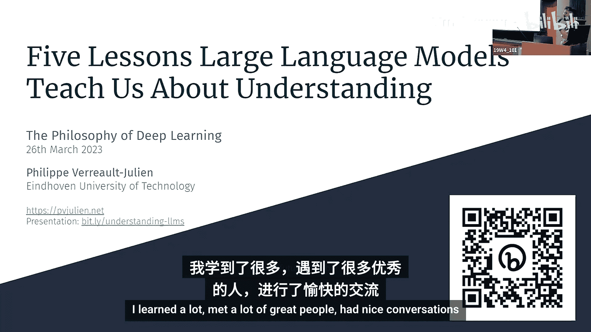
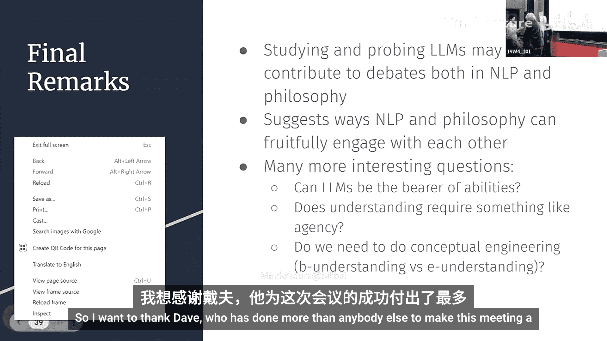

# 009：大型语言模型的语言与认知能力

在本节课中，我们将探讨大型语言模型（LLMs）在语言处理和认知能力方面的表现。我们将分析其“形式语言能力”与“功能语言能力”的区别，并讨论模型是否具备真正的“理解”或“交流意图”。通过结合神经科学、哲学和人工智能的视角，我们将梳理当前关于LLMs能力的核心辩论与见解。

---

## 形式与功能语言能力：来自神经科学的启示

上一节我们介绍了课程的整体框架，本节中我们来看看如何借鉴人类大脑的结构来理解LLMs的能力。来自MIT的Anna Ivanova提出，我们可以将语言能力区分为“形式语言能力”和“功能语言能力”。

*   **形式语言能力**：指对语言本身规则和模式的知识，例如句法、词法和语法。在人类大脑中，这主要由一个独立的“语言网络”处理。
*   **功能语言能力**：指在现实世界中使用语言所需的、非语言特定的技能，如数学推理、社会推理和世界知识。这些能力依赖于大脑中其他专门网络。

这种区分有坚实的神经科学基础。大脑的语言网络对各类语言处理（听、说、读、写）反应强烈，但对数学、逻辑推理等非语言任务反应微弱。此外，大脑语言网络受损的病人可能丧失语言能力，但其他认知功能（如推理）却可能保持完好。

那么，大型语言模型在这两方面的表现如何呢？

以下是评估LLMs能力的一些核心发现：

*   **形式语言能力**：以GPT系列为代表的现代LLMs在语法判断、长距离依赖（如主谓一致）等任务上表现优异，已接近人类水平。这表明它们在掌握语言的形式规则方面非常出色。
*   **功能语言能力**：LLMs在需要多步骤的正式推理（如数学运算）和**稳健、系统化的世界知识**方面仍然存在明显缺陷。它们的知识可能是脆弱、有偏见和不完整的，容易受到提示词或对话上下文的影响。

这种区分提示我们，在构建和评估未来的语言模型时，可能需要采用更模块化的架构（类似人脑），并设计更有针对性的评测基准，分别检验其形式和功能能力。

---

## 语言模型是否缺乏交流意图？

上一节我们讨论了LLMs在能力上的分化，本节中我们转向一个更根本的哲学问题：LLMs是否具备“交流意图”？匹兹堡大学的Nuhu Osman Atta对此进行了分析。

许多批评者认为，LLMs（尤其是基于Transformer的模型）缺乏真正的交流意图，因为它们的内在机制（如下一个词预测）从根本上就不适合编码意图。然而，这个论点面临几个挑战。

首先，即使在人类认知科学中，“交流意图”的心理现实性也存在争议。它可能更像是一个解释社会行为的边界条件，而非一个具体的、可定位的内在表征机制。

其次，在更早的、面向任务的对话系统中，研究者曾明确设计模块来表征用户的可能行动意图（如订餐、查询评分）。虽然现代Transformer模型没有这样的显式模块，但通过适当的“探针”分析，我们能在其表征中发现对句法、语义、共指等特征的敏感性。这表明，仅通过检查模型架构就断言其“无法”具备某种功能是草率的。

最后，序列预测本身在人类语言处理中扮演着重要角色（例如，N400脑电波成分与词汇预测概率相关）。因此，将基于序列预测的模型完全排除在“可能具备交流意图”的范畴之外，理由并不充分。

总之，关于LLMs是否具有交流意图的许多否定性论证是薄弱的。与其纠缠于此，不如转向更具体的社会技术问题，例如：在何种社会情境下，我们会倾向于将意图赋予机器？模型的训练过程（如基于人类反馈的强化学习）是否引入了类似人类学习意图的对话语境？

---

## 功能、内容与理解：一个语义学视角

上一节我们探讨了意图问题，本节我们从内容与功能的关系入手，分析LLMs的“理解”问题。牛津大学的Patrick Butlin回顾并修正了他之前提出的“功能论证”。

“功能论证”的核心思想源于目的论语义学：一个表征要具有特定的内容（如“火山会喷发”），它必须具有携带该信息的功能。而一个系统只有在其任务涉及相关环境（人类世界）时，才会利用关于该环境的信息。由于传统LLMs的核心任务是“下一个词预测”——一个纯粹的语言学任务——因此其内部状态的功能是携带关于语言的信息，而非关于世界的信息，故其无法理解关于世界的陈述。

然而，这个论证面临两个主要反驳：

1.  **微调改变了任务**：现代LLMs经常针对特定任务（如正确回答事实性问题）进行微调。这时的任务目标就与世界事实相关了，而不仅仅是语言模式。
2.  **世界知识有助于语言任务**：即使在执行下一个词预测时，关于世界的知识（例如人们通常相信什么）对于生成看似合理的文本也是极其有用的。因此，LLMs的内部状态很可能同时携带关于语言和关于世界的信息。

这就引出了一个根本的“不确定性”问题：当一个系统状态携带了多种相关信息（如“塔林是爱沙尼亚首都”和“`Tallinn`是`What's the capital of Estonia?`的常见后续”），且这些信息都能用于解释系统行为时，我们很难确定究竟是哪种信息内容在起作用。因此，仅凭宽泛的哲学原则（如功能论证）难以断定LLMs是否理解，需要更细致的表征内容分析。

---

## 大型语言模型带给我们的四点启示

最后，我们来看看LLMs的研究如何反过来启发我们关于“理解”本身的哲学思考。日内瓦大学的Philippe Verraes提出了四点启示。

**启示一：理解是有程度的**
关于LLMs是否理解的争论常常是非此即彼的。但哲学上普遍认为理解是有程度之分的（从初步理解到深入理解）。LLMs在各种评测指标上展现的渐进式进步，正体现了这种“程度性”。这促使我们思考：理解的门槛是什么？如何评估理解的程度？

**启示二：把握（Grasping）至关重要**
许多哲学理论认为，“理解”需要一种“把握”关系，即认知主体以某种方式掌握解释或信息。LLMs能够对复杂理论（如进化论）进行看似合理的解释，这迫使我们澄清“把握”的本质：它纯粹是推理性的，还是需要现象性意识（如感受质）？如果后者是必要的，那么当前的LLMs就无法真正理解。

**启示三：推理能力是核心但非全部**
哲学家列举的理解所需能力（如反事实推理、表征操控、认知控制）大多是推理性的。LLMs在这些方面正变得越来越强。然而，AI研究也提示我们，其他能力（如抽象、类比）可能同样重要，而哲学对此关注相对较少。

**启示四：理解可能与虚假或不正当信念不相容**
有些哲学观点认为理解可以是“非事实性的”（基于错误模型）或无需确证。然而，LLMs作为“随机鹦鹉”，可能输出虚假或无确证的内容。如果它们基于这些内容运作，还能算理解吗？这促使我们反思：可靠的知识来源和真相对理解是否不可或缺？这对于确保AI伦理也至关重要。

---

## 总结

本节课中，我们一起学习了关于大型语言模型语言与认知能力的多维度探讨。我们区分了**形式语言能力**与**功能语言能力**，并看到LLMs在前者上表现卓越，在后者上仍有不足。我们审视了关于LLMs缺乏**交流意图**的论点，发现其论证基础并不牢固。我们分析了从**功能**推导**内容**进而判断**理解**的复杂性，指出了其中的不确定性。最后，我们从LLMs的研究中获得了关于“理解”本质的哲学启示，包括其程度性、对“把握”的依赖、对推理及其他能力的需要，以及与真理和确证的可能关联。这些讨论凸显了跨学科合作对于深入理解人工智能和人类智能本质的重要性。