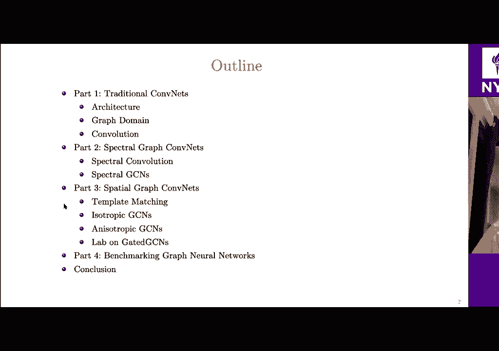
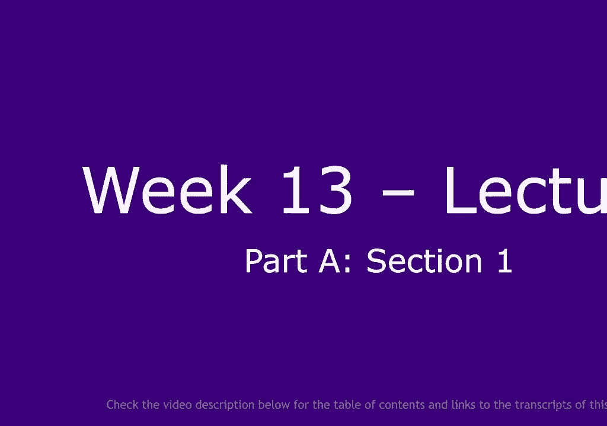
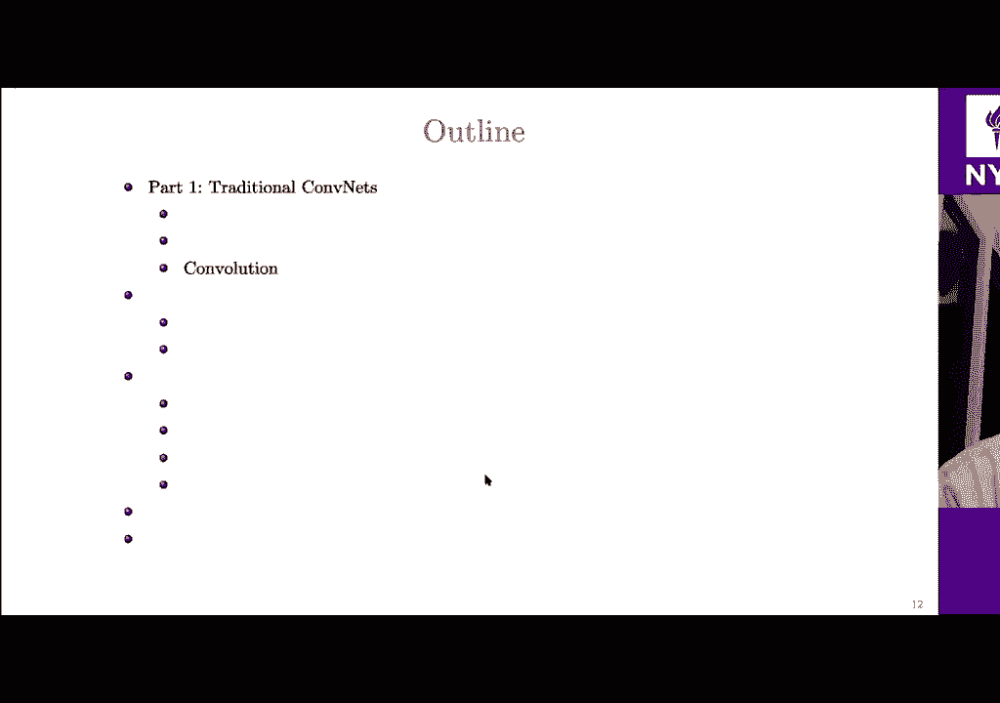
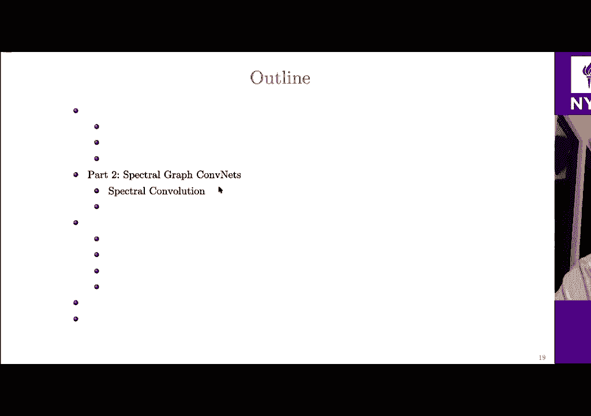
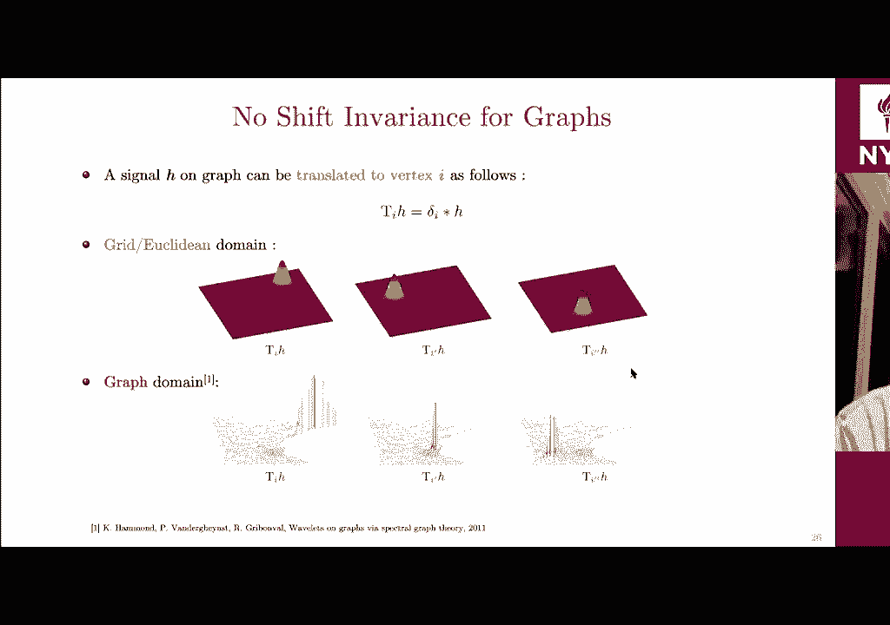
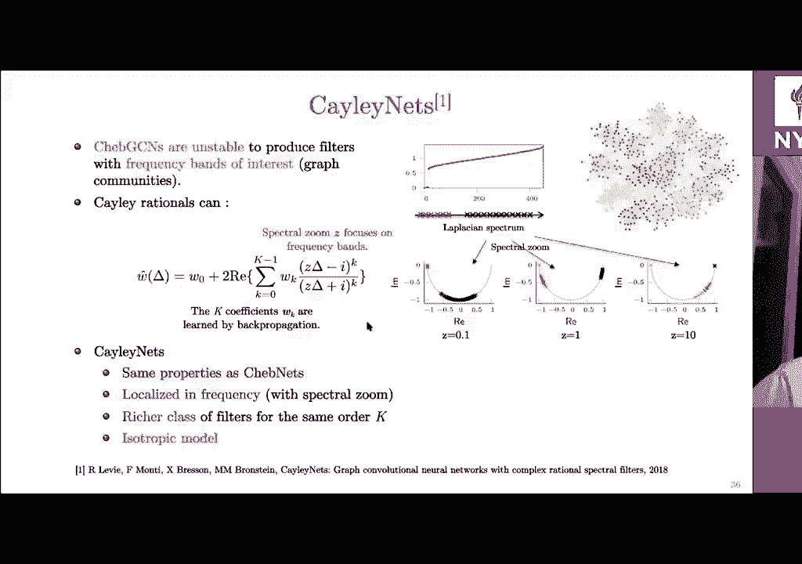
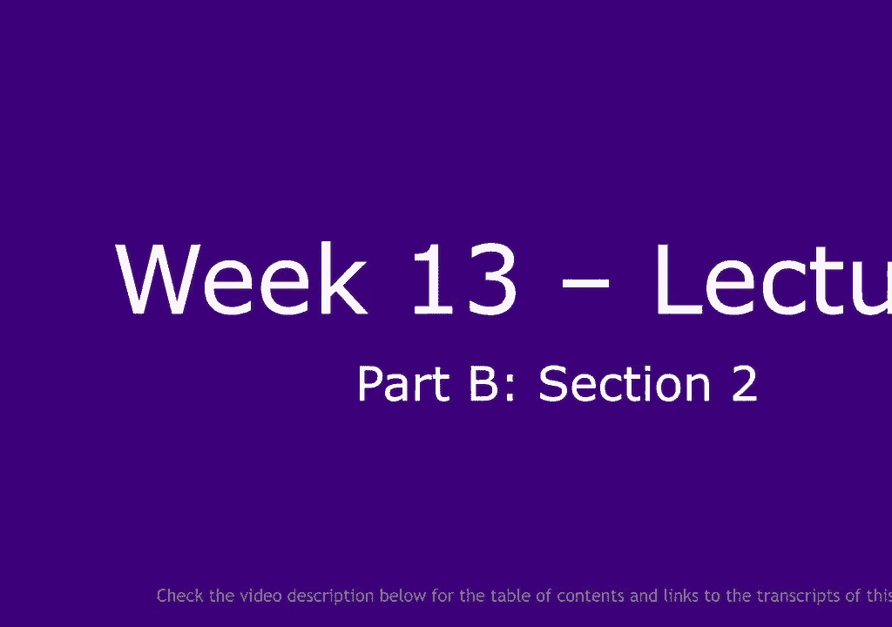

# 课程P24：图卷积网络（GCNs）教程 📚

在本节课中，我们将学习图卷积网络（GCNs）的核心概念。我们将从传统的卷积架构开始，逐步扩展到图结构数据，并介绍两种主要的图卷积方法：谱图卷积和空间图卷积。课程内容力求简单直白，适合初学者理解。

---

## 🏁 概述：从传统卷积到图卷积

卷积神经网络（CNNs）是计算机视觉、语音处理和自然语言处理等领域的突破性技术。它们通过利用数据的局部性、平稳性和层次性等假设，有效地解决了高维学习问题。然而，这些传统卷积操作依赖于数据的规则网格结构（如图像的像素网格）。当面对社交网络、大脑连接图或分子结构等非欧几里得数据时，我们需要将卷积的概念扩展到图结构上。

本节我们将回顾传统卷积，并引出在图结构上定义卷积所面临的挑战。

---

## 🖼️ 传统卷积架构回顾

我们都知道，卷积神经网络是计算机视觉领域的重大突破。例如，在ImageNet竞赛中，使用卷积和池化操作的网络将图像分类误差降低了一半，这标志着从手工设计特征到特征学习的范式转变。卷积网络在语音处理和自然语言处理中也取得了显著成功。

卷积网络之所以强大，是因为它们能够为图像数据找到最佳的表示形式来解决特定问题。当然，我们尚未完全理解卷积网络的所有奥秘，这本身也开辟了许多研究领域。

当我们使用卷积网络时，主要基于以下假设：
1.  **数据是合成的**：图像、视频、语音等数据由局部模式构成。
2.  **局部感受野**：网络中的神经元只连接到上一层的局部区域，而非全部神经元。
3.  **平稳特性**：相似的模式在数据域中共享（例如，图像中不同位置的黄色斑块是相似的）。
4.  **层次组合**：低级特征组合形成中级特征，中级特征再组合形成更高级的抽象特征。

卷积网络的第一部分负责提取这些层次化特征，第二部分则用于解决具体的任务（如分类、推荐），这构成了一个端到端的学习系统。

---

## 📊 理解数据域：从网格到图

在传统设置中，数据域具有规则的网格结构：
*   **图像/视频**：二维像素网格，每个节点（像素）具有特征（如RGB值）。
*   **自然语言处理**：一维单词序列，每个节点（单词）具有特征（如词嵌入）。
*   **语音**：一维时间序列，每个节点（时间点）具有特征（如气压值）。

这种规则的网格结构使得我们可以精确定义数学操作（如卷积和池化），并且计算高效。

然而，许多新兴数据并不具备这种规则结构：
*   **社交网络**：用户作为节点，好友关系作为边。连接模式不构成网格。
*   **神经科学**：大脑的不同区域（节点）通过神经纤维（边）连接，形成复杂的图结构。
*   **量子化学**：分子中的原子（节点）通过化学键（边）连接，结构取决于具体的分子。

所有这些问题的共同点是，它们都可以用**图**来建模。一个图由三个基本实体定义：
1.  **顶点集合 V**：包含 n 个节点。
2.  **边集合 E**：描述节点之间的连接。
3.  **邻接矩阵 A**：一个 n×n 矩阵，记录节点之间的连接强度。

此外，每个节点可以具有一个 d_v 维的特征向量，每条边可以具有一个 d_e 维的特征向量，整个图也可以具有一个 d_g 维的全局特征向量。

---

## 🔍 核心挑战：如何将卷积扩展到图？

现在，关键问题是如何将卷积操作扩展到图结构上。我们首先回顾卷积的两种经典定义。

### 定义一：模板匹配（相关运算）

在计算机视觉中，卷积通常被视为模板匹配。数学上，对于图像域 Ω 中的位置 i，卷积输出为：
`h_{i}^{l+1} = ∑_{j∈Ω} w_j · h_{i-j}^{l}`
其中 `w` 是卷积核（模板），`h^l` 是第 l 层的特征。在实际操作中，我们通常使用相关运算（将减号改为加号），因为学习过程中翻转核不影响结果。

这种定义的关键在于：
*   **局部性**：核具有紧凑的支持（如3x3），只对中心节点的邻居求和。
*   **顺序重要性**：在规则网格上，节点的排序是固定的（例如，索引 j3 总是对应模板的右上角）。这使得匹配具有明确的意义。

然而，在图结构上直接应用模板匹配面临两个主要问题：
1.  **节点顺序缺失**：图上没有预定义的节点顺序（如“左上角”）。索引是任意的，因此直接匹配节点特征向量没有意义。
2.  **邻居数量可变**：模板中的节点数可能与图中某个节点的邻居数量不匹配。

### 定义二：卷积定理

另一种定义利用卷积定理：两个函数卷积的傅里叶变换等于它们各自傅里叶变换的点积。
`F(w * h) = F(w) ⊙ F(h)`
对于规则网格（如图像），我们可以利用快速傅里叶变换（FFT）高效计算，复杂度为 O(n log n)。

问题在于：我们能否将傅里叶变换的定义扩展到图上？关键在于如何定义图上的傅里叶变换并使其计算高效。

基于这两种定义，我们发展出了两大类图神经网络：**空间图卷积网络**（基于模板匹配思想）和**谱图卷积网络**（基于卷积定理思想）。

---

## 📈 谱图卷积网络

谱方法的核心是利用图的谱（拉普拉斯矩阵的特征值）理论来定义卷积。我们通过四个步骤来构建谱卷积。

### 步骤一：定义图拉普拉斯算子

图拉普拉斯矩阵是谱理论的核心算子。对于具有 n 个顶点的图，我们通常使用归一化拉普拉斯矩阵：
`L = I - D^{-1/2} A D^{-1/2}`
其中 `A` 是邻接矩阵，`D` 是度矩阵（对角矩阵，`D_{ii} = ∑_j A_{ij}`）。拉普拉斯矩阵可以衡量图上函数的平滑度。

### 步骤二：定义傅里叶基

我们对拉普拉斯矩阵进行特征分解：
`L = Φ Λ Φ^T`
其中 `Λ` 是由特征值 `λ_1, ..., λ_n` 构成的对角矩阵，`Φ` 的每一列是对应的特征向量 `φ_1, ..., φ_n`。这些特征向量被称为图的**傅里叶基**，它们是正交的。

### 步骤三：定义傅里叶变换

对于定义在图顶点上的函数（信号）`h`（一个 n 维向量），其图傅里叶变换定义为将 `h` 投影到傅里叶基上：
`ĥ = Φ^T h`
逆傅里叶变换则为：
`h = Φ ĥ`
这本质上只是矩阵与向量的乘法。

### 步骤四：利用卷积定理

根据卷积定理，图上两个函数 `w` 和 `h` 的卷积可以定义为：
`w * h = Φ ( (Φ^T w) ⊙ (Φ^T h) ) = Φ ( diag(ŵ) Φ^T h )`
我们可以将 `diag(ŵ)` 视为一个**谱滤波器**，它是特征值 `λ` 的函数。因此，谱卷积操作就是用一个谱滤波器 `g_θ(Λ)` 来调制信号的傅里叶系数：
`w * h = Φ g_θ(Λ) Φ^T h`

**存在的问题**：直接计算需要完整的特征分解，复杂度为 O(n²)，对于大型图不可行。此外，学到的滤波器不一定在空间上是局部化的。

---

## 🛠️ 实用的谱GCN：ChebNet与GCN

为了解决计算复杂度和局部性问题，研究者提出了改进方案。

### ChebNet：用多项式逼近谱滤波器

ChebNet的核心思想是用一个 K 阶多项式来逼近谱滤波器 `g_θ(Λ)`：
`g_θ(Λ) ≈ ∑_{k=0}^{K} θ_k T_k(Λ̃)`
其中 `T_k` 是切比雪夫多项式，`Λ̃` 是缩放后的特征值矩阵。这样做的好处是：
*   **局部性**：K 阶多项式滤波器在空间上具有 K-跳的局部支持。
*   **线性复杂度**：卷积操作可以递归计算，无需特征分解，复杂度为 O(K|E|)，对于稀疏图是线性的。
*   **参数共享**：只需要学习 K+1 个参数 `θ_k`。

卷积操作变为：
`w * h ≈ ∑_{k=0}^{K} θ_k T_k(L̃) h`
其中 `L̃` 是缩放后的拉普拉斯矩阵。`T_k(L̃) h` 可以通过递归关系高效计算。

### GCN：一阶近似

著名的图卷积网络（GCN）可以看作是 ChebNet 的一阶近似（K=1），并进一步简化后得到的模型。其每一层的传播规则为：
`H^{(l+1)} = σ( D^{-1/2} Ã D^{-1/2} H^{(l)} W^{(l)} )`
其中 `Ã = A + I` 是加了自连接的邻接矩阵，`W^{(l)}` 是可学习的权重矩阵，`σ` 是非线性激活函数。这个操作本质上是对每个节点，将其自身特征与邻居特征的平均值进行混合后变换。

**谱GCN的特点**：
*   **各向同性**：滤波器在所有方向上是相同的（因为拉普拉斯矩阵是各向同性的）。
*   **高效**：计算复杂度与边数成线性关系。
*   **无需节点顺序**：对节点的排列具有不变性。

---

## 🧩 空间图卷积网络

空间方法直接从模板匹配的思想出发，试图在图结构上定义局部聚合操作。

### 核心思想：邻居聚合

由于图上没有固定的节点顺序，我们不能直接使用一个固定的模板向量与每个邻居匹配。最简单的解决方案是：**让所有邻居共享同一个可学习的变换**，然后对变换后的邻居特征进行聚合（如求和、平均）。

最基础的空间GCN层操作可以表示为：
`h_i^{(l+1)} = σ( W^{(l)} · AGGREGATE( { h_j^{(l)} : j ∈ N(i) } ) )`
其中 `N(i)` 是节点 i 的邻居集合，`AGGREGATE` 是聚合函数（如均值、求和、最大值），`W^{(l)}` 是可学习的权重矩阵。

### 各向同性与各向异性空间GCN

*   **各向同性GCN**：如上式所示，所有邻居使用相同的权重 `W` 进行处理。GCN、GraphSAGE等属于此类。它们计算效率高，但假设所有邻居的重要性相同。
*   **各向异性GCN**：考虑到不同邻居的重要性可能不同，我们希望对邻居进行差异化处理。这可以通过引入注意力机制或利用边特征来实现。
    *   **图注意力网络（GAT）**：为每个邻居 `j` 计算一个注意力系数 `α_{ij}`，然后进行加权聚合：
        `h_i^{(l+1)} = σ( ∑_{j∈N(i)} α_{ij} W^{(l)} h_j^{(l)} )`
        其中 `α_{ij}` 通过一个可学习的注意力机制计算，通常基于节点 `i` 和 `j` 的特征。
    *   **门控机制与边特征**：显式地利用边特征 `e_{ij}` 来调制信息传递，例如：
        `h_i^{(l+1)} = σ( ∑_{j∈N(i)} η(e_{ij}) ⊙ W^{(l)} h_j^{(l)} )`
        其中 `η` 是一个基于边特征的可学习函数，`⊙` 是逐元素乘法。

**有趣的联系**：标准的Transformer模型可以看作是在一个**全连接图**上运行的空间图注意力网络，其中每个节点（如单词）都与图中所有其他节点相连，注意力权重由查询-键机制计算。

---

## 🧪 图神经网络基准与通用流程

为了公平评估不同GNN模型的性能，我们需要超越小型数据集的标准基准。一个完整的图神经网络处理流程通常包含三层：

1.  **输入/嵌入层**：将原始的节点特征和边特征通过线性层或嵌入层映射到低维向量 `H^{(0)}` 和 `E^{(0)}`。
2.  **图神经网络层堆叠**：堆叠 L 层GNN层（如GCN、GAT、ChebNet等），每一层都更新节点和边的表示：
    `H^{(l)}, E^{(l)} = GNNLayer( H^{(l-1)}, E^{(l-1)}, A )`
3.  **任务层**：根据下游任务类型，对最终的图表示进行处理：
    *   **图级任务（分类/回归）**：先通过全局池化（如均值池化、求和池化）得到整个图的表示向量，然后输入MLP。
    *   **节点级任务**：直接将每个节点的最终表示输入MLP。
    *   **边级任务**：将一条边两端节点的表示拼接（或其它操作）后输入MLP。

---

## 🎯 总结

在本节课中，我们一起学习了图卷积网络（GCNs）的核心知识。我们从传统卷积网络及其假设出发，认识到将其扩展到图结构数据的重要性与挑战。

我们详细探讨了两种主要的扩展思路：
1.  **谱图卷积**：基于卷积定理和图拉普拉斯算子的谱分解来定义卷积。ChebNet和GCN是其中高效且实用的代表，它们通过多项式逼近避免了昂贵的特征分解，实现了线性复杂度，但通常是各向同性的。
2.  **空间图卷积**：基于邻居聚合的思想来模拟模板匹配。从简单的各向同性聚合（如GCN）发展到更精细的各向异性聚合（如GAT），后者能够区分不同邻居的重要性。

我们还了解了图神经网络的通用处理流程和基准测试的重要性。图神经网络为社交网络分析、药物发现、推荐系统等众多领域提供了强大的工具，是一个充满活力且快速发展的研究领域。理解其基本原理是探索更高级应用和研究的坚实基础。