# 3：随机梯度下降与反向传播 🧠

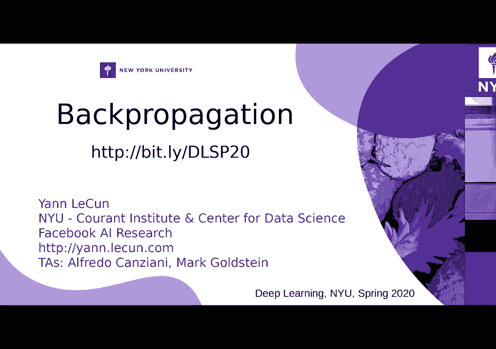

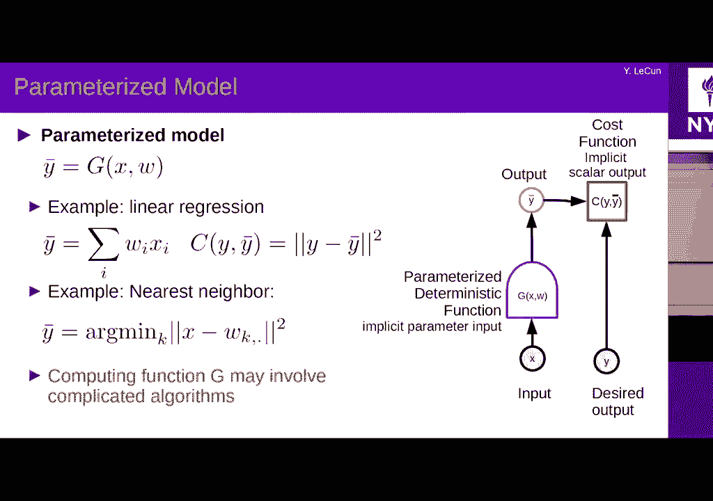


在本节课中，我们将学习深度学习中的两个核心优化算法：**随机梯度下降** 和 **反向传播**。我们将从参数化模型的基本概念开始，逐步深入到梯度计算、链式法则的应用，以及如何通过模块化的视角来理解神经网络的前向与反向传播过程。课程内容旨在让初学者能够清晰地掌握这些关键概念及其实现原理。

---

## 参数化模型与监督学习范式 📊

上一节我们介绍了课程概述，本节中我们来看看机器学习的基础——参数化模型。

参数化模型本质上是一个函数。这个函数依赖于两个参数：**输入** 和 **可训练参数**。在训练过程中，参数在所有样本间是共享的，但每个训练样本的输入是不同的。

在深度学习中，参数通常被隐式地存储在模型内部。一个典型的监督学习系统可以表示为一个计算图。

以下是监督学习系统的基本组成部分：
*   **参数化模型 (G)**：一个确定性函数，接收输入 `X` 和参数 `W`，产生预测输出 `Y_bar`。
*   **成本函数 (C)**：一个标量函数，比较模型的预测输出 `Y_bar` 和真实目标 `Y`，计算出一个损失值。
*   **样本损失 (L)**：对于单个样本 `(X, Y)`，其损失 `L(X, Y, W)` 等于成本函数 `C` 的输出。
*   **总损失 (J)**：在整个训练集 `S` 上，总损失是所有样本损失的平均值，公式为：
    `J(W) = (1/|S|) * Σ_{(X,Y)∈S} L(X, Y, W)`

机器学习的核心任务就是找到一组参数 `W`，使得总损失 `J(W)` 最小化。

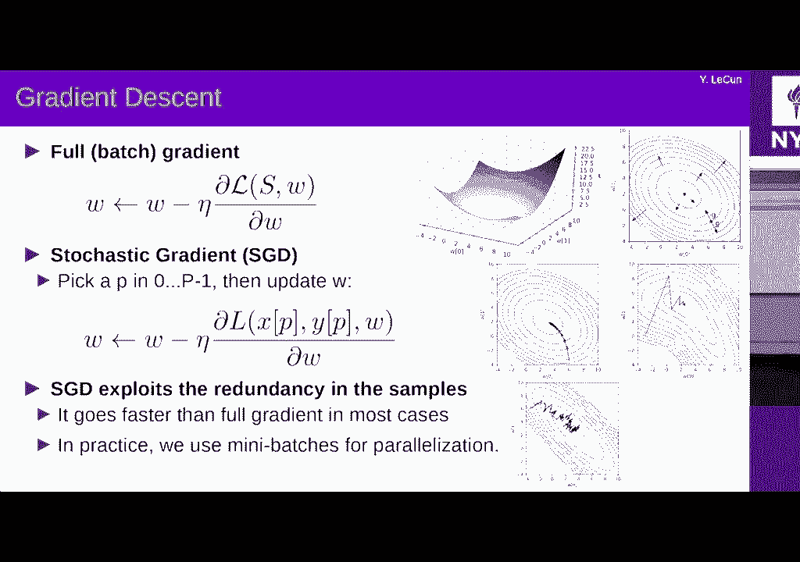


---

## 基于梯度的优化方法 📉

上一节我们定义了要优化的目标函数，本节中我们来看看如何通过基于梯度的方法来最小化它。

基于梯度的优化方法假设我们可以相对容易地计算目标函数的梯度。梯度下降是最基本的方法，其思想是沿着函数最陡的下降方向（负梯度方向）迭代更新参数，以找到最小值。

梯度下降的更新规则可以用以下公式表示：
`W_new = W_old - η * ∇J(W_old)`
其中 `η` 是学习率（步长），`∇J(W)` 是总损失 `J` 关于参数 `W` 的梯度。

然而，计算整个训练集上的梯度（批量梯度下降）在数据集很大时计算代价高昂。因此，我们更常用**随机梯度下降**。

以下是随机梯度下降的核心思想：
*   **随机梯度下降**：每次迭代时，我们不计算所有样本的平均梯度，而是随机抽取一个样本 `(X_p, Y_p)`，计算该样本的损失 `L` 关于参数的梯度，并沿此方向更新参数。更新公式为：
    `W_new = W_old - η * ∇_W L(X_p, Y_p, W_old)`
*   **小批量梯度下降**：在实际应用中，更常见的是使用一小批样本（一个批次）的平均梯度来更新参数。这样做既减少了单样本更新带来的噪声和振荡，又能利用现代硬件（如GPU）的并行计算能力，提高效率。
*   **与强化学习的区别**：在监督学习中，成本函数 `C` 是可微的，我们可以直接计算梯度。而在强化学习中，奖励信号（类似于成本）通常是一个不可微的黑盒，只能通过采样来估计，这使得训练效率较低。

---

## 传统神经网络结构 🧱

上一节我们介绍了优化算法，本节中我们来看看这些算法要优化的对象——神经网络的结构。

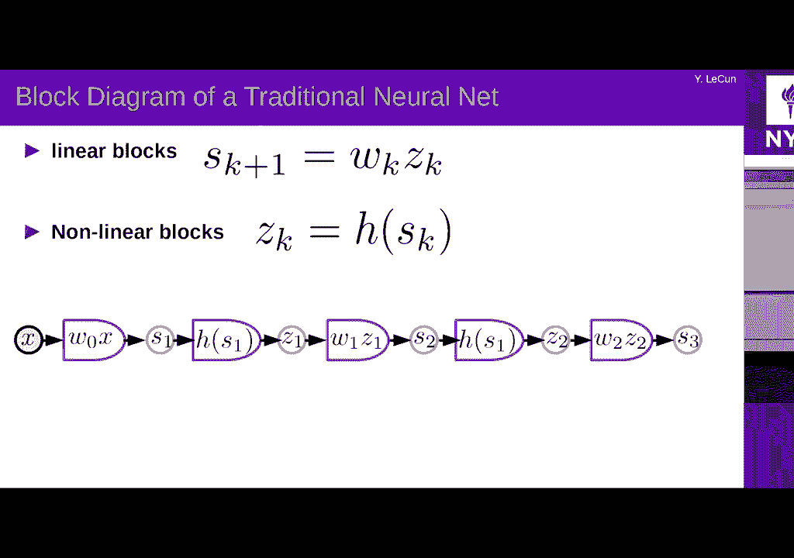


传统的神经网络由交替的**线性层**和**非线性激活函数**堆叠而成。

一个两层的神经网络（通常称为三层网络，包括输入层、隐藏层和输出层）的前向传播过程如下：
1.  **第一层（线性）**：输入向量 `X` 乘以权重矩阵 `W0`，得到加权和向量 `S1`。公式为：`S1 = W0 * X`。
2.  **第一层（非线性）**：将 `S1` 的每个分量通过一个非线性激活函数 `h`（如ReLU），得到激活值 `Z1`。公式为：`Z1 = h(S1)`。
3.  **第二层（线性）**：`Z1` 乘以权重矩阵 `W1`，得到 `S2`。公式为：`S2 = W1 * Z1`。
4.  **第二层（非线性）**：将 `S2` 通过激活函数，得到最终输出 `Z2`（或 `Y_bar`）。

如果没有非线性激活函数，多个线性层的组合等价于单个线性层，网络就无法学习复杂的模式。因此，非线性激活函数至关重要。

在PyTorch等框架中，我们可以用面向对象的方式简洁地定义网络：
```python
class SimpleNet(nn.Module):
    def __init__(self, input_size, hidden_size, output_size):
        super().__init__()
        self.linear1 = nn.Linear(input_size, hidden_size)
        self.linear2 = nn.Linear(hidden_size, output_size)
        self.relu = nn.ReLU()

    def forward(self, x):
        x = x.view(-1) # 展平输入
        s1 = self.linear1(x)
        z1 = self.relu(s1)
        s2 = self.linear2(z1)
        return s2
```

---

## 反向传播与链式法则 🔄

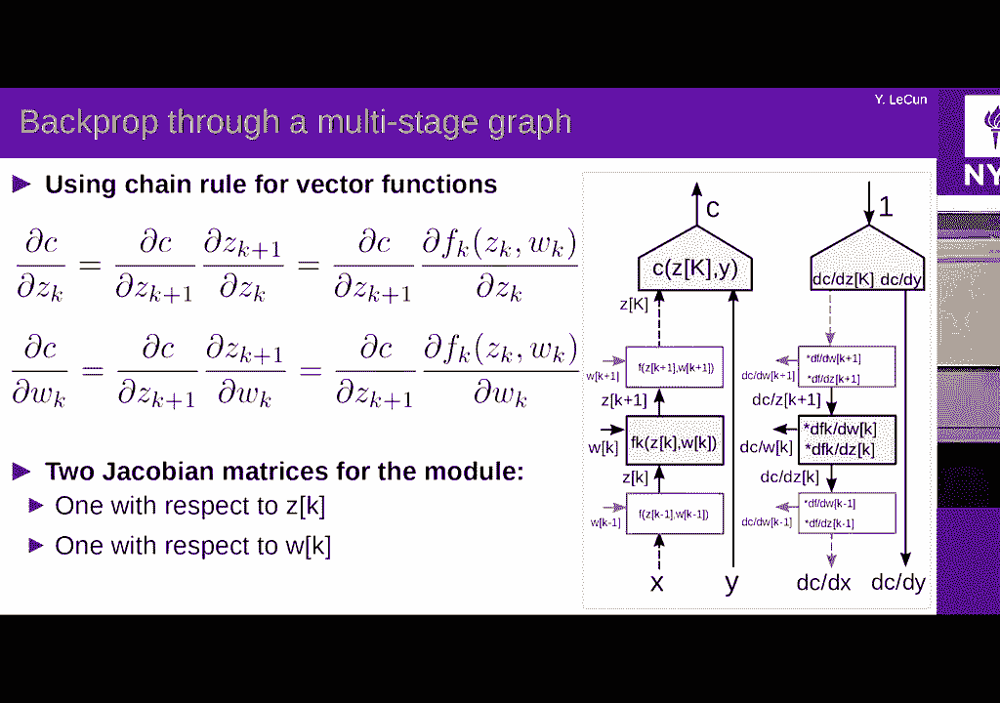


上一节我们了解了网络如何前向计算输出，本节中我们来看看如何高效地计算损失函数关于所有参数的梯度，即反向传播。

反向传播的核心是**链式法则**。考虑一个简单的复合函数 `C = C(Z)`，`Z = h(S)`。根据链式法则，`C` 关于 `S` 的导数为：
`dC/dS = (dC/dZ) * (dZ/dS) = (dC/dZ) * h'(S)`

在神经网络中，我们将这个原理应用于每一层。假设我们已知损失 `C` 关于第 `k+1` 层输入 `Z_{k+1}` 的梯度 `dC/dZ_{k+1}`，那么我们可以计算：
1.  `C` 关于第 `k` 层参数 `W_k` 的梯度：`dC/dW_k = (dC/dZ_{k+1}) * (dZ_{k+1}/dW_k)`
2.  `C` 关于第 `k` 层输入 `Z_k` 的梯度（用于继续反向传播）：`dC/dZ_k = (dC/dZ_{k+1}) * (dZ_{k+1}/dZ_k)`

其中，`dZ_{k+1}/dW_k` 和 `dZ_{k+1}/dZ_k` 是模块 `F_k`（执行 `Z_{k+1} = F_k(Z_k, W_k)` 操作）的**雅可比矩阵**。

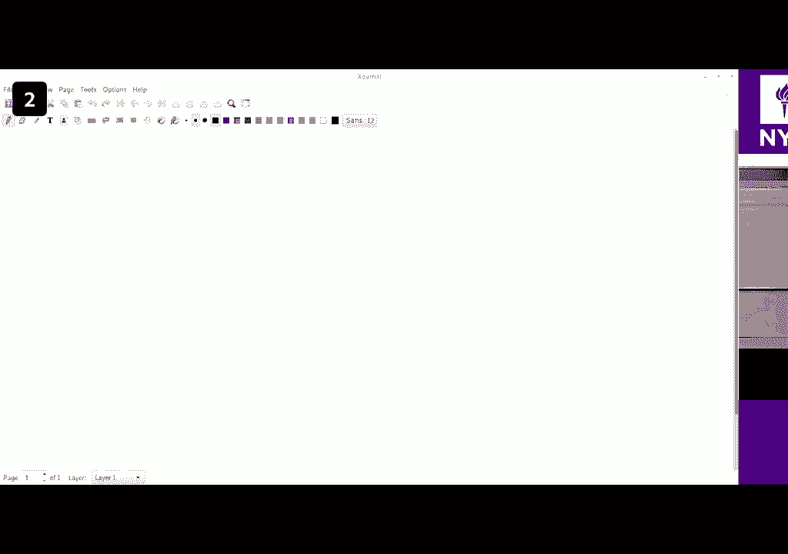


从计算图的角度看，反向传播构建了一个与原始前向计算图结构相似但信号反向流动的图，用于计算梯度。现代深度学习框架（如PyTorch的Autograd）可以自动完成这一过程。

---

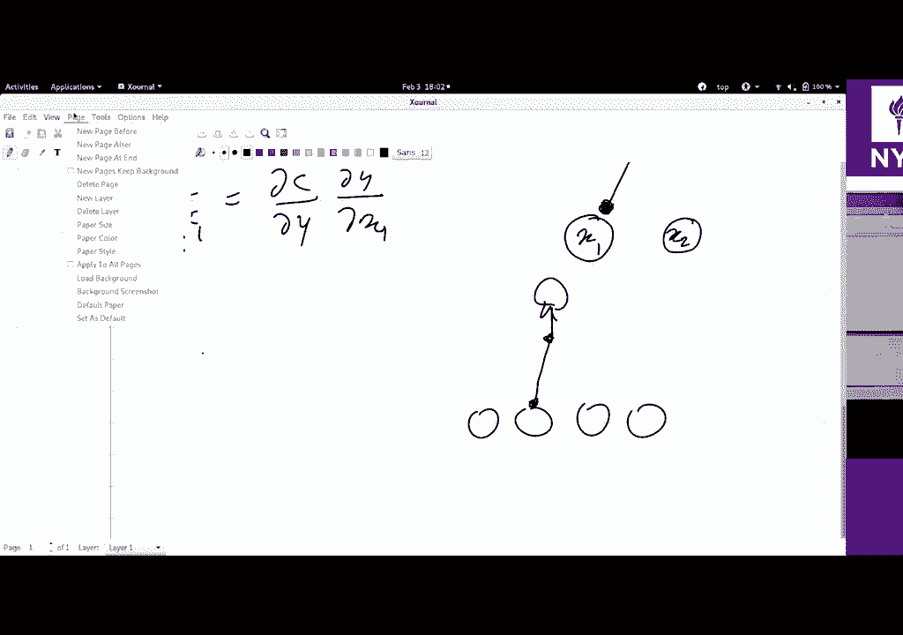


## 常见模块的反向传播 🧩

上一节我们介绍了反向传播的一般原理，本节中我们具体看看几种常见计算模块的梯度传播方式。

理解基本模块的梯度传播有助于我们设计新的网络层或调试模型。

以下是几种关键模块的行为：
*   **复制模块**：将单个输入 `X` 复制到多个输出（如 `Y1=X`, `Y2=X`）。在反向传播时，流向该输入的总梯度是来自所有输出分支的梯度之和。`dC/dX = dC/dY1 + dC/dY2`。
*   **求和模块**：将多个输入（如 `X1`, `X2`）相加得到一个输出 `Y = X1 + X2`。反向传播时，输出梯度被**复制**并流向每一个输入。`dC/dX1 = dC/dY`, `dC/dX2 = dC/dY`。
*   **最大值模块**：输出是输入中的最大值，例如 `Y = max(X1, X2)`。这就像一个开关，只将梯度传递给前向传播时被选中的那个输入，其他输入的梯度为零。
*   **Softmax模块**：将一组分数转换为一个概率分布。`Y_i = exp(X_i) / Σ_j exp(X_j)`。其反向传播计算稍复杂，是一个很好的练习。它通常用于多分类网络的最后一层。
*   **Sigmoid模块**：`σ(s) = 1 / (1 + exp(-s))`。当其输入 `s` 的绝对值很大时，输出会饱和（接近0或1），导致梯度 `σ'(s)` 变得非常小，这被称为“梯度消失”问题。因此，在深层网络中，Sigmoid的使用已减少，转而更多使用ReLU及其变体。

---

## 实践技巧与总结 🛠️

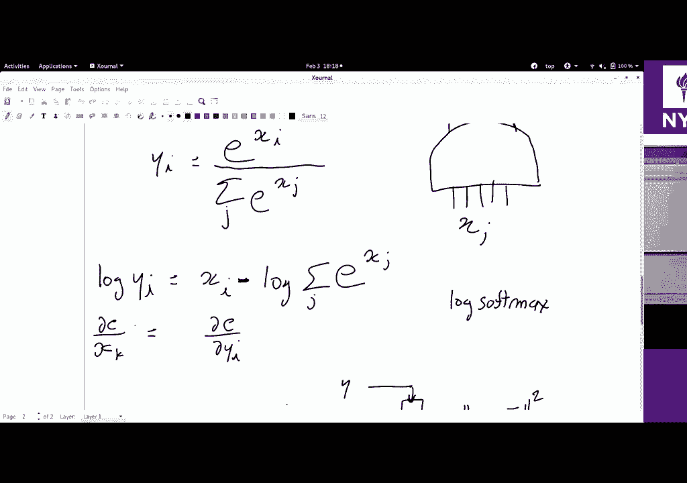


上一节我们剖析了核心计算模块，本节中我们将以一些重要的实践技巧作为课程的结尾。

成功的深度学习实践不仅需要理解算法，还需要掌握一系列工程化技巧来使模型有效训练。

以下是一些关键的训练技巧：
*   **输入归一化**：对输入数据的每个特征进行归一化，使其均值为0，方差为1。这有助于稳定训练，加速收敛。例如，对于图像数据，可以计算所有训练图片每个通道（R, G, B）的均值和标准差，然后用它们来归一化每张图片。
*   **权重初始化**：不能将权重初始化为零或过大过小的随机值。常用的方法是“Xavier初始化”或“He初始化”，其目标是使每一层输出的方差与输入的方差大致相同。例如，使用均值为0，方差为 `1 / fan_in` 的正态分布来初始化权重，其中 `fan_in` 是该层的输入数量。
*   **学习率调整**：使用学习率衰减策略，例如随着训练轮次增加逐步降低学习率，有助于模型在后期精细调整。更高级的优化器（如Adam）会自动调整每个参数的学习率。
*   **正则化**：
    *   **L2正则化/权重衰减**：在更新权重时，除了减去梯度项，还会将权重本身乘以一个略小于1的因子 `(1 - λ)`，这等价于在损失函数中增加了权重的L2范数惩罚项，倾向于让权重向量变小。
    *   **Dropout**：在训练过程中，随机将神经网络中一部分神经元的输出置零。这可以防止网络对某些特定的神经元产生过度的依赖，是一种有效的正则化手段，能提升模型的泛化能力。
*   **使用合适的损失函数**：对于分类问题，使用交叉熵损失配合Softmax或LogSoftmax，通常比使用均方误差损失效果更好，能缓解梯度饱和问题。

---

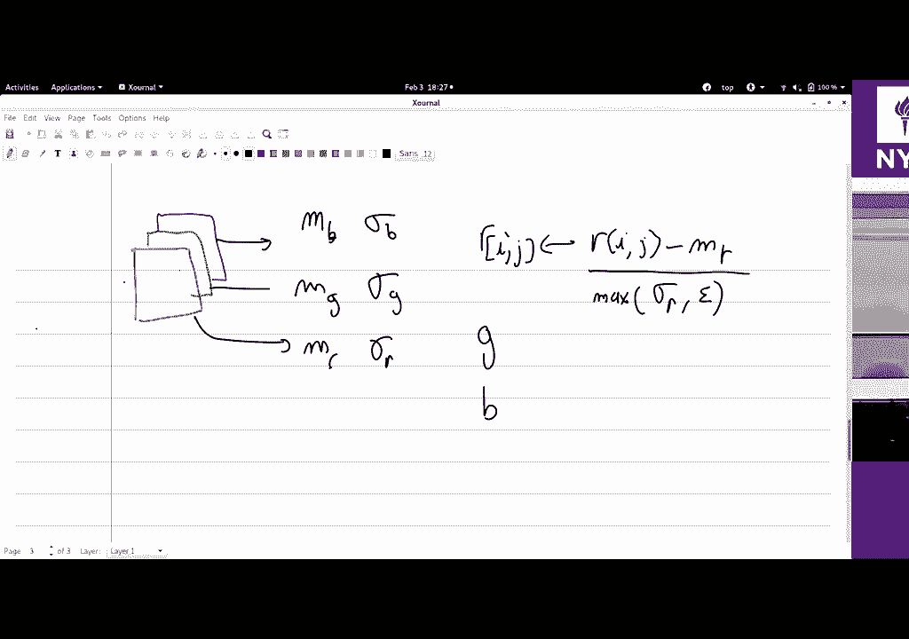

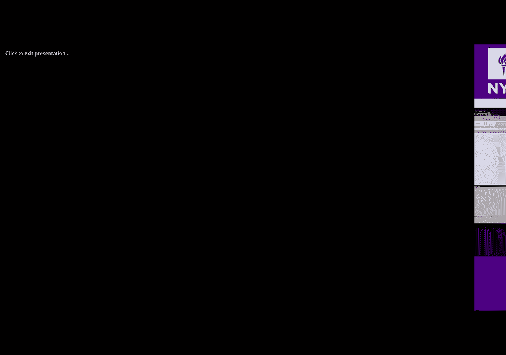

## 总结 📝

本节课中我们一起学习了深度学习的两个基石：**随机梯度下降** 和 **反向传播**。

我们从**参数化模型**和**监督学习**的基本框架出发，定义了需要最小化的损失函数。接着，我们探讨了如何使用**基于梯度的方法**进行优化，重点介绍了**随机梯度下降**及其变体**小批量梯度下降**的原理与优势。

然后，我们深入研究了**传统神经网络**的结构，理解了线性变换与非线性激活函数交替堆叠的本质。为了高效计算梯度，我们详细阐述了**反向传播算法**，其核心是利用**链式法则**将损失梯度从输出层逐层反向传播至输入层，并解释了如何将其视为在计算图上进行梯度传递的过程。

我们还具体分析了**复制、求和、最大值、Softmax、Sigmoid**等常见模块在反向传播中的行为。最后，我们总结了一系列至关重要的**实践技巧**，包括输入归一化、权重初始化、学习率调整、正则化方法等，这些技巧对于成功训练深度学习模型不可或缺。

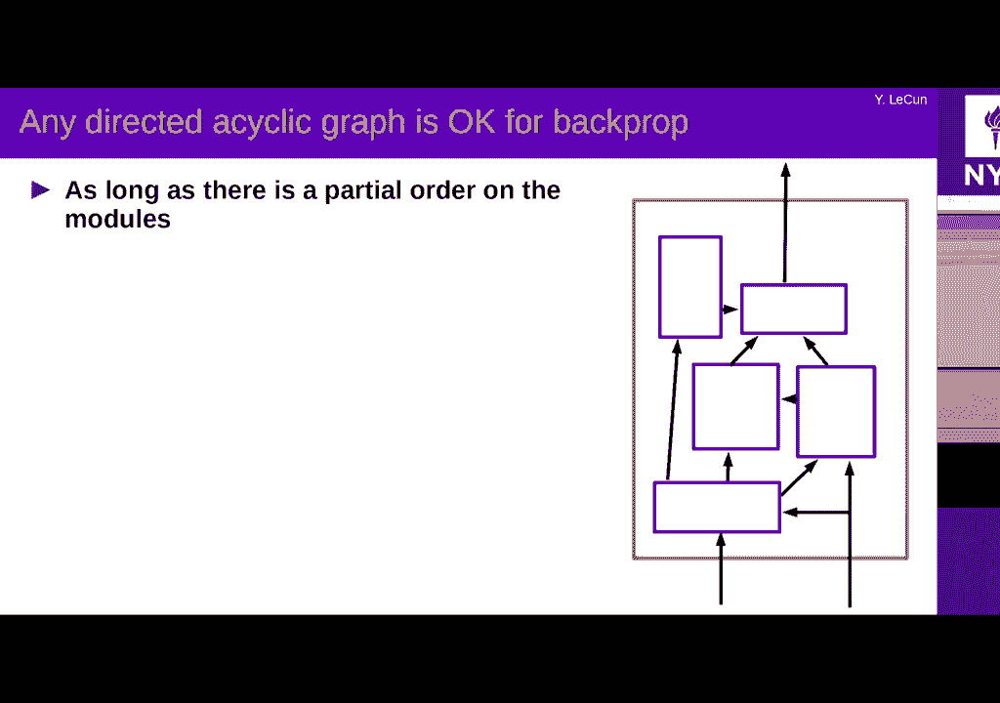

掌握这些核心概念和技巧，是您进一步探索更复杂神经网络架构和应用的基础。