# 6：第3周 - 实践课 - 自然信号特性与卷积神经网络 🧠

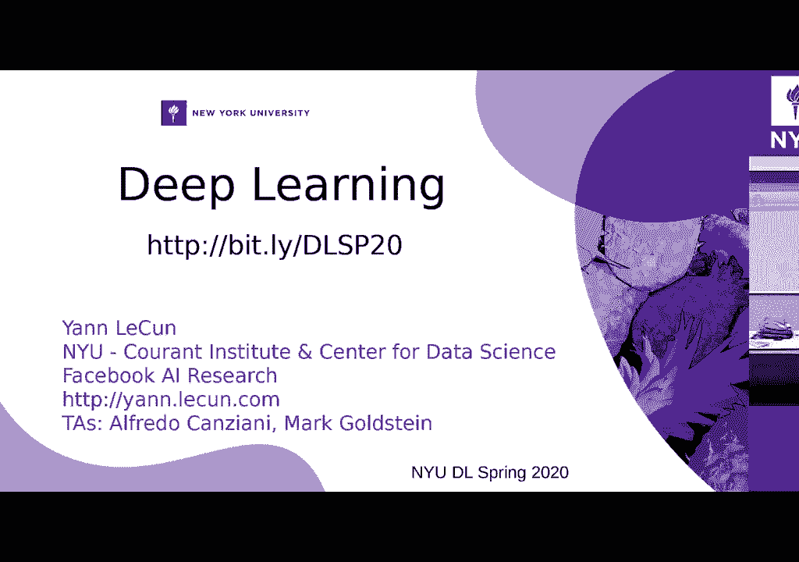

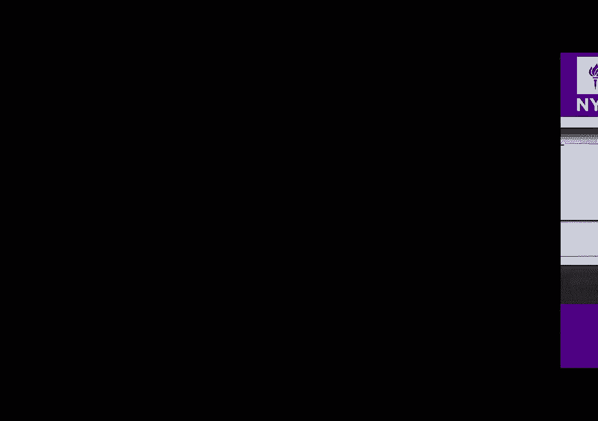

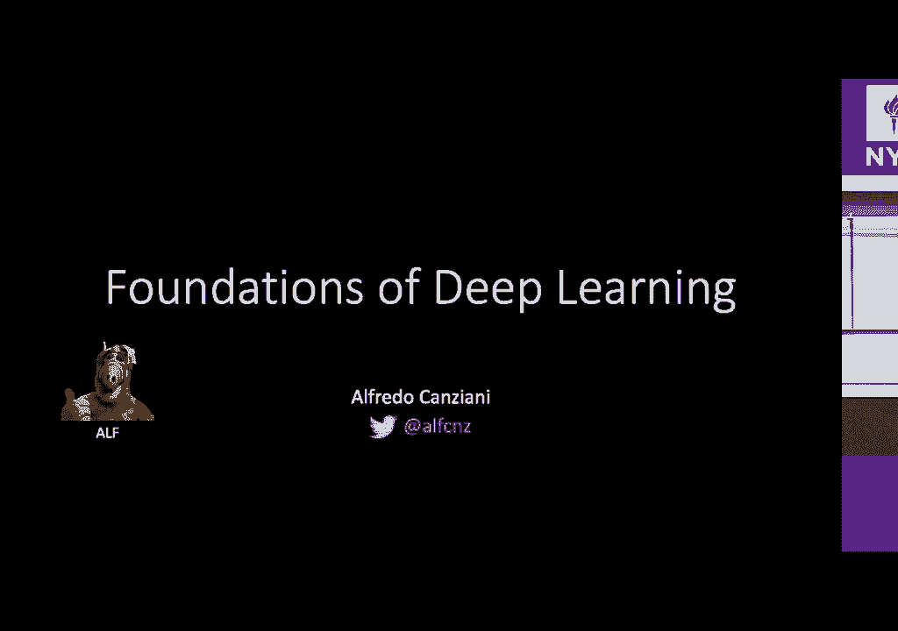

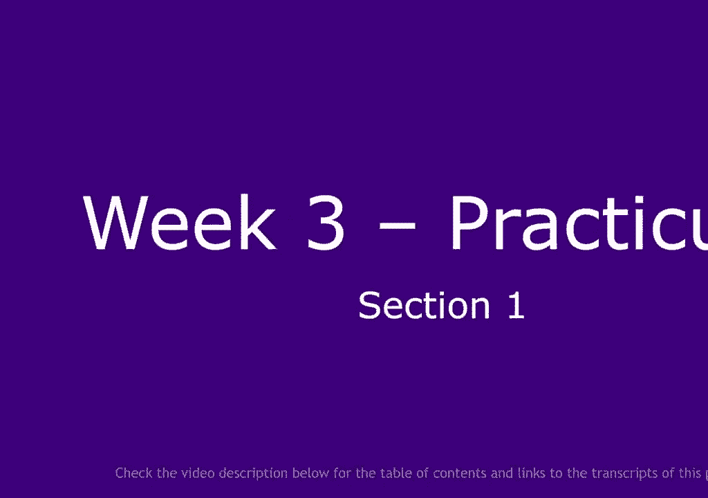

在本节课中，我们将学习自然信号（如图像、音频）的核心特性，并理解卷积神经网络（CNN）如何利用这些特性来高效地处理数据。我们将从信号的基本属性开始，逐步过渡到CNN的设计原理和实际应用。

## 自然信号的三个核心特性 📡

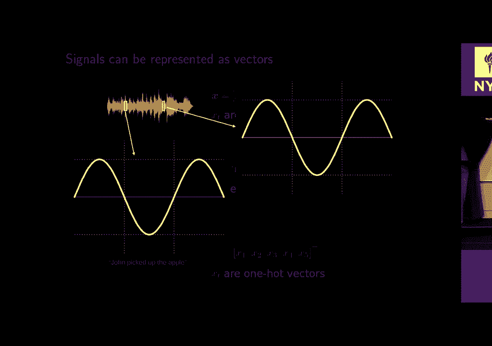

上一节我们介绍了课程的主题，本节中我们来看看什么是自然信号以及它们的关键特性。自然信号，如声音和图像，通常表现出三种主要属性：平稳性、局部性和组合性。

### 平稳性

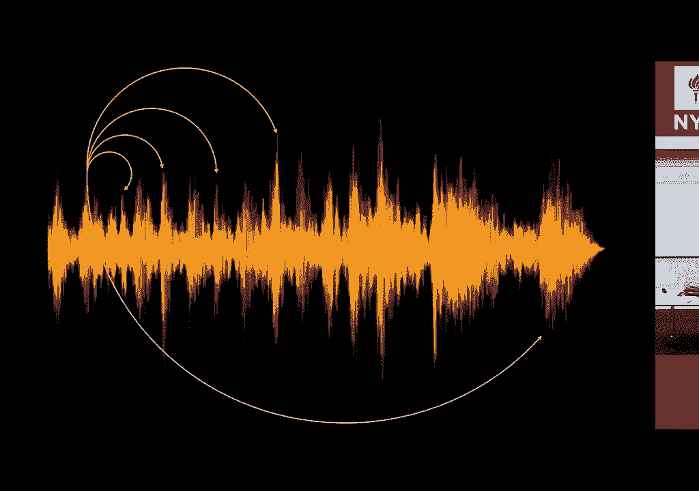

平稳性意味着信号中相同的模式会在一维（如时间）或二维（如空间）上重复出现。例如，一段音频中的特定音调或一张图像中的纹理可能会在信号的不同位置反复出现。

### 局部性

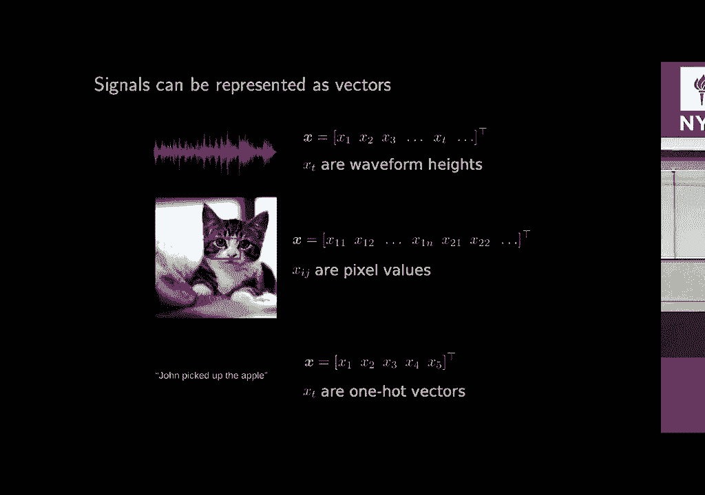

局部性是指信号中某一点的信息主要与其邻近点的信息相关，而与远处点的信息关系不大。例如，图像中一个像素的颜色，更可能与其周围像素的颜色相似，而不是与图像另一端的像素颜色相关。

### 组合性

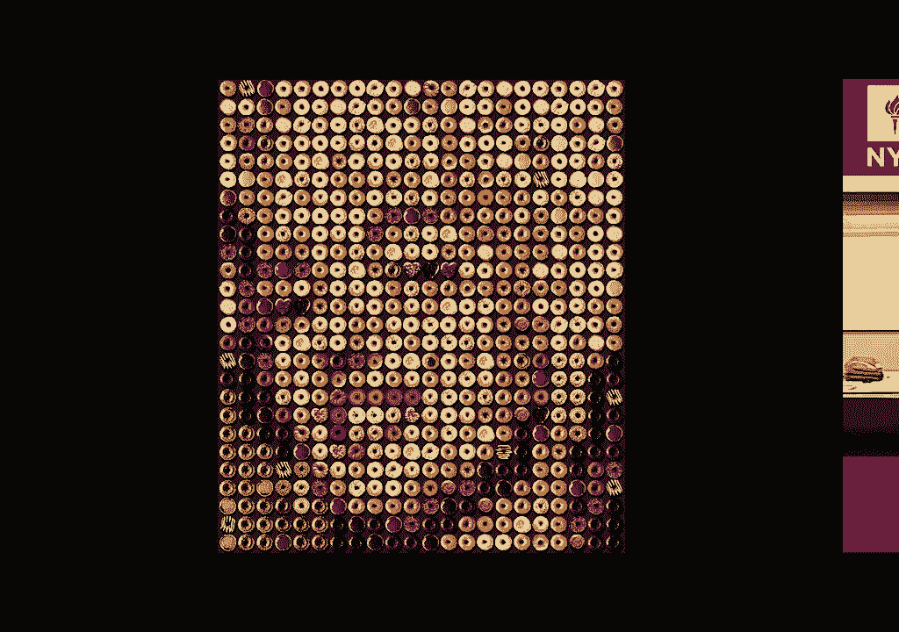

组合性是指复杂的结构由更简单、更小的部分组合而成。例如，一张人脸图像可以由眼睛、鼻子、嘴巴等局部特征组合而成；一个句子可以由单词组合而成。

---

## 从全连接网络到卷积神经网络 🔄

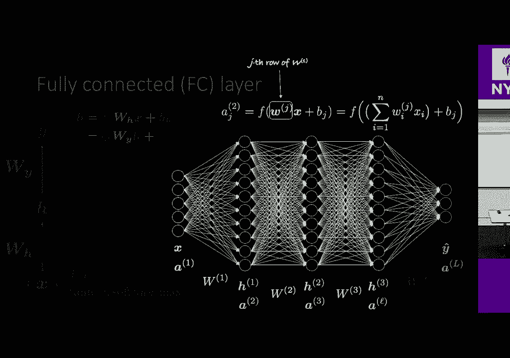

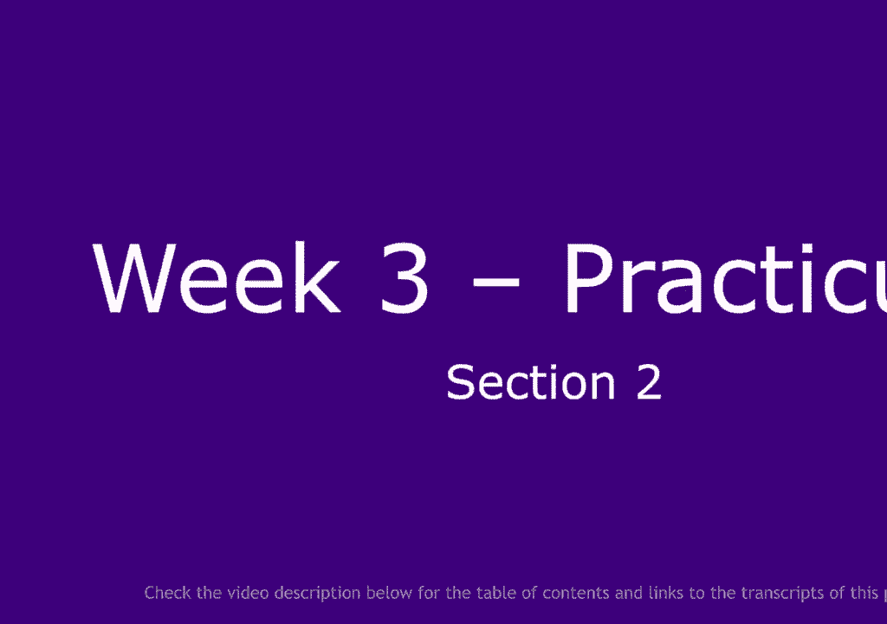

上一节我们了解了自然信号的特性，本节中我们来看看传统的全连接神经网络在处理这类信号时面临的问题，以及卷积神经网络如何提供解决方案。

在全连接网络中，每个神经元都与上一层的所有神经元相连。对于一个像图像这样的高维输入（例如 256x256 像素），这意味着需要学习海量的连接权重，计算成本极高，且容易过拟合。

然而，根据自然信号的**局部性**特性，一个神经元其实无需关注整个输入，只需关注输入的一个小局部区域即可。因此，我们可以删除那些连接遥远区域的权重，使网络连接变得**稀疏**。这大大减少了需要计算的参数数量。

根据自然信号的**平稳性**特性，相同的模式可能出现在输入的不同区域。因此，我们无需为每个局部区域都学习一套独立的权重。相反，我们可以让网络的不同部分**共享同一套权重**（即卷积核）。这意味着我们只需学习一小部分参数，就能让这些参数在输入的所有位置上检测相同的模式。

结合**稀疏连接**和**参数共享**，就构成了卷积操作的核心思想。这使得CNN具有以下优势：
*   **参数效率高**：需要训练的参数更少。
*   **训练更快，泛化更好**：由于参数共享，用于训练每个权重的数据更多。
*   **平移不变性**：无论模式出现在输入中的哪个位置，都能被相同的卷积核检测到。

---

## 卷积网络的实际架构与操作 🏗️

上一节我们介绍了卷积的核心思想，本节中我们来看看卷积神经网络在实际中是如何构建和工作的。

一个典型的用于图像处理的CNN架构会堆叠多个卷积层。随着网络层次的加深，每一层“看到”的输入范围（即**感受野**）会越来越大，从而能够组合低层特征，形成更高层、更抽象的特征表示。

以下是CNN中常见的组件：

*   **卷积层**：执行核心的卷积操作。其关键超参数包括卷积核大小（如3x3）、步长和填充。
    *   **填充**：在输入边缘添加零值，以控制输出特征图的空间尺寸。
    *   **为什么常用奇数大小的卷积核？**：奇数核（如3x3, 5x5）有明确的中心点，便于对称填充，以保持空间尺寸。
*   **非线性激活函数**：如ReLU，被添加在卷积层之后，为网络引入非线性，使其能够学习更复杂的模式。
*   **池化层**：用于对特征图进行下采样，减少空间尺寸和计算量，同时提供一定的平移不变性。常见操作有最大池化和平均池化。
*   **归一化层**：如批归一化，用于稳定和加速训练过程。
*   **残差连接**：允许信息绕过某些层直接向前传播，有助于缓解深层网络中的梯度消失问题，使训练极深的网络成为可能。

在整个网络中，信息流可以概括为：将**空间信息**（图像的高度和宽度）逐步转化为**特征信息**（通道的深度）。早期的层关注低级特征（如边缘、纹理），后期的层则组合这些特征形成高级概念（如物体部件）。

---

## 实践对比：全连接网络 vs 卷积神经网络 ⚖️

理论需要实践验证。本节中我们通过一个简单的实验来直观对比两种网络架构的性能差异。

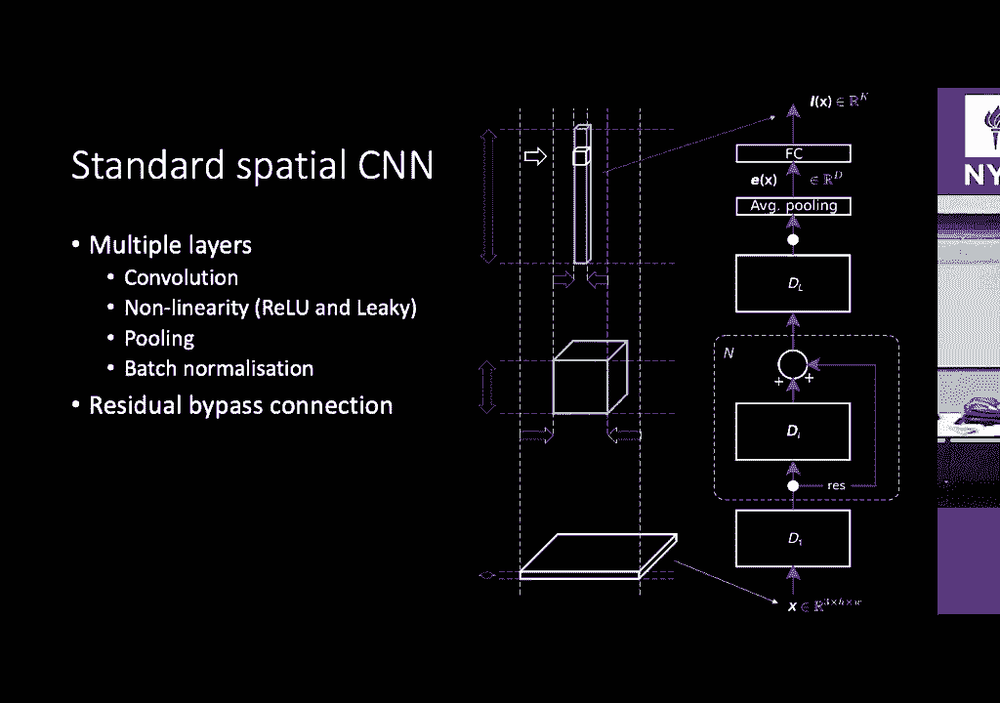

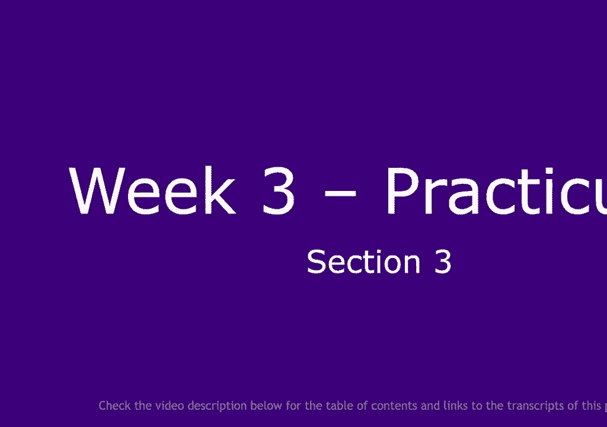

我们使用MNIST手写数字数据集进行实验，并确保两种网络（全连接网络和卷积神经网络）具有**相同数量级的参数**。

1.  **正常图像训练**：
    *   在全连接网络上，模型需要学习图像中任意两个像素点之间可能的关系，其中很多长程依赖是冗余的。
    *   在卷积神经网络上，模型专注于学习局部像素之间的关系。
    *   实验结果：两者性能相近（例如，全连接网络达到87%准确率），但CNN的参数利用效率更高。

2.  **像素打乱的图像训练**：
    *   我们对所有输入图像的像素进行**相同的随机打乱**，但保持标签不变。这彻底破坏了图像的**空间局部性**和**平稳性**。
    *   再次用两种网络进行训练。
    *   实验结果：全连接网络的性能**下降不多**，因为它原本就学习所有像素对之间的关系，打乱只是改变了像素的索引顺序。而卷积神经网络的性能**显著下降**，因为它所依赖的局部空间模式已被破坏。

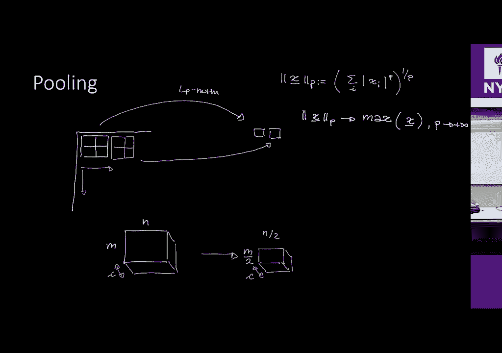

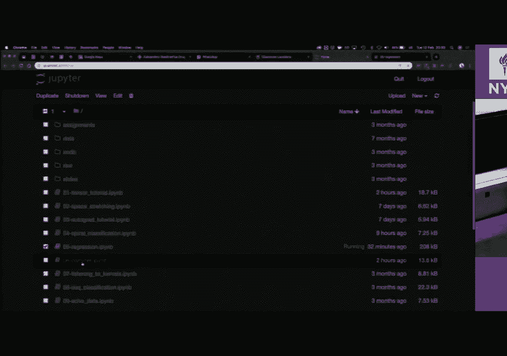

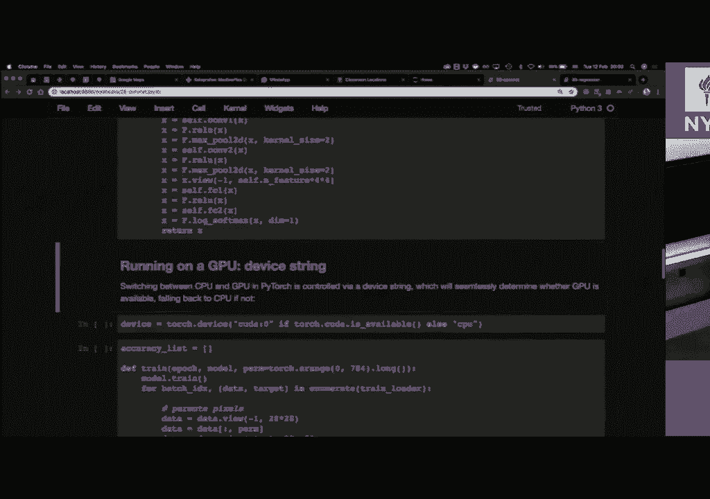

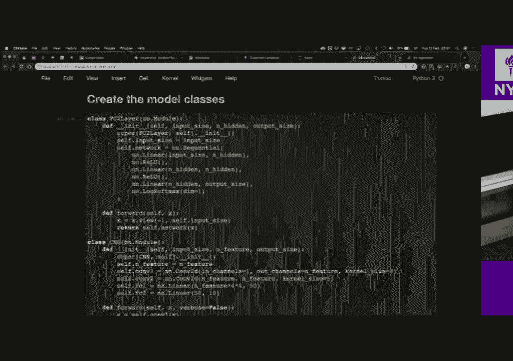

这个实验清晰地表明：**卷积神经网络的有效性严重依赖于输入数据具有局部性和平稳性**。当这些先验假设成立时，CNN是高效且强大的工具；当这些假设被破坏时，其优势将不复存在。

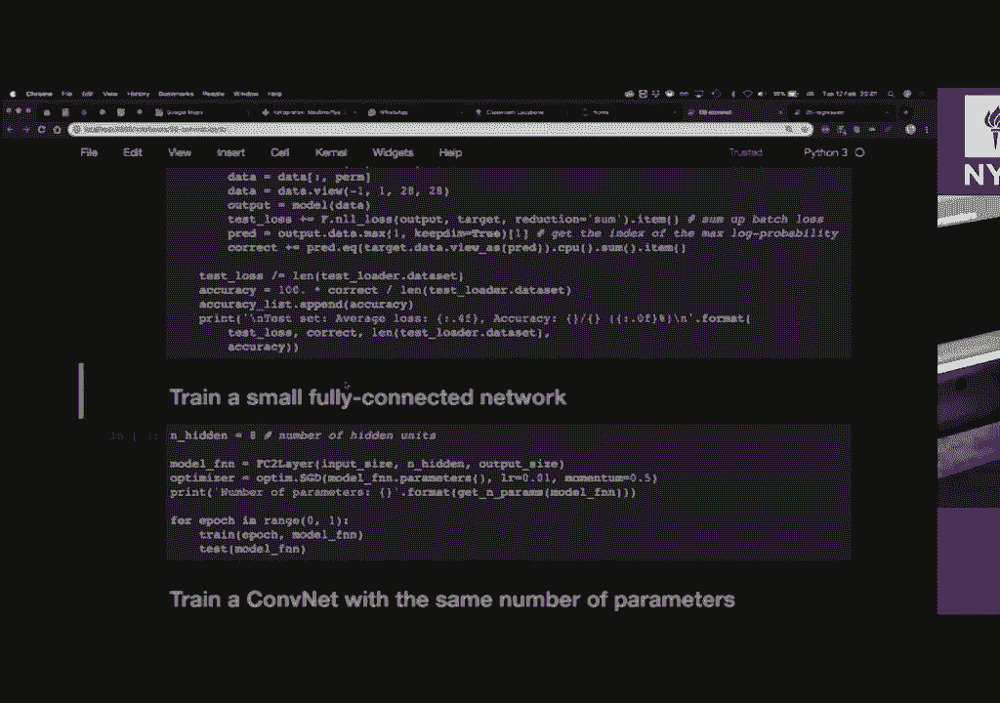

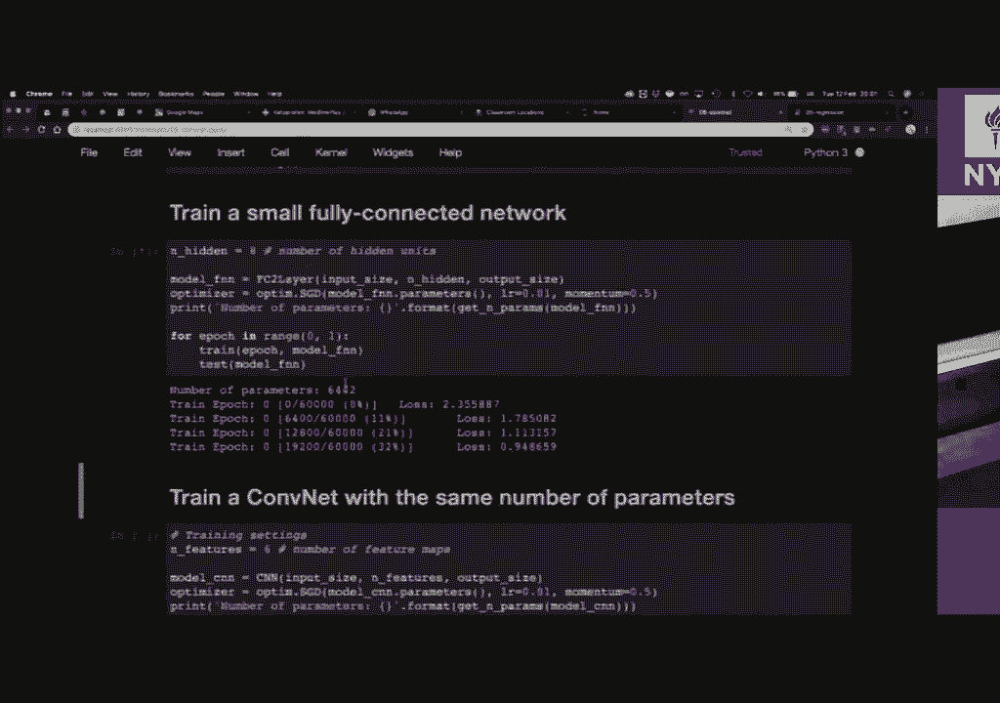

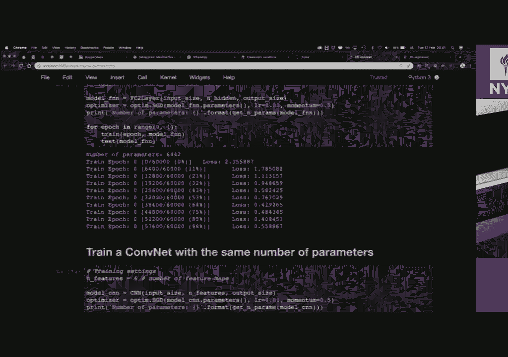

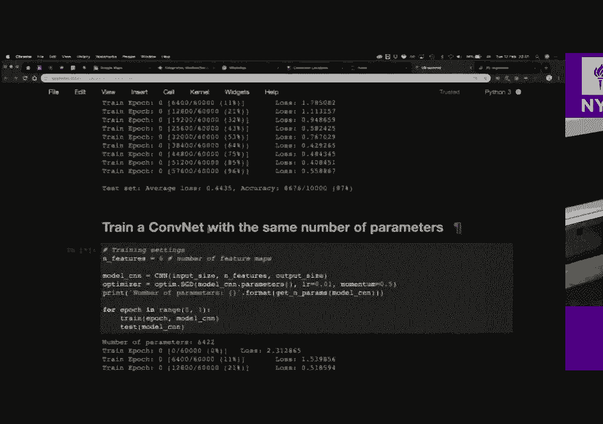

---

## 总结 📝

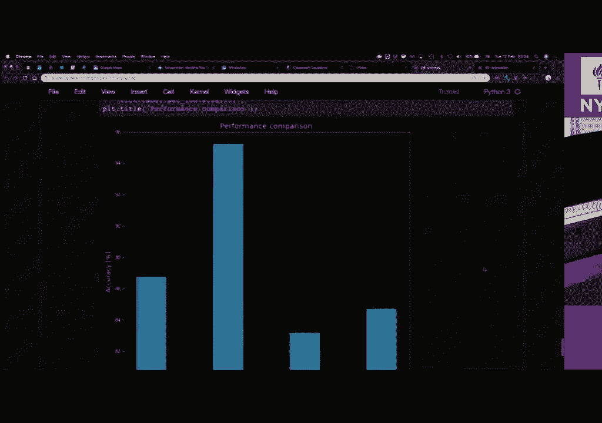

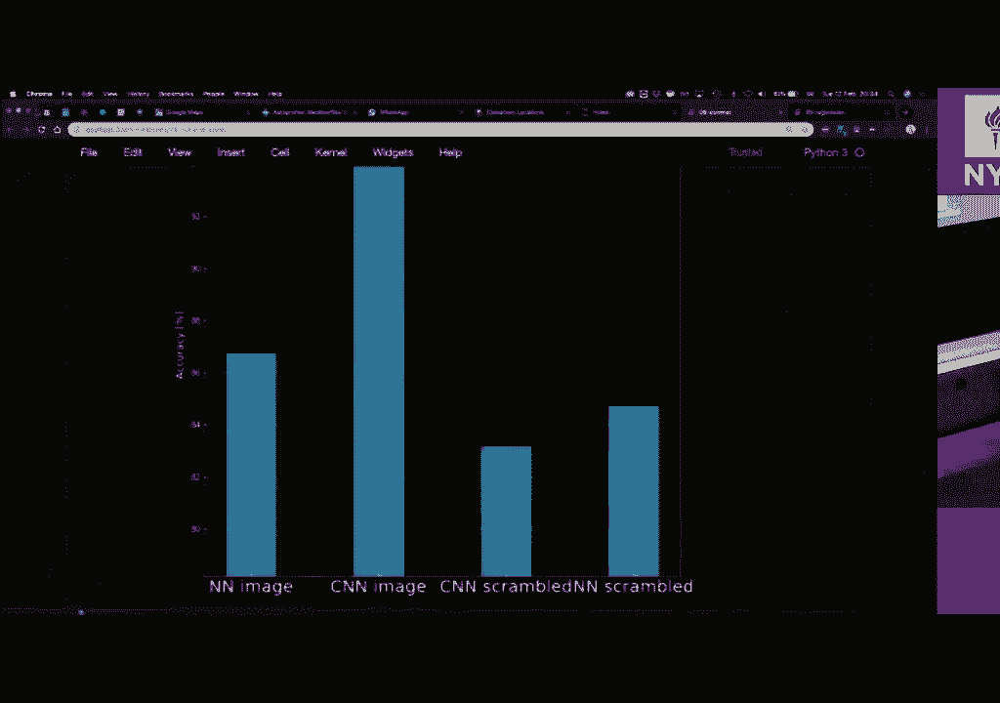

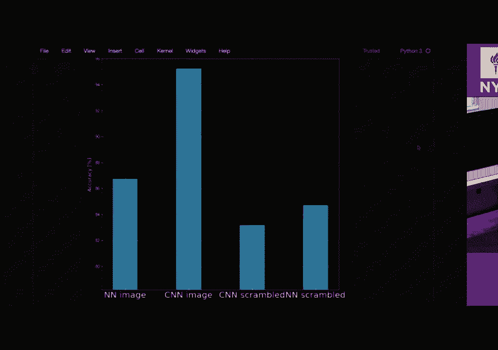

本节课我们一起学习了自然信号的三个核心特性（平稳性、局部性、组合性），并深入探讨了卷积神经网络如何利用**稀疏连接**和**参数共享**来高效处理具备这些特性的数据。我们还了解了CNN的标准架构组件，并通过实践对比，验证了CNN的设计与数据特性之间的紧密联系。理解这些基本原理，是有效应用和设计卷积神经网络的关键。