# 8：优化方法在神经网络中的应用 🚀

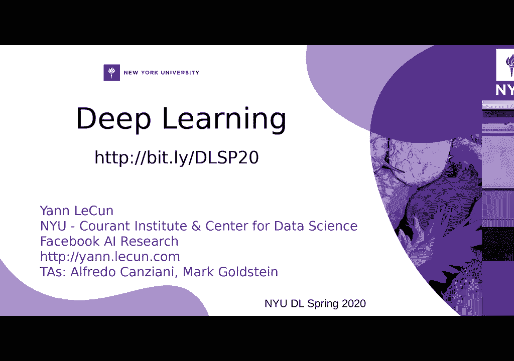

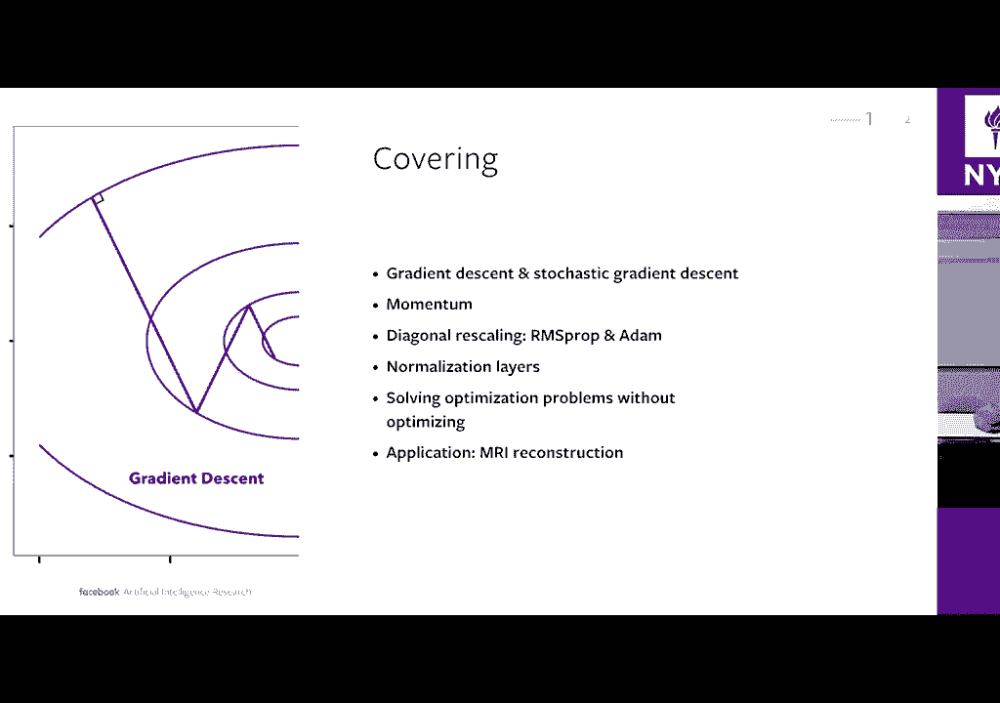

在本节课中，我们将学习优化方法，特别是梯度下降及其变体，以及它们在训练神经网络中的核心作用。优化是机器学习的基石，它帮助我们调整网络参数以最小化损失函数，从而提升模型性能。

---

## 概述 📋

优化是机器学习和某些方面的核心。今天要谈论的方法将每天都用在您的角色中，潜在地作为应用科学家、研究科学家或数据科学家。我将专注于这些方法的应用，特别是而不是背后的理论，部分原因是我们还没有完全理解所有这些方法。所以我来这里并说这就是它为什么起作用的原因，我会简化一些事情，但是我可以告诉您如何使用它们，我们如何知道它们在某些情况下会起作用，以及最好的方法是用来训练您的神经网络。

---

## 梯度下降法 📉

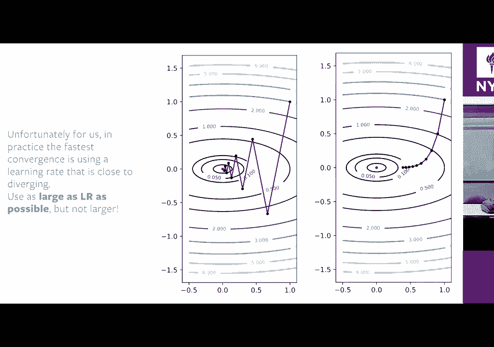

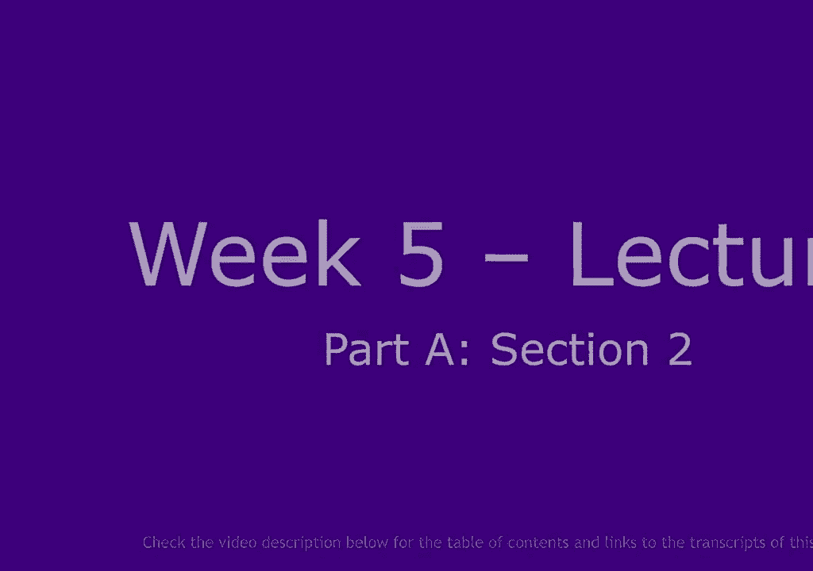

上一节我们介绍了优化的核心概念，本节中我们来看看最基础的优化方法——梯度下降法。

向您介绍优化主题，我需要从世界上最差的梯度下降方法开始，我将在稍后解释。这是最糟糕的方法，但首先我们将使用最通用的方法。

现在制定优化，您将要考虑的问题将会具有比这更多的结构，但是从符号上来说这非常有用，以这种方式开始。所以我们现在讨论的是函数f。优化程序的属性将在f上采用其他结构，但在我们的神经网络中练习结构基本上不遵循假设人们没有做出任何假设。

练习，我将从通用F开始，即使我们已经将其视为连续且可区分的。自从神经网络进入错误假设的领域，如今，大多数人在实践中都无法区分，而是有一个等效的子差速器，您基本上可以将其插入所有这些公式，如果您不顾一切，就没有理论来支持它，应该可以工作。

所以这里显示了梯度下降的方法，这是一个迭代方法。因此您从点k等于零开始，并在每一步都更新点。这里我们将使用W来表示当前的迭代，是神经网络点的标准命名法，将是一些重量的大集合，每层一个重量张量，但符号我们将整个东西压缩成一个向量，您可以想像一下，通过将所有向量重塑为所有张量两个向量并将它们连接在一起。

这种方法是我们要做的非常简单，就是遵循负梯度的方向。它的原理很简单，所以让我给你一个图，也许这将有助于解释为什么遵循负梯度方向是一个好主意。所以我们对我们的功能知之甚少，更好的是，当我们优化要查看的功能时，这是一个高层次的想法，景观局部优化景观。所以通过优化景观我是指我们网络中所有可能的权重的域，现在我们不知道是什么，如果我们在您的网络上使用任何特定的权重，我们将不知道是否会发生，它会更好地完成我们尝试将其培训到的任务，或更糟糕的是。

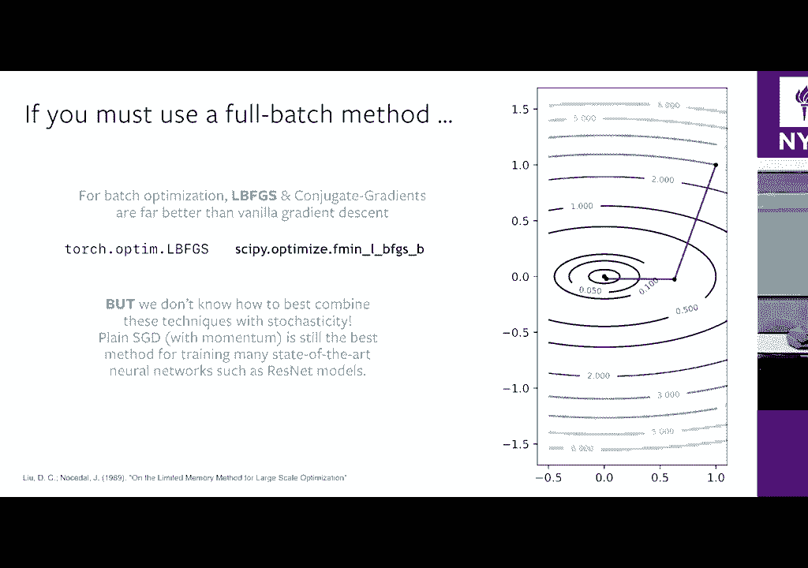

但我们确实知道，局部是当前为ad的点以及渐变和此渐变提供一些有关我们可以沿该方向行驶的信息，可能会改善我们网络的性能，或者在这种情况下降低价值。在此设置中，我们的功能最小化，最小化功能本质上就是在网络中进行培训，因此最小化损失将使您在分类任务中表现最佳，或您正在尝试做的任何事情。

因为我们只看世界在本地，此渐变基本上是我们拥有的最佳信息，您可以认为这是从一个山谷开始，在那里您开始某个可怕的地方，例如，山顶上的小指部分，您旅行从那里下来，在每个点上，您都遵循您附近的方向最遗憾的是最陡峭的下降，实际上是对百分比进行分级的方法，有时被称为最速下降法。该方向将如果您在本地移动仅一个假设我之前提到的这种平滑度是无穷小，实际上在实践中是不正确的，但我们将假设平滑度这一小步长只会使梯度变化很小，因此，您乘车的方向至少是一个好的方向小步骤。

我们基本上只是沿着这条路走，采取更大的步骤，因为我们可以穿越风景，直到到达底部的山谷是我们的功能最小化。现在有一个我们可以针对一些问题类别说些什么，我将使用我们可以做的最简单的问题类，因为这是我唯一的事情真的可以在一张幻灯片上完成任何数学运算，所以请多多包涵。此类是二次的，因此对于二次优化问题，我们实际上只基于渐变就知道很多，所以首先渐变离开整个空间的一半，现在用绿色来说明这一点线，所以我们在那一点线在绿线附近开始，知道解决方案不能在空间的其余部分，并且从您的网络，但它仍然是我们要遵循的真正好的指导方针。

负梯度的方向可能在其他地方有更好的解决方案空间，但要找到它们比仅仅寻找最好的要困难得多，我们所处位置附近的解决方案，所以我们正在努力寻找最佳解决方案我们附近的解决方案。您可以想象这是地球上有许多丘陵和山谷，我们不希望知道关于地球另一边的一座山的东西，但我们当然可以寻找我们目前所在的山下的山谷。

实际上，您可以在这里将这些功能表示为这些功能地形图这与您使用的地形图相同，熟悉来自地球的地球，这些环代表山，现在这里的环代表下降，所以这是底部我们在这里显示的山谷不是那里中心的山顶，所以我们梯度消除了整个可能空间的一半，这非常合理，然后去寻找这个负梯度，因为它是正交于这条在空间后会切断的线，您可以看到我已经得到了正交的指示，你在那里的小拉正方形。

所以，花费梯度下降的梯度属性在很大程度上取决于这些二次问题的问题结构实际上是相对容易地描述将要发生的事情，所以我将给您一个这里有一些概述，我会花几分钟，因为它是非常有趣。我希望你们中有一定背景的人线性代数可以遵循此推导，但我们将考虑二次优化问题现在该问题在灰色框中表示。

在顶部，您可以看到这是一个二次数，其中a是一个正定矩阵，我们可以处理更广泛的Quadra二次方程，这可能但是在正定情况和光栅下分析最简单，当然，用w- b和u作为在二次方的情况下，这个问题的形式是闭合的。时代B现在我们要做的是采取绿色框中显示的步骤，我们只是将其插入到距解的距离中，所以这个wk减去1减去W星离解决方案还有一段距离，所以我们想看看随着时间的变化，这个想法是，如果随着时间的推移我们越来越接近解决方案，该方法就是收敛。

因此我们从与解决方案的距离开始，将其插入现在，通过重新整理一点点更新的价值，我们可以将这些术语组合在一起，并且我们可以将B写为反所以我们可以拉或者我们可以将W星拉到里面的支架里面，然后我们得到这个表达式，它是矩阵乘以先前距离解矩阵乘以以前的距离解，现在我们不知道关于这个二次方在哪个方向上变化最大的任何事情，但是我们不能仅仅通过采用矩阵作为范数，到解的距离在这里这个范数在底部，这是现在当您考虑矩阵规范时的底线。

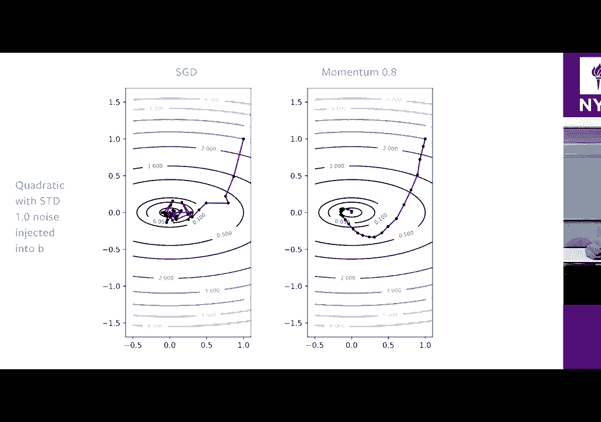

很明显，您将拥有一个表达式，其中该矩阵的特征值将是1减去mu gamma或1减去L伽玛。现在我得到这个的方式是我只看什么是极限本征a的值，我们称它们为mu和L，然后将它们插入表达式。我们可以看到这种组合的极限特征值是什么矩阵I减去gamma a，您现在具有此绝对值，您可以优化并获得二次方的最佳学习率，但是最佳学习率在实践中并不可靠，您可能不会想要使用它。

以便可以使用的更简单的值是L ll上的1特征值，这使您的收敛速度为1减去缩短解决方案每一步的距离。

---

## 随机梯度下降法 🔄

上一节我们分析了二次问题下的梯度下降，本节中我们来看看在实际神经网络训练中更常用的随机梯度下降法。

我们将每天都在练习中训练神经网络，因此，投放优化实际上并没有什么不同，我们要做的是用随机替换梯度下降步骤中的梯度。现在在神经网络中可以近似梯度，在这里，通过随机逼近来精确表示的是损失的梯度对于单个数据点单个实例，您可能要调用它，所以我得到了在这里的记号中，这个函数L是一天的损失数据点由AI索引，我们通常将其写在优化文献作为函数fi，我将使用此表示法，但您应该将fi想象成一个单一实例I和此处的损失。

我正在使用有监督的学习设置，其中有我标记为YI的数据点，所以他们指出XI标签YI函数的全部损失显示在顶部，这是所有这些F的总和。现在让我给您更多解释对于我们在这里所做的事情，我们将其随机放置在渐变中梯度，这是一个Luisi近似值，这通常是在随机优化设置，因此我们具有渐变和在我们的设置中，它的期望值等于整个梯度，因此您可以想到随机梯度下降步骤为完全梯度步骤期望。

现在这实际上并不是查看它的最佳方法，因为有一个发生的事情远不止于梯度下降和噪声，所以让我给你一点细节，但是首先我让任何人问任何问题，在我继续之前先在这里。

关于这个，但是是的，所以你是对的，所以使用整个数据集来计算梯度就是我所说的梯度下降。梯度下降在机器学习中我们现在几乎总是使用小批量生产，因此人们可能会在使用“梯度下降”之类的名称时，他们真的在谈论随机梯度下降以及您提到的内容是绝对正确的。

所以训练神经网络有些困难，使用非常大的批量，这在一定程度上可以理解，我会在下一张幻灯片上进行实际解释。让我让我进入您的首先指出问题的答案，实际上是这里的第三点随机梯度下降中的噪声引起这种现象，称为退火，并且该图直接它的右边说明了这种现象，因此您的网络培训风景很多，有很多小地方不是好的极小值出现在通往好的极小值的路径上的极小值。

很多人都赞成的理论是SGD渐变中产生的噪声实际上有助于优化器跳跃在这些坏的最小值上，理论上这些坏的最小值很小空间，所以他们很容易越过，我们是一个很好的最小值，导致您自己网络上的良好性能更大，更难跳过，所以，这个回答你的问题是的。

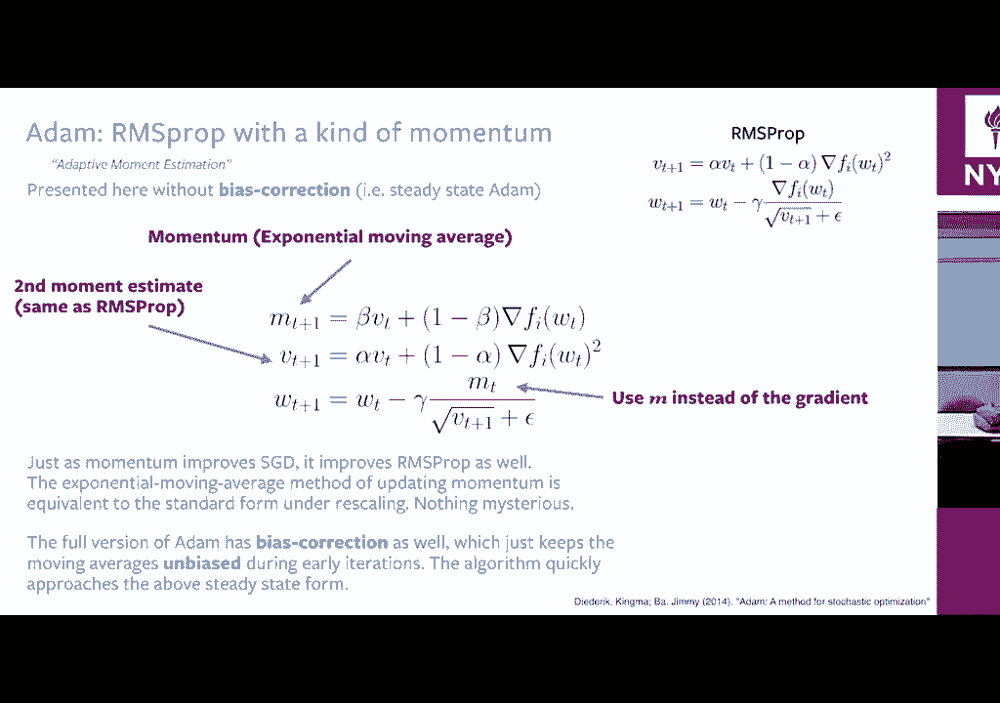

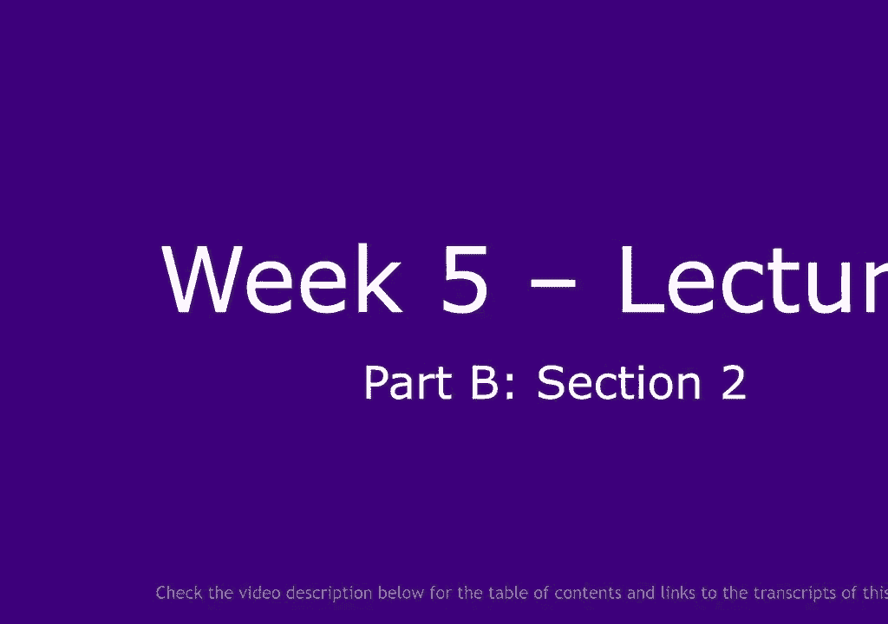

所以除了退火的观点之外，还有实际上还有其他一些原因，因此我们在我们从每个术语梯度和使用随机梯度获得的信息让我们在很多情况下利用这种冗余，几百个示例几乎与在完整数据上计算出的梯度一样好设置，通常便宜几千倍，具体取决于您的问题，就是鉴于以下原因，很难提出令人信服的理由使用梯度下降随机梯度下降的成功，这就是为什么厌恶的梯度说这是我们最好的错过之一，但梯度下降是最坏的情况之一。

实际上，早期的相关性很明显，这个令人反感的梯度可以关联到高达0.999的系数那些早期阶段的真实梯度的相关系数优化，所以我想简要谈一谈您需要了解的内容，我认为Jana已经简要提及了这一点，但实际上我们不使用随机梯度下降中的单个实例我们如何使用小批量实例，所以我只是在这里使用一些符号，但是每个人都使用迷你批处理使用不同的符号，因此您不应该过于依赖记法。

但基本上每个步骤中我都会在这里将其称为B，I为步长，您基本上使用迷你批处理中的梯度，这是数据的子集，而不是现在，几乎每个人都将使用此mini随机选择统一批处理，有些人使用替换采样，有些人使用时没有替换采样，但是，为此，差异并不重要，您可以使用小型配料有很多优点，因此实际上有一些很好的推动作用理论上的理由不是任何批次，但实际的原因是，这些实际原因中的绝大多数是我们进行的计算氨训练时，可能会以1%的效率利用我们的硬件。

网络，如果我们尝试使用单个实例，我们将获得最大收益批量有效使用数百种硬件的高效利用，例如，如果您正在训练典型的imagenet数据集，例如，您不要使用小于64的批量来获得良好的效率，可以降到32，但另一个重要的应用是分布式培训和，正如之前提到的，这确实是一件大事，最近能够训练imagenet天说，通常需要两天时间训练，不久前，只花了一个小时就花了一个星期的时间，他们这样做的方法是使用非常大的微型批次大量批次中，您需要使用一些技巧才能使其正常工作，您可能不会讲授入门课程，所以我鼓励您检查该纸，如果您有兴趣将它作为图像网小时忘了我不记得的脸书作者，目前的第一作者作为旁注，在某些情况下，您需要进行完整的批次优化，不要在其中使用梯度下降，这种情况我不能强调得足够多，即使有完整的批次数据是迄今为止最有效的方法，即插即用，您无需考虑它的积累，即l-bfgs，经过50年的优化研究，效果非常好，火炬的实现非常好，但是SyFy的实现会导致一些过滤15年前编写的代码，这几乎是防弹的，因为它们就是那些，所以这是一个好问题。

传统上，您确实需要使用完整的数据集，现在管焊炬实现实际上支持使用微型电池有点灰色地带，因为实际上没有理论支持，这可能会很好地解决您的问题，也可能无法解决问题，值得尝试，我的意思是您想为每个梯度使用整个数据集评估，或者更有可能，因为很少有人要这样做，可能更有可能您正在解决其他一些优化问题，不是在您的网络中训练，而是可能与一些辅助问题有关，您需要解决没有此数据点结构的优化问题，不是夏天不是数据点的总和，希望这是另一个，是的，哦。

是的，这个问题很年轻，建议我们使用小批量等于我们数据集中的类数的大小，为什么是问题是合理的答案是我们想要任何向量代表整个数据集，通常每个类都相当在属性上与其他类不同，因此使用小批量实际上每个类平均包含一个实例，可以显式执行该操作，尽管不必要，通过具有大约等于该大小的尺寸，我们可以假定它具有食物梯度的结构，因此您可以捕捉到很多相关性，全梯度显示的数据，这是一个很好的指南，尤其是当您在不受硬件过多约束的CPU上进行培训，当对CPU批处理量进行能量培训时，此处的效率对于硬件利用率取决于问题，我总是会推荐迷你批处理我认为不值得尝试以1号为起点，赚取小额收益也许值得探索，是的，还有另一个问题是在退火示例中，所以问题是为什么丢失风景如此动摇，这实际上是非常非常实际法则的逼真描述猛击了神经网络，令人难以置信的是，他们有很多丘陵和山谷，这是现在我们正在积极研究的东西是，有很多很好的极小值，所以山丘和山谷知道这一点是因为您的网络具有与之相关的组合方面，可以通过将所有权重转移到周围来收割电流表，使其成为神经网络，您可以从事您的工作，您将知道它的输出是否完全相同，所有这些权重都在移动，您正在执行的任务是什么，基本上对应于参数空间中的其他位置，因此，鉴于这些可能的重新排列方式呈指数级增长，获得与网络相同的权重，这就是这些峰值的令人难以置信的尖峰数，现在的原因为什么这些局部极小值仍然活跃研究，所以我不确定我能给你一个很好的答案，但他们在实践中绝对可以观察到，我可以说的是，它们似乎少了一个问题我们非常，像最先进的网络一样，所以这些本地最小值被认为是15年前的大问题，但此刻人们基本上从未遭受打击在实践中，当使用某种推荐参数时，例如，当您使用非常大的批次时，您可能会遇到这些问题，甚至清楚地表明，使用大批量生产时性能不佳甚至这些较大的最小值可归因于这些局部最小值，所以对正在进行的研究是的问题是您无法真正看到这种局部结构，因为我们处在这个百万维的空间中，这不是一个好方法看到它，是的，我不知道人们是否已经探索过，我不是熟悉相关论文，但我敢打赌有人看过它，所以您可能想要对Google询问，是的，因此神经网络设计中的许多进步都有实际上在很多方面都减少了这种颠簸，所以这是为什么它不再被认为是一个大问题的原因，在过去被认为是一个大问题还有其他问题，是的，很难看到，但是您可以做某些事情，我们可以峰谷肯定较小，并且通过重新缩放某些部分的神经网络可以放大某些方向的曲率，可以拉伸和压缩特定创新残差的方向提到的连接很容易看到它们平滑损失实际上您可以在两点之间画两条线空间，您会看到沿这条线发生的事情，这实际上是我们最好的方式有一个可视化的百万维空间，所以我把他变成了一个维您会发现，这两点之间的关系要好得多使用这些剩余连接时选择的任何两点，我都会在讲课中谈论所有关于闪避的问题，是的，如果希望我能无需再次询问即可回答该问题，但我们会看到，感谢任何其他问题，是的，所以l-bfgs很棒的方法，优化研究人员的星座，我们仍在使用SGD，60年代或更早时发明的方法仍是最先进的技术，但是。

---

## 动量法 ⚡

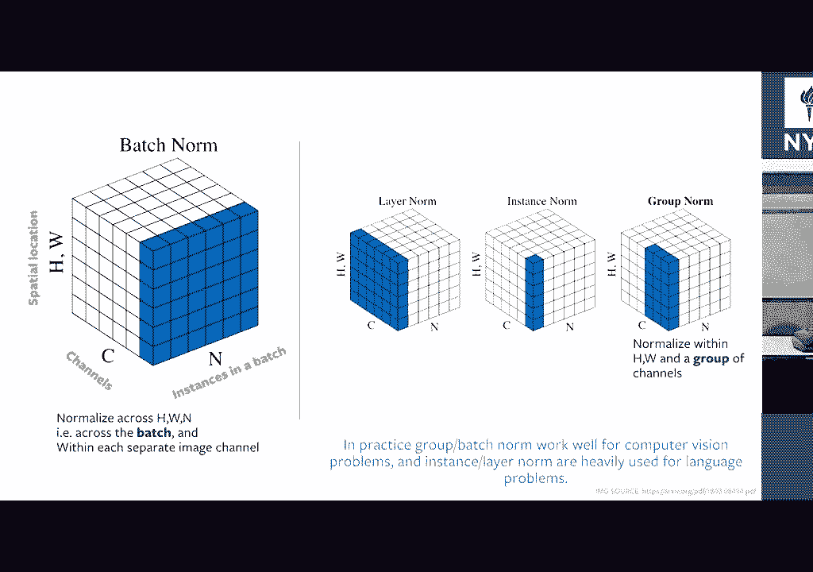

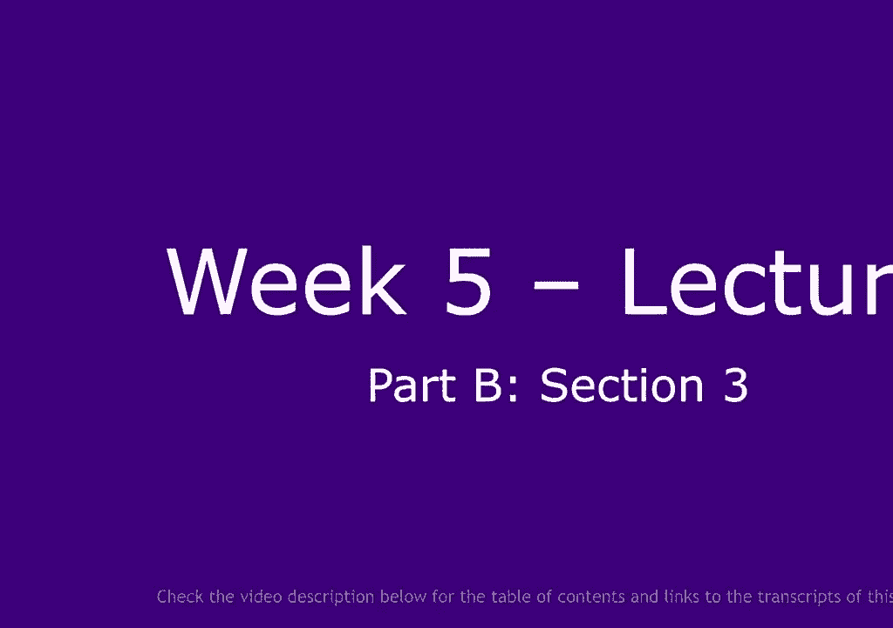

上一节我们探讨了随机梯度下降，本节中我们来看看能显著提升训练效率的动量法。

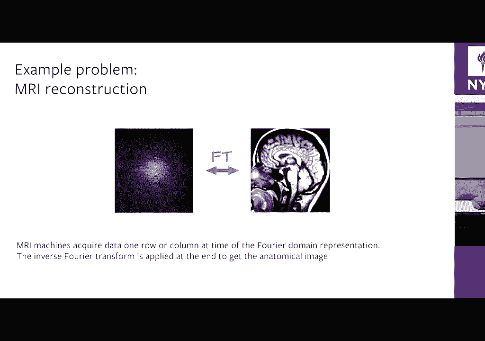

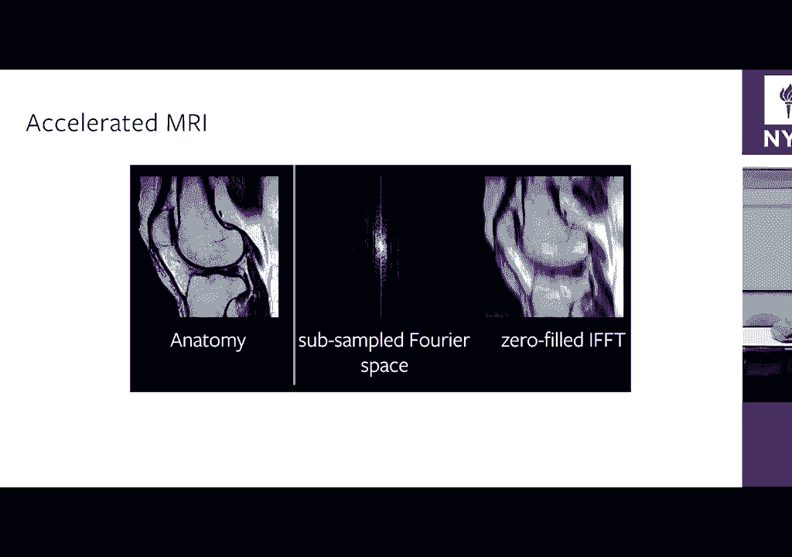

实际上是几年后的一些创新，但是有一些创新自sed发明以来的一项创新，其中一项创新是我稍后再谈，所以动力十足。当您使用随机时，应该几乎总是使用梯度下降，值得详细介绍一下，您经常会调整动量参数和网络，这是有助于了解调优过程中的实际操作，因此，动量的问题很容易被误解，这可以解释实际上存在三种不同的动量写作方式，看起来完全不同，但结果却是相当的，我只想之所以介绍这两种方式，是因为第三种方式不是众所周知，而是，实际上，我认为查看它的正确方法是我不谈论我的在这里进行研究，我们将讨论它如何在您将要使用的软件包。

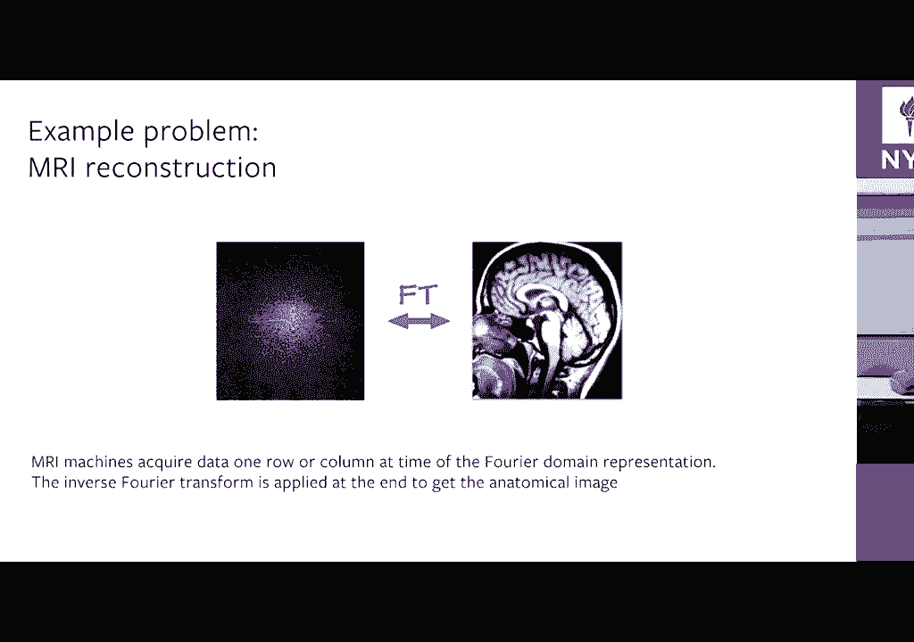

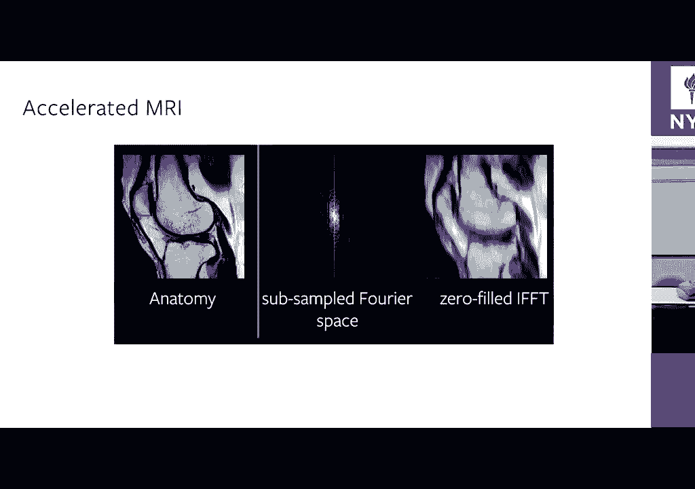

这里的第一种形式是实际实现的，在Python和您将在此处使用的其他软件中，我们维护两个变量现在您会看到许多使用不同符号的论文，这里P是在物理学中用于动量的符号，通常也将其用作在讨论sed与动量时的动量变量，所以我将关注那个约定，所以我们现在不必再进行单个迭代，而必须使用Eretz P和W，并在每一步都更新它们，这是一个非常简单的更新，因此，P更新涉及添加到旧P，而不是完全添加到旧P，P我们对旧的P进行阻尼，我们通过将其乘以一个常数来减小它，比一个更糟，所以减少旧的P，在这里我使用beta帽子作为常数，因此在实践中可能会有0.9的少量阻尼和，我们添加了新的梯度。

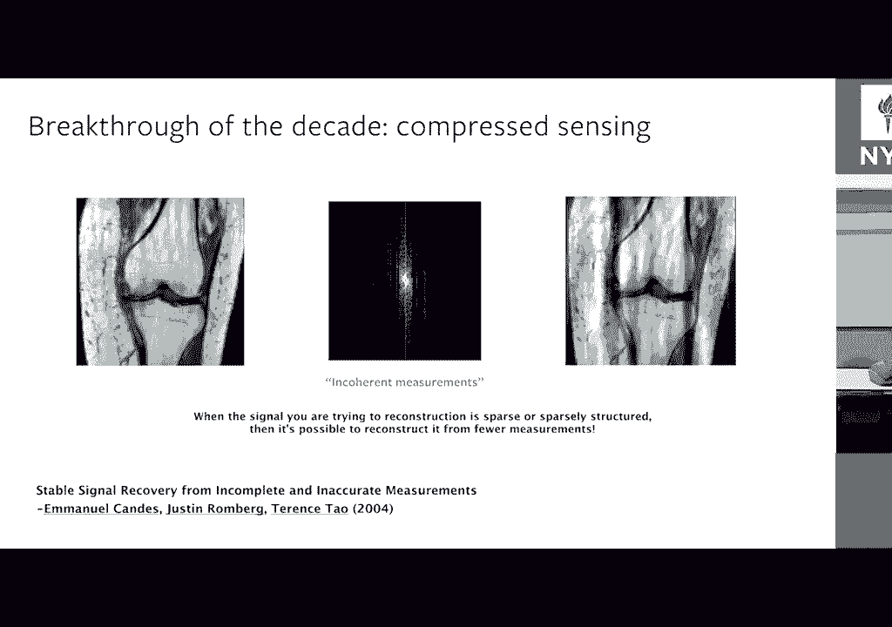

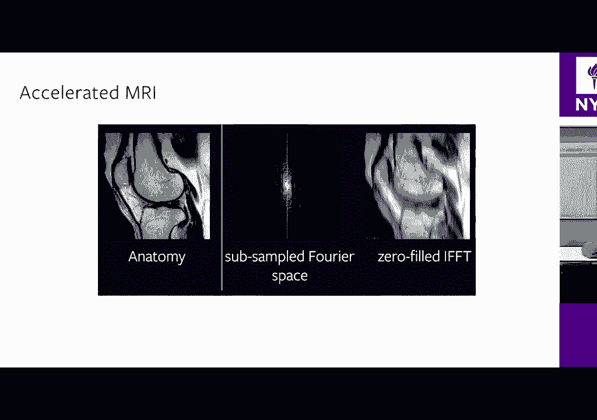

所以P是这种累积的梯度缓冲区，您可以想到新的梯度在何处可以达到全价，而过去的梯度又在哪里在每一步都减少了一定的系数，通常为0.9减小，因此缓冲区往往是某种梯度的连续求和，基本上，我们只是将其修改为custer梯度两步下降，使用这个P而不是负梯度而不是梯度对不起，自从两行公式以来，在更新中使用P而不是最好以下面的第二种形式来理解，等价的情况下，您需要对地图的beta进行较小的转换，所以它不是，两种方法之间的beta完全相同，但实际上是相同的，因为在实践中，这些基本相同，直到获得罗马化和，我认为这部电影可能更清晰，这种形式称为随机重球方法，这里我们的更新仍然包括渐变，但我们也加上我们现在所走的过去方向的倍数副本，这意味着我们在这里实际上在做什么，所以实际上并不难进行可视化，我将使用一种经过提炼的可视化出版物，您可以在那里看到底部的衣服，但我对此非常不同意，他们在该文档中讨论的内容，但我喜欢可视化，因此，让我们使用had，我将在后面解释为什么我不同意一些问题，但这是非常简单，所以您可以将动量视为物理过程，而我提到你们中那些已经完成物理入门课程的人涵盖了这一点，所以动量是事物在不断移动中的特性，如果您熟悉牛顿法则，目前正在朝着正确的方向发展，法律规定事物要朝着前进的方向前进，这是动量，当您进行物理映射时，梯度有点像，推动你识字的力量，以此类推，它在每个点上都推着沉重的球，而不是使戏剧性左侧显示的每一步的行进方向都发生了变化图，而不是进行这些巨大的改变，我们将做一个适度的变化，所以当我们意识到自己走错了路时方向，我们有点掉头，而不是踩下手刹，摆弄它在很多实际应用中，问题会给您带来很大的改善，所以在这里您可以看到您，到解决方案结束时更接近解决方案，并且振荡更少，您会看到这种振荡，因此，如果您使用梯度下降型方法，所以我们在这里谈论梯度之上的动量，在可视化中下降，您将得到这种振荡，这只是梯度下降的特性，如果不修改，就无法摆脱它，方法，我们对他们来说在某种程度上可以减轻这种振荡。

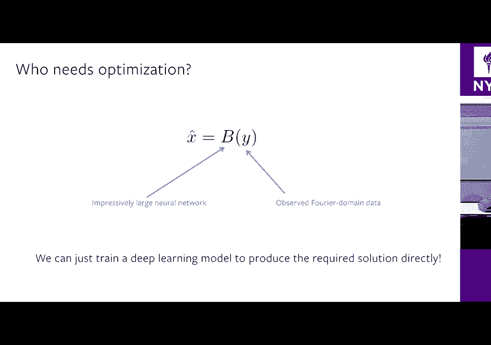

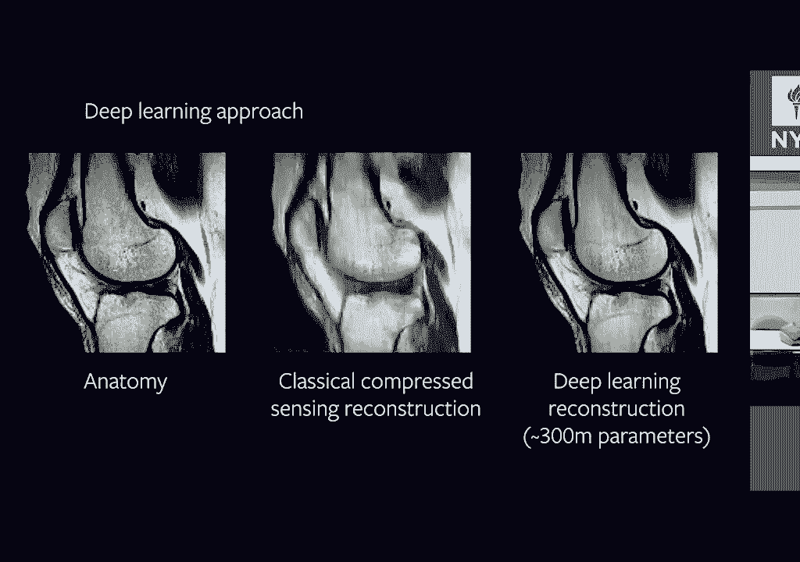

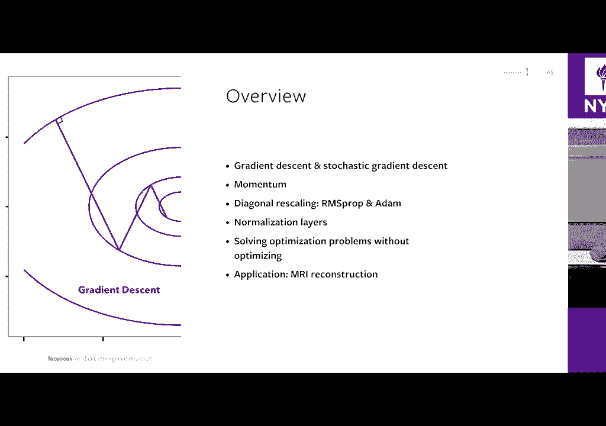

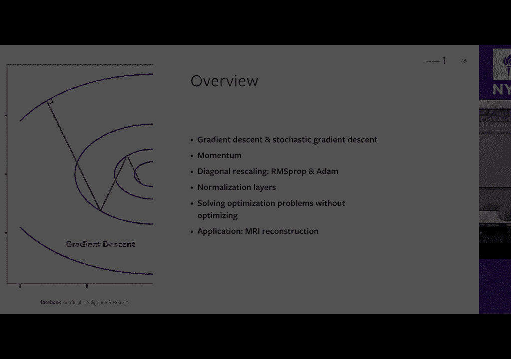

这里的另一种可视化效果将使您对如何这个beta参数控制事物的系现在更大，如果等于零，则返回零，您会在梯度下降中分散注意力，必须小于1，否则Met在开始时一切都会炸毁，包括过去的渐变，随着时间的流逝越来越重，在零到一之间，典型值范围从0.25到小像0.99，所以在实践中您可以接近一个，发生的是，较小的值会导致您更快地改变方向，所以在您可以在左侧看到带有小Beta的