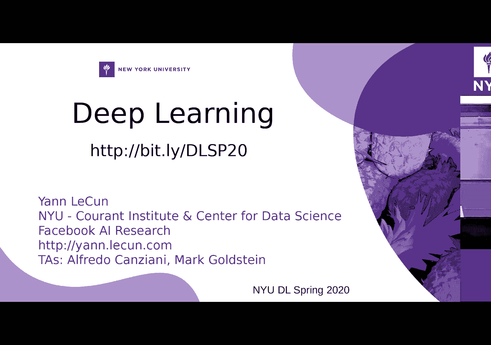
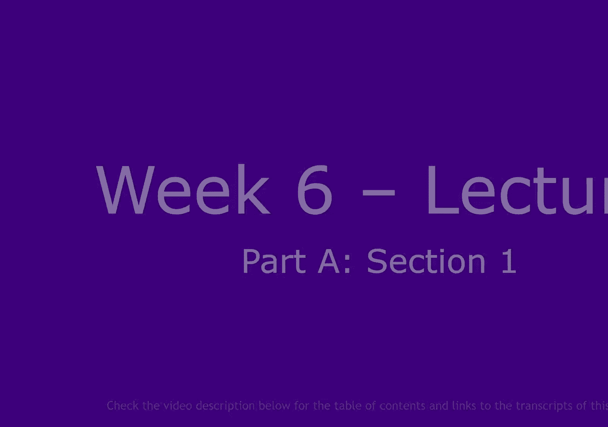
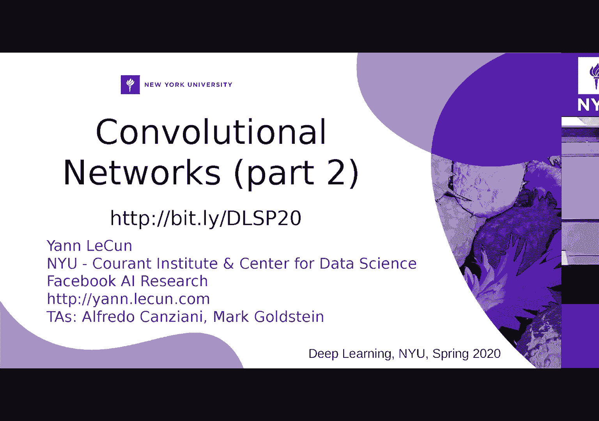
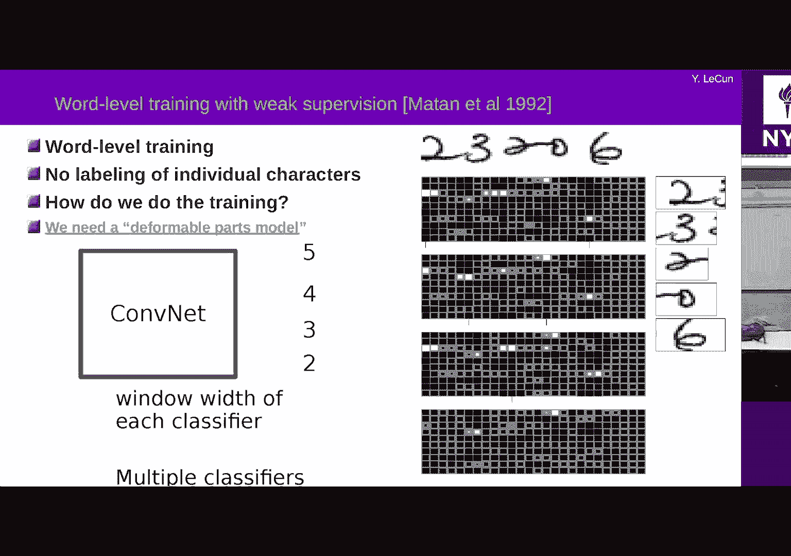

# 10：卷积神经网络应用、循环神经网络与注意力机制 🧠

在本节课中，我们将学习卷积神经网络（CNN）在多种任务中的应用，并探讨循环神经网络（RNN）及其变体，特别是注意力机制的基本原理。我们将通过具体的例子和公式来理解这些概念，并了解它们如何在实际问题中发挥作用。

---

## 🖼️ 卷积神经网络的应用

上一节我们介绍了卷积神经网络的基本原理，本节中我们来看看CNN在实际任务中的多种应用方式。

### 滑动窗口与目标检测

CNN可以通过滑动窗口的方式处理大尺寸图像。每个窗口经过网络后，会输出一个分数向量，表示该窗口属于各个类别的可能性。例如，对于一个包含多个字符的图像，CNN可以输出每个窗口内字符类别的分数。

**公式**：若网络有两层池化层，每层的下采样率为2，则总下采样率为4。这意味着输出层每个单元对应输入图像中一个4×4像素区域的窗口。

以下是处理重叠检测结果的常用方法：

*   **非极大值抑制（NMS）**：当多个相邻窗口都检测到高分数目标时，只保留分数最高的那个，抑制其周围的检测结果。这常用于物体检测任务，以避免对同一物体进行重复报告。

### 字符识别与序列解释

CNN可用于识别图像中的字符串，例如邮政编码。由于字符可能相连，我们无法预先分割。解决方法是将CNN应用于整个字符串区域，网络会在不同位置输出一系列分数。

为了从这些分数中得到一个连贯的字符序列（例如“3206”），我们需要一个后处理步骤。这可以通过构建一个分数矩阵，并使用动态规划寻找最优路径来实现。

**核心思想**：将不同位置、不同尺度检测器得到的分数，整合为一条最可能的字符序列路径。这类似于语音识别中的动态时间规整（DTW）算法。

### 人脸检测与多尺度处理

人脸检测是CNN的经典应用。我们训练一个CNN分类器，用于判断一个图像块（如30×30像素）是否包含人脸。

然而，实际图像中的人脸尺寸多变。解决方法之一是**多尺度方法**：

1.  将原始图像按一定比例（如√2）逐步缩小，构建一个图像金字塔。
2.  在每一层缩放后的图像上运行同一个人脸检测CNN。
3.  将不同尺度上的检测结果映射回原始图像坐标，并进行合并。

**计算成本**：虽然需要处理多个尺度的图像，但由于图像尺寸变小，计算量并非线性增长。总成本大约是处理原始图像的2倍（1 + 1/2 + 1/4 + ... ≈ 2），这是可以接受的。

为了减少误报（将非人脸物体检测为人脸），可以采用**难例挖掘**：
*   收集大量不包含人脸的图像。
*   用初始检测器在这些图像上运行，收集所有被误判为“人脸”的图像块。
*   将这些难例作为负样本加入训练集，重新训练检测器。重复此过程几次，可以显著提升检测器鲁棒性。

### 语义分割

语义分割是为图像中的每一个像素分配一个类别标签的任务（如“道路”、“车辆”、“行人”）。

一种方法是采用“以像素为中心”的patch分类方法：
*   以每个像素为中心，截取一个固定大小的图像块（如40×40像素）。
*   将该图像块输入CNN，由网络判断中心像素的类别。
*   在整张图像上滑动这个操作，为每个像素生成标签。

为了获得更准确的分类，特别是对于需要更大上下文信息的像素（如判断“天空”），可以使用**多尺度上下文融合**：
*   将原始图像以及下采样2倍、4倍的图像分别输入同一个CNN。
*   将网络在深层输出的特征图进行上采样，使其与原始图像尺寸一致。
*   将这些来自不同尺度的特征图拼接起来，再送入一个分类器进行最终决策。这样，分类器在做每个像素的决策时，实际上拥有了来自原始图像更大区域（如184×184像素）的上下文信息。

---

## 🔁 循环神经网络（RNN）与序列建模

上一节我们探讨了CNN在空间数据上的应用，本节中我们来看看如何处理时间序列或序列数据。

### RNN的基本结构

循环神经网络用于处理序列数据。其核心思想是引入“隐藏状态”，该状态会随着时间步传递，使网络具备记忆能力。

**基本公式**：
对于一个时间步 `t`：
1.  **编码器**：`h_t = f_e(x_t)` （将输入 `x_t` 编码为向量 `h_t`）
2.  **循环层**：`z_t = g(h_t, z_{t-1}; W)` （`g` 是循环函数，`W` 是可训练参数，`z_{t-1}` 是上一时刻的隐藏状态）
3.  **解码器**：`y_t = f_d(z_t)` （根据隐藏状态 `z_t` 产生输出 `y_t`）

通过沿时间轴“展开”这个循环结构，我们可以得到一个前馈网络，从而可以使用反向传播算法进行训练，这种方法称为**随时间反向传播（BPTT）**。

### RNN的挑战与门控机制

简单的RNN在实践中面临两个主要问题：
1.  **梯度消失/爆炸**：在长序列上反向传播时，梯度会指数级地缩小或增大，导致难以训练。
2.  **长期依赖记忆困难**：简单的RNN难以记住很久以前的信息（例如，在长代码中匹配括号）。

为了解决这些问题，研究者设计了**门控循环单元（GRU）** 和**长短期记忆网络（LSTM）**。它们通过引入“门”结构（由Sigmoid函数实现，输出0到1之间的值），来有控制地更新和重置隐藏状态。

**GRU的核心思想**：
*   **更新门**：决定有多少旧隐藏状态需要保留，有多少新信息需要加入。
*   **重置门**：决定如何将旧隐藏状态与当前输入结合。
这些门允许网络学习在长时间步中保持信息不变，从而缓解梯度消失和长期记忆问题。

### 注意力机制

注意力机制是神经网络中一个强大的模块，它允许模型在处理当前信息时，有选择地“关注”输入序列中的相关部分。

**基本计算步骤**：
1.  给定一个查询向量 `q` 和一组键值对 `{k_i, v_i}`。
2.  计算 `q` 与每个键 `k_i` 的相似度（如点积）：`α_i = q^T k_i`。
3.  对相似度分数应用Softmax函数，得到一组权重系数：`c_i = softmax(α_i)`，满足 `Σ c_i = 1`。
4.  输出是值 `v_i` 的加权和：`output = Σ c_i * v_i`。

这相当于让模型从值存储器中，根据查询 `q`，读取一个软性的、加权组合后的值。整个操作是可微分的，可以嵌入到神经网络中并通过梯度下降进行训练。

### 注意力在机器翻译中的应用

在神经机器翻译中，最初的编码器-解码器模型需要将整个输入句子的信息压缩到一个固定长度的向量中，这在处理长句子时效果不佳。

引入**注意力机制**后，解码器在生成每一个目标语言单词时，可以动态地查看输入句子所有单词的隐藏状态，并决定将“注意力”集中在哪个或哪些单词上。这极大地提升了翻译质量，特别是对长句子的处理能力，并迅速成为机器翻译的主流方法。

### 记忆网络与神经图灵机

记忆网络将注意力机制进一步推广，构建了一个外部可寻址的记忆模块。网络可以学习如何向这个记忆模块写入信息（存储故事），以及如何从中读取信息（回答问题）。

**基本操作**：
*   **寻址（读取）**：使用输入（查询）与记忆中的键进行比较，通过注意力权重读取相关的值。
*   **写入**：根据网络的学习目标，更新记忆中的值。

这种结构使神经网络具备了类似计算机的工作记忆能力，可以执行需要多步推理和临时存储信息的复杂任务。神经图灵机是这一思想的延伸，试图用可微分的操作模拟图灵机的读写头移动。

---

## 📝 总结

本节课中我们一起学习了：
1.  **卷积神经网络（CNN）的广泛应用**：包括通过滑动窗口进行目标检测、字符识别、人脸检测（结合多尺度处理和难例挖掘）以及语义分割（结合多尺度特征融合）。
2.  **循环神经网络（RNN）的基本原理与局限**：RNN通过隐藏状态处理序列，但存在梯度消失和长期依赖问题。
3.  **门控循环单元（GRU/LSTM）**：通过门控机制有效控制信息流，缓解了简单RNN的问题。
4.  **注意力机制的核心思想**：允许模型动态地聚焦于输入的相关部分，其核心是计算一个加权的和，权重由查询与键的相似度决定。
5.  **注意力机制的革命性影响**：在机器翻译等任务中，注意力机制使模型不再需要将整个序列压缩到一个固定向量，显著提升了性能。
6.  **记忆网络**：基于注意力构建的外部记忆模块，使神经网络具备了可微分的工作记忆能力，能够处理需要多步推理的任务。

这些概念，尤其是注意力机制，构成了现代深度学习模型（如Transformer）的基石，并在自然语言处理、计算机视觉等领域持续发挥着核心作用。