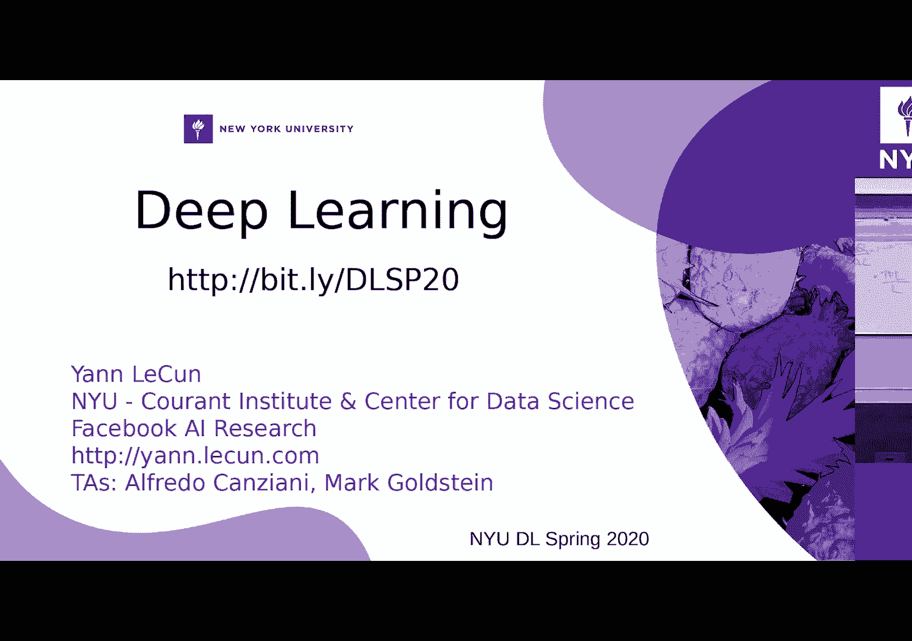
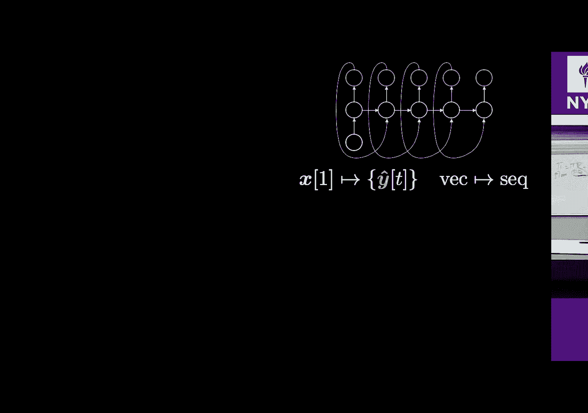
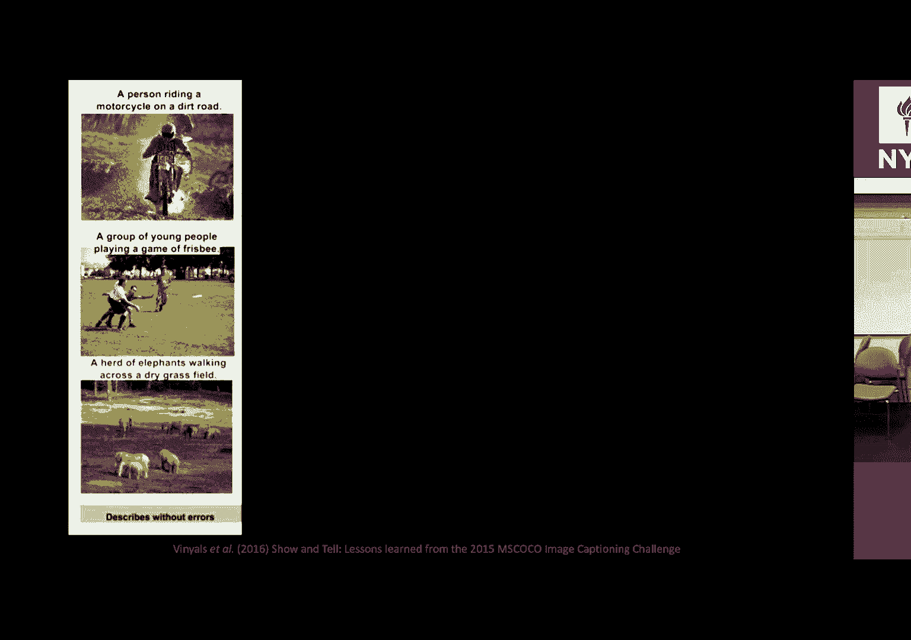
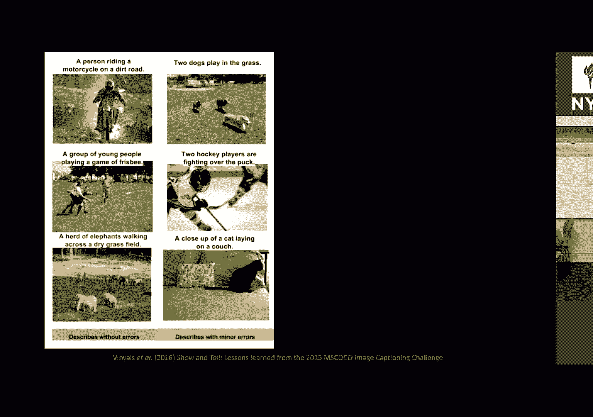

# 11：RNN 与 LSTM 架构详解 🧠




在本节课中，我们将学习递归神经网络（RNN）及其变体——长短期记忆网络（LSTM）的基本概念、工作原理和应用场景。我们将从序列数据处理的需求出发，逐步理解这些网络架构的设计思想、数学公式以及它们如何解决传统神经网络在处理序列数据时遇到的挑战。

---







## 从组合逻辑到序列逻辑 🔄

上一节我们介绍了传统的前馈神经网络，它类似于数字电路中的组合逻辑，其输出仅取决于当前输入。然而，在处理序列数据（如时间序列、文本、语音）时，我们需要一种能够记住“过去”信息的网络。

递归神经网络（RNN）应运而生。RNN 引入了“内部状态”的概念，其输出是**当前输入**和**系统先前状态**的函数。这类似于数字电路中的时序逻辑，系统拥有内部记忆单元（如触发器）。

一个简单的 RNN 单元在时间步 `t` 的计算可以表示为：
```
h_t = f(W_xh * x_t + W_hh * h_{t-1} + b_h)
y_t = g(W_hy * h_t + b_y)
```
其中：
*   `x_t` 是时间步 `t` 的输入。
*   `h_t` 是时间步 `t` 的隐藏状态（即内部记忆）。
*   `h_{t-1}` 是上一个时间步的隐藏状态。
*   `W_xh`, `W_hh`, `W_hy` 是权重矩阵。
*   `b_h`, `b_y` 是偏置项。
*   `f` 和 `g` 是非线性激活函数（如 `tanh` 或 `softmax`）。

通过这种结构，信息得以在时间维度上传递。

---

## RNN 的应用模式 📊

RNN 因其处理序列的能力，被广泛应用于多种模式。以下是几种主要的应用架构：

*   **一对一（序列生成）**：输入一个向量（如图像），输出一个符号序列（如图像描述句子）。例如，输入一张“黄色校车”的图片，输出 “a yellow school bus parked in a parking lot”。
*   **多对一（序列分类）**：输入一个序列，输出一个向量或类别。例如，输入一段文本（单词序列），输出其情感分类（积极/消极）。
*   **一对多（序列生成）**：输入一个向量或起始符号，输出一个序列。例如，输入一个主题词，让网络续写一段故事。
*   **多对多（序列到序列）**：输入一个序列，输出另一个序列。这曾是机器翻译的标准方法，即编码器-解码器架构。编码器将输入序列压缩成一个“语义向量”，解码器再将该向量展开为目标语言序列。

在这些嵌入空间中，语义相似的词会聚集在一起，并且可以进行有趣的向量运算，例如：`“国王” - “男人” + “女人” ≈ “女王”`。

---

## RNN 的挑战：梯度消失与爆炸 💥

虽然 RNN 理论上可以记忆长期信息，但在实践中训练深度 RNN（即时间步很长的 RNN）会遇到严重问题。

当通过时间反向传播（BPTT）计算梯度时，梯度需要沿着时间步反向传播。每一步都会乘以权重矩阵 `W_hh` 的转置。如果 `W_hh` 的特征值大部分小于1，梯度会指数级衰减（**梯度消失**），导致早期时间步的参数几乎无法更新。反之，如果特征值大于1，梯度则会指数级增长（**梯度爆炸**），导致训练不稳定。

这限制了经典 RNN 只能学习短期的依赖关系。

---

## 解决方案：长短期记忆网络（LSTM） 🚪

为了解决梯度消失问题，Sepp Hochreiter 和 Jürgen Schmidhuber 在 1997 年提出了 LSTM。LSTM 的核心思想是引入“门控”机制和一条几乎无阻碍的“细胞状态”通道。

一个 LSTM 单元包含三个门：
1.  **遗忘门（f_t）**：决定从细胞状态中丢弃哪些信息。
2.  **输入门（i_t）**：决定哪些新信息将被存入细胞状态。
3.  **输出门（o_t）**：基于细胞状态，决定输出什么。

其核心计算公式如下：
```
f_t = σ(W_f · [h_{t-1}, x_t] + b_f)  # 遗忘门
i_t = σ(W_i · [h_{t-1}, x_t] + b_i)  # 输入门
o_t = σ(W_o · [h_{t-1}, x_t] + b_o)  # 输出门

C̃_t = tanh(W_C · [h_{t-1}, x_t] + b_C)  # 候选细胞状态
C_t = f_t * C_{t-1} + i_t * C̃_t         # 更新细胞状态
h_t = o_t * tanh(C_t)                   # 计算当前隐藏状态输出
```
其中 `σ` 是 `sigmoid` 函数，输出 0 到 1 之间的值，代表“通过比例”。`*` 表示逐元素相乘。

**关键点**：细胞状态 `C_t` 的更新路径主要是**逐元素相乘和相加**。特别是，从 `C_{t-1}` 到 `C_t` 的路径上，梯度流主要乘以遗忘门 `f_t`（一个标量或向量），而不是一个完整的矩阵 `W_hh`。如果遗忘门被学习为接近 1，梯度就可以几乎无衰减地反向传播很远，从而解决了长期依赖问题。门结构让网络学会了何时“写入”、“读取”或“重置”其长期记忆。

---

## 实践与比较 ⚖️

在实践环节，我们通过两个任务比较了 RNN 和 LSTM 的性能：

1.  **序列分类任务**：生成长度为 100-110 的符号序列，其中包含两个关键标记 `X` 和 `Y`。序列的类别（Q, R, S, T）由 `X` 和 `Y` 的出现顺序决定。网络需要忽略大量随机噪声（A, B, C, D），识别出关键模式。
    *   **结果**：在简单和中等长度序列上，LSTM 能快速达到 100% 准确率。而经典 RNN 学习速度较慢，或在更长的依赖任务上完全失败。可视化 LSTM 的细胞状态可以发现，特定单元专门用于“记住”是否看到了第一个 `X`，直到看到 `Y` 后才重置，这清晰地展示了其记忆机制。

2.  **回声任务**：网络需要记忆并在若干时间步后复现之前看到的输入脉冲。
    *   **结果**：LSTM 能够完美地完成需要长期记忆的任务。当将长序列分块训练时，LSTM 可以通过其细胞状态在块之间传递记忆，而 RNN 则难以维持跨块的信息。

这些实验表明，LSTM 的门控机制使其能够有效地学习和保持长期信息，是处理序列数据的强大工具。

---

## 总结 📝

本节课我们一起学习了递归神经网络的核心思想及其进化版本 LSTM。
*   **RNN** 通过引入循环连接和隐藏状态，具备了处理序列数据的能力，其输出依赖于当前输入和历史状态。
*   然而，经典 RNN 存在**梯度消失/爆炸**问题，难以学习长期依赖。
*   **LSTM** 通过巧妙的**门控结构**（遗忘门、输入门、输出门）和**细胞状态**，创建了一条梯度高速公路，显著缓解了梯度消失问题，使其能够有效地记忆和利用长距离信息。
*   在实践中，LSTM 在语言建模、机器翻译、序列分类等需要理解上下文的任务上，表现通常远优于经典 RNN。

理解 RNN 和 LSTM 是进入现代序列建模（如注意力机制和 Transformer）的重要基石。