# 12：基于能量的模型与自监督学习 🧠

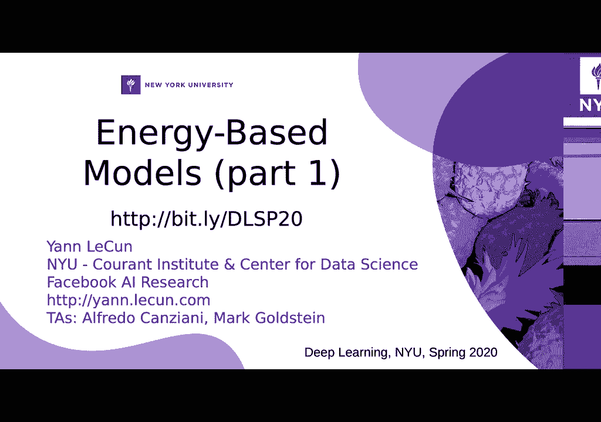

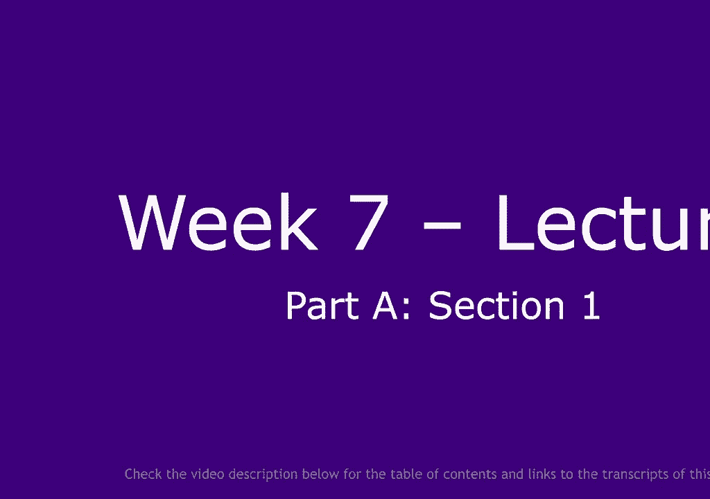

在本节课中，我们将要学习**基于能量的模型**的基本概念，并探讨它与**自监督学习**的联系。我们将了解如何用能量函数来表达变量间的依赖关系，以及如何利用这种模型进行预测和推理。课程内容将涵盖从基本定义到训练方法的全过程。

---

## 基于能量的模型：基本概念 🔋

上一节我们介绍了课程概述，本节中我们来看看基于能量的模型的核心思想。

基于能量的模型是一种用于表达多种学习范式的框架。它不像我们在监督学习中运行的那种简单算法，事情更为复杂。它包含了许多方法，但可能更容易理解。我认为那些可能是病态的方法。如果您想减少能源消耗，基于能量的方法确实是一种特殊情况。

从某种意义上讲，它很有启发性，它解释了很多看起来非常不同的事物，当您无法获得这种统一视图时。我要说的是，首先在监督学习中同样适用。有些人称之为有监督的学习，或者我们称之为自监督的学习。我们今天要谈一点。

关于观察到一组变量 `X` 的模型，我们问这个模型预测变量 `Y` 的集合。但我没有指定 `X` 是图像还是其他什么。`Y` 是一个离散变量，例如对于分类任务，`Y` 就像整数。`X` 可能是图像，而 `Y` 是描述它的标签；或者 `X` 是一段文字，`Y` 是另一种语言的句子；`X` 可以是整个文本，而 `Y` 可以是该文本的简化版本或摘要。因此，它可以是任何东西。我在这里没有指定具体形式，但它来自于前馈模型是否存在这两个问题。

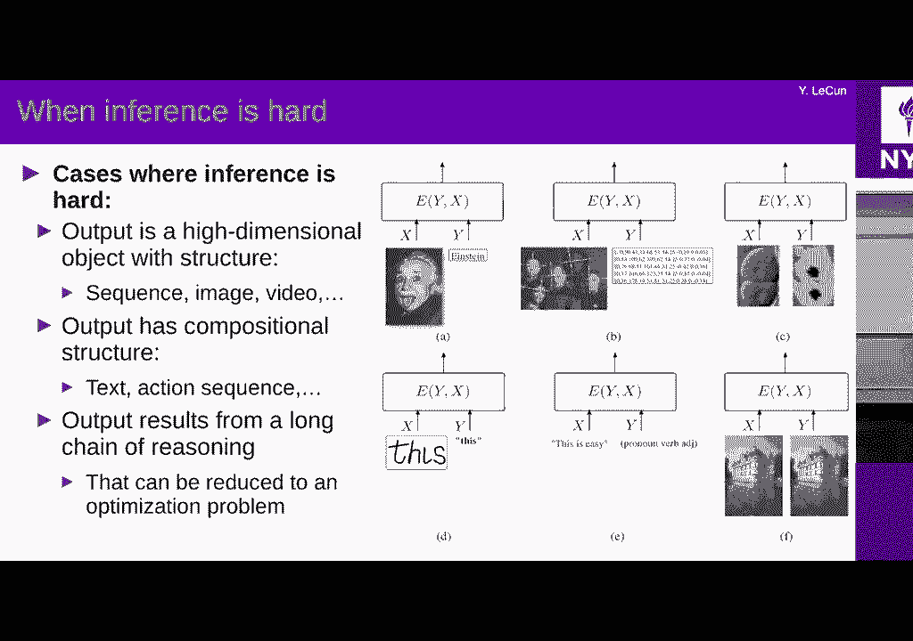

神经网络或其他经典模型先于您。如果您知道有限的固定数量的计算会产生输出。有一个多层结构，您知道有固定数量的层。即使您拥有循环网络，对可以展开多少次也有一定的限制。因此，您基本上知道了固定的计算量。

但是有两个问题并不完全适合。第一种情况是计算输出时需要一些更复杂的计算，而不仅仅是有限的加权和与非线性变换。第二种情况是当我们尝试训练机器产生的不是单个输出，而是一组可能的输出。因此在这种情况下，根据分类，我们实际上是在训练机器以生产多种输出。我们正在训练它为每种可能的情况产生单独的分数。理想情况下，我们知道的系统中的类别会得出正确类别的最佳分数。在实践中，其他人的分数很小。

您知道我们运行输出时的情况，通过 softmax 函数，分数会产生一种分布，我们只选择一个分数很高的输出。但基本上我们告诉机器要做的是产生每个类别的分数，然后我们将选择最好的。当输出是连续的高维时，这是不可能的。所以，输出比如是一张图像，我们在图像上没有 softmax 函数。没有列出所有可能图像的方法，那么您知道无法在它们上规范化分布，因为它是高维连续空间。即使它是一个真正合理的连续空间，我们也不可能将该连续空间划分为离散的箱子，然后在上面进行 softmax 操作。它只能在小尺寸、低维度上工作。

所以当我们有高维连续空间时，我们不能要求系统为我们为所有可能的输出给出类似的分数，即使它是离散的，但可能是无限的。所以像我们生成文本之类的东西，给定长度的可能文本数量非常非常多。我们不能只对所有可能的文本进行 softmax 操作。存在相同的问题，所以我们如何以紧凑形式表示所有可能文本的得分分布？那就是基于能量的模型出现的地方。

但特别是基于能量的模型以及基于能量的解决方案模型给我们一个想法：我们将使用隐式函数。换句话说，我们不会让得分系统直接产生 `Y`，我们只是想问系统，一个特定的 `X` 和 `Y` 是否彼此兼容。所以这是该文本的一个不错的翻译。文字听起来不错，因为我们要怎么与文本或机器进行比较？让我们先理解这一点。

所以我们是 `X` 和 `Y` 的隐式函数 `f`，它将取 `X` 和 `Y`，并告诉我们这两个值是否兼容。如果是，为什么图像 `X` 的一个好的标签是 `y`？如果是高度故事的高分辨率版本低分辨率图像，如果 `Y` 很好，该句子的德语翻译等。现在，推理程序将给定一个 `X`，找到一个 `Y`，该 `Y` 产生一个较低的值，为此 `X` 和 `Y` 产生一个低值。换句话说，最终 `Y` 与 `X` 兼容。

因此，在可能的 `Y` 值位置上搜索，该值会产生 `X` 和 `Y` 的 `f` 函数的一个好值。所以我们看到通过最小化某些函数来影响的想法。几乎每个模型都可能暗示您坚持使用了什么。人们能想到会以这种方式工作吗？我的意思是，除了您用神经网络进行多类分类，通过基本找到得分最高的类别，您可以将其视为最低的能量。所以基本上我们将尝试找到一个输出，满足一堆约束条件，这些约束条件由 `X` 和 `Y` 的这个函数 `f` 定义。

如果您听说过图形模型，您知道所有的贝叶斯网络，甚至经典的 AI 或 SAT 问题，它们基本上可以用这些术语表述为问题：找到一组变量的值，这些变量将由某些要测量的函数来表示它们的兼容性好。所以我们现在不谈论运行好，我们只是在讨论推理。我们假设给出了 `X` 和 `Y` 的这个函数 `f`。我们将谈论稍后如何学习它。

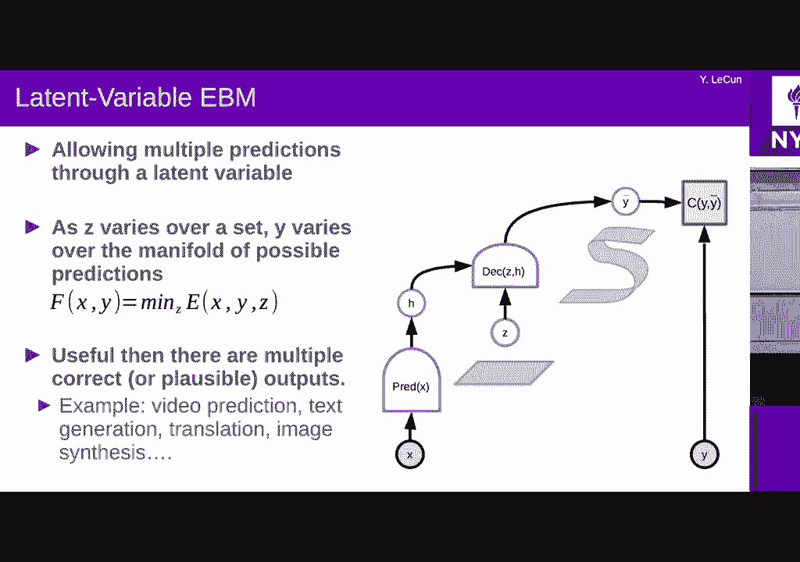

能量功能不是我们对运动进行优化的意思，而是缓解推理过程中的问题。推理是从 `X` 找到 `Y`。所以这种能量函数是标量值，当 `Y` 与 `X` 兼容时值低，当 `Y` 与 `X` 不兼容时值高。因此您希望此函数具有这样的形状：对于给定的 `X`，所有与此 `X` 兼容的 `Y` 值能量低，并且所有不兼容的值具有更高的能量。这就是您所需要的，因为那么推理程序将找到 `Y` 的值，使 `X` 和 `Y` 的 `F` 最小化。注意，`Y` 可能不是一个值，因为可能存在多个值，并且您的推理算法实际上可能会经历多个值或检查多个值，在给您一个或几个好的值之前。

让我们举一个简单的例子。当标量变量的维数为 `X` 时，这里是一个实数值，`Y` 是一个实数值。这里的蓝点是数据点。那么，如果您想捕获数据中 `x` 和 `y` 之间的依赖关系，您想要的能量函数是这个形状或那个形状。但是，这样，如果您采用 `x` 的特定值，则在蓝点附近的 `y` 值能量较低。所以像这样的函数捕获了 `x` 和 `y` 之间的依赖关系。

现在推断给定 `X` 的最佳 `y` 是什么？如果您有这样的功能，您可以使用梯度下降。所以如果我给您一个 `X`，可以得出与该 `X` 对应的 `y` 的最佳值是多少？从一些随机的 `Y` 开始，然后通过梯度下降，找到函数的最小值。这可能会有点困难，但是从表征两个变量之间依赖关系的角度来看，这个能量函数几乎和任何其他方法一样好。

我来解决这个离散情况，当 `y` 是离散时是容易的。我们已经讨论过了，我会重新用能量方面的术语来表述。前馈模型是显式函数，因为它从 `X` 计算预测 `Y`，但它只能做出一个预测。我们可以在离散值的情况下作弊，输出对应于每种可能的分类都附有分数，但效果很好。但您不能使用这个技巧处理高维连续值或组合值。

所以基于能量的模型实际上是一个隐式函数。请记住，在微积分中的隐函数，您想要一个方程。圆是 `x` 和 `y` 的函数，而您不能将 `Y` 写成 `X` 的函数。写一个方程，比如 `X` 平方加 `y` 平方等于 1，您就定义了单位圆。所以 `X` 平方加 `y` 平方减 1 是隐式函数，当您求解它等于零时，您得到圆圈。

这里的另一个例子再次是 `x` 和 `y` 的标量值。这里的黑点是数据点。因此对于红色条表示的 `x` 的三个值，存在 `y` 的多个兼容值，其中一些实际上是排序的值的连续性。因此我们希望能量函数看起来基本上是在这里，我有点画水平。该能量函数的集合在数据点上消耗低能量，在更高能量的地方消耗高能量。这是一个稍微复杂一些的版本，我之前展示的 3D 模型的模块类型。

问题是我们是否要对系统进行训练，使其适应环境，从而计算出能量函数实际上具有适当的形状。当 `y` 连续时，`F` 光滑且可微是很好的，因此我们可以使用基于梯度的推理算法。所以如果我们有这样的函数，我给您一个 `X` 和 `Y` 点，您可以通过梯度下降找到最接近它的点。如果我给您一个 `x` 的值，您可以知道沿 `y` 方向通过梯度下降进行搜索，找到一个最小化它的值。这就是推理算法。

算法真的是一个处方：您将其最小化。为此，存在各种不同的方法。基于梯度的方法就是其中之一。在 `F` 复杂的情况下，您可能无法依靠搜索方法，因此您可能不得不使用其他技巧。在大多数情况下，尽管它简化了。但对于那些知道图形模型的人，图形模型基本上是基于能量的模型，能量函数分解为能量项的总和，每个能量项考虑到您正在处理的变量的子集。因此，`F` 是某些 `f_s` 集合的总和，每个 `f_s` 占用 `Y` 的子集，或 `x` 和 `y` 等的子集。如果它们以特定形式组织，那么有有效的推理算法来找到这些项总和的最小值，这些项与您感兴趣的变量有关。这就是您所知道的在图形模型中的推理算法。如果您不知道，这是您无需考虑的。

正如我所说的，您可能想要使用它的情况是当推理比您所知道的要复杂得多时，当输出为高维时，通过几层神经网络运行，并具有序列或图像或图像序列的结构。当输出具有组合结构时，无论是文本、动作序列，您知道诸如此类的内容，或者当您需要从复杂的长链推理中解决约束满足问题时。

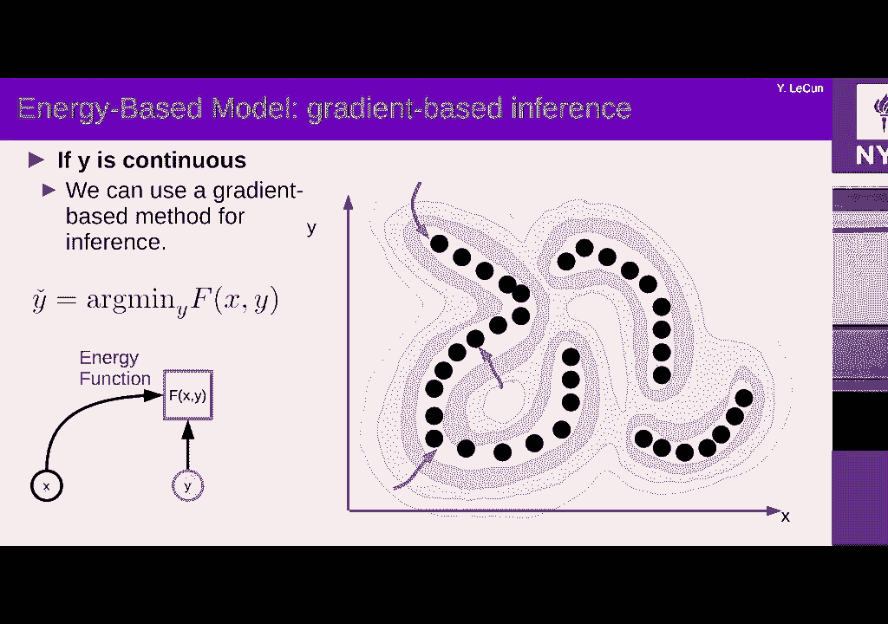

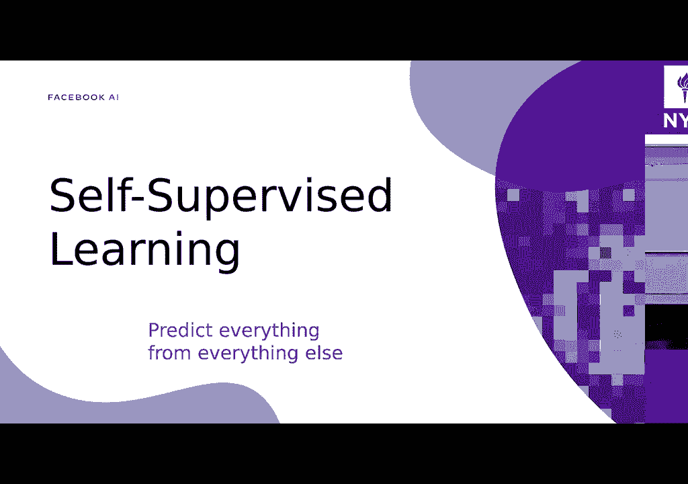

好的，这是基于能量的模型的一种特殊类型。

---

## 包含潜在变量的能量模型 🎭

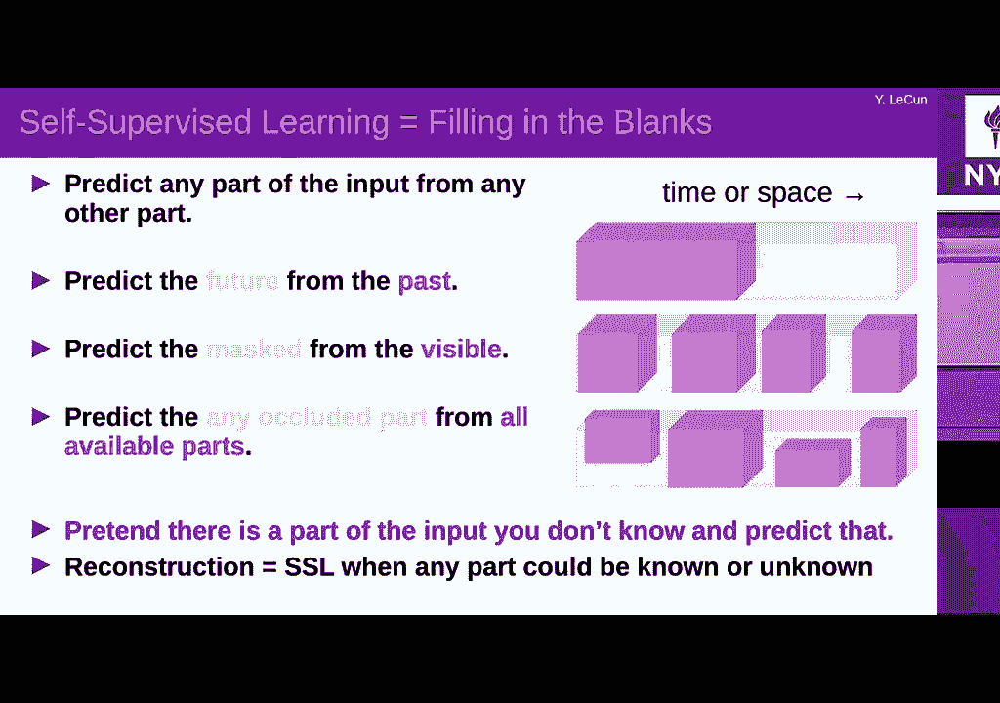

上一节我们介绍了基本的能量模型，本节中我们来看看包含潜在变量的模型，它们开始变得有趣起来。

在这种情况下，书面变量 EBM 我们不仅取决于您所观察的变量 `X` 和想要预测的变量 `Y`，我们也依赖于额外的变量 `Z`，没有人告诉您它的价值。这个潜在的变量是您以这样的方式构建模型：它取决于潜在变量。如果您使用此潜在变量，推断问题将变得更加容易。

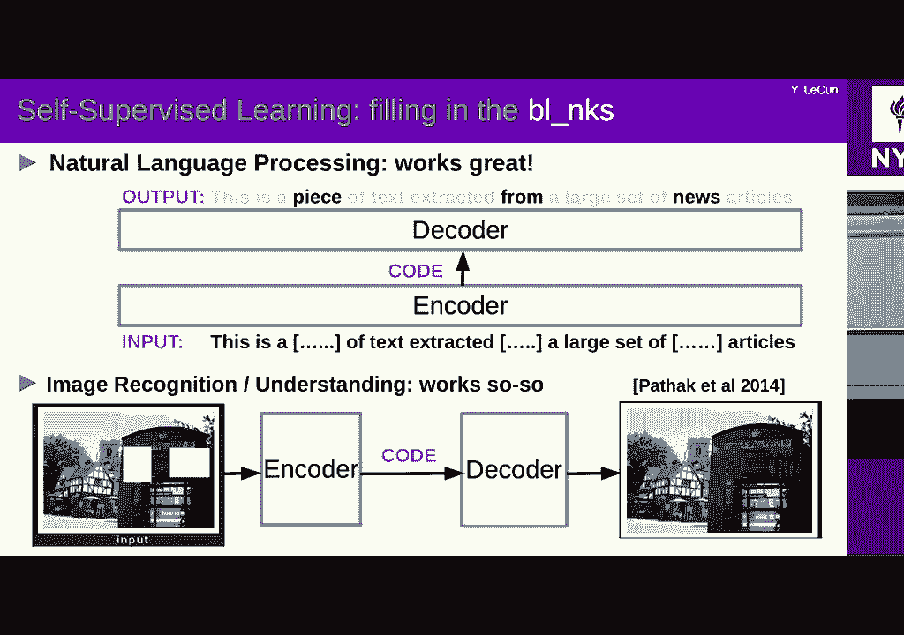

所以假设您确实赢得了团队的认可。我喜欢我告诉您的这个例子：如果您知道字符在哪里，阅读单词就好多了。这里的主要问题是，单词不仅是阅读单个字符，而且您实际上会发现角色是什么样的，一个字符在哪里结束，另一个字符在哪里开始。如果我要告诉您，这对您来说会容易得多。如果您懂英语，请在此处阅读此字符序列（英文），您可以解析它，您可能可以找出单词边界在哪里，因为您具有这种高级知识。无论是否知道单词是英文的，我想对您来说，同样的道理，除非您会说法语，否则不知道边界这个词会怎样。

在这种情况下，电池一词以及顶部的字符边界对于解决问题很有用，例如字符识别，将各个字符识别器应用于每个字符，但您不知道它们在哪里。所以您怎么知道如何解决这个问题？所以如果我告诉您，那将是一个有用的潜在变量。

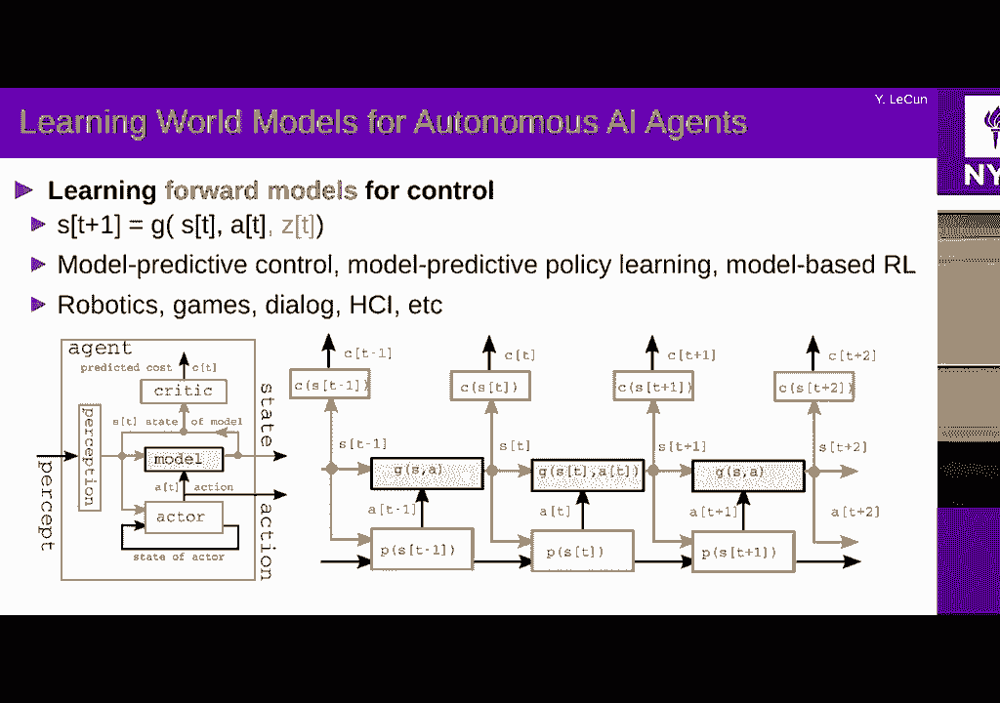

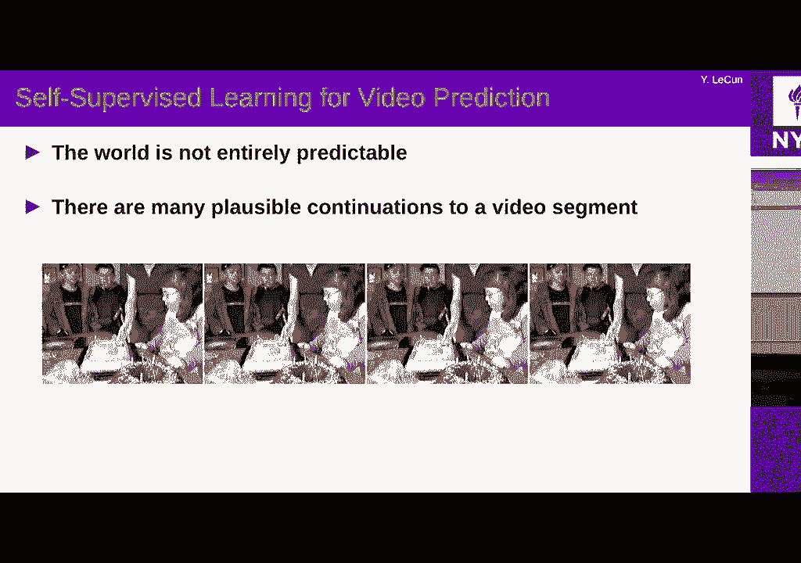

对于语音识别，问题在于您不知道单词之间的边界在哪里。音素要么是语音，要么非常像连续文本。连续语音，我们可以解析单词，因为我们知道单词在哪里，因为我们了解该语言。但有人说的是您不懂的语言，您有一个非常模糊的想法其中“边界”一词是。当您无法使用没有重音的语言时，之所以容易，是因为单词上有重音。所以如果您能找出重音，您大概可以弄清楚单词边界在哪里。没有重音的法语，您无法想像没有办法。

现在，您的视频 phasma 不会说确定，只有一种字体可以向右移动。所以您知道这是一种连续的音素串，除非您知道边界，否则很难说出边界在哪里。语言，这将是一个可行的联系，因为如果有人告诉您这些界限在哪里，那么您将能够做该任务。所以这就是您使用潜在变量的方式。

这种使用潜变量的方法已经在数十年中使用了，在自然语言处理环境中的语音识别环境，在我所说的 OCR 和许多不同的其他应用程序中，特别是涉及序列的应用程序，而且在计算机视觉方面。所以像您这样的事情知道您想要检测一个人在哪里，但您不知道该人的穿着或人在这样的事情上的位置。所以您知道那些是变量，如果您知道我愿意的话，尽管如今，视觉效果还可以。所以如果您有一些可变模型，这是如何进行推理。

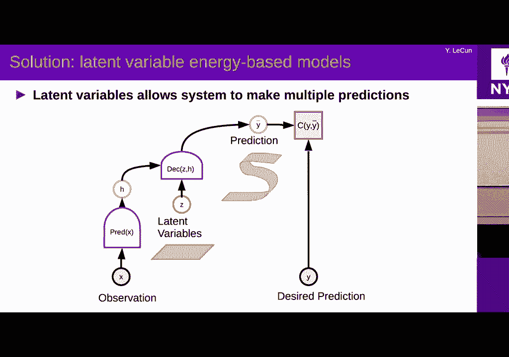

所以您现在有了一个新的能量函数，称为 `F(X, Y, Z)`。在推理中，您要相对于 `Z` 和 `Y` 最小化它。所以您问系统给我 `Y` 和 `Z` 的变量组合。意思是这个能量函数，我实际上只在乎 `Y` 的值，但是我必须同时对 `Z` 进行最小化。我稍后再给您一些具体的例子。

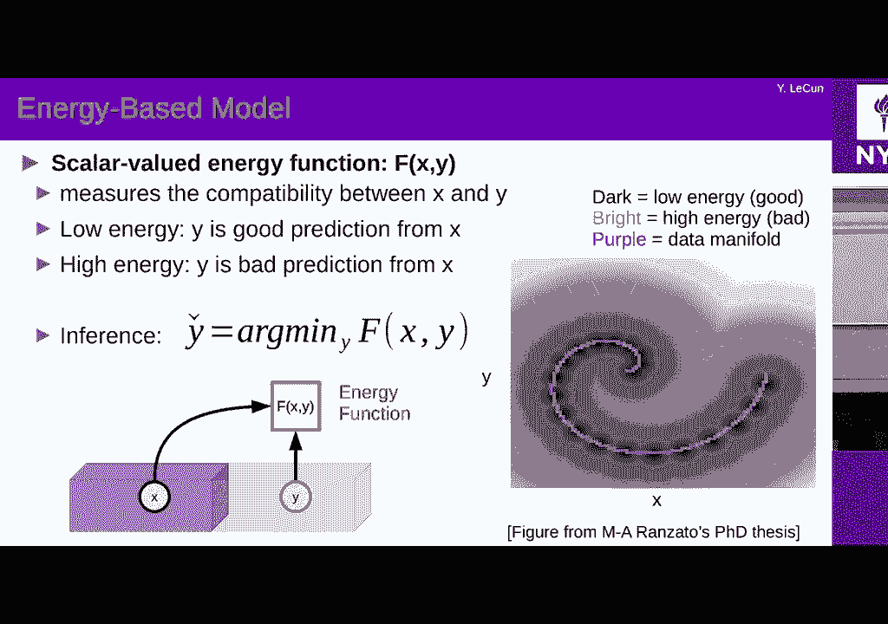

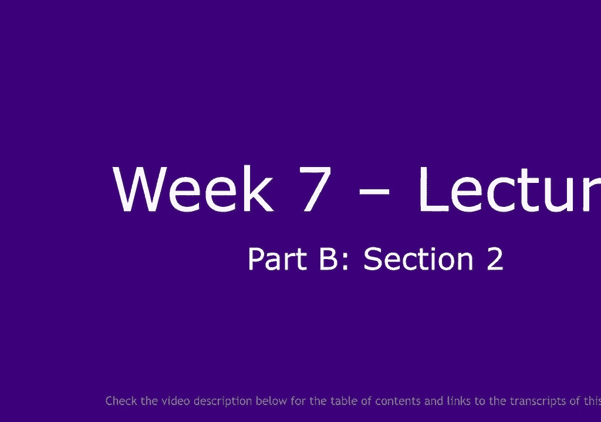

实际上，这等效于定义新能量函数 `F_inf(X, Y)`。`F_inf(X, Y)` 是 `min_Z F(X, Y, Z)`。您得到 `X`、`Y`、`Z` 的函数，则找到了最小值。现在可以消除 `Z` 变量，而得到 `x` 和 `y` 函数。在实践中，您永远不会那样做，所以我没有练习尽量减少尊重到 `Y` 和 `Z`，因为我们不知道如何表示一个函数。

但是有一个替代方法是在这里用她定义 `F_beta`。我写 `F_beta(X, Y) = -1/beta * log(∫_Z e^{-beta * F(X, Y, Z)} dZ)`。您会看到，如果将 `beta` 设为无穷大，这种 `F_beta` 收敛到 `F_inf`，这就是为什么我称它为 `F_inf`。如果 `beta` 非常大，唯一重要的是 `F(X, Y, Z)` 中 `Z` 的值产生最低的值，因为其他所有值都将很大。所以即使指数不会真正计算，唯一要计数的是具有最低值的那个。所以如果您只有一个项，其中 `F(X, Y, Z)` 的 `Z` 的值产生最小的值，则对数会取消指数值和 `beta` 值的负 1，无法取消负的 `beta`，而您的平均值仅等于 `F(X, Y, Z)`。好的，这就是您在上面看到的极限。

所以如果我在此定义 `F(X, Y)` 一遍又一遍，然后我回到了前面的问题，就是最小化 `F(X, Y)` 相对于 `Y` 进行推断。我认为潜在变量模型对您没有太大的影响，关于要做的潜在变量有一个额外的最小化。比那还好，所以允许潜伏也有很大的优势。通过改变集合中的潜在变量可以说的变量，系统的预测输出也会在一个集合上变化。

所以这是一个 `X` 进入我称为预测变量的特定体系结构。这是一种神经网络，它产生一些表示特征 `X` 表示，然后 `X` 和 `Z` 表示，我将涉及的内容很少。这就是我在这里所说的解码器，它产生一个预测 `Y_bar`。我们要预测的变量 `Y` 的预测。此处的能量函数只是比较 `Y_bar` 和 `y`。您对这种图很熟悉，我们讨论过有关它们的内容较早。

所以如果我选择在一个集合上改变 `Z`，我们假设二维正方形，在此以该灰色图表示。然后预测 `Y_bar` 将，在这种情况下，也会随着一组变化而变化。功能区，基本上可以拥有一台机器，现在我可以通过改变潜变量可以产生多个输出。我可以有这个机器产生多种输出，而不仅仅是单一的输出。

好的，假设您要制作视频预测。所以有很多原因可能导致您想要制作视频预测。其中一个很好的理由是建立非常好的视频压缩，例如，压缩系统的另一个很好的原因是您正在尝试从挡风玻璃观看的视频中预测驾驶汽车时周围的汽车。这是正在进行的工作，因此成为能够在发生之前预测会发生什么。实际上，这是智慧的本质。

现在预测，您正在看着我，我在说，您对几秒钟后我的嘴里就会冒出一个字，我将要做的手势还是一些想法或要朝什么方向移动，但是不是一个精确的想法。所以如果您训练自己的神经网络来制作一个从现在起两秒钟我对我的预测只有一个，如果您训练自己，就无法做出准确的预测。最小二乘法，我们应该训练一个可以预测的东西。我在这里的看法是，系统能做的最好的事情就是产生一个我的图像模糊，因为它不知道我要向左还是向右移动，不知道我的手会像这样或那样。所以它会得出所有可能结果的平均值，那将是图像模糊。所以预测变量无论是什么都非常重要，能够处理不确定性并能够做出多种预测。

参数化预测集的方法是通过一个潜在变量，而不是谈论分布或可能病态的模型。这是在我们谈论这个问题之前，还可以吗？潜在变量不是一个参数，不是权重，而是每个样本都会改变的值。因此，基本上在训练期间我们还没有谈论训练，但是在训练期间，训练，我给您 `X`，而您找到 `Z`，能量与电流的关系。这些神经网络的参数值是最好的，您最好猜出 `Z` 的值是多少，然后将其馈给一些损失函数，您要针对参数最小化的功能。网络损失函数不一定是平均值，不一定能量可能还可以，实际上大多数时候是另外一回事。

所以从这个意义上说，您运行 `Z` 信息 `Z` 好的。您不想使用“学习”一词，因为学习意味着您拥有在这里为 `Z` 所获得的整个训练集所学到的所有氛围的一个价值。对于您的训练集中的每个样本或每次放置您的样本具有不同的价值。测试站点就可以了，这样就不会学到它们了。它们被推断是的。

另一个例子是他的翻译。所以翻译有一个很大的问题是语言翻译，因为没有一个通常将一段文本正确地从一种语言翻译成另一种语言。表达相同想法的方式有很多，为什么您选择了一个？所以如果有某种方法可以很好地将系统可以翻译的所有可能的翻译参数化，想要与给定文本相对应的产品（德语）翻译成英文可能有多种翻译，您需要列出全部正确。并且通过更改一些潜在变量，您可能知道更改翻译产生的很好。

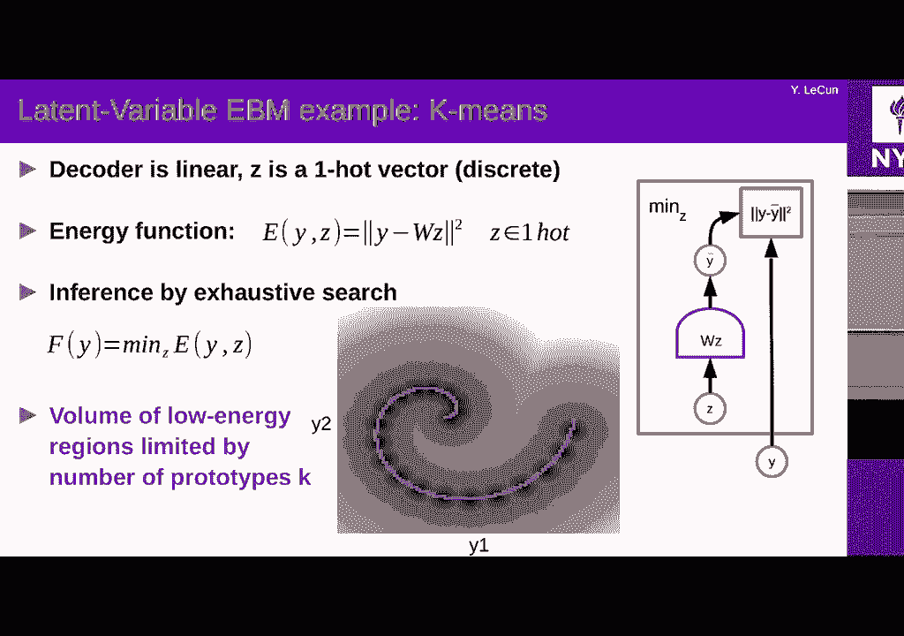

现在让我们将其与概率联系起来。

---

## 从能量到概率的转换 📊

上一节我们介绍了包含潜在变量的模型，本节中我们来看看如何将能量模型与概率联系起来。

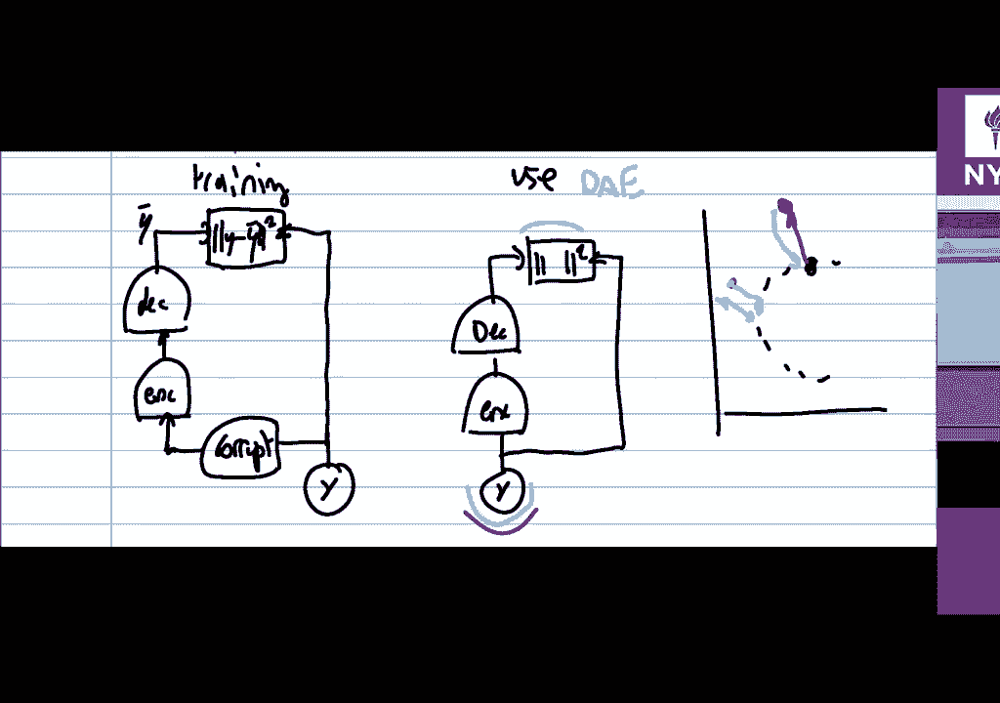

定价模型中有一种转化能量的方法，您可以将其视为一种，如果您愿意，因为低能量好而高能量不好，则需要负分数。将能量转化为概率以及通往二十种幻觉的方法，我们已经讨论过的概率，使用所谓的吉