# 13：第7周实践课 - 欠完备与过完备自编码器 🧠

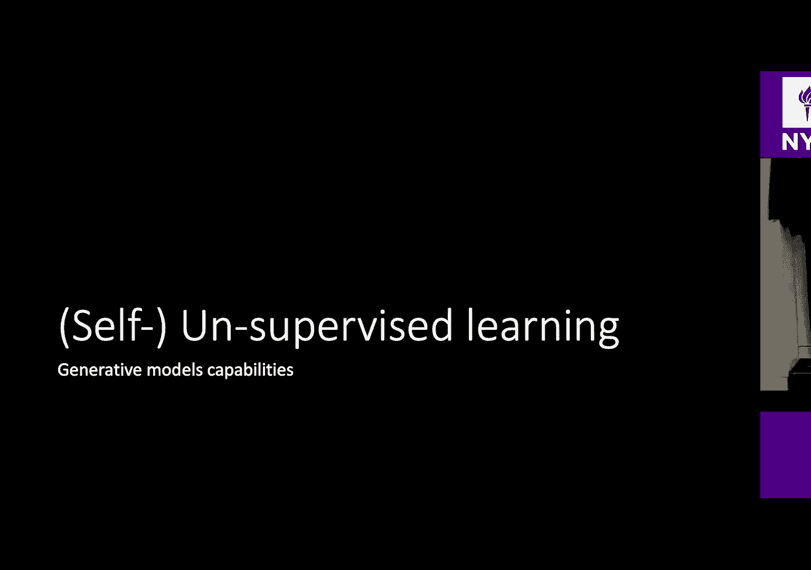


在本节课中，我们将学习自编码器的核心概念，特别是欠完备和过完备自编码器的工作原理、应用场景以及如何通过它们学习数据的内在表示。我们将通过简单的例子和代码来理解这些模型如何压缩和重建数据，并探索它们在去噪等任务中的强大能力。

---

## 概述：什么是自编码器？

自编码器是一种无监督学习模型，其目标是学习输入数据的高效表示（编码），然后从这个表示中重建出原始输入（解码）。它由两部分组成：编码器将输入数据压缩成一个潜在空间表示，解码器则从这个表示中重建数据。

核心公式可以表示为：
`x_hat = decoder(encoder(x))`
其中 `x` 是原始输入，`x_hat` 是重建的输出。训练的目标是最小化 `x` 和 `x_hat` 之间的差异。

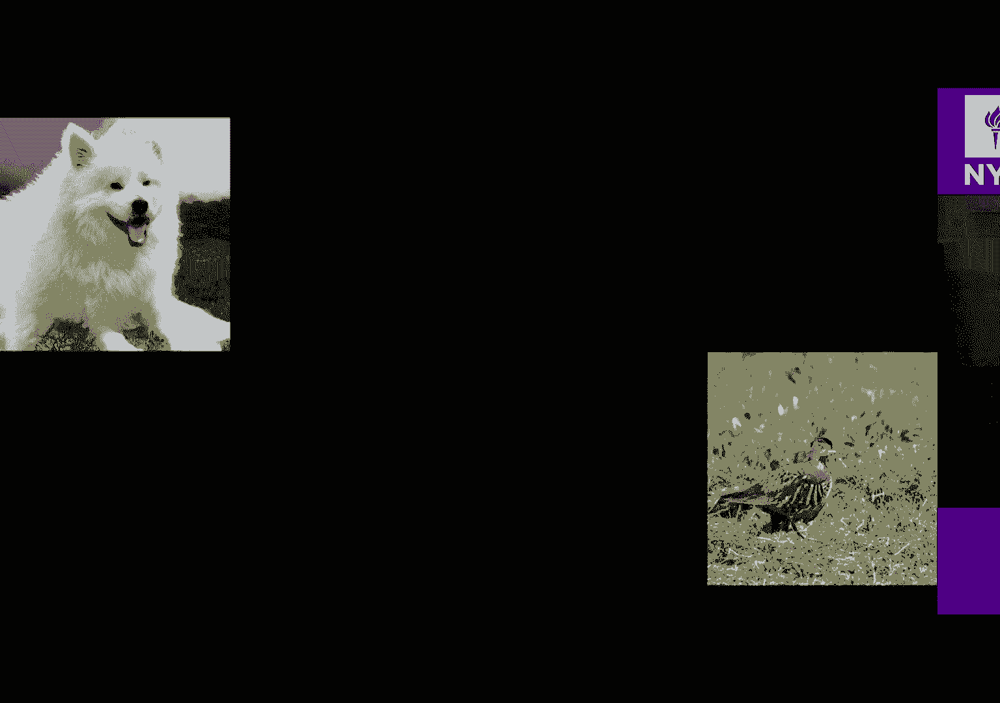

上一节我们介绍了生成模型的基本概念，本节中我们来看看自编码器这一具体且强大的无监督学习工具。

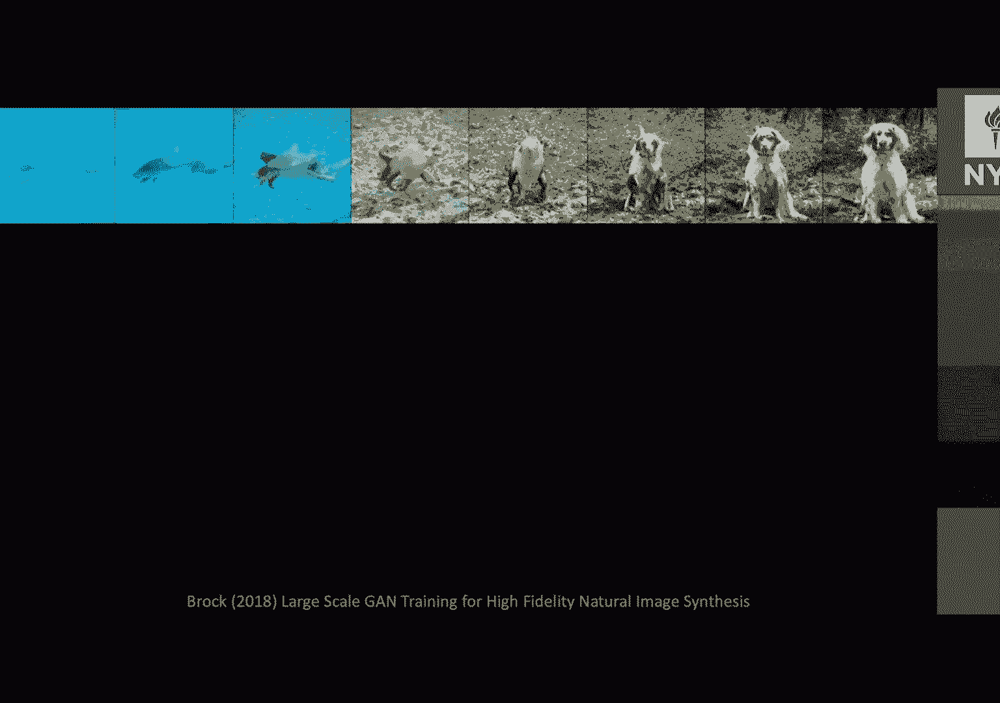

---

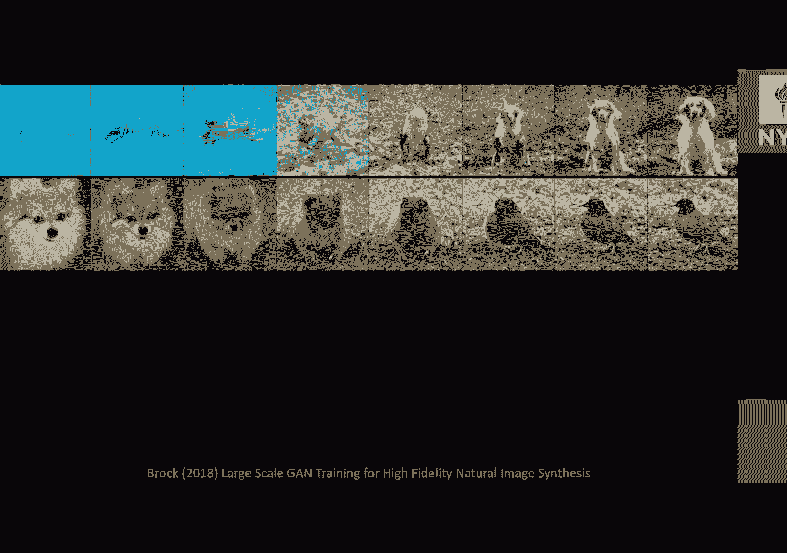

## 自编码器的基本架构

自编码器的网络结构与我们之前见过的神经网络相似，但有一个关键区别：它的输出目标是预测其自身的输入。网络从底部的输入层开始，经过一个绿色的中间隐藏层，最终输出层试图重建原始的输入。

以下是其工作的简化描述：
1.  输入数据 `x`（例如，一幅图像）被送入编码器。
2.  编码器将其转换为一个低维或高维的隐藏表示 `h`。
3.  解码器接收 `h` 并尝试重建出原始输入 `x_hat`。
4.  损失函数计算 `x` 和 `x_hat` 之间的差异（如均方误差），并通过反向传播更新网络权重。

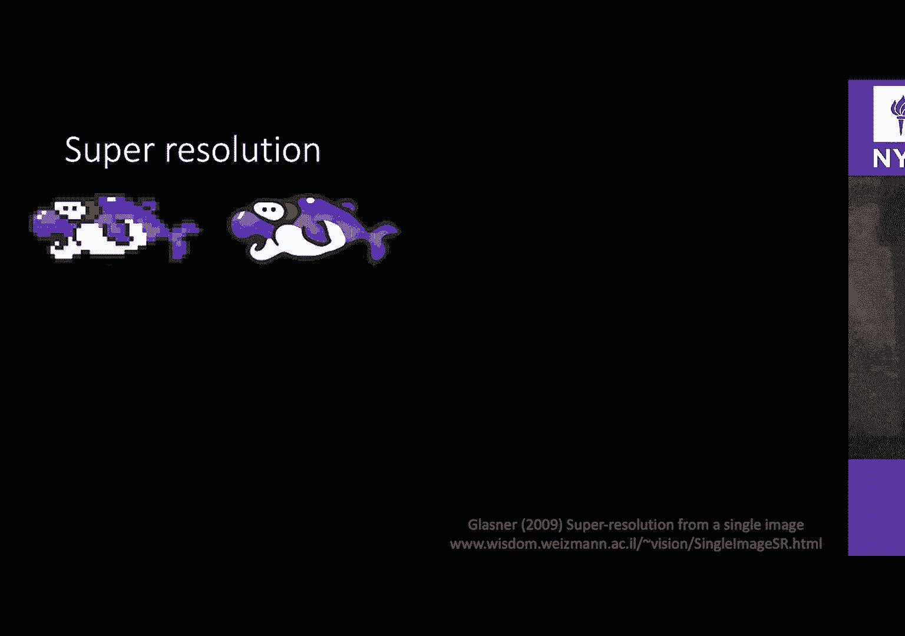

这种结构迫使网络学习数据中最重要的特征，以便能够准确地重建它。

---

## 欠完备自编码器：学习压缩

当隐藏层的维度 `D` 小于输入维度 `N` 时，我们称之为**欠完备自编码器**。即 `D < N`。

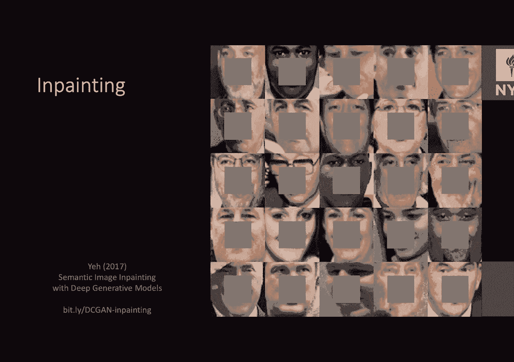

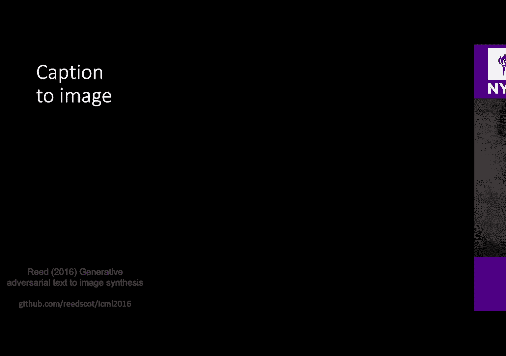

在这种情况下，网络无法简单地学习恒等映射（即直接复制输入），因为中间表示的信息容量小于输入。这迫使网络必须学习如何以更紧凑的形式捕捉输入数据中最关键的信息，从而实现了一种数据压缩。

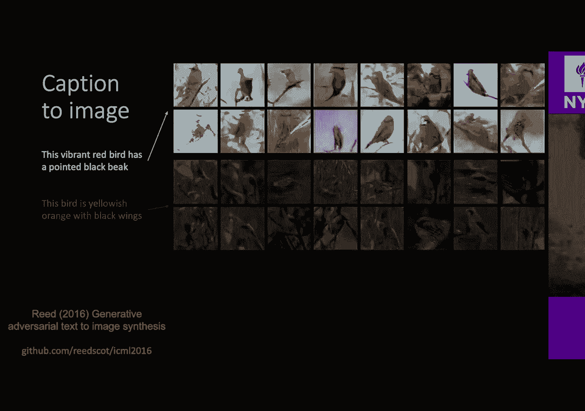


例如，如果输入是784维的MNIST手写数字图像，而隐藏层只有30维，那么网络必须学会将这784个像素的信息“挤压”到30个数值中，然后再尝试重建。这30个数值就构成了该数字在潜在空间中的表示。

欠完备自编码器的目标函数通常就是重建损失：
`Loss = MSE(x, x_hat)`

---

## 过完备自编码器与正则化

相反，当隐藏层的维度 `D` 大于或等于输入维度 `N` 时（`D >= N`），我们称之为**过完备自编码器**。

这里出现了一个问题：如果隐藏层比输入还大，网络很容易就学会恒等映射，即简单地将输入复制到隐藏层再复制到输出，而不学习任何有意义的数据结构。为了避免这种情况，我们必须对模型施加约束，引入“信息瓶颈”。

以下是几种防止过拟合、促使网络学习有用表示的方法：

### 1. 降噪自编码器
降噪自编码器通过向输入数据添加噪声（如随机将部分像素置零）来训练。网络接收被破坏的、有噪声的输入 `x_tilde`，但训练目标却是重建原始的、干净的输入 `x`。

这个过程迫使网络学习到数据流形（data manifold）的结构，并学会如何将偏离流形的点（带噪声的输入）拉回到流形上（干净的重建）。它学习的是一个向量场，该向量场将输入空间中的点映射回训练数据所在的流形。

### 2. 稀疏自编码器
稀疏自编码器在损失函数中添加了对隐藏层激活值的正则化项（如L1正则化），鼓励隐藏层中只有少数神经元对任何给定输入保持活跃。这迫使网络学习到一种稀疏的、类似特征检测器的表示。

损失函数变为：
`Loss = MSE(x, x_hat) + λ * ||h||_1`
其中 `||h||_1` 是隐藏层激活值的L1范数，`λ` 是控制稀疏性强度的超参数。

### 3. 收缩自编码器
收缩自编码器惩罚隐藏表示 `h` 对输入 `x` 的导数（即雅可比矩阵的Frobenius范数）。这鼓励模型学习对输入微小变化不敏感的鲁棒性表示，使得潜在空间表示更加平滑和稳定。

损失函数为：
`Loss = MSE(x, x_hat) + λ * ||J_f(x)||_F^2`
其中 `J_f(x)` 是编码器函数 `f` 在 `x` 处的雅可比矩阵。

---

## 潜在空间插值的魅力

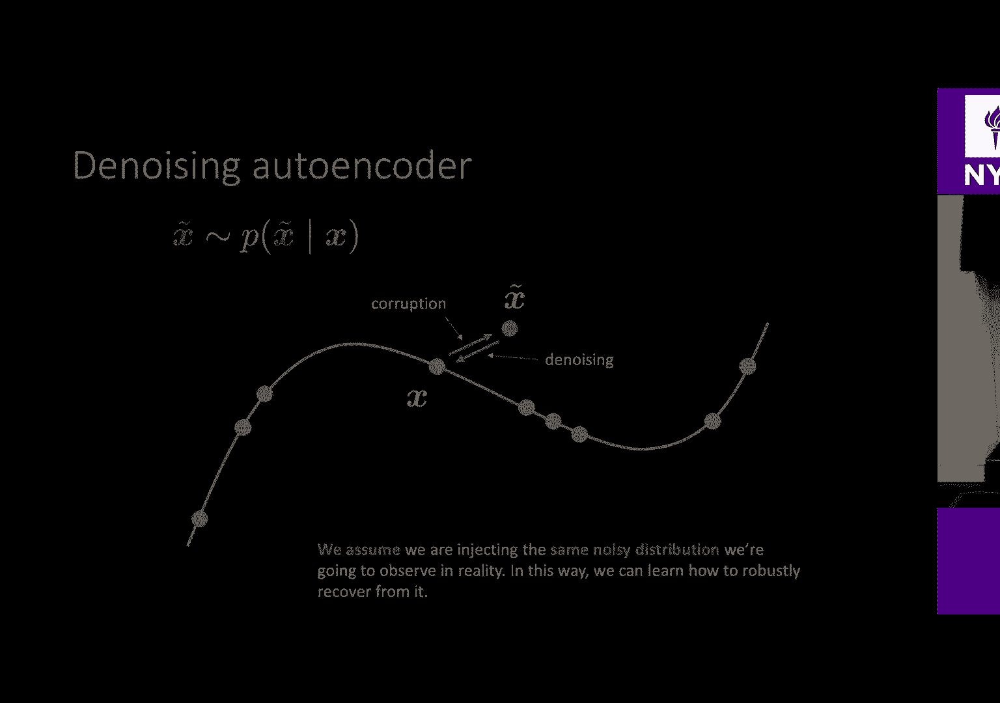

自编码器一个强大的特性是其学习到的潜在空间。在潜在空间中，数据的语义被编码为连续的向量。这意味着我们可以在两个数据点（如一张狗和一张鸟的图片）的潜在表示之间进行线性插值，并将插值点解码回像素空间。

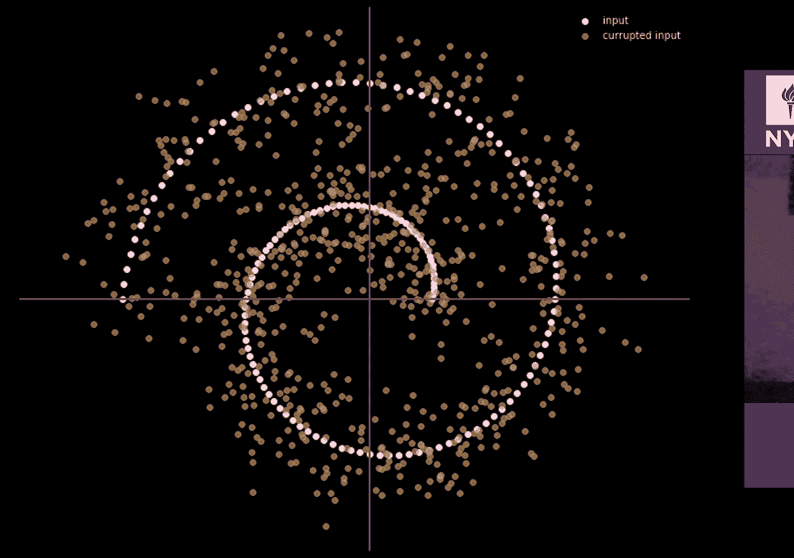

与直接在像素空间进行插值（会产生模糊、无意义的叠加图像）不同，在潜在空间插值会产生语义上平滑过渡的图像（例如，从狗逐渐 morph 成鸟）。这证明了自编码器确实捕捉到了数据背后更高层次、更本质的特征。

---

## 实践：代码示例与结果

让我们通过一个简单的PyTorch代码示例来看看自编码器的实际效果。我们将构建一个处理MNIST手写数字的自编码器。

首先，我们定义模型结构、损失函数和优化器。

```python
import torch
import torch.nn as nn
import torch.optim as optim

class Autoencoder(nn.Module):
    def __init__(self, input_dim=784, hidden_dim=30):
        super(Autoencoder, self).__init__()
        # 编码器
        self.encoder = nn.Sequential(
            nn.Linear(input_dim, hidden_dim),
            nn.Tanh()
        )
        # 解码器
        self.decoder = nn.Sequential(
            nn.Linear(hidden_dim, input_dim),
            nn.Tanh()
        )

    def forward(self, x):
        h = self.encoder(x)
        x_hat = self.decoder(h)
        return x_hat

# 初始化模型、损失和优化器
model = Autoencoder(input_dim=784, hidden_dim=30)
criterion = nn.MSELoss()
optimizer = optim.Adam(model.parameters(), lr=0.001)
```

接下来是训练循环。我们加载MNIST数据，将其展平为向量，然后进行训练。

```python
# 假设 train_loader 是已经准备好的MNIST数据加载器
num_epochs = 20
for epoch in range(num_epochs):
    for data in train_loader:
        img, _ = data
        img = img.view(img.size(0), -1)  # 展平图像
        # 前向传播
        output = model(img)
        loss = criterion(output, img)
        # 反向传播和优化
        optimizer.zero_grad()
        loss.backward()
        optimizer.step()
    print(f'Epoch [{epoch+1}/{num_epochs}], Loss: {loss.item():.4f}')
```

训练完成后，我们可以观察重建效果。欠完备自编码器（隐藏层30维）能够重建出可辨认的数字，但会丢失一些细节，这是压缩的代价。

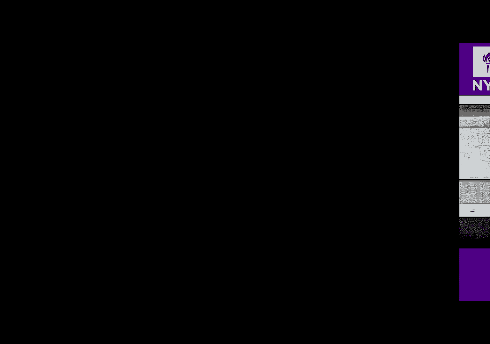


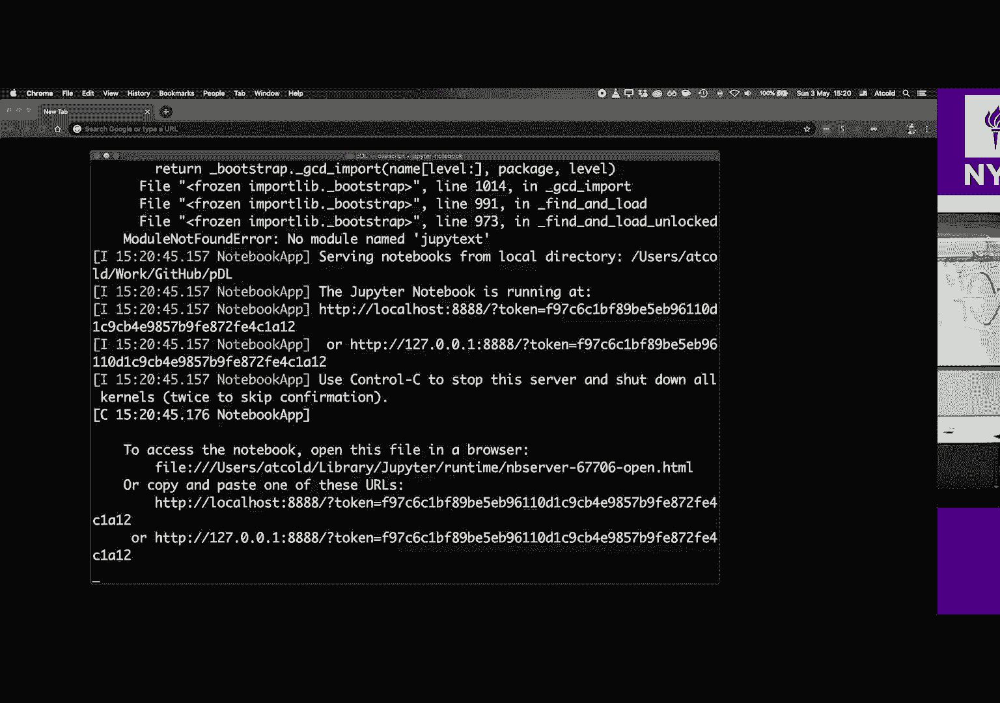

---

### 构建降噪自编码器

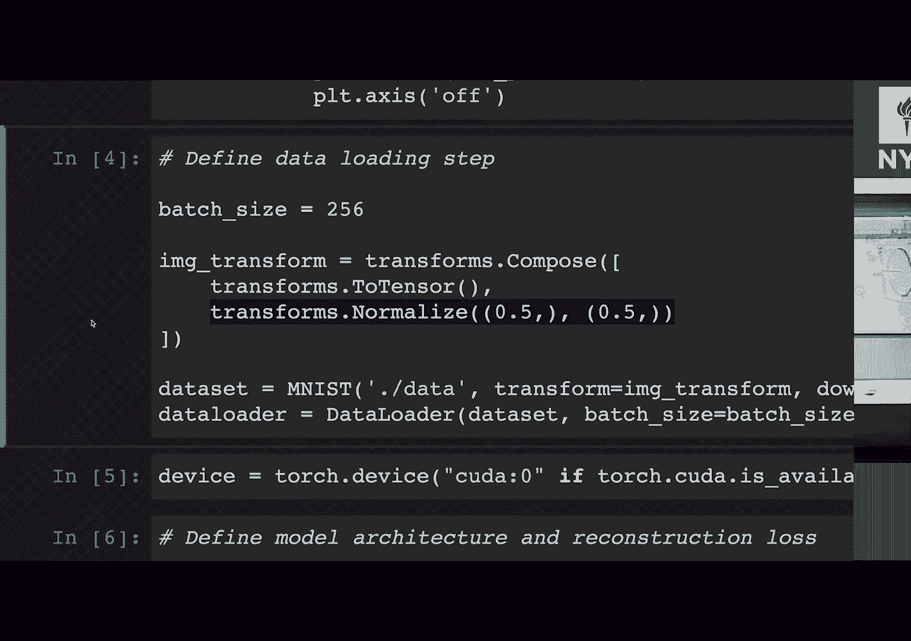

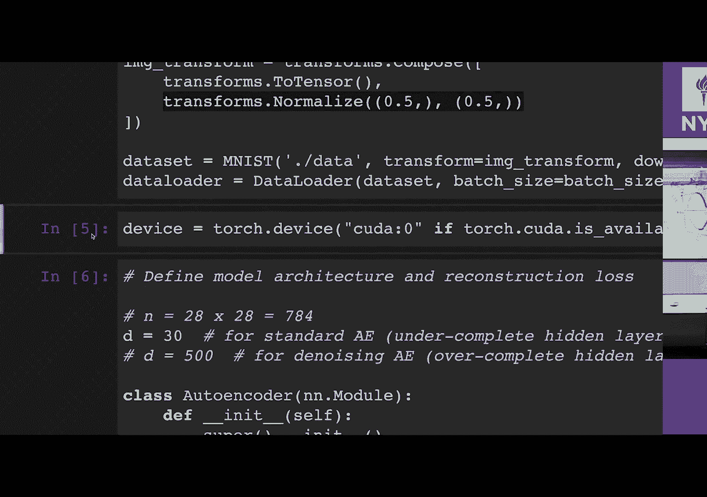

现在，我们修改代码来创建一个降噪自编码器。关键步骤是在输入时随机丢弃一部分像素（添加噪声），但训练目标仍是原始图像。

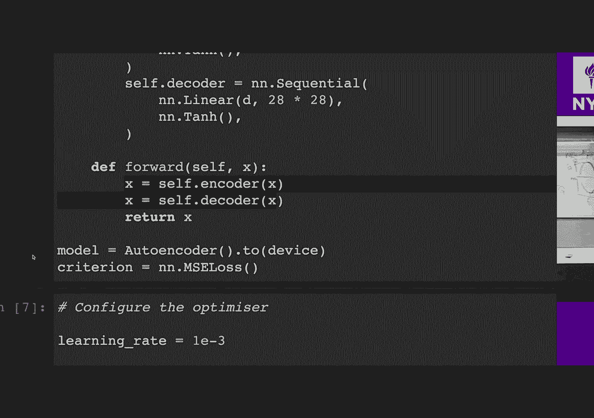

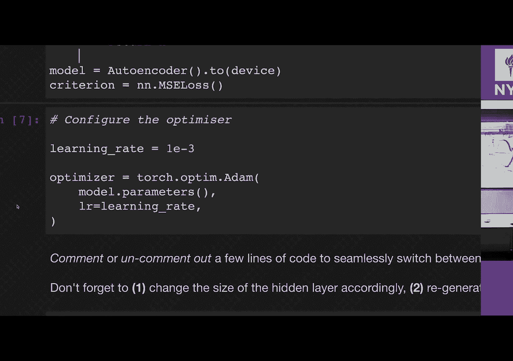

```python
class DenoisingAutoencoder(nn.Module):
    def __init__(self, input_dim=784, hidden_dim=500):
        super(DenoisingAutoencoder, self).__init__()
        self.encoder = nn.Sequential(
            nn.Linear(input_dim, hidden_dim),
            nn.Tanh()
        )
        self.decoder = nn.Sequential(
            nn.Linear(hidden_dim, input_dim),
            nn.Tanh()
        )
        self.dropout = nn.Dropout(p=0.5)  # 以50%的概率丢弃神经元/像素

    def forward(self, x):
        # 添加噪声：应用Dropout来模拟像素丢失
        x_noisy = self.dropout(x)
        h = self.encoder(x_noisy)
        x_hat = self.decoder(h)
        return x_hat

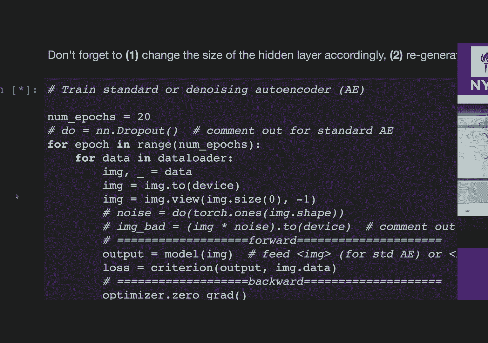

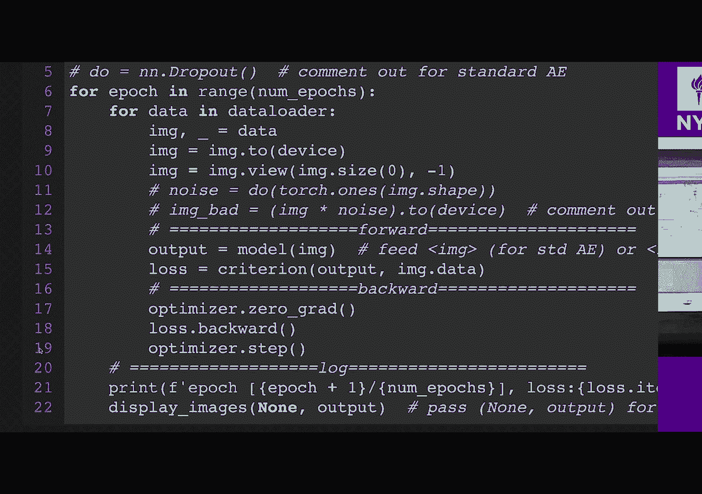

# 训练过程类似，但输入是 x_noisy，目标是原始 x
model_dae = DenoisingAutoencoder(hidden_dim=500)
optimizer_dae = optim.Adam(model_dae.parameters(), lr=0.001)

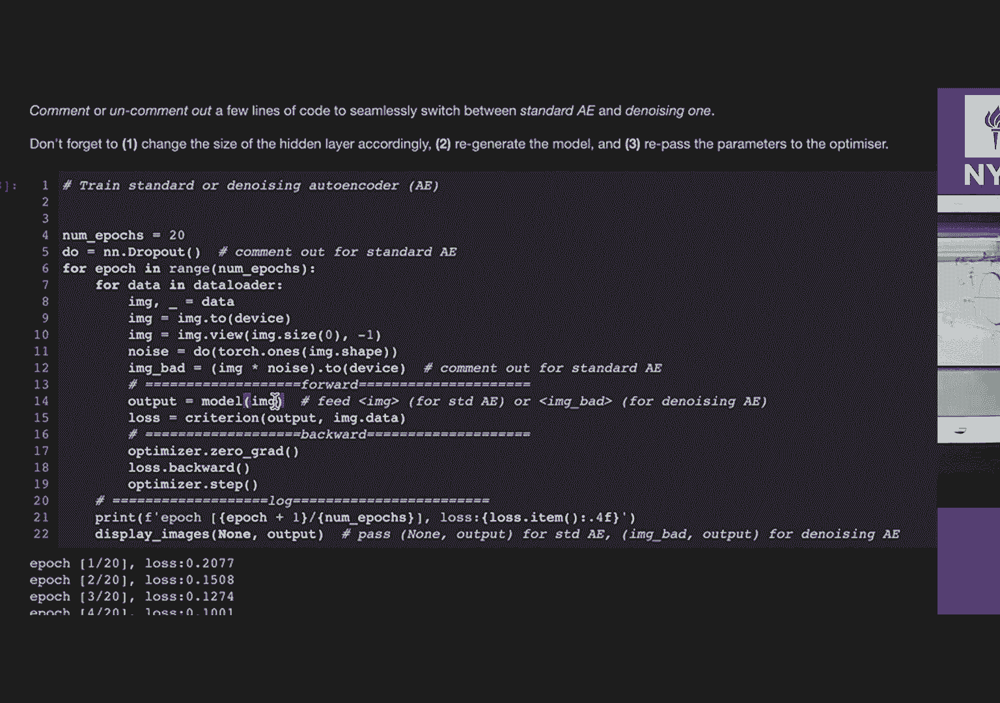

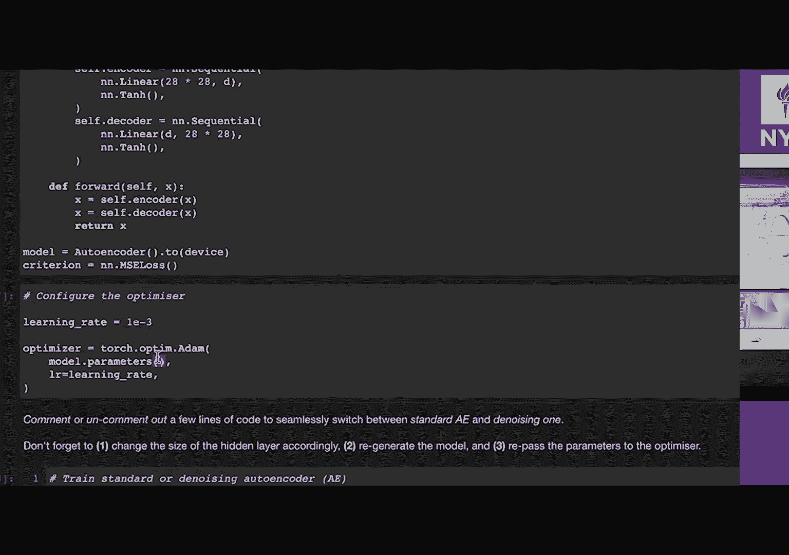

for epoch in range(num_epochs):
    for data in train_loader:
        img, _ = data
        img = img.view(img.size(0), -1)
        # 模型前向传播（内部添加噪声）
        output = model_dae(img)
        # 损失计算：输出与原始干净图像比较
        loss = criterion(output, img)
        optimizer_dae.zero_grad()
        loss.backward()
        optimizer_dae.step()
```

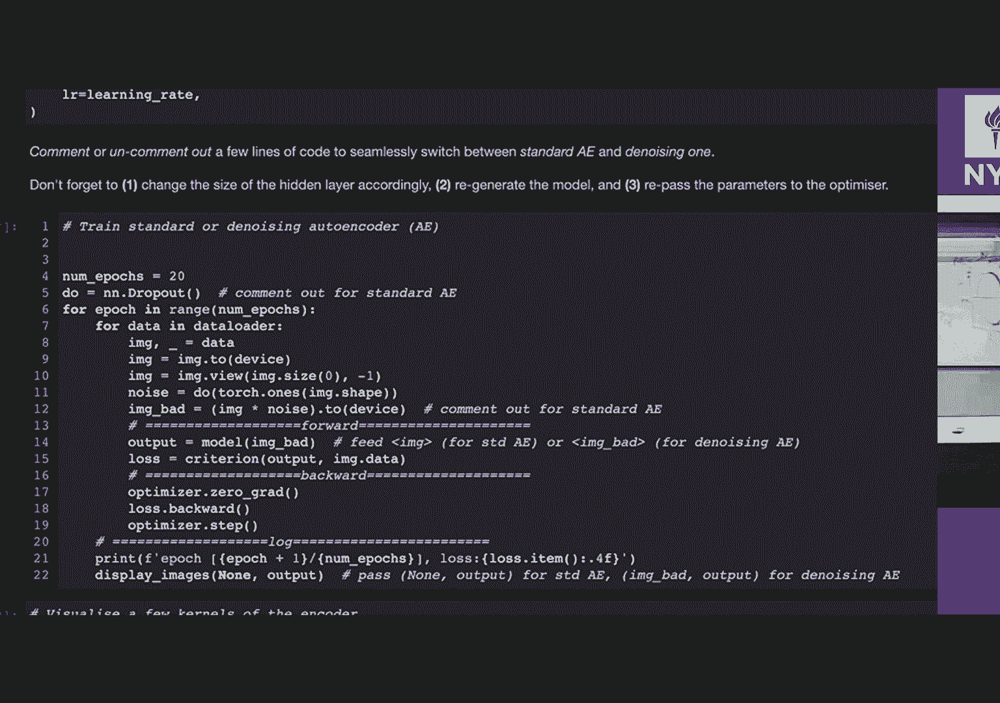

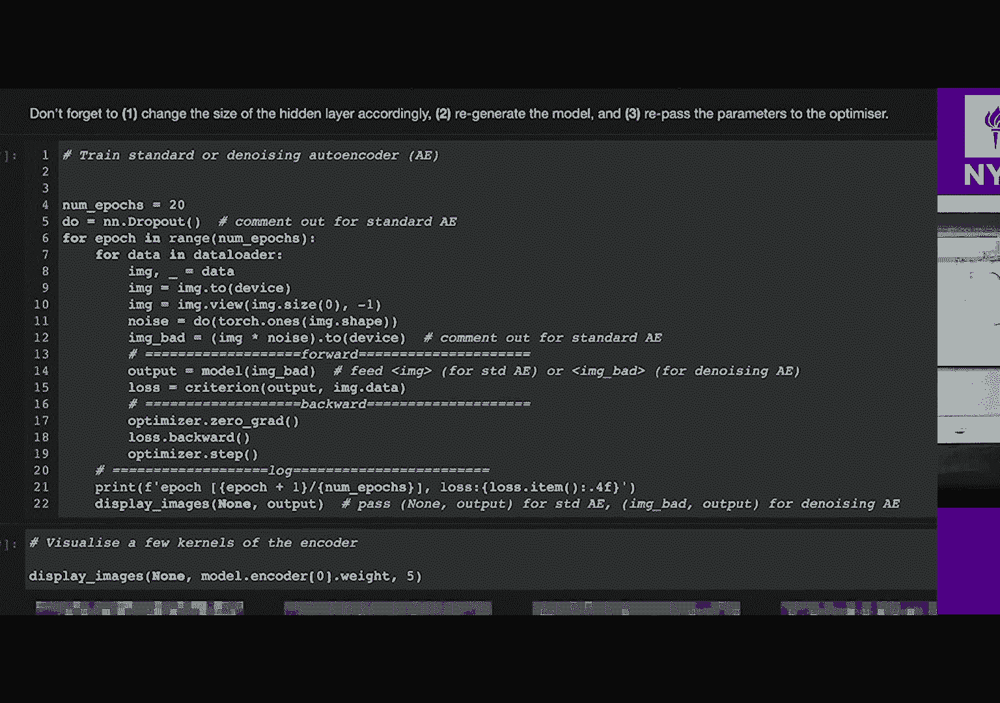

降噪自编码器学习到的滤波器与欠完备自编码器有显著不同。欠完备自编码器的许多滤波器在数字区域外是均匀的（不关心背景），而降噪自编码器的滤波器在整个图像区域都学习了有意义的边缘和形状特征，因为它需要根据受损的上下文来推断缺失部分。

---

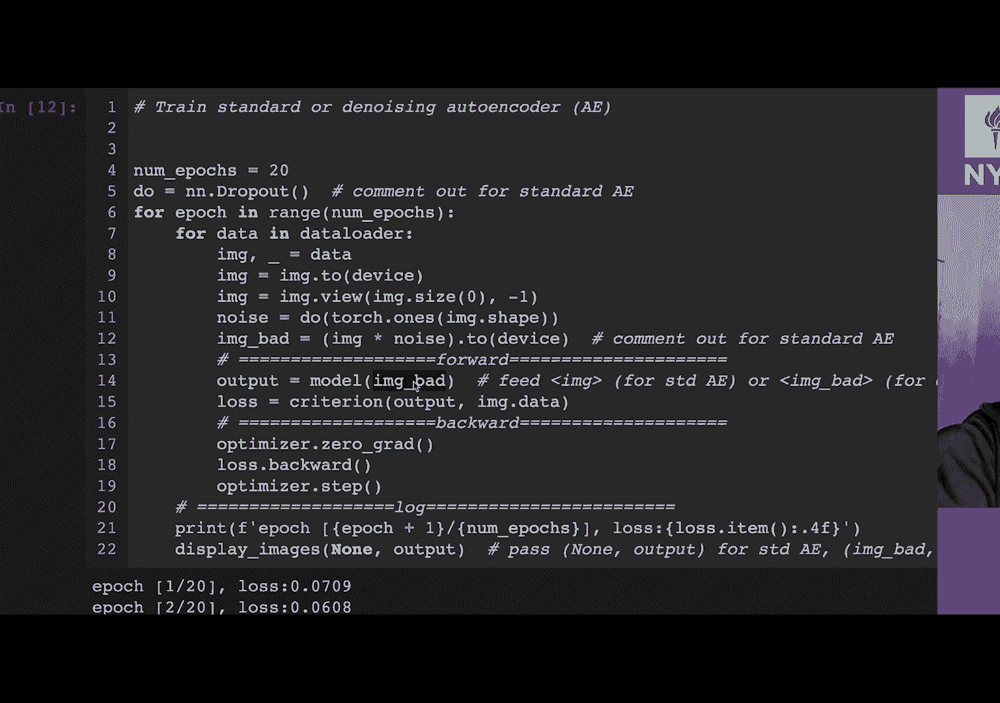

## 与经典去噪算法对比

为了展示降噪自编码器的能力，我们可以将其与传统的图像去噪算法（如OpenCV中的非局部均值去噪或TV-L1算法）进行比较。

实验表明，对于我们特定引入的噪声类型（随机像素丢失），我们训练的降噪自编码器在视觉质量上通常优于这些传统算法。这是因为自编码器直接从数据中学习了噪声分布的特定模式和图像本身的先验知识，从而能进行更智能的重建。

---

## 总结

本节课中我们一起学习了自编码器的核心思想。我们首先介绍了自编码器的基本架构和目标——重建输入。然后，我们深入探讨了两种主要类型：
*   **欠完备自编码器**：通过使隐藏层维度小于输入，强制网络学习数据的压缩表示。
*   **过完备自编码器**：隐藏层维度较大，但需要通过正则化技术（如降噪、稀疏性约束或收缩惩罚）来防止网络学习平凡的恒等映射，从而迫使它学习有用的特征。

我们还探讨了自编码器潜在空间的性质，以及在该空间中进行插值可以实现有意义的语义过渡。最后，我们通过实践代码演示了如何构建和训练这些模型，并观察了它们在图像重建和去噪任务上的效果。

自编码器是理解数据内在结构、进行特征学习和数据生成的强大工具，为更复杂的生成模型（如变分自编码器VAE和生成对抗网络GAN）奠定了基础。