# 14：第8周 - 对比方法与正则化潜变量模型 🧠

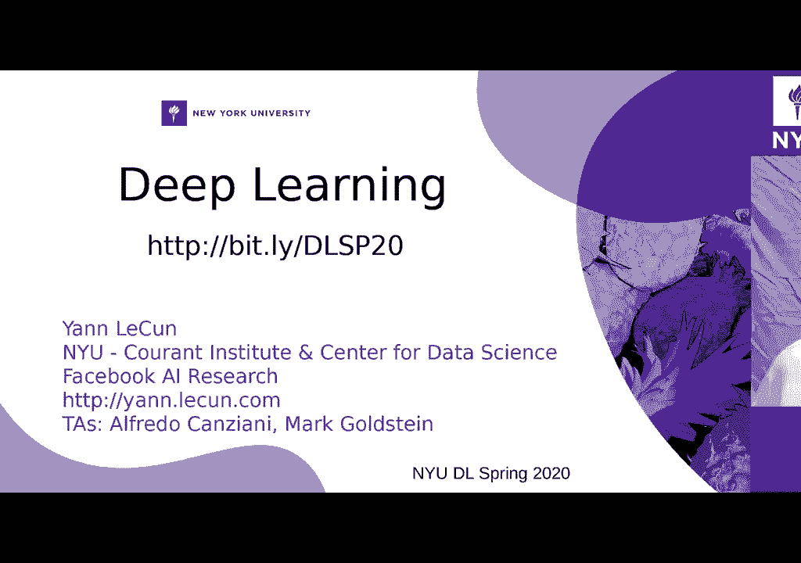

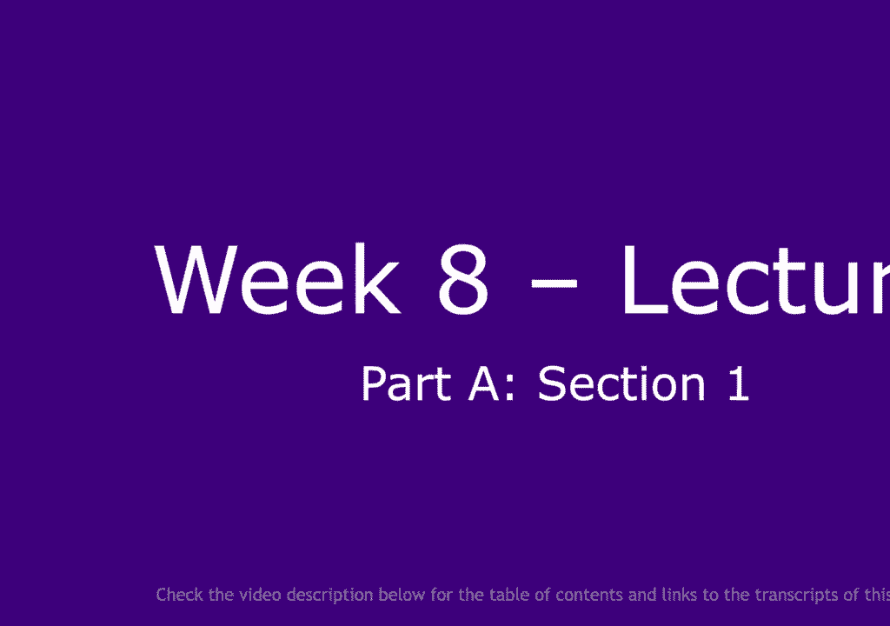

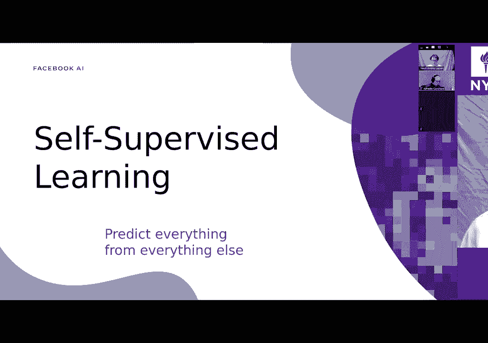

在本节课中，我们将学习基于能量的模型，并重点探讨其在自监督或无监督学习中的应用。我们将回顾对比方法，并深入介绍正则化潜变量模型，特别是稀疏编码和变分自编码器的核心思想。

---

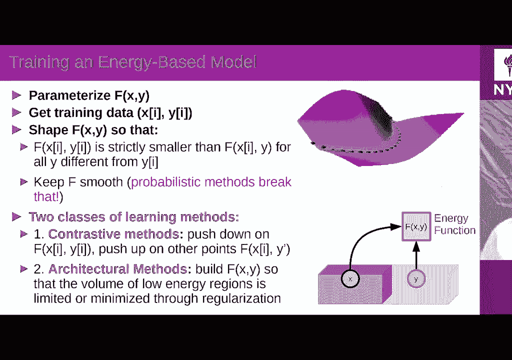

## 1. 回顾：基于能量的模型

上一节我们介绍了监督学习的基本范式。本节中，我们来看看基于能量的模型如何扩展这一范式。

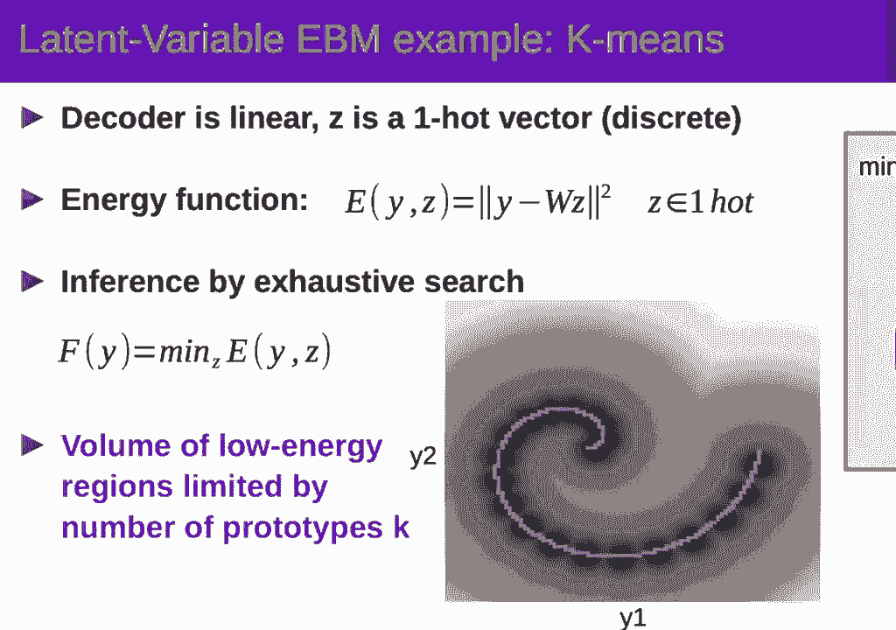

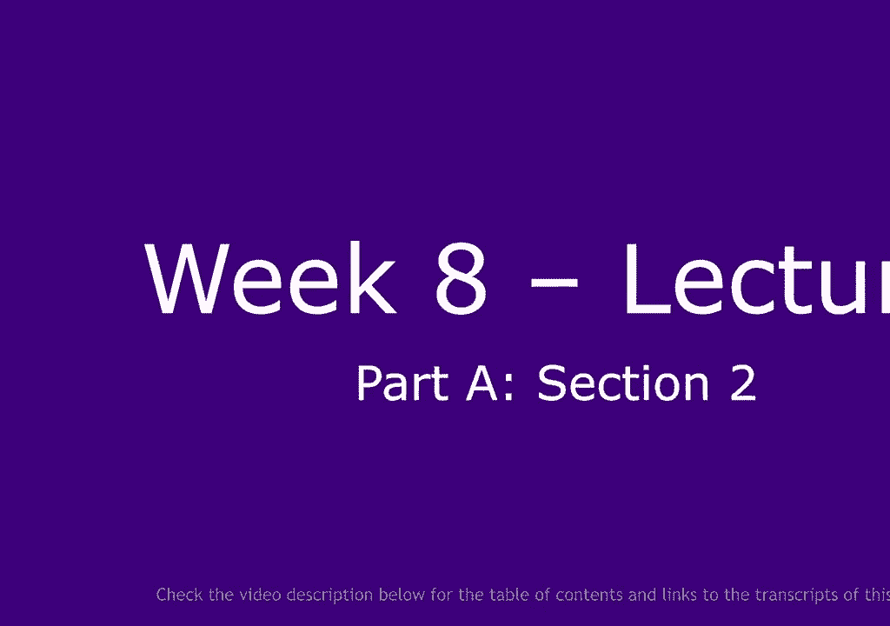

在基于能量的模型中，我们使用一个隐式函数来捕获变量之间的依赖关系。例如，在给定输入 `x` 的情况下，可能存在多个合理的输出 `y`。能量函数 `F(x, y)` 为每个 `(x, y)` 对分配一个标量能量值。学习的目标是塑造能量函数，使得数据样本的能量较低，而其他组合的能量较高。

**核心公式**：
`F(x, y)` 表示 `(x, y)` 对的能量。推理过程是寻找使 `F(x, y)` 最小化的 `y`。

当没有输入 `x` 时，我们处理的是无条件模型，能量函数 `F(y)` 仅捕获 `y` 各分量之间的相互依赖性。为了处理输出的多模态性，我们引入了潜变量 `z`。

**带有潜变量的能量函数**：
`F(x, y, z)`。推理时，给定 `x` 和 `y`，我们寻找使 `F(x, y, z)` 最小化的 `z`。

训练基于能量的模型包括参数化能量函数，并收集训练样本 `(x, y)`（或仅 `y`），然后塑造能量函数，使其为良好的 `(x, y)` 组合分配低能量，为其他组合分配高能量。

---

## 2. 对比方法 🔄

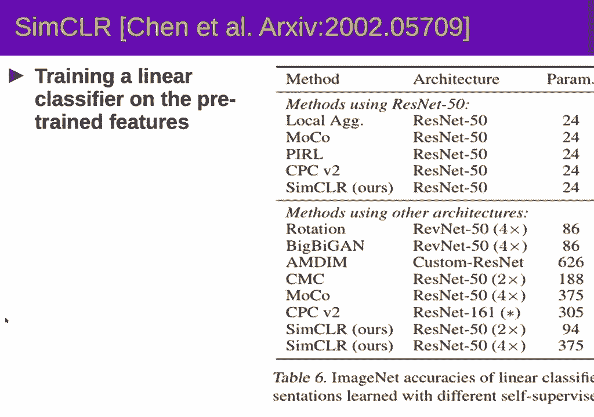

上一节我们定义了能量模型的目标。本节中，我们来看看如何通过对比方法来实现这一目标。

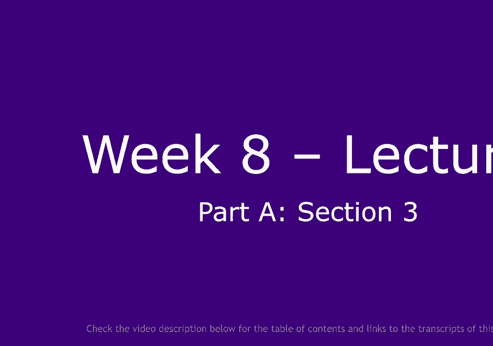

对比方法的基本思想是压低训练样本的能量，同时推高其他点的能量。这通常通过构建一个“孪生网络”架构来实现。

以下是实现对比方法的关键步骤：

1.  **构建网络**：使用两个共享权重的网络（或两个不同的网络），分别处理输入 `x` 和 `y`。
2.  **提取特征**：两个网络输出特征向量 `h` 和 `h'`。
3.  **计算相似度**：使用点积或余弦相似度等方法计算 `h` 和 `h'` 之间的相似度 `S(h, h')`。
4.  **定义损失**：对于正样本对（兼容的 `x` 和 `y`，如图像及其增强版本），最小化 `S(h, h')`（即降低能量）。对于负样本对（不兼容的 `x` 和 `y`），最大化 `S(h, h')`（即提高能量）。

一种流行的目标函数是噪声对比估计（NCE）损失，其形式类似于softmax：

**NCE损失公式**：
`L = -log[ exp(S_pos) / (exp(S_pos) + Σ exp(S_neg)) ]`
其中 `S_pos` 是正样本对的相似度，`S_neg` 是负样本对的相似度。

近期研究（如MoCo、SimCLR）表明，使用这种对比方法预训练的大型模型（如ResNet），即使在少量标注数据上微调，也能在ImageNet等任务上取得接近全监督学习的性能。

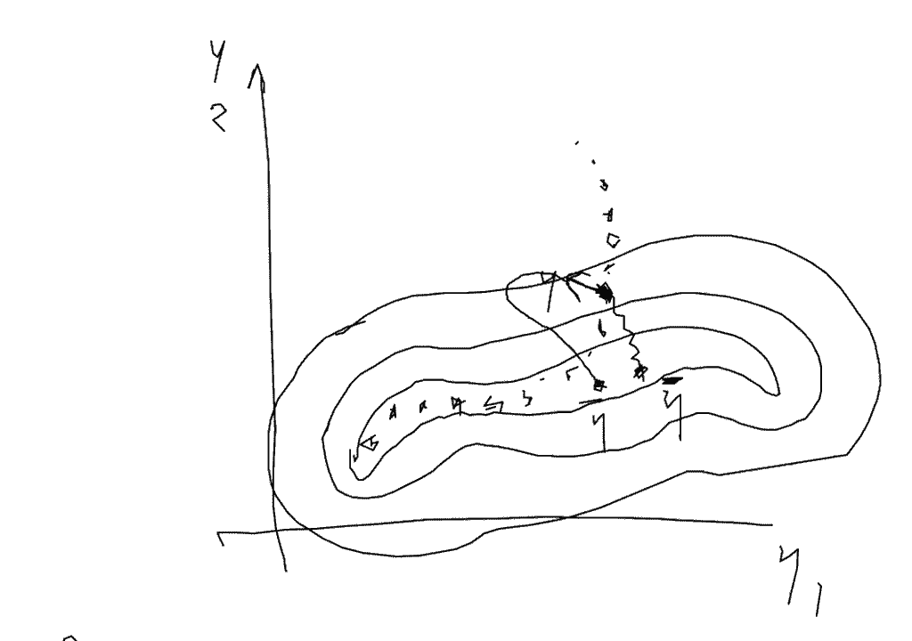

---

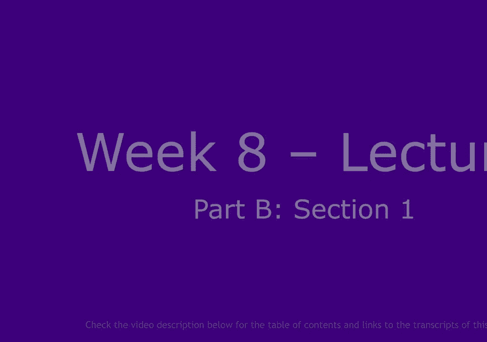

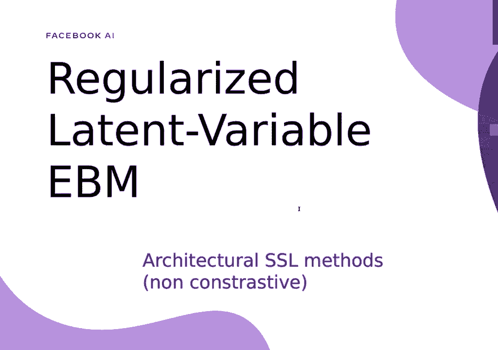

## 3. 架构方法：以去噪自编码器为例 🛠️

对比方法需要大量负样本。本节中，我们来看看另一种思路：通过设计模型架构本身来限制低能量空间的体积，即架构方法。

去噪自编码器是架构方法的一个典型例子。其核心思想是：

1.  **破坏输入**：从一个干净的数据点 `y` 出发，通过添加噪声、掩码部分内容等方式得到损坏版本 `x`。
2.  **训练重建**：训练一个自编码器（编码器-解码器），输入损坏的 `x`，目标是重建出原始的 `y`。
3.  **能量函数**：能量定义为重建 `y_bar` 与原始 `y` 之间的差异，例如平方欧几里得距离 `C(y, y_bar)`。

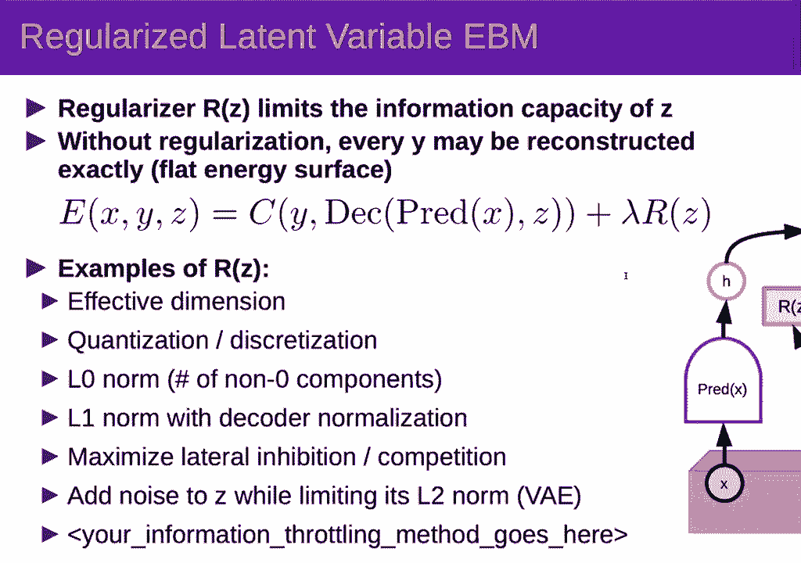

**能量函数**：
`F(x, y) = C(y, Decoder(Encoder(x)))`

通过这种方式，模型被训练为将低能量分配给数据流形上的点（即能被成功重建的点），而流形外的点则具有较高的重建误差（即高能量）。这种方法在自然语言处理（如BERT的掩码语言模型）中取得了巨大成功。

---

## 4. 正则化潜变量模型：稀疏编码 📊

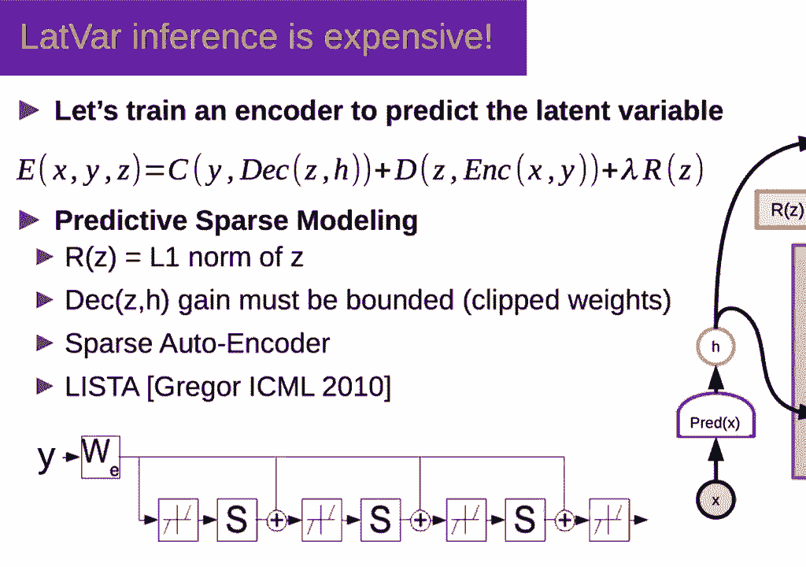

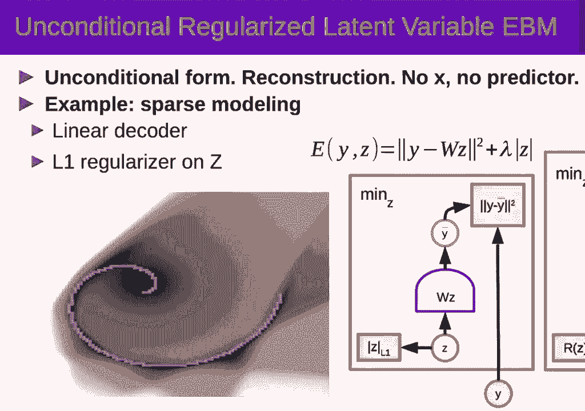

无论是对比方法还是简单的去噪自编码器，在高维空间中都需要精心设计以避免平凡解。本节中，我们引入正则化潜变量模型，它通过显式限制潜变量 `z` 的信息内容来约束模型。

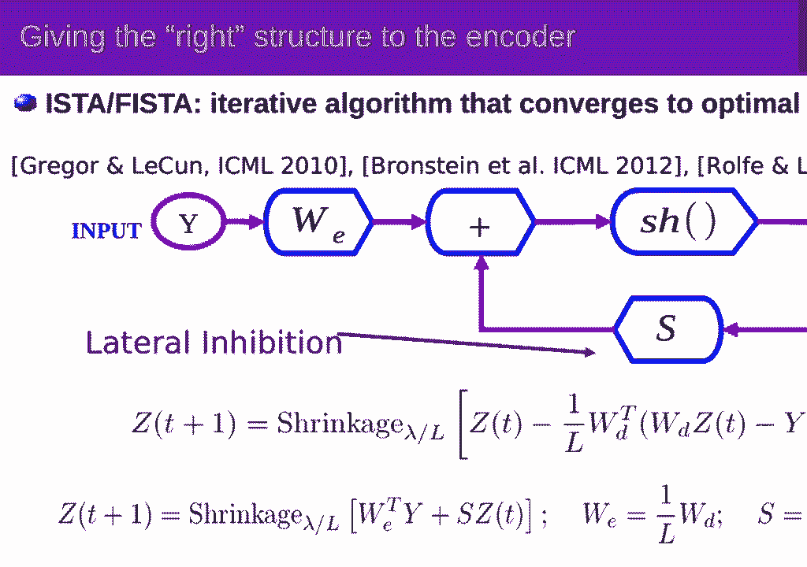

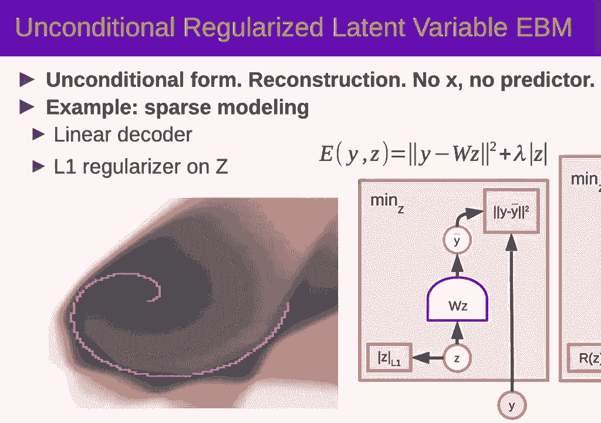

一个关键问题是：如何限制潜变量 `z`，使其不能编码所有信息，从而迫使模型学习有意义的表示？答案是向能量函数中添加关于 `z` 的正则化项 `R(z)`。

**正则化能量函数**：
`E(y, z) = C(y, Decoder(z)) + λ * R(z)`
其中 `λ` 控制正则化强度。

### 4.1 稀疏编码

稀疏编码是一种经典的正则化潜变量模型。它使用 `L1` 范数作为正则化项，迫使潜变量 `z` 的大部分分量为零。

**稀疏编码能量函数**：
`E(y, z) = ||y - Wz||² + λ * ||z||₁`
其中 `W` 是字典矩阵，`||z||₁` 是 `z` 的 `L1` 范数（各分量绝对值之和）。

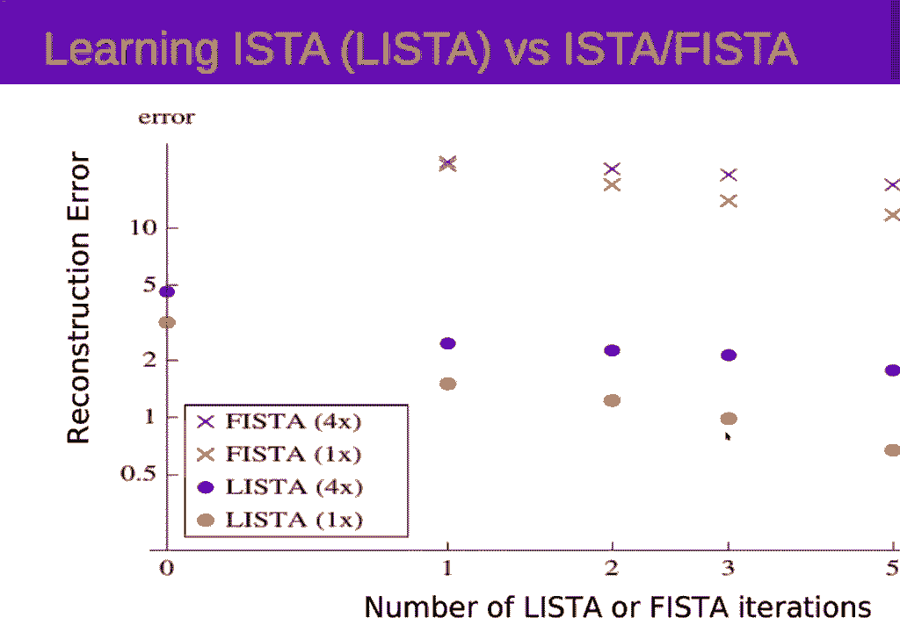

训练过程包括两步迭代：
1.  **推理（稀疏编码）**：对于每个 `y`，求解 `z* = argmin_z E(y, z)`。这可以使用迭代收缩阈值算法（ISTA）等优化算法。
2.  **学习（字典更新）**：固定 `z*`，更新字典 `W` 以最小化重建误差，通常需要约束 `W` 的列范数以防止退化。

稀疏编码可以学习到数据的基本组成成分，例如在图像上学习到类似Gabor滤波器的边缘检测器。

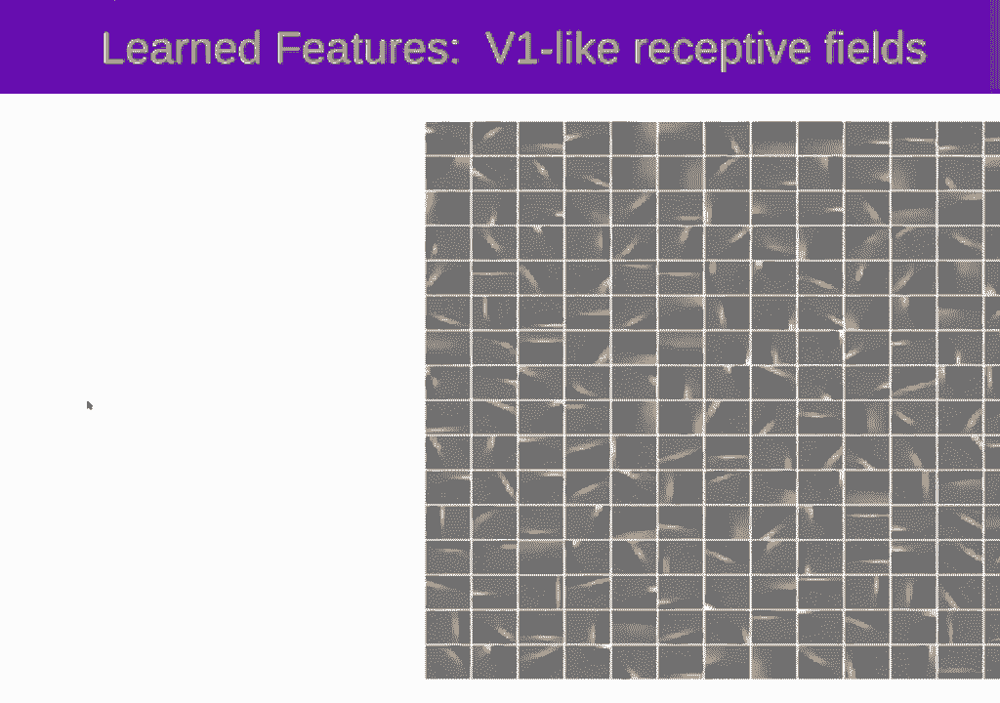

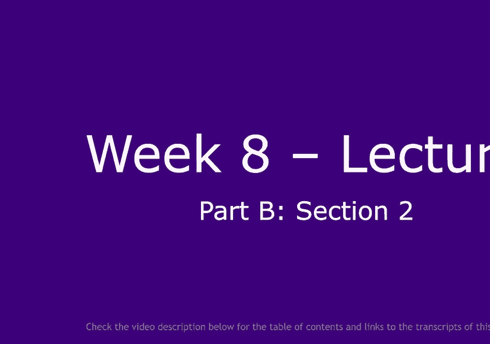

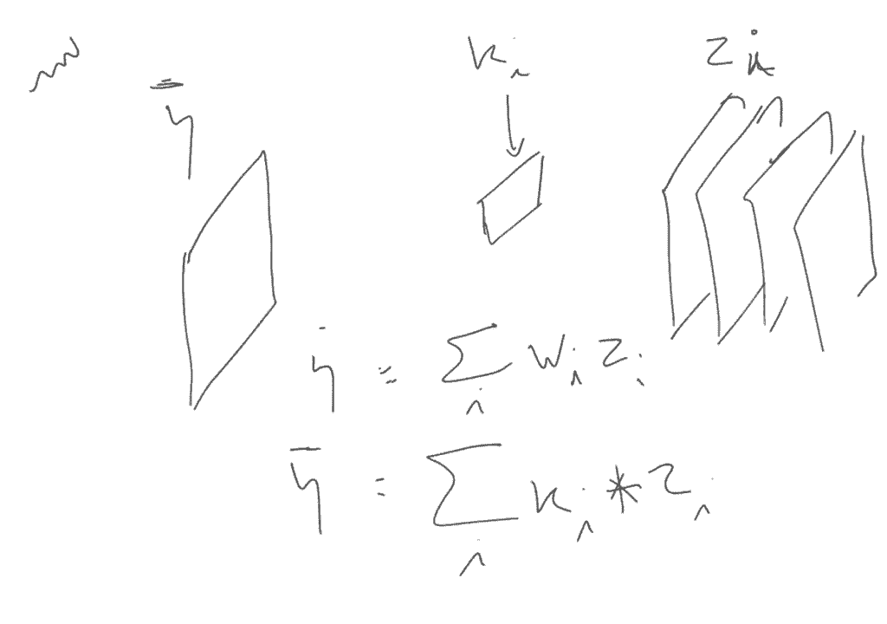

### 4.2 学习快速推理：LISTA

直接优化求解 `z*` 计算成本高。LISTA（Learned Iterative Shrinkage and Thresholding Algorithm）的核心思想是训练一个神经网络编码器来近似这个优化过程。

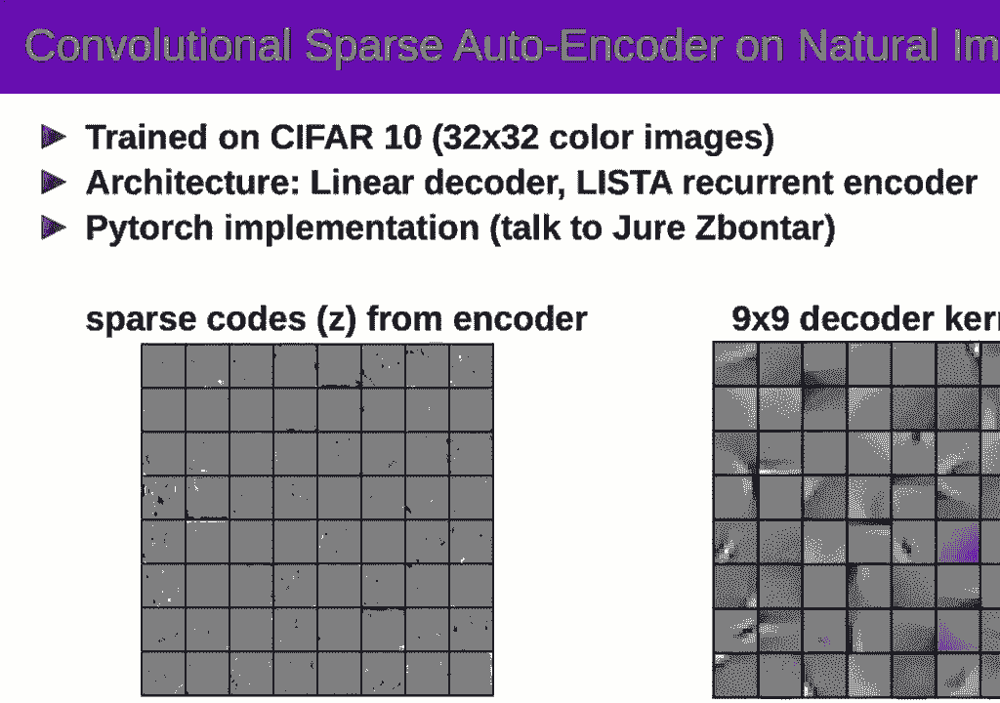

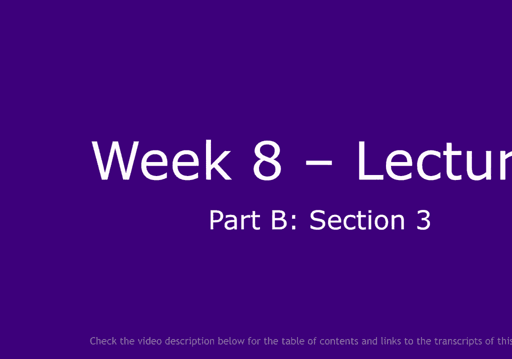

**LISTA架构**：
编码器被设计成模拟ISTA算法的迭代步骤，通过训练使其在固定迭代次数后输出的 `z_bar` 接近最优解 `z*`。损失函数包括重建误差、`z` 的正则化项以及预测 `z_bar` 与最优 `z*` 之间的距离。

这种方法能显著加速推理，并且学到的编码器在相同迭代次数下比原始ISTA算法得到更好的近似解。

---

## 5. 正则化潜变量模型：变分自编码器（VAE）🎭

上一节我们通过 `L1` 正则化引入稀疏性。本节中，我们看看另一种限制潜变量信息的方法：向潜变量添加噪声，即变分自编码器。

VAE的能量函数视角如下：
1.  **编码器**：输入 `y`，输出分布参数（如均值 `z_bar` 和方差）。
2.  **采样**：从该分布（如高斯分布 `N(z_bar, I)`）中采样得到 `z`。
3.  **解码器**：用 `z` 重建 `y_bar`。
4.  **能量函数**：包含三项：
    *   重建误差 `C(y, y_bar)`。
    *   正则化项 `R(z)`，通常是 `z` 的先验分布（如标准正态）的负对数。
    *   编码器预测 `z_bar` 与采样 `z` 之间的距离 `D(z, z_bar)`，这对应于让 `z` 的分布接近编码器预测的分布。

**VAE能量函数（概念式）**：
`E(y, z) ≈ C(y, Decoder(z)) + R(z) + D(z, Encoder(y))`

通过向 `z_bar` 添加噪声（采样），我们限制了编码器能通过 `z` 传递的信息量。为了防止编码器通过增大 `z_bar` 的范数来规避噪声（使噪声相对不重要），VAE损失函数中包含一个KL散度项，它充当了一个“弹簧”，将 `z` 的分布拉向标准正态先验（原点附近）。这迫使所有数据的潜表示聚集在原点周围，形成一个连续的流形，避免了离散的、分离的表示。

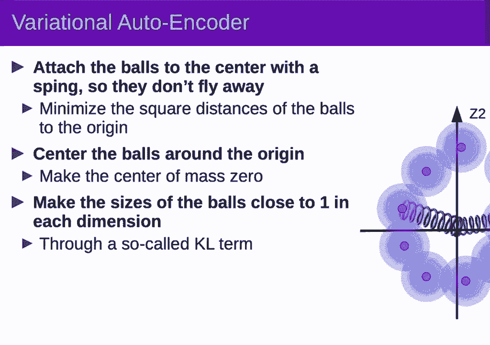

平衡重建误差和KL散度项是训练VAE的关键，太强的“弹簧”会导致潜变量崩溃（后验坍塌），太弱则会使模型忽略潜变量。

---

## 6. 总结与展望

本节课我们一起学习了基于能量的模型在自监督学习中的两大流派：

*   **对比方法**：通过显式比较正负样本对来塑造能量表面。它效果强大但需要大量负样本和计算资源。
*   **正则化潜变量模型**：通过架构设计（如稀疏编码的 `L1` 正则化）或随机性（如VAE的噪声注入）来限制潜变量的信息容量，从而自动将数据流形之外的能量推高。这是解决自监督学习中表示学习退化问题的重要途径。

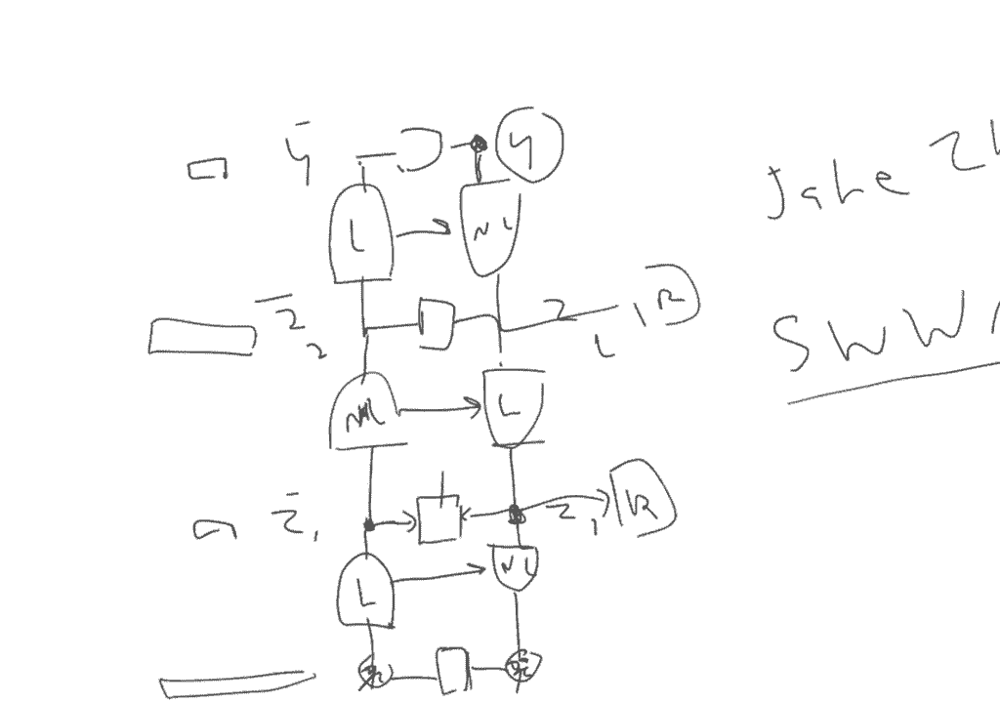

未来的工作在于更好地结合这两种方法的优点，并设计出更高效、更稳定的正则化机制，以学习到通用、非退化的数据表示。