# 16：第9周 – 讲座：组稀疏性、世界模型与生成对抗网络 🧠

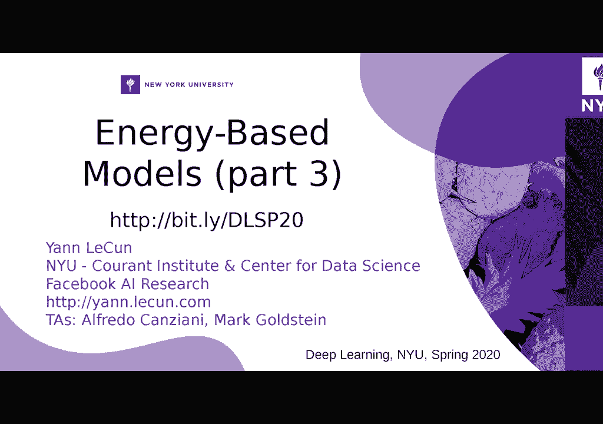

在本节课中，我们将学习基于能量的模型、组稀疏性、世界模型以及生成对抗网络的核心概念。我们将从稀疏编码和自动编码器开始，逐步深入到如何构建和训练能够预测世界状态变化的模型，并探讨生成对抗网络作为一种特殊的对比学习方法。

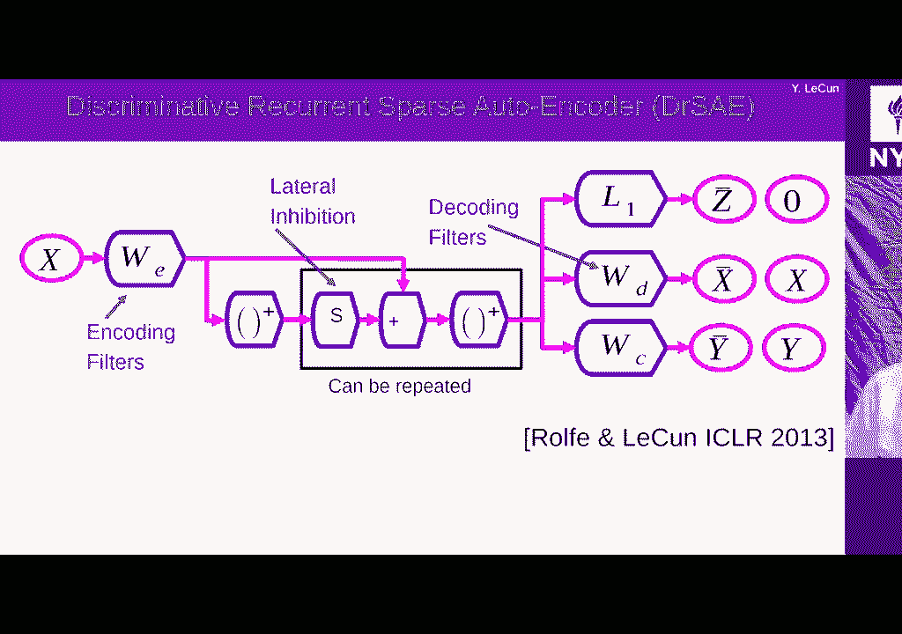

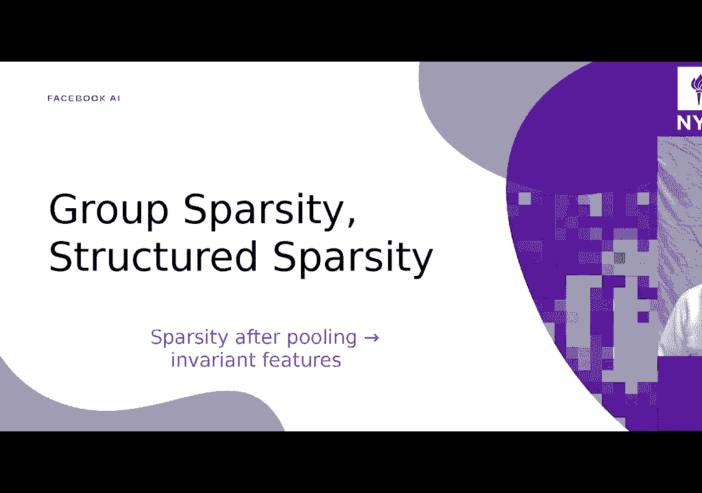

---

## 概述 📋

本节课内容分为三个主要部分。首先，我们将回顾稀疏编码，并介绍一种结合了稀疏自动编码器和分类器训练的架构。接着，我们将探讨组稀疏性和结构性稀疏性，这是一种通过分组正则化来学习具有不变性特征的方法。最后，我们将讨论如何构建世界模型来预测未来状态，并简要介绍生成对抗网络的基本原理。

---

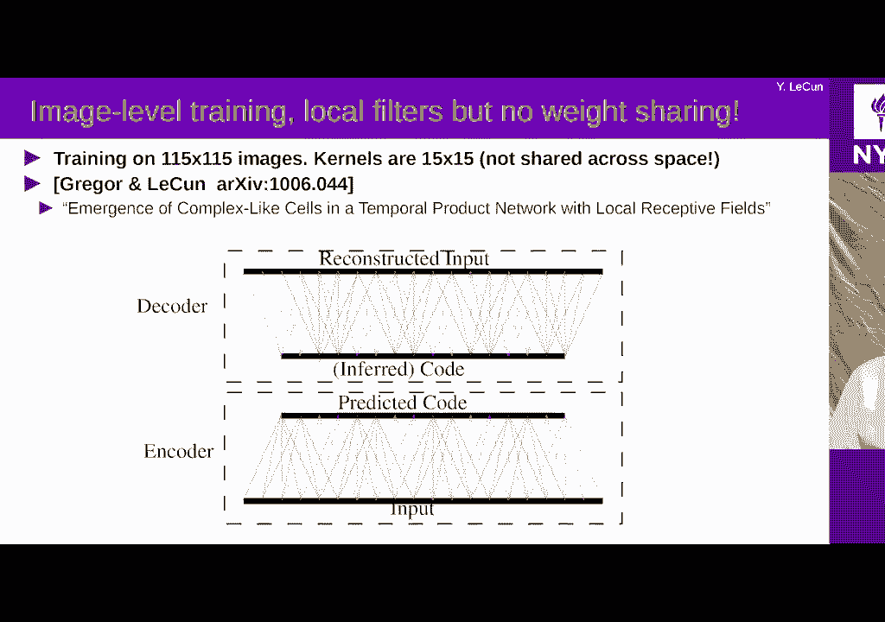

## 稀疏自动编码器与分类器 🧩

上一节我们介绍了稀疏编码。本节中，我们来看看如何将其与分类器结合，构建一个多任务学习系统。

这个架构的核心思想是训练一个神经网络同时完成三件事：
1.  重建输入数据。
2.  使编码（潜在特征）具有稀疏性。
3.  根据编码预测数据类别。

以下是该架构的示意图：

具体来说，系统包含一个编码器和一个解码器。编码器将输入 `x` 转换为稀疏特征向量 `z`。解码器尝试从 `z` 重建 `x`。同时，一个简单的线性分类器被附加在特征向量 `z` 上，用于预测类别标签。

整个系统的训练目标是同时最小化三个损失项：
*   **重建损失**：最小化输入 `x` 与重建输出之间的平方误差。公式为：`L_recon = ||x - decode(z)||^2`
*   **稀疏性损失**：在特征向量 `z` 上施加 L1 正则化，使其稀疏。公式为：`L_sparse = λ * ||z||_1`
*   **分类损失**：最小化分类器的预测误差（如交叉熵损失）。

这种方法的优点在于，通过强制系统寻找既能重建输入又能用于分类的特征，可以避免学习到退化的、无信息量的特征，从而起到正则化的作用。当有标签的训练数据不足时，这是一种有效的训练神经网络的方法。

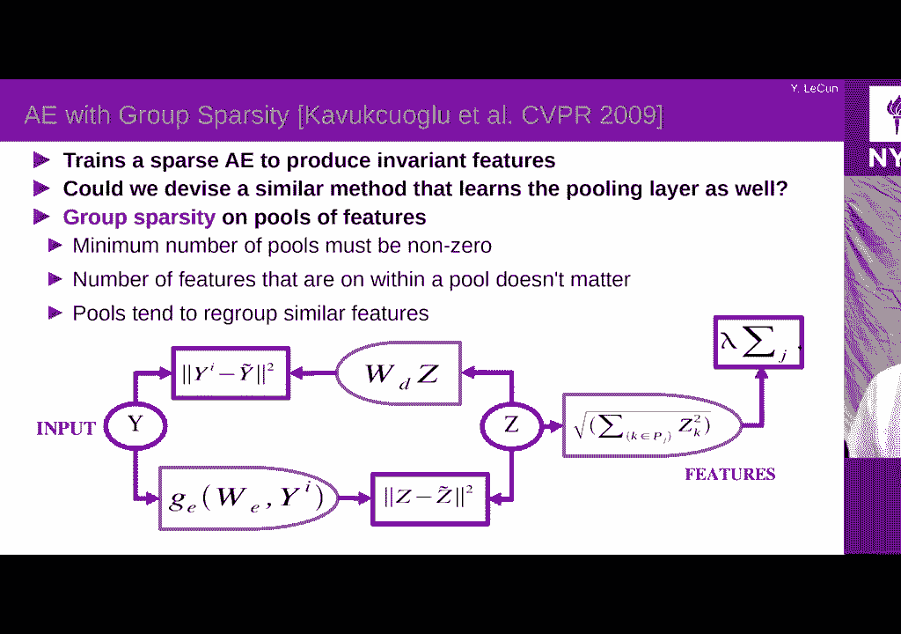

---

## 组稀疏性与结构性稀疏性 🔗

上一节我们介绍了基础的稀疏性。本节中，我们来看看一种更高级的稀疏性形式——组稀疏性，它能够引导系统学习具有结构不变性的特征。

组稀疏性的核心思想不是对单个特征进行独立的稀疏约束，而是将特征分组，并对整个组的激活进行约束。这促使相似的特征被分组激活，从而学习到对某些变换（如旋转、尺度）具有不变性的特征。

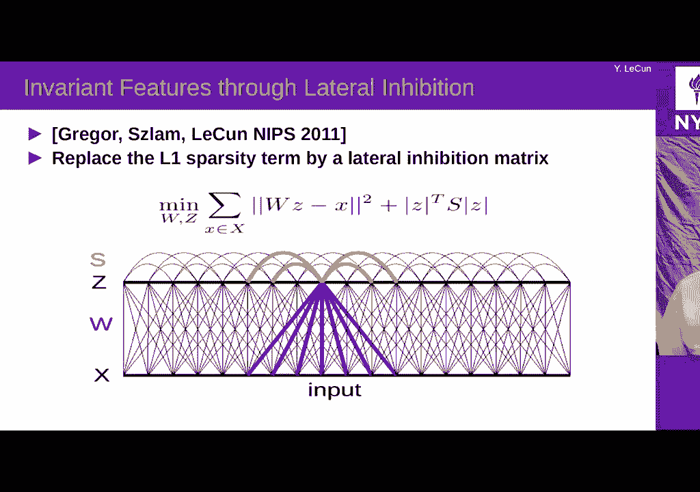

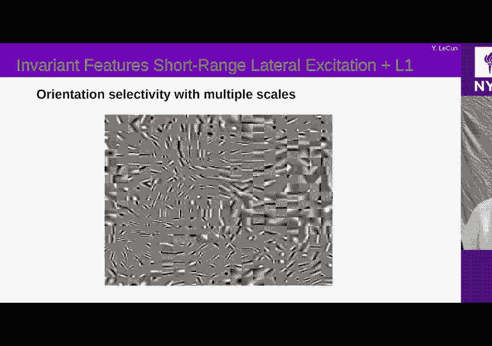

### 组稀疏正则化

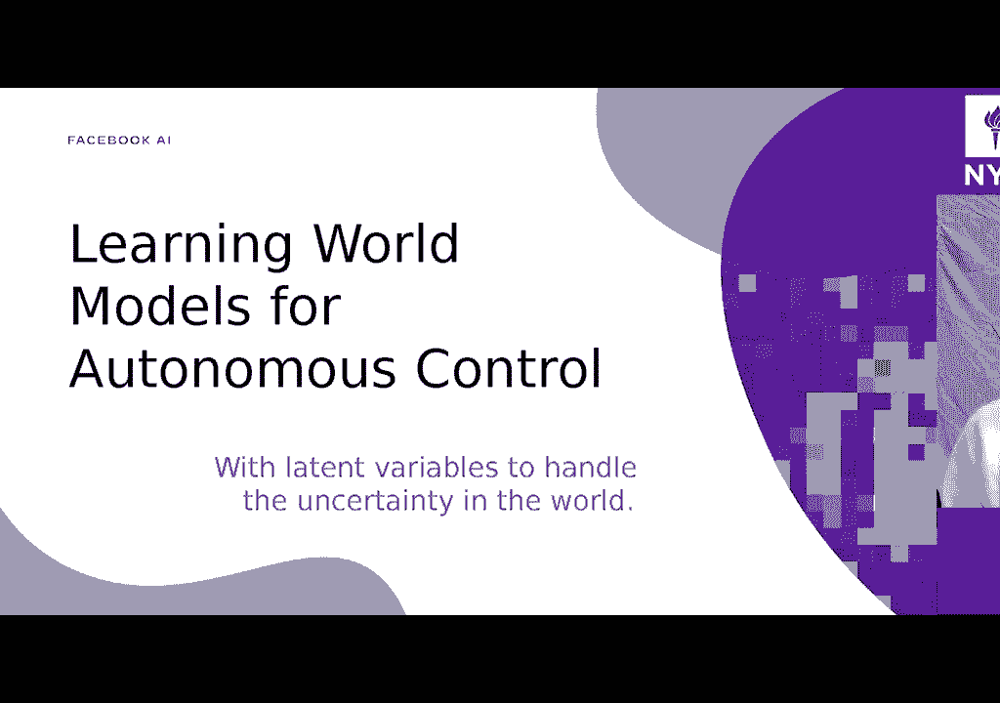

假设我们的稀疏特征向量为 `z`。我们将其分量划分为若干组（组可以重叠或不重叠）。对于第 `j` 组，我们计算组内特征的 L2 范数：
`||z_{G_j}||_2 = sqrt( sum_{i in G_j} z_i^2 )`

总的组稀疏正则化项是所有组的 L2 范数之和：
`L_group_sparse = sum_j ||z_{G_j}||_2`

与 L1 正则化倾向于关闭单个特征不同，组 L2 正则化倾向于关闭整个组。如果某些特征非常相似且倾向于同时被激活，系统就会将它们分到同一组，因为这是最小化激活组数的最佳方式。

### 应用与可视化

在实践中，我们可以将特征组织在某种拓扑结构中（例如 2D 网格），然后定义滑动窗口作为组。例如，在一个 16x16 的特征网格上，定义大小为 6x6、步长为 3 的滑动窗口作为重叠的组。

通过这种方式训练出的解码器权重（即特征本身）在拓扑空间中会呈现出缓慢变化的模式，例如类似“风车”或“漩涡”的结构。这与哺乳动物初级视觉皮层中观察到的“方位功能图”非常相似，其中对相似方向敏感的神经元在空间上是邻近的。

这种方法可以被视为一种“特征池化”，但它是在特征维度上进行的，而非空间维度。它可以被用来预训练神经网络：先以无监督方式训练一个具有组稀疏性的卷积自动编码器，然后丢弃解码器，将编码器作为特征提取器用于后续的有监督任务。

---

## 世界模型与预测控制 🌍

上一节我们讨论了如何从静态数据中学习特征。本节中，我们来看看如何构建一个能够预测动态世界未来状态的模型，即“世界模型”。

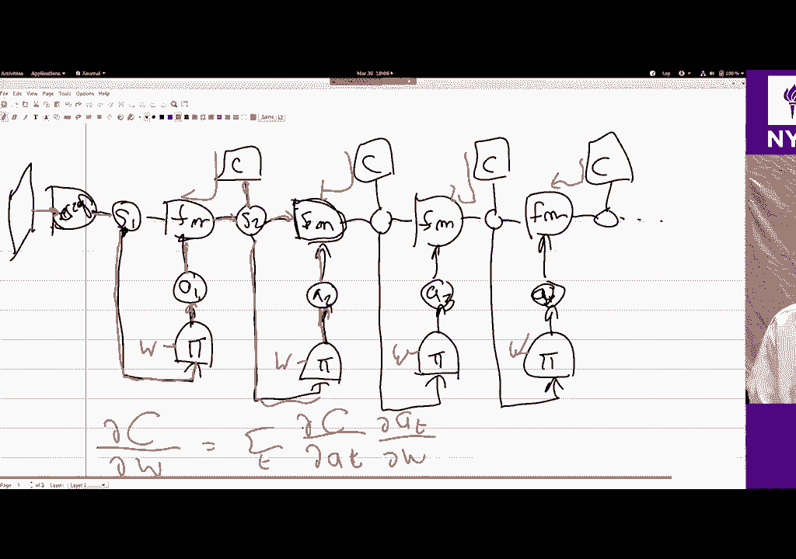

一个自主智能体系统通常包含四个部分：
1.  **感知模块**：观察世界，并计算当前状态的表示 `s_t`。
2.  **世界模型（前向模型）**：给定当前状态 `s_t`、采取的动作 `a_t` 以及一个代表未知信息的潜在变量 `z_t`，预测下一个状态 `s_{t+1}`。
3.  **成本函数**：评估状态或轨迹的“好坏”。
4.  **策略**：根据当前状态决定采取什么动作。

### 模型预测控制

如果我们有一个训练好的、可微分的前向模型和成本函数，我们就可以进行**模型预测控制**。其过程是：
1.  从当前状态 `s_t` 开始。
2.  在脑海中（使用前向模型）模拟未来多步，尝试不同的动作序列 `[a_t, a_{t+1}, ...]`。
3.  计算每个模拟轨迹的总成本。
4.  通过梯度下降等优化方法，找出能最小化总成本的最优动作序列。
5.  执行序列中的第一个动作 `a_t`。
6.  观察到新的状态 `s_{t+1}` 后，重复整个过程。

这属于 **System 2** 类型的思考，即需要 deliberate planning（深思熟虑的规划）。

### 训练世界模型

训练前向模型本身就是一个预测问题，其架构与我们之前讨论的基于能量的模型类似：
*   **输入**：当前状态 `s_t`（可视为 `x`）和动作 `a_t`。
*   **输出**：对下一个状态 `s_{t+1}`（可视为 `y`）的预测。
*   **潜在变量**：`z_t`，用于捕捉影响未来状态但无法从当前状态直接观测到的信息（如其他智能体的意图、随机噪声）。

为了防止模型作弊（例如，忽略 `s_t` 和 `a_t`，仅从 `z_t` 重建 `s_{t+1}`），我们必须限制潜在变量 `z_t` 的信息容量。这可以通过之前提到的技巧实现，例如：
*   对 `z_t` 添加噪声（如变分自编码器 VAE 的方法）。
*   使用一个编码器来预测 `z_t`，并约束其输出分布。
*   在训练时，随机将一半样本的 `z_t` 设为零，迫使模型必须利用 `s_t` 和 `a_t` 的信息。

### 策略网络：从 System 2 到 System 1

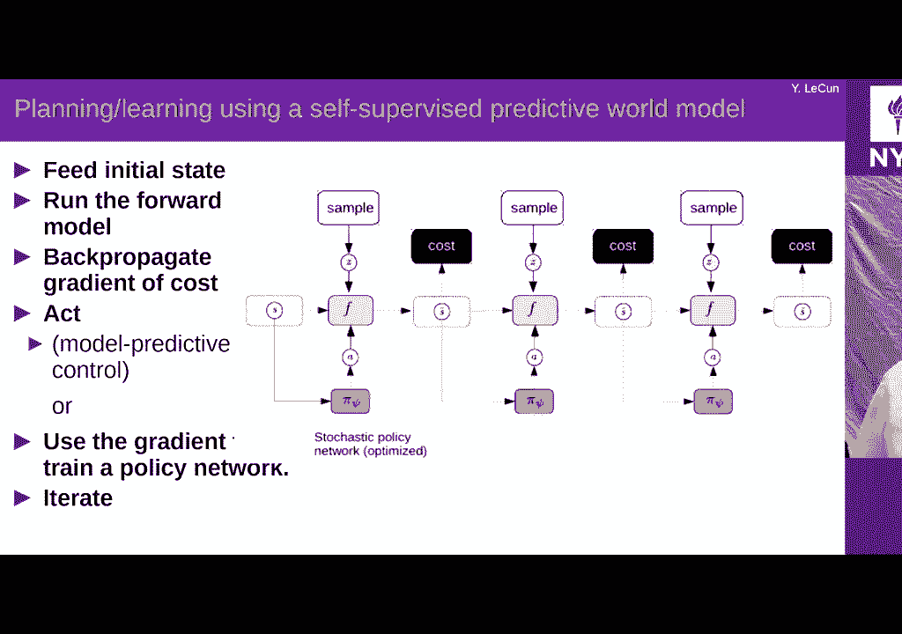

模型预测控制虽然强大，但计算量较大。我们可以训练一个**策略网络**来直接学习从状态 `s_t` 到最优动作 `a_t` 的映射。这个策略网络可以通过在模拟环境中，将模型预测控制优化得到的动作序列作为目标，通过监督学习进行训练。

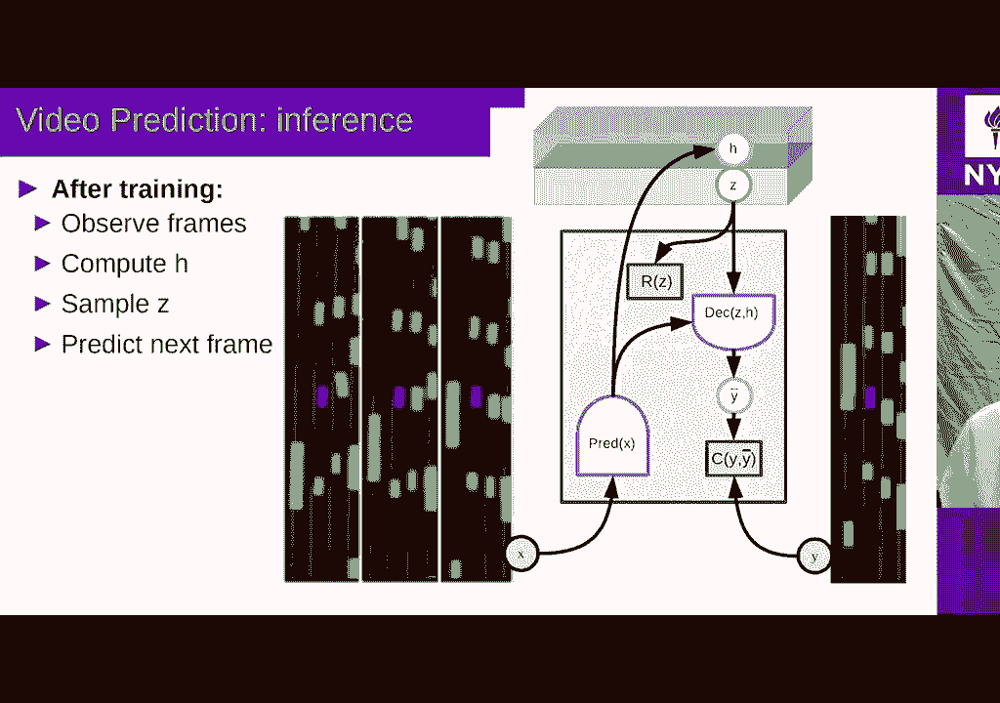

一旦策略网络训练完成，智能体就可以像 **System 1** 一样快速反应，无需每一步都进行耗时的内部模拟。这类似于人类从新手（需要思考每一步）到专家（凭直觉快速反应）的学习过程。

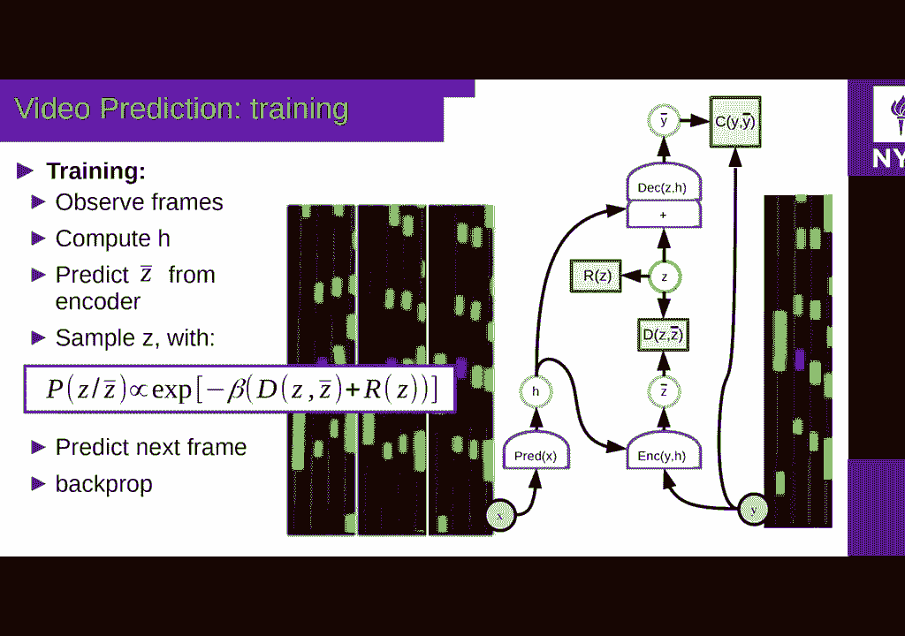

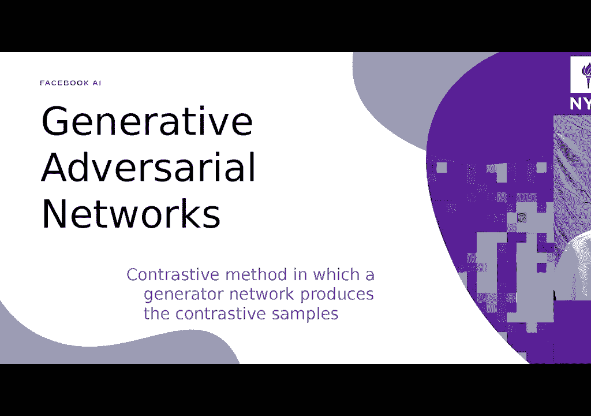

---

## 生成对抗网络 ⚔️

最后，我们简要介绍生成对抗网络，它可以被视为对比学习的一种特殊形式。

在基于能量的模型框架中，我们希望数据点处的能量低，非数据点处的能量高。对比方法通过主动生成“坏样本”（对比点）并推高其能量来实现这一点。

GAN 的核心思想是：**使用一个神经网络（生成器 G）来智能地生成这些对比样本**。
*   **判别器 D**：即我们的能量函数 `E(y)` 或 `f(y)`。它试图给真实数据 `y` 低能量（高分数），给生成数据 `y_bar` 高能量（低分数）。
*   **生成器 G**：它从一个随机噪声 `z` 生成样本 `y_bar = G(z)`。它试图生成能以假乱真、欺骗判别器的样本，即让 `f(G(z))` 尽可能低（能量低，分数高）。

训练过程是一个两人博弈（极小极大游戏）：
1.  **训练判别器**：最大化其区分真实数据和生成数据的能力。
    `max_D [ log(D(y)) + log(1 - D(G(z))) ]`
2.  **训练生成器**：最小化其被判别器识破的概率（或等价地，最大化判别器对生成数据的误判）。
    `min_G [ log(1 - D(G(z))) ]` （原始形式，或使用其他损失如 `-log(D(G(z)))`）

原始的 GAN 公式存在训练不稳定和模式崩溃等问题。后续的改进（如 WGAN）通过约束判别器函数的平滑性（Lipschitz 连续性）来获得更稳定、更有用的能量函数（判别器），使得生成样本的质量和多样性得到提升。

---

## 总结 🎯

本节课中我们一起学习了：
1.  **多任务稀疏自动编码器**：结合重建、稀疏性和分类损失，可以作为一种有效的正则化方法，尤其在标签数据稀缺时。
2.  **组稀疏性**：通过对特征分组进行正则化，可以引导模型学习具有结构性和不变性的特征表示，与生物视觉系统有有趣的对应。
3.  **世界模型**：构建可微分的前向模型来预测环境动态，是实现高级规划和快速反应的基础。我们讨论了模型预测控制、如何训练前向模型，以及如何从中提炼出快速的策略网络。
4.  **生成对抗网络**：作为一种对比学习方法，它通过生成器与判别器的对抗博弈来学习数据分布，其核心可置于基于能量的模型框架下理解。

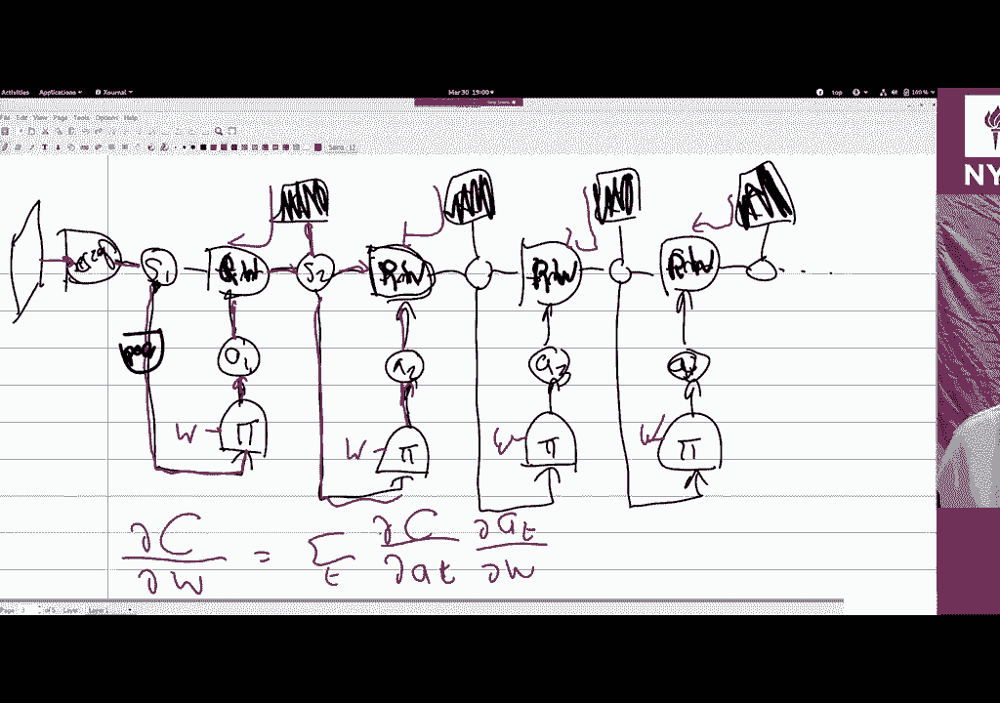

这些概念为理解自监督学习、无监督特征学习以及构建自主智能体提供了重要的理论基础和工具。