# 17：基于能量的生成对抗网络 (GANs) 教程 🧠

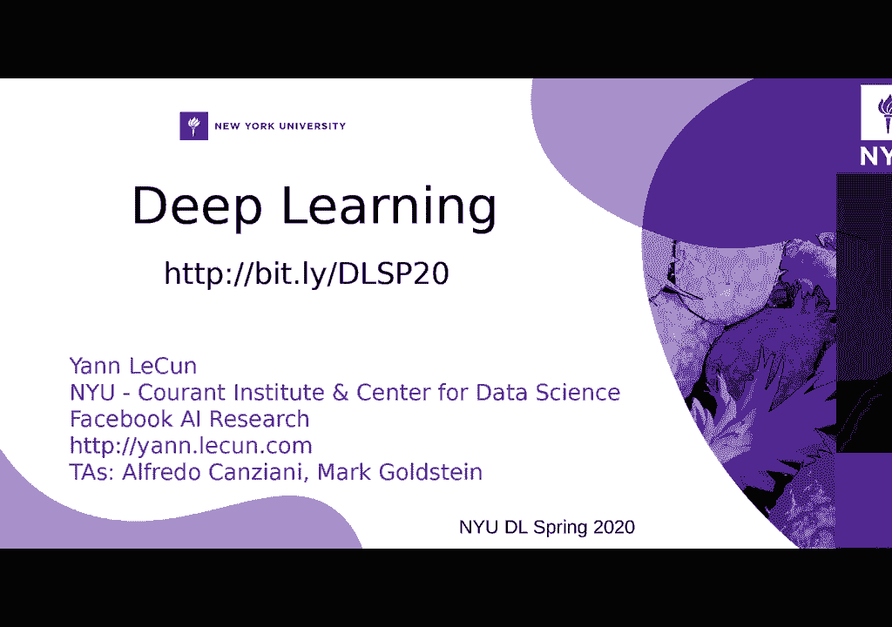

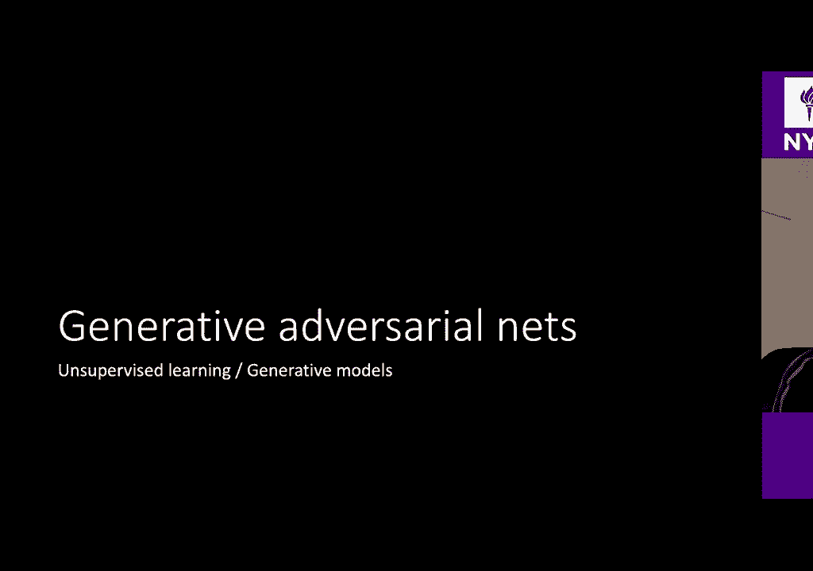


在本节课中，我们将要学习**生成对抗网络 (GANs)** 的核心概念，特别是其基于能量的视角。我们将了解GANs如何通过一个生成器和一个判别器（或成本网络）的对抗过程来学习生成数据，并探讨其工作原理、训练过程以及面临的挑战。

---

## 概述 📋

生成对抗网络是一种强大的无监督学习生成模型。它通过学习输入数据的概率分布，能够生成与原始数据相似的新样本。在本教程中，我们将深入探讨GANs的架构、训练动态以及如何避免常见的陷阱。

---

## 1. 生成模型与无监督学习

上一节我们介绍了课程目标，本节中我们来看看生成模型的基础。生成模型属于无监督学习领域，其目标是学习数据样本的概率分布。例如，自编码器中的解码器就可以被视为一种生成模型。

生成模型必须能够生成遵循特定分布的数据，就像原始输入数据一样。在没有标签的情况下，我们通过观察数据本身来学习其内在结构。

---

## 2. GANs 的基本架构

理解了生成模型的概念后，本节我们来剖析GANs的架构。一个典型的GAN由两个主要部分组成：**生成器 (Generator)** 和**判别器 (Discriminator)**，在基于能量的视角下，判别器也常被称为**成本网络 (Cost Network)**。

以下是GAN的基本工作流程：
1.  **生成器 (G)**：接收一个从简单分布（如正态分布）中采样的随机噪声向量 `z`，并将其映射到数据空间，生成一个假样本 `x_hat = G(z)`。
2.  **判别器/成本网络 (D/C)**：接收一个样本（可以是真实样本 `x` 或生成样本 `x_hat`），并输出一个标量值。这个值可以理解为样本是“真实”的概率（判别器视角），或是样本的“能量/成本”（能量模型视角）。**成本越高，样本看起来越不真实。**


与变分自编码器(VAE)从数据点开始编码到潜在空间再解码不同，GAN直接从潜在空间采样，通过生成器生成数据。

---

## 3. 对抗训练过程

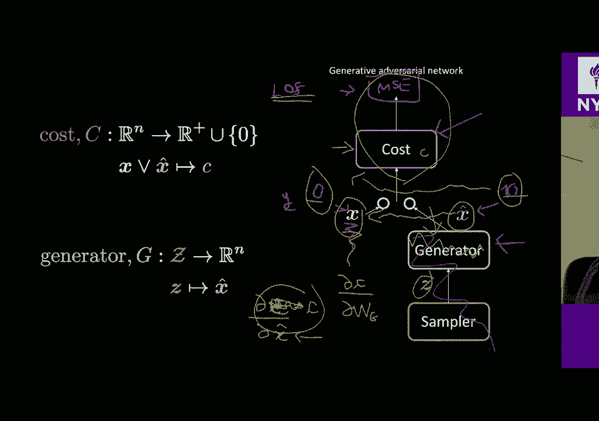

了解了架构后，本节我们来看看这两个网络是如何通过对抗过程进行训练的。训练目标是一个极小极大博弈（Minimax Game）：
*   **判别器的目标**：正确区分真实数据和生成数据。对于真实数据，输出高置信度（低成本）；对于生成数据，输出低置信度（高成本）。
*   **生成器的目标**：迷惑判别器，使其生成的样本被判别器误认为是真实数据（即，让判别器对生成样本也输出低成本）。


**训练步骤通常交替进行：**
1.  **固定生成器，训练判别器**：用一批真实数据和一批生成数据训练判别器，使其分辨能力更强。
2.  **固定判别器，训练生成器**：利用判别器提供的梯度信息来更新生成器，使其生成更逼真的数据。

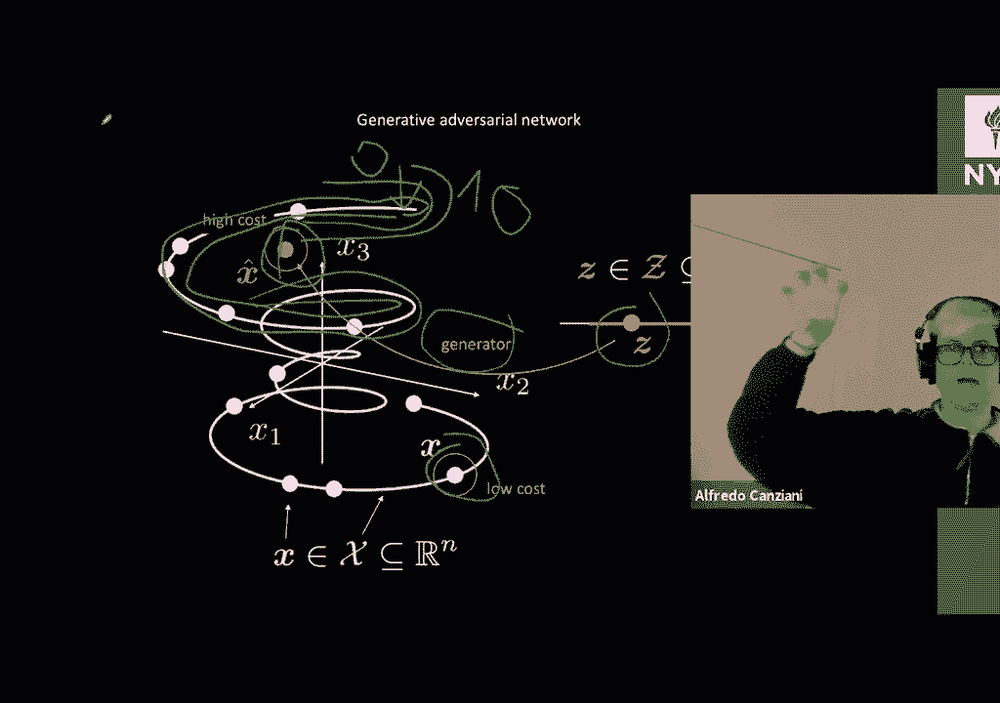

这个过程可以类比为：
*   **生成器**：伪造货币的造假者（意大利人）。
*   **判别器**：鉴别货币真伪的专家（德国人）。
*   **梯度**：间谍反馈的信息，告诉造假者他们的假币在哪里露出了破绽，从而指导他们改进技术。


---

## 4. 损失函数与梯度流

上一节我们形象地理解了对抗过程，本节中我们从数学和代码角度看看其具体实现。关键在于损失函数的设计和梯度的反向传播。

对于**判别器（成本网络）**，其损失函数鼓励它对真实样本输出低值，对生成样本输出高值。一个简单的实现是使用均方误差（MSE Loss）：
*   目标：真实样本 `x` 对应输出 `0`，生成样本 `x_hat` 对应输出 `m`（例如 `m=10`）。
*   损失函数：`L_D = MSE(D(x), 0) + MSE(D(G(z)), m)`

对于**生成器**，其损失直接来自于判别器对生成样本的输出。生成器的目标是**最小化这个输出值**：
*   损失函数：`L_G = D(G(z))`
*   这意味着生成器利用判别器提供的梯度 `d(D(G(z)))/dG` 来更新自身参数，使得 `D(G(z))` 变小。

```python
# 伪代码示意训练循环
for epoch in range(num_epochs):
    # 1. 训练判别器
    real_data = get_real_batch()
    noise = sample_noise()
    fake_data = generator(noise).detach() # 截断梯度，不更新生成器

    d_real = discriminator(real_data)
    d_fake = discriminator(fake_data)

    # 判别器损失：真样本趋近1，假样本趋近0
    d_loss = binary_cross_entropy(d_real, ones) + binary_cross_entropy(d_fake, zeros)
    d_loss.backward()
    optimizer_D.step()

    # 2. 训练生成器
    noise = sample_noise()
    fake_data = generator(noise)
    d_fake = discriminator(fake_data)

    # 生成器损失：让判别器对假样本的输出趋近1（即判别器被骗）
    g_loss = binary_cross_entropy(d_fake, ones)
    g_loss.backward()
    optimizer_G.step()
```

**关键点**：在训练判别器时，我们`detach()`生成器的输出，防止梯度传播到生成器。在训练生成器时，我们使用判别器对生成数据的输出作为损失，但将标签设为“真实”（1），从而引导生成器产生能骗过判别器的数据。

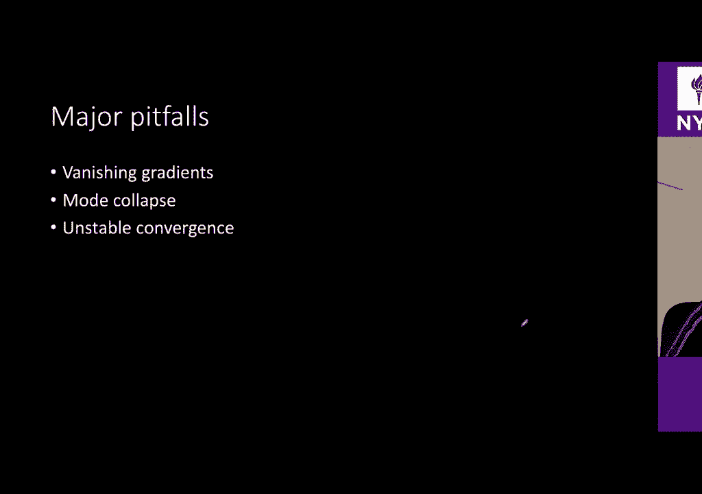


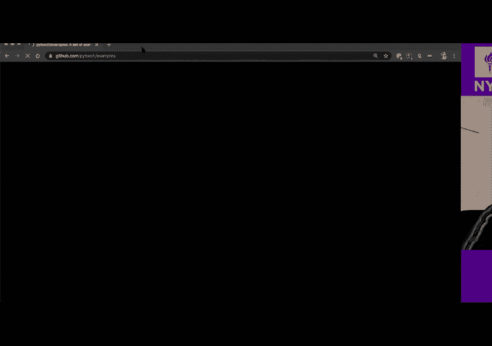

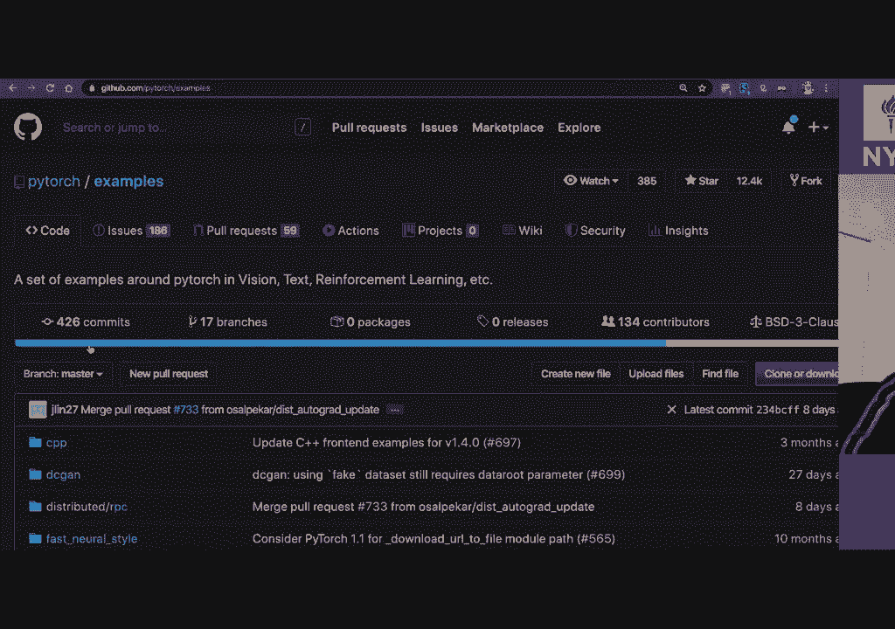

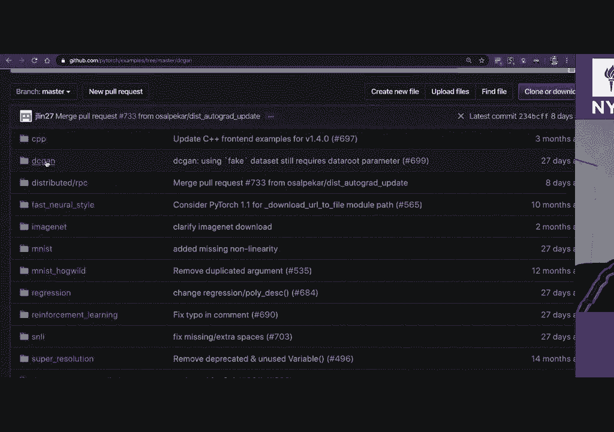

---

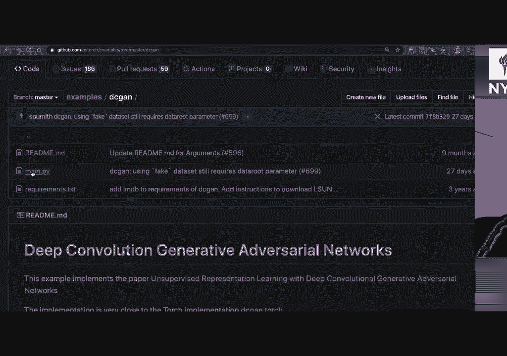

## 5. GANs 的挑战与陷阱

训练GAN并非易事，本节我们探讨几个常见的挑战。

以下是GAN训练中面临的主要问题：

1.  **判别器饱和**：如果判别器训练得太好，对生成样本的输出会很快饱和（例如非常接近0），导致梯度消失（`d(L_G)/dG ≈ 0`）。生成器因无法获得有效的梯度而停止学习。
2.  **模式崩溃**：生成器可能发现某个特定样本（或一小类样本）能有效欺骗判别器，于是开始只生成这个样本，而忽略了数据分布的其他模式（多样性）。生成器将所有输入`z`都映射到同一个输出`x`。
3.  **训练不稳定**：生成器和判别器处于动态博弈中。判别器的决策边界在不断变化，生成器的目标也在移动。这可能导致训练振荡，难以收敛到一个平衡点。
4.  **评估困难**：没有完美的客观指标来衡量生成样本的质量和多样性。常用的方法如**初始分数**依赖于另一个在图像数据上预训练的分类网络。


*上图为模式崩溃的示意图，生成的数据点（蓝）坍塌到少数几个点，缺乏多样性。*

为了解决梯度消失问题，一个改进是使用**基于能量的模型**或**使用重构误差作为成本**。例如，训练一个自编码器仅能很好地重构真实数据。对于远离真实数据流形的生成样本，其重构误差会很大，这个误差就可以作为连续、非饱和的成本信号来训练生成器。

---

## 6. 代码实例解析

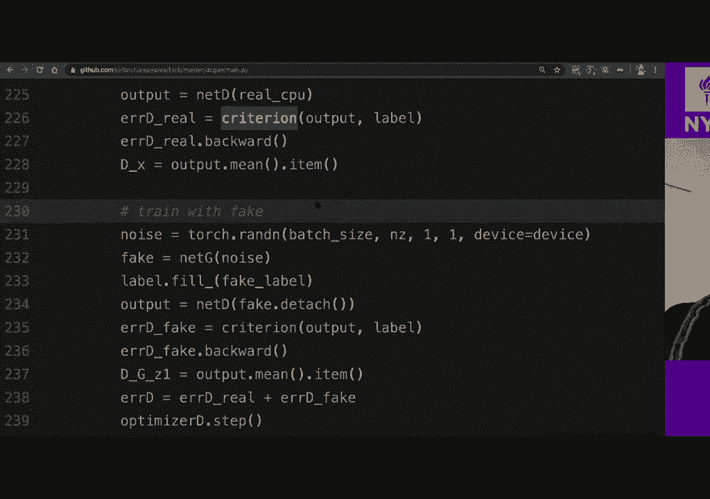

理论需要实践来巩固，本节我们简要查看一个使用PyTorch实现的DCGAN代码片段，理解其中的关键部分。

```python
# 生成器网络示例 (DCGAN)
class Generator(nn.Module):
    def __init__(self, nz, ngf, nc):
        super(Generator, self).__init__()
        self.main = nn.Sequential(
            # 输入是Z，进入卷积
            nn.ConvTranspose2d(nz, ngf * 8, 4, 1, 0, bias=False),
            nn.BatchNorm2d(ngf * 8),
            nn.ReLU(True),
            # 上采样层...
            nn.ConvTranspose2d(ngf, nc, 4, 2, 1, bias=False),
            nn.Tanh() # 输出范围[-1, 1]
        )
    def forward(self, input):
        return self.main(input)

# 判别器网络示例
class Discriminator(nn.Module):
    def __init__(self, nc, ndf):
        super(Discriminator, self).__init__()
        self.main = nn.Sequential(
            # 输入是 (nc) x 64 x 64
            nn.Conv2d(nc, ndf, 4, 2, 1, bias=False),
            nn.LeakyReLU(0.2, inplace=True), # 使用LeakyReLU防止梯度消失
            # 下采样层...
            nn.Conv2d(ndf * 8, 1, 4, 1, 0, bias=False),
            nn.Sigmoid() # 输出一个概率值
        )
    def forward(self, input):
        return self.main(input)
```
**代码要点**：
*   **生成器**使用转置卷积进行上采样，最终使用`Tanh`激活将像素值规范到`[-1, 1]`。
*   **判别器**使用普通卷积进行下采样，使用`LeakyReLU`而非普通`ReLU`来避免负值区域的梯度完全为零，这对梯度流动至关重要。
*   训练循环遵循我们之前描述的交替步骤，注意梯度清零、计算和参数更新的顺序。

---

## 总结 🎯

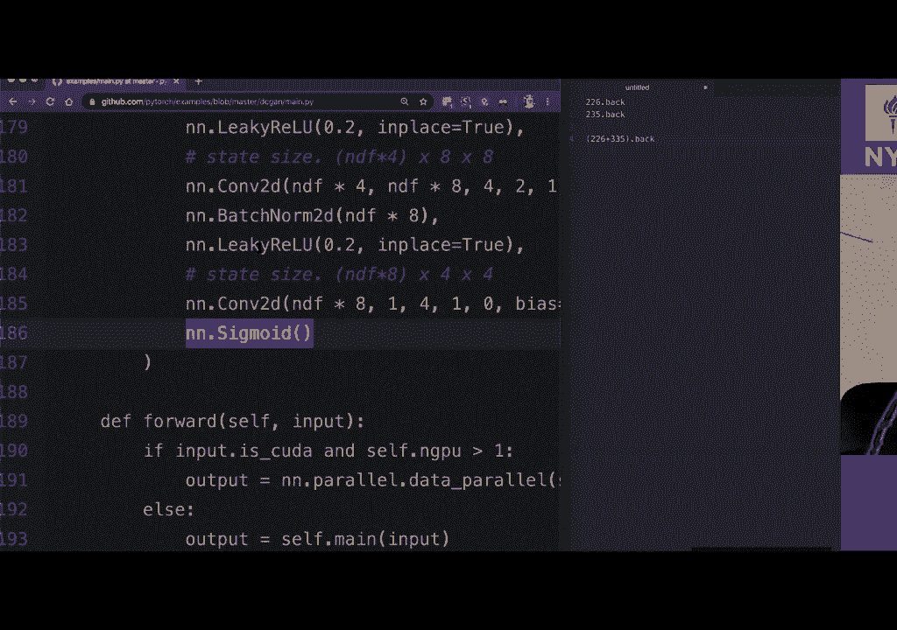

本节课中我们一起学习了生成对抗网络的核心原理。我们从生成模型的概念出发，详细介绍了GAN中生成器与判别器的对抗架构及其训练过程。我们探讨了GAN训练中的关键挑战，如梯度消失和模式崩溃，并简要分析了实践代码。

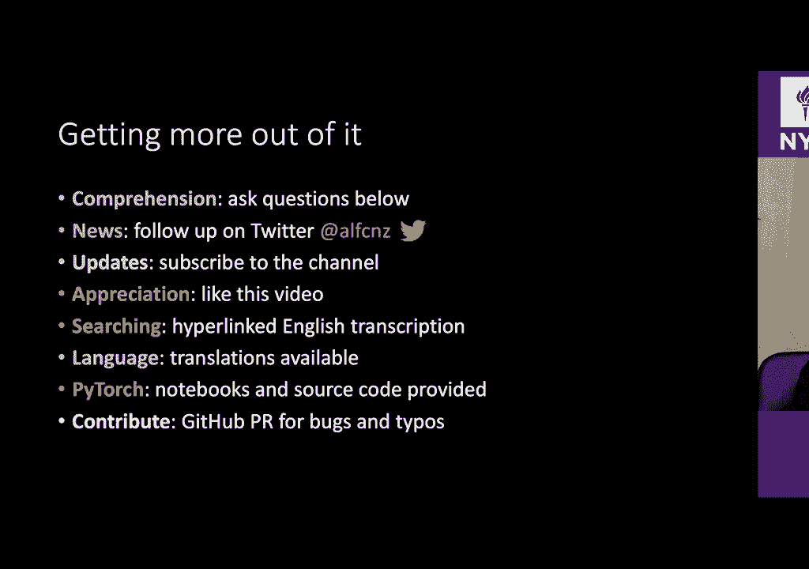

GAN提供了一种无需显式定义似然函数就能学习复杂数据分布的强大框架。理解其基于能量的视角和对抗训练的动态本质，是掌握现代生成模型的关键一步。尽管训练存在挑战，但GAN在图像生成、风格迁移等领域取得了令人瞩目的成果。