# 18：计算机视觉中的自监督学习 👁️📚

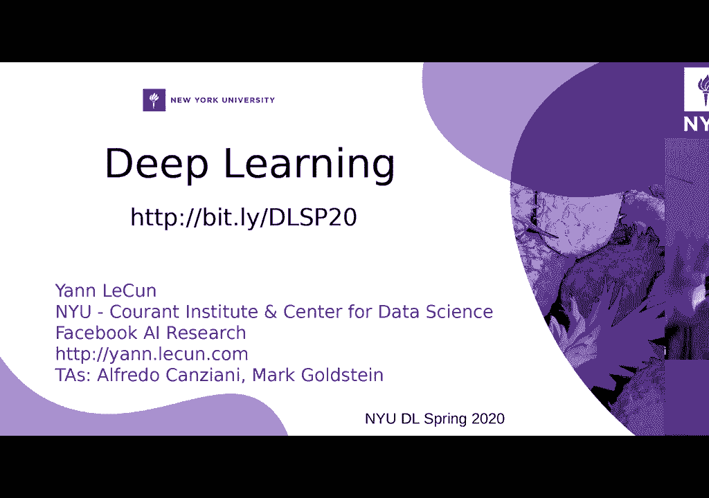

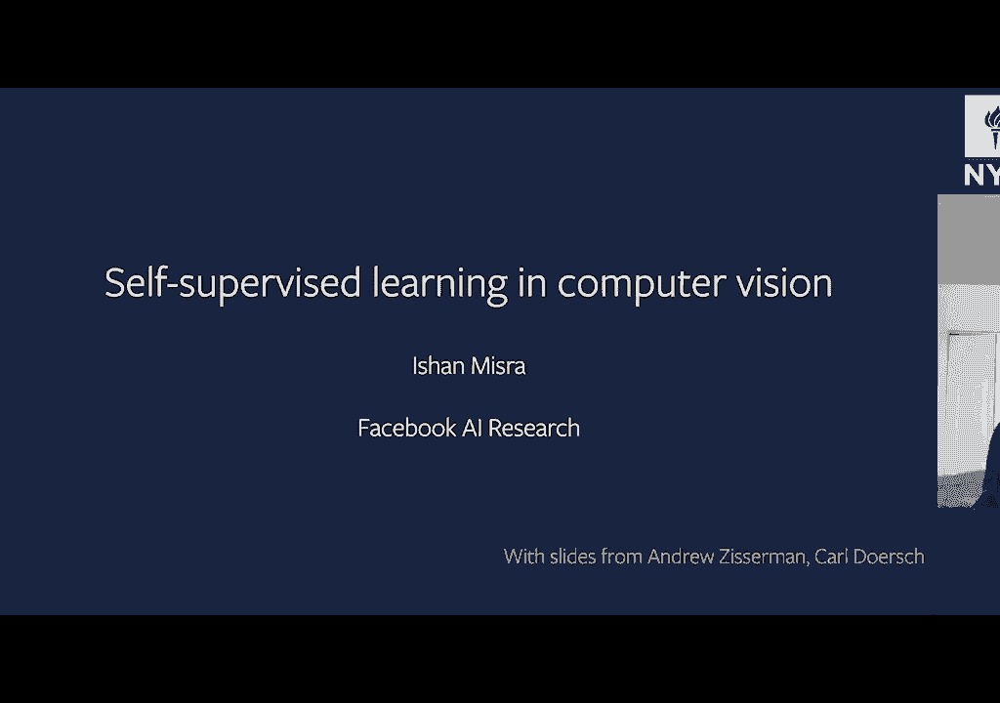

## 概述
在本节课中，我们将学习计算机视觉领域的自监督学习。自监督学习是一种利用数据本身的结构来生成监督信号，从而学习有效数据表示的方法。我们将探讨其动机、核心方法、评估方式以及最新的研究进展。

---

## 1. 为什么需要自监督学习？🤔

上一节我们介绍了课程概述，本节中我们来看看为什么需要自监督学习。

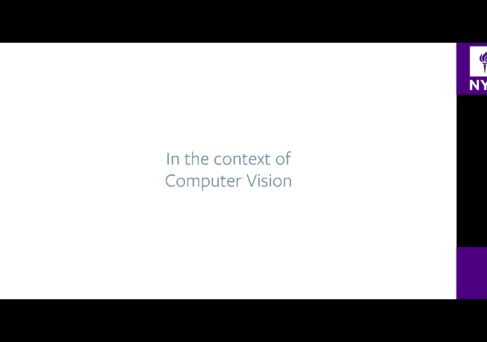

传统的监督学习在计算机视觉中取得了巨大成功，例如在ImageNet上进行图像分类预训练。这种方法学习到的表示对于下游任务（如目标检测）非常有用，即使下游任务的标签数据有限。

然而，这种方法依赖于收集大量带标签的图像。例如，ImageNet数据集包含约1400万张图片和22,000个概念，其标注工作耗费了大约22人年。这凸显了获取大规模精确标注数据的困难和昂贵。

相比之下，互联网上存在海量的无标签图像数据。如果能够利用这些数据本身来学习表示，就可以减少对人工标注的依赖。自监督学习正是为此而生，它旨在从数据中自动生成监督信号。

---

## 2. 什么是自监督学习？🔍

上一节我们探讨了自监督学习的动机，本节我们来正式定义它。

自监督学习可以被视为一种无监督学习。其核心思想是：**通过预测数据的一部分来自数据的另一部分，从而学习表示**。

更具体地说：
*   **监督学习**：给定输入（如图像），我们有明确的目标（如“这是一只猫”）。
*   **无监督学习**：只有输入，没有明确的目标。
*   **自监督学习**：标签来自数据本身的共现部分或属性。我们设计一个“代理任务”，其目标是从数据中自动生成。

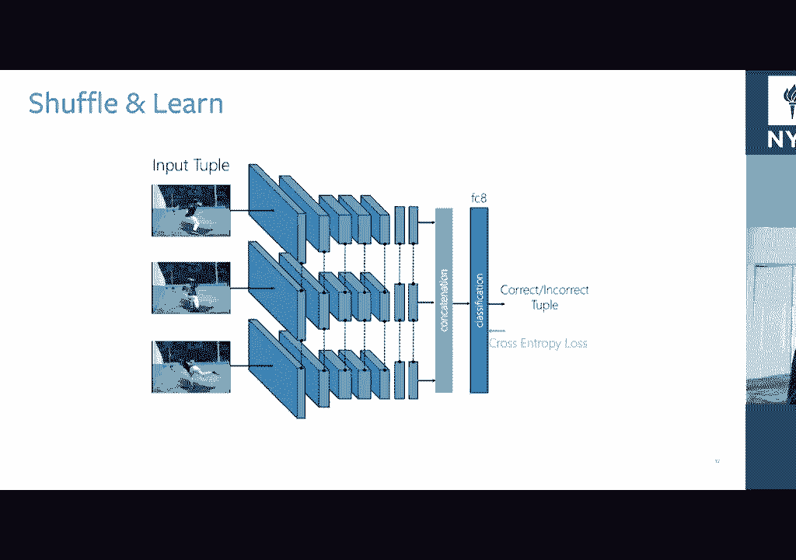

一个经典的例子是自然语言处理中的掩码语言模型（如BERT）：给定一个不完整的句子（如“猫坐在____上”），模型需要预测被掩码的单词（如“垫子”）。这个预测任务的目标（即被掩码的单词）完全来自数据本身。

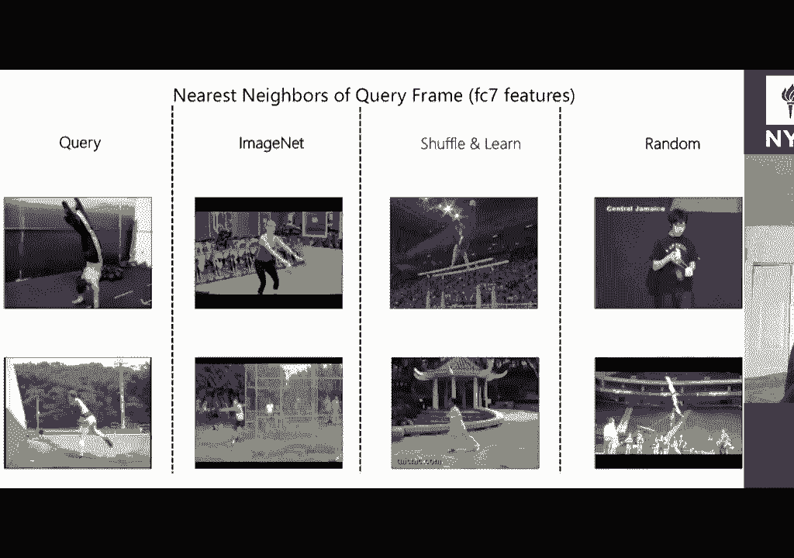

---

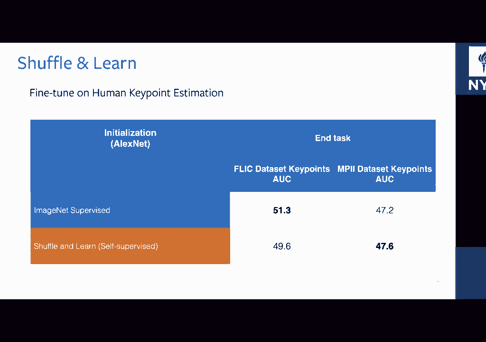

## 3. 视觉中的代理任务 🎯

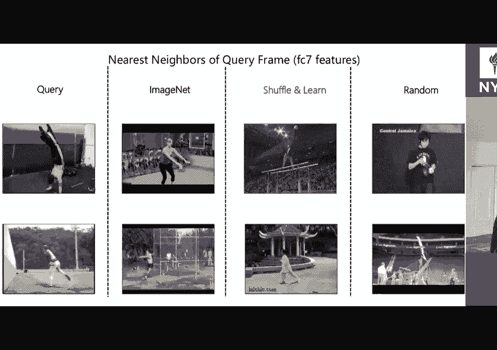

上一节我们定义了自监督学习，本节我们来看看在计算机视觉中如何设计具体的“代理任务”。

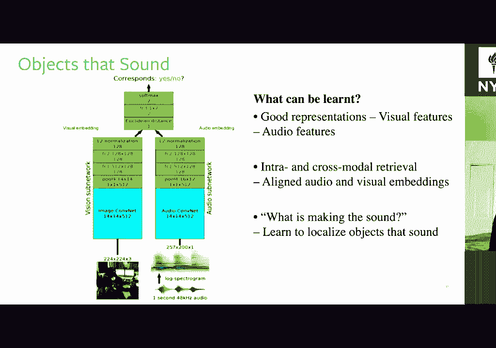

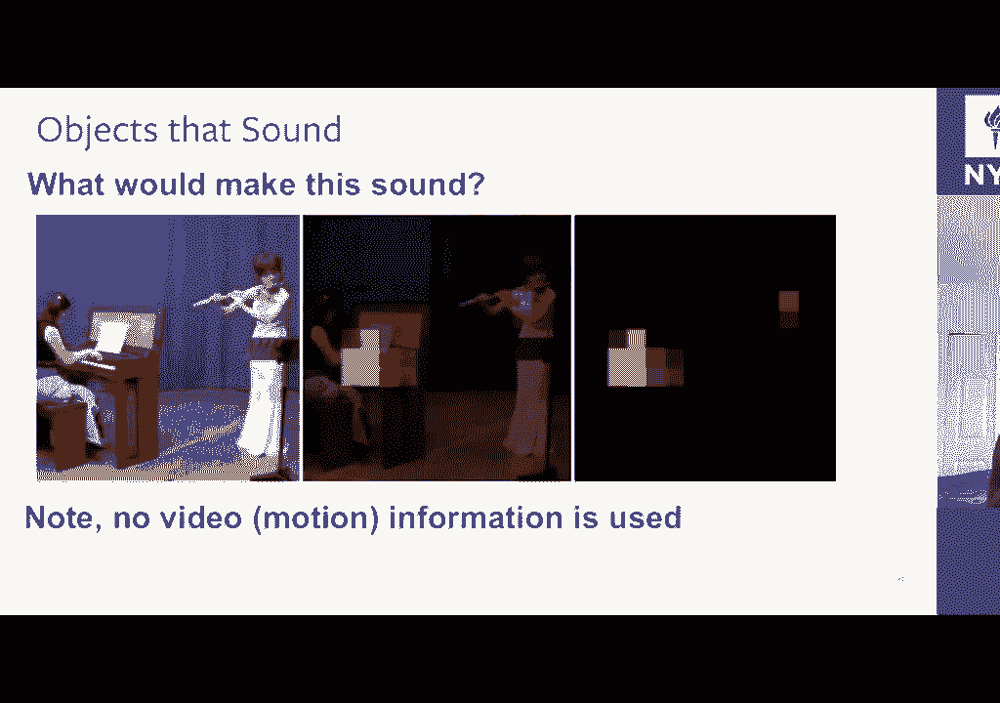

代理任务本身并非我们最终关心的任务（如图像分类），而是我们用来学习良好数据表示的“借口”。以下是几种经典的视觉代理任务：

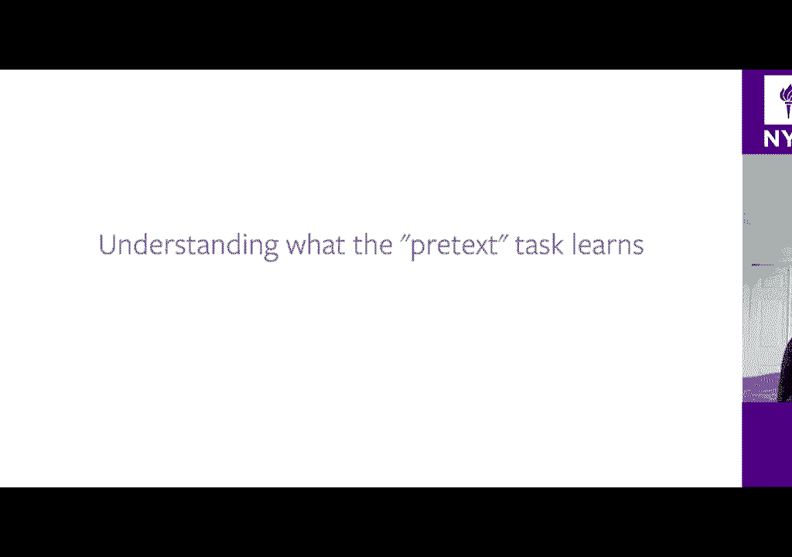

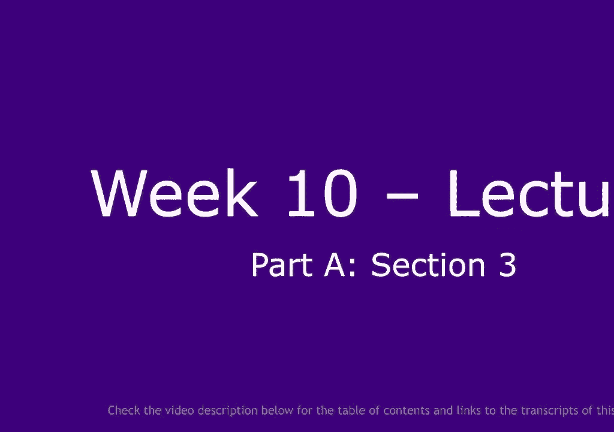

以下是几种经典的视觉代理任务：

1.  **相对位置预测**：从图像中采样两个补丁，让网络预测第二个补丁相对于第一个补丁的位置（例如，右上、左下等）。这迫使网络理解图像的局部结构和内容。
    *   **公式/代码描述**：任务可形式化为一个8分类问题（8个可能的方向）。

2.  **图像旋转预测**：将图像旋转0°、90°、180°或270°，然后让网络预测所应用的旋转角度。这要求网络理解图像中物体的常规朝向和场景布局。
    *   **公式/代码描述**：任务可形式化为一个4分类问题。

3.  **图像着色**：给定一张灰度图像，让网络预测其颜色。这要求网络识别物体和场景的语义信息（例如，天空是蓝色的，草地是绿色的）。
    *   **公式/代码描述**：最初被构建为分类（预测颜色bin）或回归（预测颜色值）问题。

4.  **上下文编码**：随机掩码图像的一部分，然后根据周围上下文来预测被掩码的内容。这类似于NLP中的掩码语言模型。

---

## 4. 视频与多模态中的代理任务 🎬🔊

上一节我们介绍了基于图像的代理任务，本节我们将视野扩展到视频和多模态数据。

视频数据具有天然的时序结构，这为设计代理任务提供了丰富的信息。

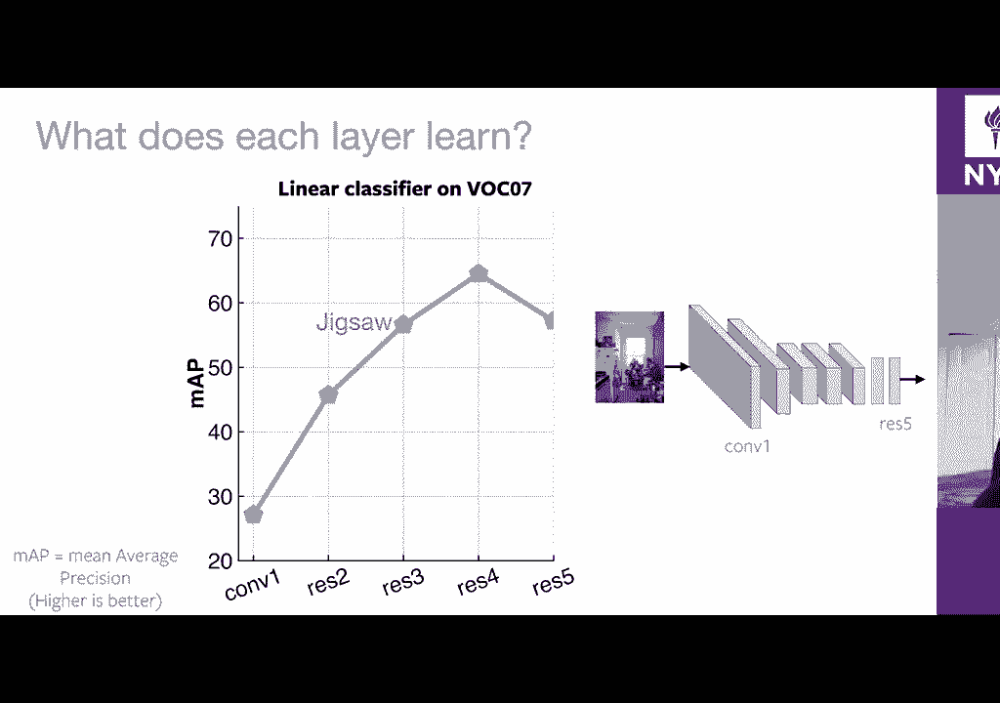

*   **帧序验证**：从视频中采样三帧，判断它们是以正确的时间顺序排列，还是被打乱了顺序。为了完成这个任务，网络需要关注视频中移动的部分（通常是主体），从而学习到与动作、姿态相关的特征。

多模态数据（如视频和对应的音频）也提供了强大的自监督信号。

*   **视听对应**：判断一段视频剪辑和一段音频剪辑是否来自同一个视频源。为了判断声音是否来自画面，网络需要识别画面中可能发声的物体（如吉他、鼓），从而学习到物体的视觉特征。

---

## 5. 从代理任务到对比学习 🔄

上一节我们看到了各种创意十足的代理任务，本节我们来思考如何系统化地设计更好的学习方法。

早期的代理任务（如预测旋转、拼图）存在一个共同点：它们都是**协变**的。网络需要预测施加在输入上的具体变换（是哪种旋转？是哪种排列？）。这可能导致网络最后一层的表示过于专注于解决这个特定的代理任务，而对下游语义任务有用的不变性信息可能被丢失。

理想的视觉表示应该具有两种属性：
1.  **将语义相似的样本在特征空间中聚集在一起**。
2.  **对不重要的变换（如颜色抖动、空间裁剪）保持不变**。

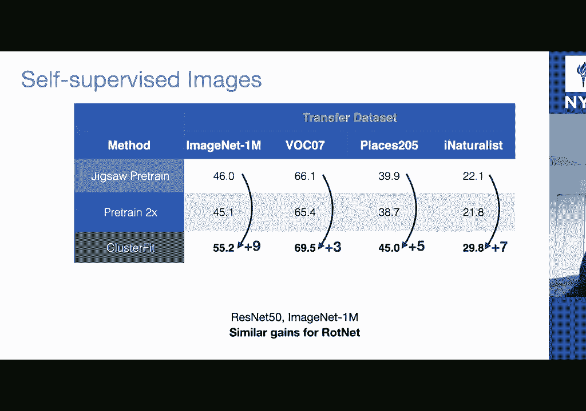

这引导我们走向**对比学习**。对比学习的核心思想是：**拉近相关样本（“正样本对”）在特征空间中的距离，同时推远不相关样本（“负样本对”）的距离**。

关键问题在于如何定义“相关”和“不相关”。在自监督设定下，正样本对通常来自：
*   同一张图像的不同数据增强视图（如不同的裁剪、颜色抖动）。
*   同一视频中时间上接近的帧。
*   匹配的视频和音频片段。

负样本则通常来自不同的图像或视频。

---

## 6. 前沿方法示例：聚类与不变性 🚀

上一节我们引入了对比学习的框架，本节我们通过两个具体的前沿工作来深入理解。

### 方法一：深度聚类
**核心思想**：迭代地进行**聚类**和**拟合**。
1.  **聚类步骤**：用一个网络（可以是任何预训练网络）提取所有图像的特征，然后对这些特征进行K-means聚类，为每张图像分配一个伪聚类标签。
2.  **拟合步骤**：训练一个新的网络，目标仅仅是预测第一步中生成的伪聚类标签。

**为什么有效**：聚类步骤剥离了原始网络中可能与下游任务无关的细节噪声，只保留了“哪些图像应该聚在一起”的核心分组信息。新网络学习预测这些分组，从而获得更泛化的表示。

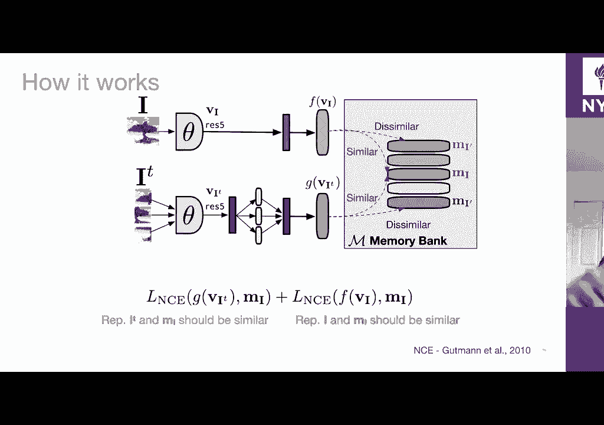

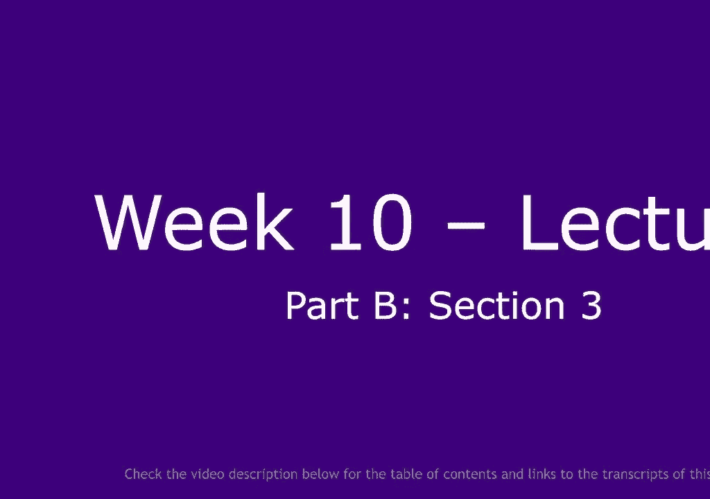

### 方法二：PIRL（代理任务不变表示学习）
**核心思想**：不再让网络预测具体的变换（如拼图的排列方式），而是让网络学习一个**对变换不变的表示**。
*   给定一张图像 `I` 及其经过变换（如拼图）的版本 `I_T`。
*   分别提取它们的特征 `f(I)` 和 `g(I_T)`。
*   训练目标不是预测变换 `T`，而是让 `f(I)` 和 `g(I_T)` 在特征空间中尽可能相似（同时与其他图像的特征不相似）。

**为什么有效**：它直接优化了表示的不变性，迫使网络忽略无关的变换，专注于捕捉图像中更本质的、语义上的内容。实验表明，这种方法学习到的表示在各个层（包括最后一层）都保持了良好的语义性，在下游任务上表现优异。

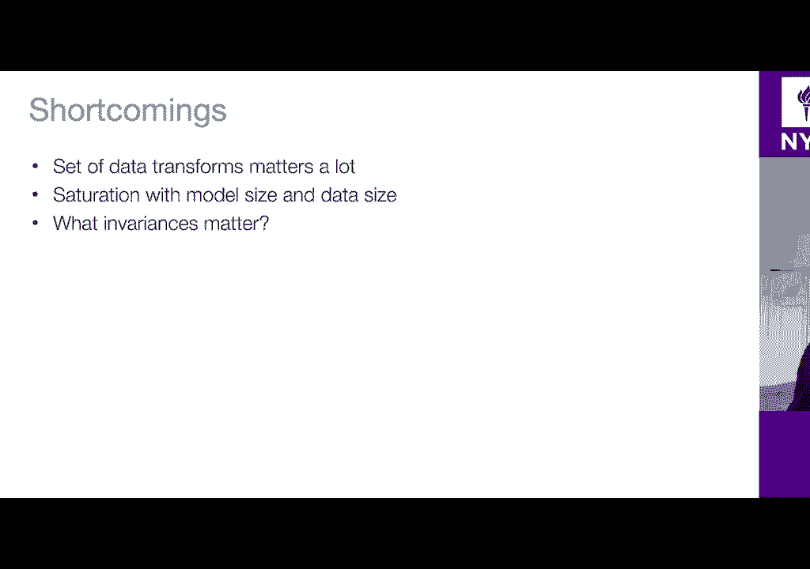

---

## 7. 评估与总结 📊

### 如何评估自监督学习方法？
评估通常分为两种方式：
1.  **线性评估**：冻结预训练好的特征提取器，只在其提取的特征上训练一个简单的线性分类器。这直接测试了特征本身的质量。
2.  **微调评估**：将预训练模型作为初始化，在下游任务上微调所有网络参数。这测试了预训练作为起点的好坏。

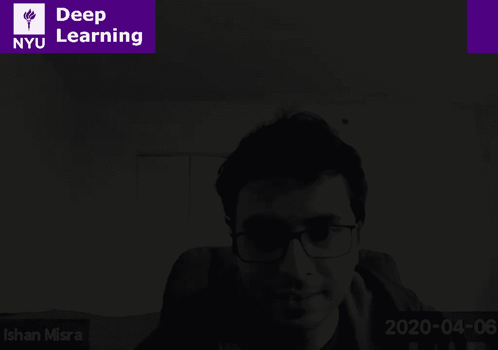

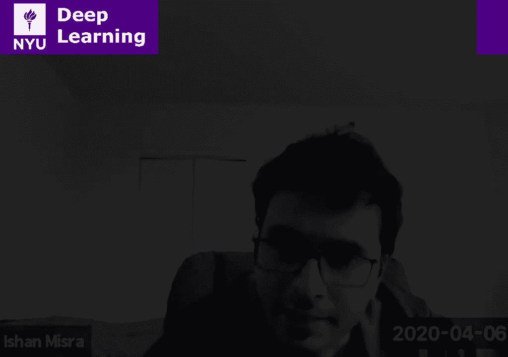

重要的是要在**多种不同的下游任务**（如图像分类、目标检测、表面法线估计、姿态估计）上进行评估，以全面衡量表示的泛化能力。

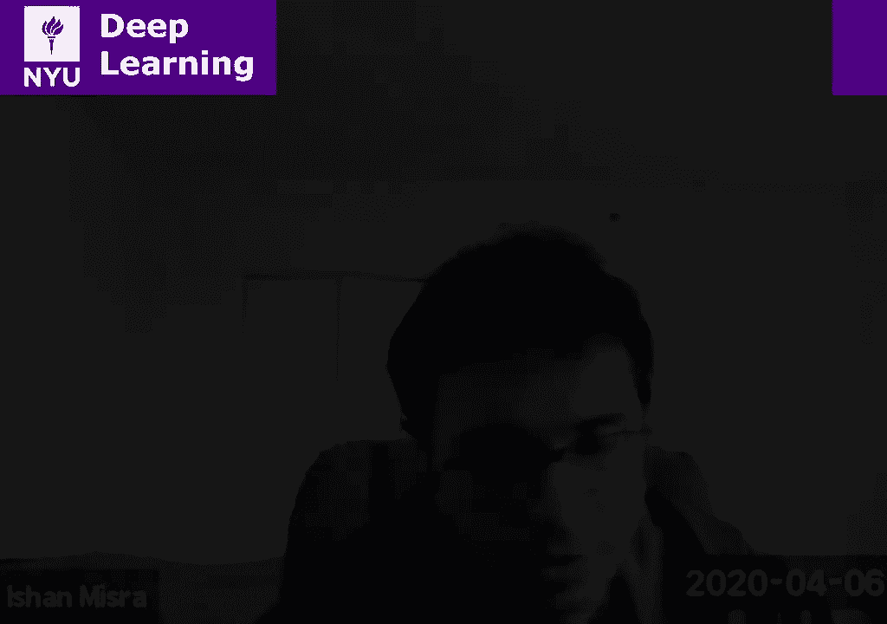

### 总结
在本节课中，我们一起学习了：
*   **动机**：人工标注数据的局限性催生了利用数据自身结构进行学习的自监督方法。
*   **核心思想**：通过设计“代理任务”，从数据中自动生成监督信号来学习表示。
*   **经典方法**：包括相对位置预测、旋转预测、着色、上下文编码等图像代理任务，以及利用时序和多模态信息的视频、音频任务。
*   **演进方向**：从解决具体的、协变的代理任务，发展到通过**对比学习**框架来学习**不变**的、**聚类友好**的表示。深度聚类和PIRL等工作代表了这一方向上的进展。
*   **关键认识**：一个好的视觉表示应该能够将语义相似的样本聚集起来，并对不重要的视觉变换保持不变。

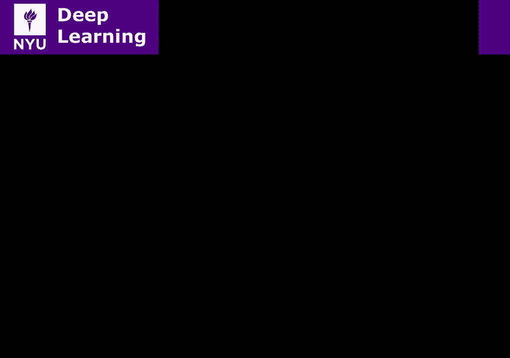

自监督学习正在减少机器学习对大量标注数据的依赖，为从更丰富、更原始的数据中学习通用表示开辟了道路。