# 20：激活函数与损失函数详解 🧠

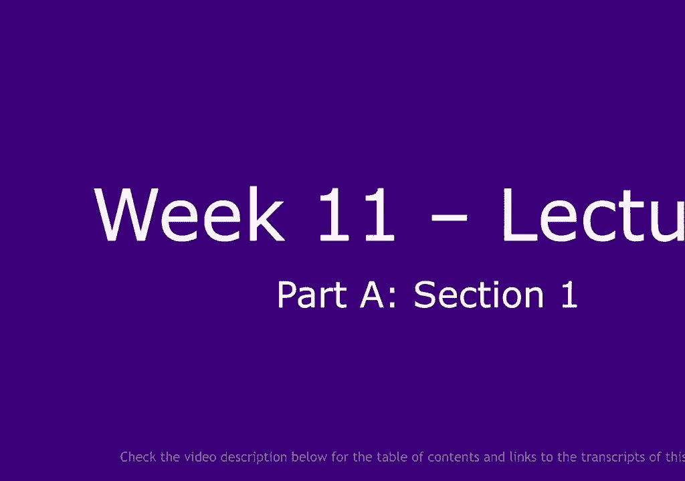

在本节课中，我们将学习 PyTorch 中常用的激活函数和损失函数。我们将了解它们的基本原理、适用场景以及如何在实际模型中选择和使用它们。通过本课程，你将能够更好地理解神经网络中非线性变换和优化目标的作用。

---

## 激活函数回顾 🔄

上一节我们介绍了课程的主要内容，本节中我们来看看激活函数。激活函数为神经网络引入了非线性，使其能够学习复杂模式。PyTorch 中定义了许多激活函数，它们大多源自各种研究论文，作者声称特定函数在其问题上表现更好。

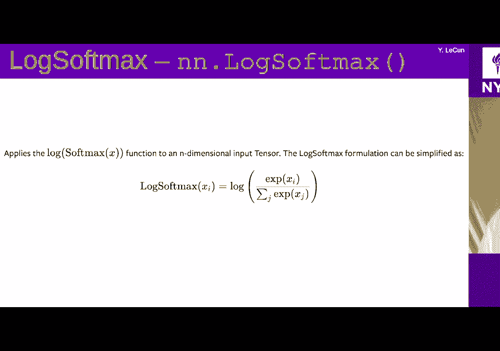

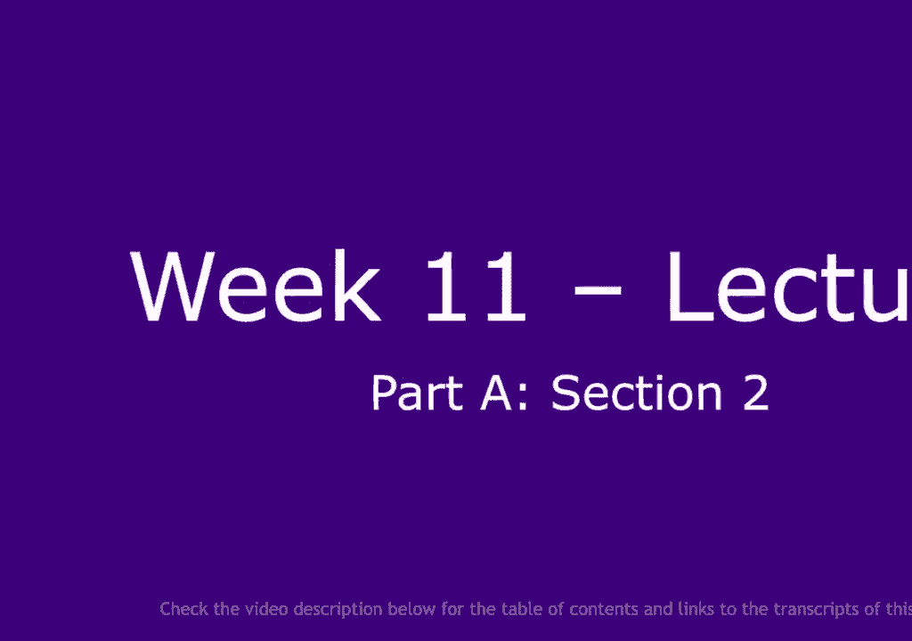

以下是几种常见的激活函数及其变体：

*   **ReLU (Rectified Linear Unit)**: 非常标准的激活函数，公式为 `f(x) = max(0, x)`。
*   **Leaky ReLU**: 允许负输入区域有一个小的正斜率，公式为 `f(x) = max(ax, x)`，其中 `a` 是一个小的正常数。
*   **PReLU (Parametric ReLU)**: Leaky ReLU 的推广，其中负区域的斜率 `a` 是可学习的参数。
*   **RReLU (Randomized ReLU)**: 训练时负区域的斜率是随机采样的。
*   **ELU (Exponential Linear Unit)**: 在负区域使用指数函数，公式为 `f(x) = x if x > 0 else a*(exp(x)-1)`。

PReLU 等函数通过允许负区域传播梯度，解决了 ReLU 在负输入时梯度为零的问题，这对于训练非常“瘦”的网络或某些生成对抗网络（GAN）的生成器尤为重要。

---

## 具有尺度参数的激活函数 ⚖️

上一节我们讨论了单拐点函数，本节中我们来看看那些输出受输入信号幅度影响的函数，它们具有内置的尺度参数。

*   **Softplus**: 可视为 ReLU 的可微版本，公式为 `f(x) = (1/β) * log(1 + exp(βx))`。参数 `β` 控制拐点的锐利程度，`β` 越大越接近 ReLU。
*   **Sigmoid / Logistic 函数**: 平滑的 S 形函数，将输入映射到 (0, 1) 区间，公式为 `f(x) = 1 / (1 + exp(-x))`。常用于循环神经网络（RNN）的门控机制。
*   **Tanh (双曲正切)**: 与 Sigmoid 类似，但输出范围在 (-1, 1) 之间，具有近似零均值，有助于后续权重的更快收敛。
*   **Swish**: 由 Google 提出，公式为 `f(x) = x * sigmoid(βx)`。它饱和速度比 Tanh 慢，缓解了梯度消失问题。
*   **Hard Tanh**: 基本上是夹在 (-1, 1) 之间的线性斜坡。

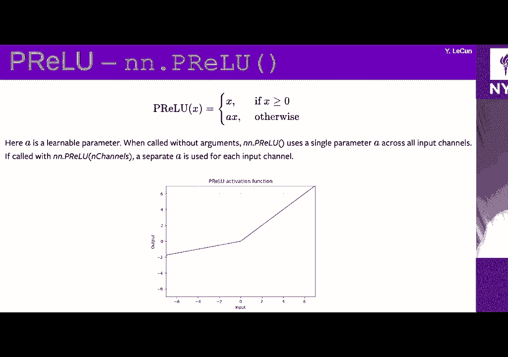

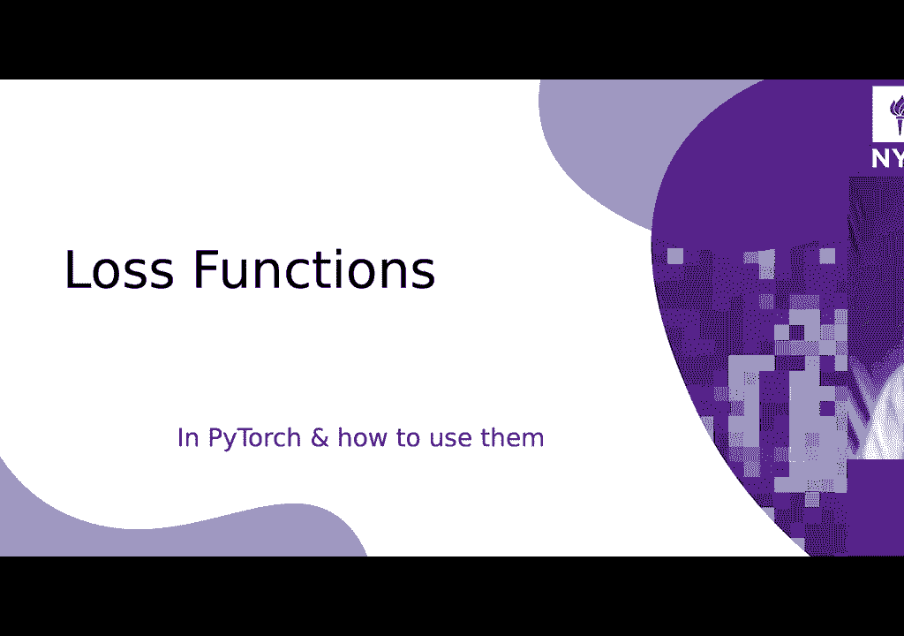

对于深度网络，单拐点函数（如 ReLU 族）通常比 Sigmoid 这类双饱和函数表现更好，部分原因在于其尺度等变性（输入乘以一个因子，输出也乘以相同因子，函数形状不变）。而 Sigmoid/Tanh 的饱和特性在深层网络中容易导致梯度消失。批量归一化（BatchNorm）等技术通过固定输入的尺度，部分缓解了这个问题。

---

## 其他特殊用途的非线性函数 🛠️

除了作为神经元的激活函数，还有一些非线性函数用于特定任务。

*   **Soft Shrinkage**: 主要用于稀疏编码等任务，将输入值向零收缩一个常数 λ，公式为 `f(x) = sign(x) * max(|x| - λ, 0)`。可以看作是 L1 正则化目标梯度下降的一步。
*   **Hard Shrinkage**: 将所有绝对值小于 λ 的输入直接置零。
*   **LogSoftmax**: 通常不单独作为激活函数，而是与负对数似然损失结合，用于多分类问题的输出层，数值上更稳定。
*   **Softmin**: 与 Softmax 类似，但将输入视为惩罚（负能量）而非分数。

Softmax 在注意力机制（如 Transformer）中是必需的，因为它能将一组分数归一化为概率分布，迫使模型集中注意力。其中的温度参数 `β` 控制分布的“硬度”，`β` 越大分布越尖锐（接近 one-hot）。训练初期可使用较小的 `β`（软分布）以获得平滑梯度，后期增大 `β`（退火）以获得更确定的决策，这在混合专家系统（MoE）中很有用。

---

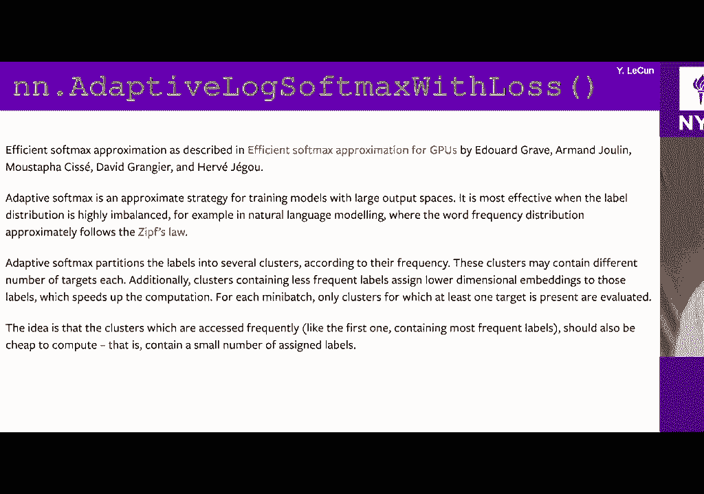

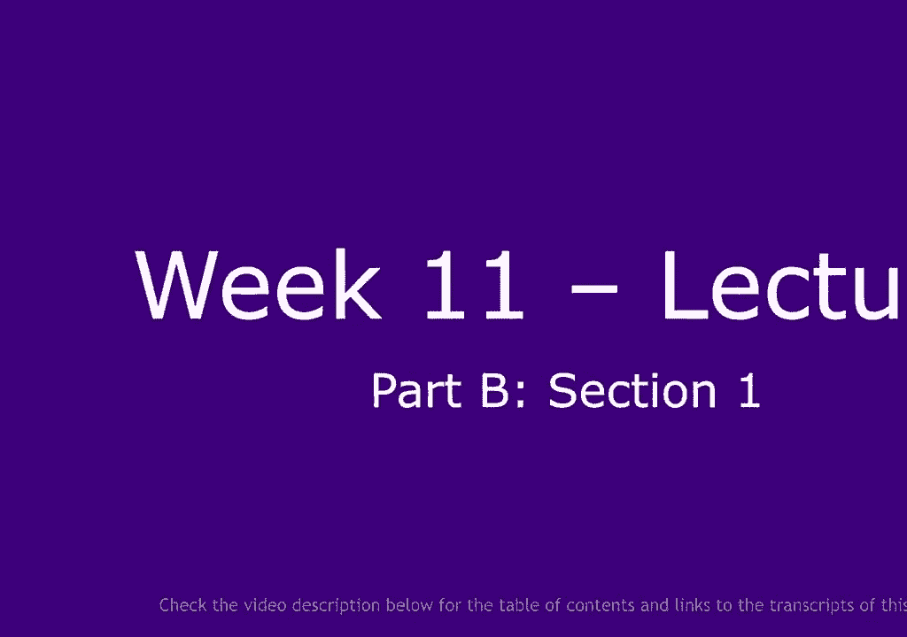

## 损失函数概览 📉

上一节我们介绍了各种非线性变换，本节中我们来看看如何定义模型的优化目标，即损失函数。PyTorch 提供了丰富的损失函数。

以下是几种基础的回归和分类损失：

*   **均方误差 (MSE)**: `L = (y_pred - y_true)^2` 的均值。最小化 MSE 会使预测值接近目标值的平均值，在图像预测中可能导致模糊。
*   **L1 损失**: `L = |y_pred - y_true|` 的均值。最小化 L1 损失会使预测值接近目标值的中位数，对异常值更鲁棒，可能产生更清晰的图像预测。
*   **Smooth L1 损失/Huber 损失**: 在零点附近使用二次函数，远处使用线性函数，平衡了 MSE 和 L1 的优点。
*   **负对数似然损失 (NLLLoss)**: 用于分类，直接最大化正确类别的分数（或最小化其负对数）。
*   **交叉熵损失 (CrossEntropyLoss)**: 通常指 **LogSoftmax + NLLLoss** 的合并版本。这是多分类最常用的损失，数值稳定。其本质是缩小模型预测分布与真实 one-hot 分布之间的 KL 散度。
*   **二元交叉熵损失 (BCELoss)**: 用于二分类，输入需经过 Sigmoid 处理。
*   **带 Logits 的二元交叉熵损失 (BCEWithLogitsLoss)**: 合并了 Sigmoid 和 BCELoss，数值上更稳定。

在类别不平衡问题中，不建议直接使用损失函数的类别权重参数，更好的做法是过采样稀有类别，使每个批次的类别频率均衡，以确保网络能为稀有类别学习到好的特征。训练后期可再用真实分布对输出层偏置进行微调。

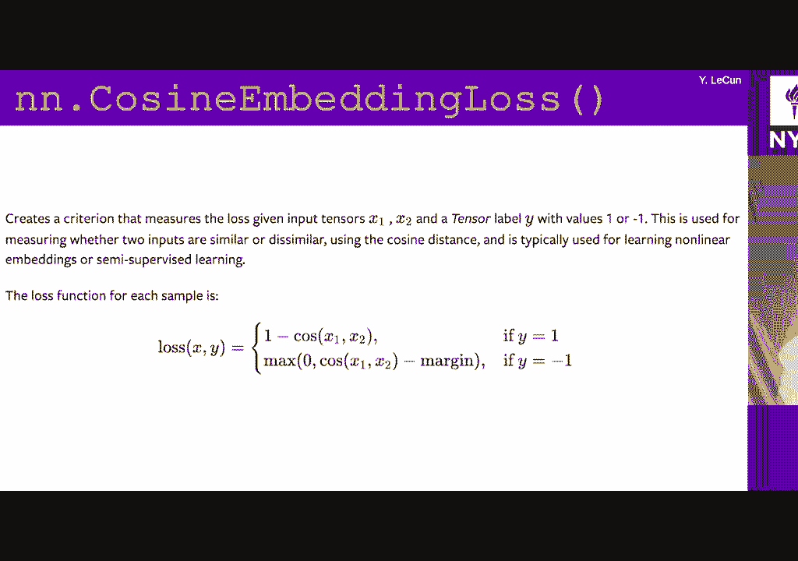

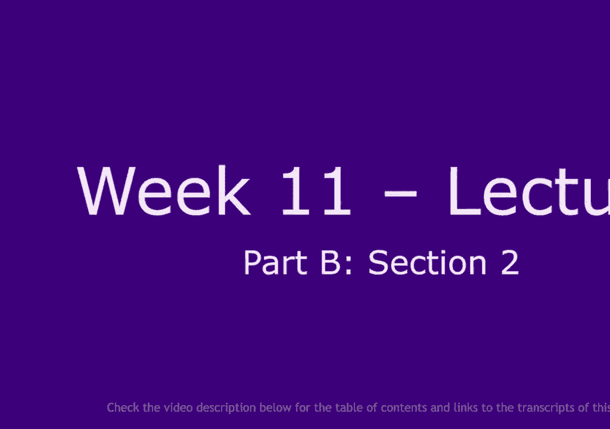

---

## 边际损失与结构化损失 🎯

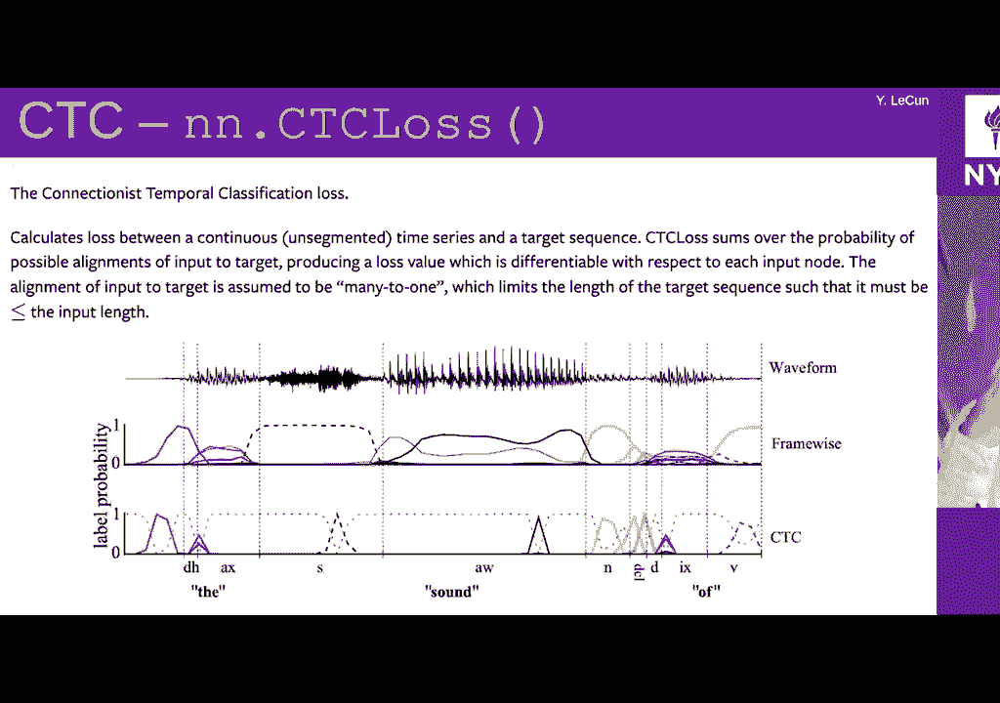

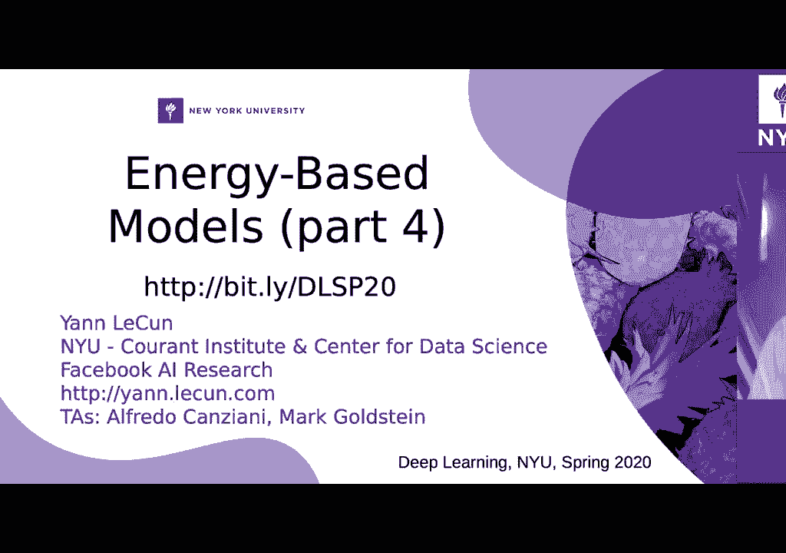

对于排序、度量学习或结构化预测任务，我们需要特殊的损失函数。

*   **边际排序损失 (MarginRankingLoss)**: 要求一对输入中第一个比第二个大至少一个边际值 `margin`。公式为 `L = max(0, -y * (x1 - x2) + margin)`，其中 `y` 指示期望的排序方向。
*   **三元组损失 (TripletMarginLoss)**: 用于度量学习。给定锚点样本 `a`、正样本 `p` 和负样本 `n`，损失函数为 `L = max(0, d(a, p) - d(a, n) + margin)`。它拉近 `a` 和 `p` 的距离，推远 `a` 和 `n` 的距离。
*   **余弦嵌入损失 (CosineEmbeddingLoss)**: 用于训练 Siamese 网络，基于余弦相似度。它鼓励相似样本的余弦相似度接近 1，不相似样本的余弦相似度小于某个边际 `margin`。
*   **连接主义时间分类损失 (CTCLoss)**: 用于序列标注任务（如语音识别），其中输入和输出序列长度可变且未对齐。它通过动态规划求最佳对齐路径，并计算损失，是可微的。

这些边际损失是构建能量基础模型（Energy-Based Models）的基础。一个好的损失函数应确保正确答案的能量低于错误答案的能量，且至少有一个边际差。例如，合页损失（Hinge Loss）及其变体就符合这一原则。

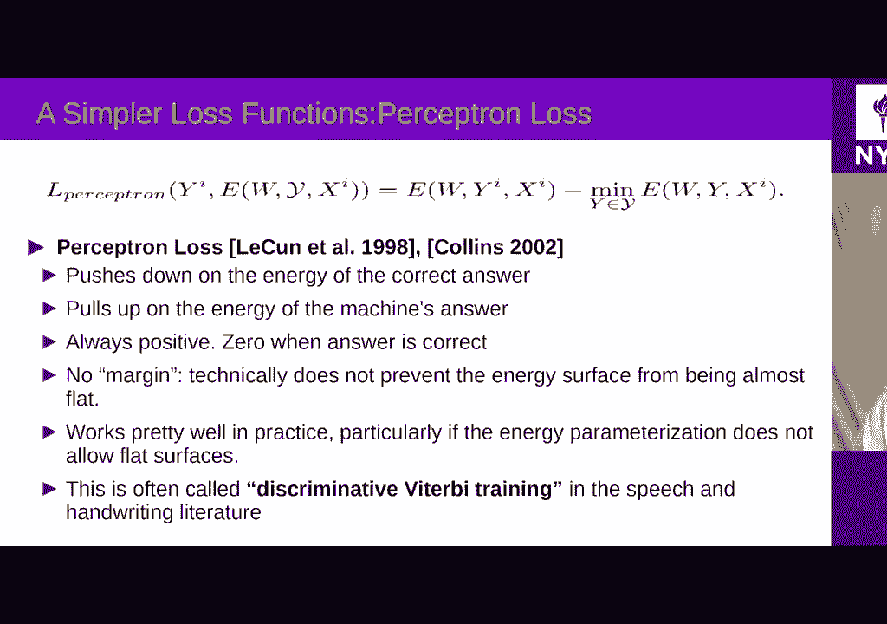

---

## 能量基础模型与损失函数设计 ⚡

更一般地，我们可以在能量基础模型（EBM）的框架下理解损失函数。在 EBM 中，模型输出一个能量函数 `E(W, Y, X)`，低能量对应好答案。

损失函数 `L` 是能量函数 `E` 和训练集 `S` 的泛函。通过最小化 `L` 来学习参数 `W`。设计 `L` 的关键是：它必须使正确样本的能量降低，同时使（至少某些）错误样本的能量升高。

*   **能量损失 (Energy Loss)**: 仅最小化正确答案的能量 `E(W, Y_i, X_i)`。这可能导致能量面整体塌缩（所有输出能量都低），除非模型结构有特殊约束。
*   **负对数似然损失 (NLL)**: 在 EBM 框架下表现为 `L = E(W, Y_i, X_i) + (1/β) log(∑_y exp(-βE(W, y, X_i)))`。第一项压低正确答案能量，第二项（对数配分函数）抬高所有答案的能量。
*   **感知器损失 (Perceptron Loss)**: `L = E(W, Y_i, X_i) - min_y E(W, y, X_i)`。仅保证正确答案能量不高于最小能量，但允许所有能量相等，不适合非线性模型。
*   **合页损失 (Hinge Loss)**: `L = max(0, E(W, Y_i, X_i) - min_{y≠Y_i} E(W, y, X_i) + m)`。确保正确答案能量比最冒犯的错误答案能量至少低一个边际 `m`，是良好的损失函数。
*   **平方平方损失 (Square-Square Loss)**: 类似合页损失，但使用平方项。

对于连续或高维的 `Y`，如何选择“最冒犯的错误答案” `Ȳ` 是一个挑战，这引出了对比学习（Contrastive Learning）中的各种负采样策略。

---

## 总结 🎓

本节课中我们一起学习了 PyTorch 中的核心组件：激活函数和损失函数。

*   **激活函数**为网络引入非线性。我们学习了 ReLU 族、Sigmoid/Tanh 族以及 Swish 等函数，理解了它们的特性（如单调性、尺度敏感性）和适用场景（如深度网络偏好单拐点函数，注意力机制需要 Softmax）。
*   **损失函数**定义了模型的优化目标。我们回顾了 MSE、L1、交叉熵等标准损失，并深入了解了边际损失（如三元组损失）和结构化损失（如 CTCLoss）在排序、度量学习和序列预测中的应用。
*   最后，我们从**能量基础模型**的视角统一审视了损失函数的设计哲学，即一个好的损失应同时压低正确答案的能量并抬高错误答案的能量。

掌握这些函数的工作原理和适用条件，将帮助你更有效地构建、调试和优化神经网络模型。