# 22：深度学习在自然语言处理中的应用 🧠

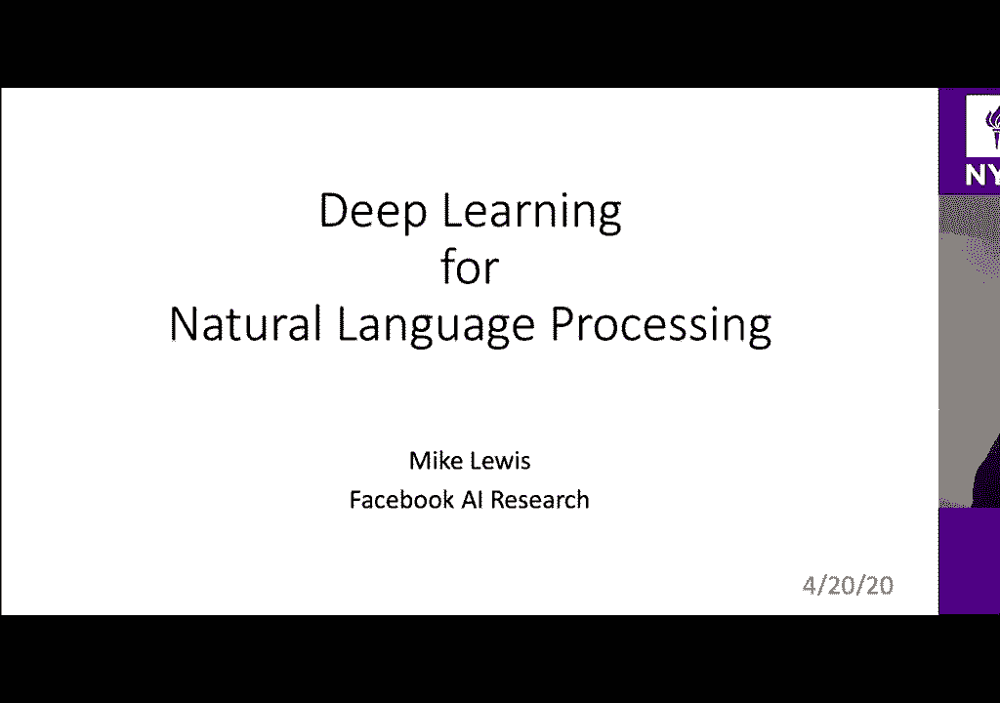

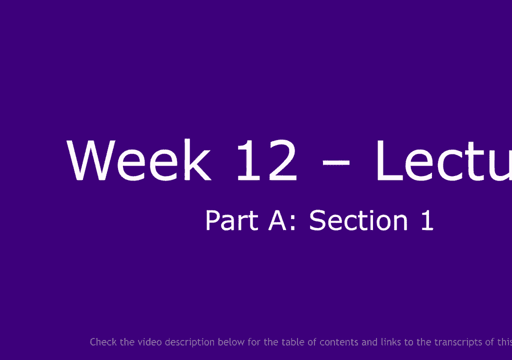

在本节课中，我们将学习深度学习在自然语言处理领域的关键技术和模型。我们将从语言建模的基础概念开始，逐步深入到Transformer架构、序列到序列模型以及自监督学习等核心内容。课程旨在为初学者提供一个清晰、全面的概览。

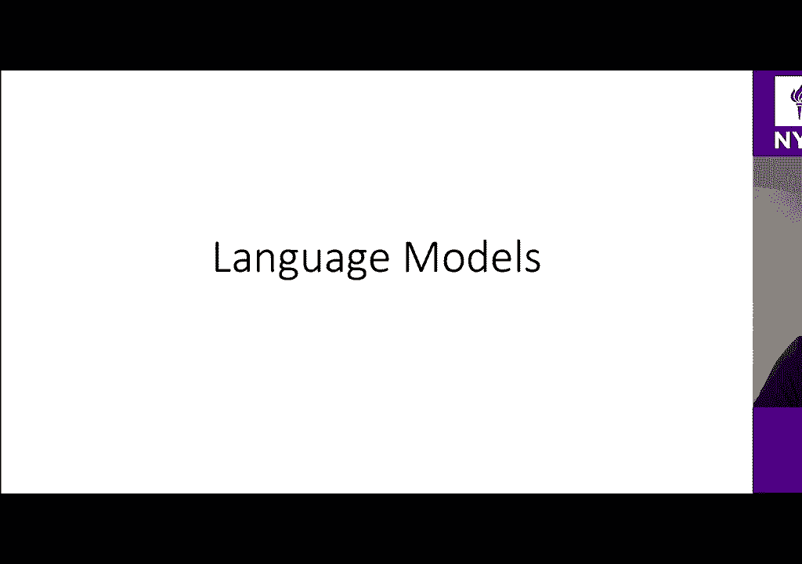

---

## 语言建模 📖

上一节我们介绍了课程的整体框架，本节中我们来看看什么是语言建模。语言建模本质上是一个密度估计问题，它为所有可能的字符串分配概率，目标是让流利的英语句子获得更高的概率。

由于可能的句子数量呈指数级增长，我们无法直接预测所有分类。最广泛使用的方法是利用链式法则将联合分布分解。具体来说，我们预测第一个单词，然后在给定第一个单词的条件下预测第二个单词，依此类推。

**公式表示：**
`P(句子) = P(单词1) * P(单词2 | 单词1) * P(单词3 | 单词1, 单词2) * ...`

这样，我们将密度估计问题转化为一系列分类问题：给定一段文本，预测下一个单词是什么。

以下是构建语言模型的基本步骤：
1.  将文本输入神经网络。
2.  神经网络将上下文映射为一个向量表示。
3.  该向量与一个大型词向量矩阵（包含模型已知的所有单词）进行点积运算，计算相似度。
4.  通过Softmax函数得到下一个单词的概率分布。
5.  模型通过最大似然估计进行训练。

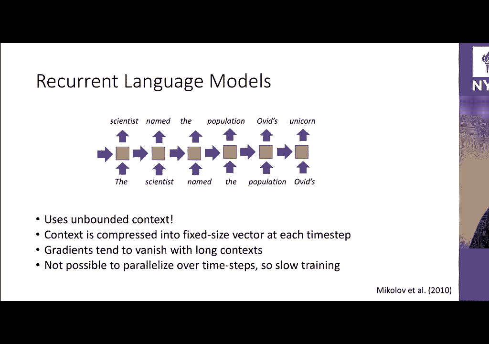

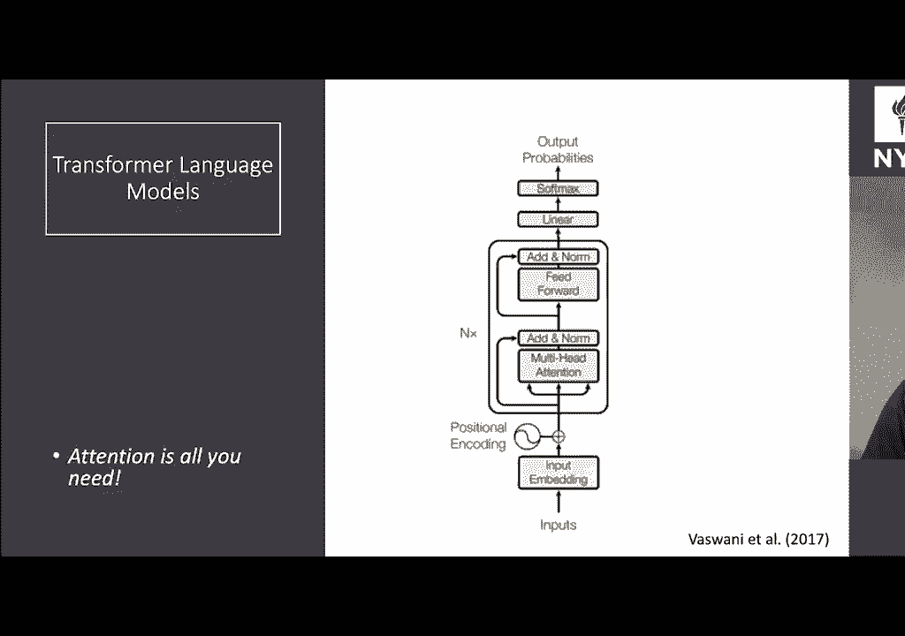

> 注意：在实际操作中，我们通常不直接处理整个单词，而是处理子词（subword）甚至字符，但建模技术保持不变。

---

## 上下文编码器：从CNN、RNN到Transformer 🔄

上一节我们介绍了语言建模的基本框架，本节中我们来看看如何构建上下文编码器。早期，人们主要使用卷积神经网络和循环神经网络。

### 卷积神经网络

CNN编码了语言的归纳偏置，即无论短语出现在什么位置，都应以相同的方式解释。典型的CNN语言模型首先将每个单词映射为一个向量（通过嵌入矩阵查找），然后应用多层一维卷积和非线性变换，最终得到一个代表上下文并用于预测下一个单词的向量。

**优点：** 模型非常快，适合处理大量训练数据。
**缺点：** 感受野有限，只能基于固定窗口内的前文进行预测，难以建模长距离依赖。

### 循环神经网络

RNN，特别是LSTM，是几年前最流行的方法。其核心思想是在每个时间步保持一个状态，该状态结合了之前的历史信息和当前输入的单词，并不断迭代更新。

**优点：** 至少在原理上，可以对无限长的上下文进行建模。
**缺点：**
1.  **信息瓶颈：** 需要将整个文档历史压缩到单个向量中。
2.  **梯度消失：** 过去单词的影响会随时间步呈指数级衰减，难以学习长期依赖。
3.  **训练缓慢：** 由于顺序计算的性质，无法充分利用GPU的并行能力。

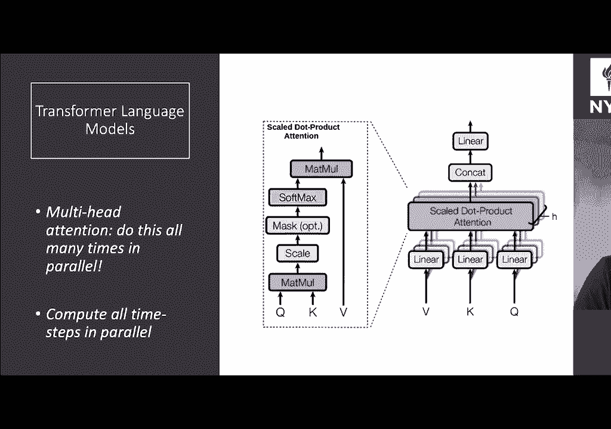

### Transformer：当前的解决方案

Transformer是当前最先进的NLP模型。它于2017年通过论文《Attention Is All You Need》引入，彻底改变了该领域。

一个Transformer块包含两个主要子层：
1.  **多头自注意力机制：** 这是Transformer的核心，允许模型直接关注输入序列中的任何位置。
2.  **前馈神经网络：** 一个具有表达力的多层感知机。

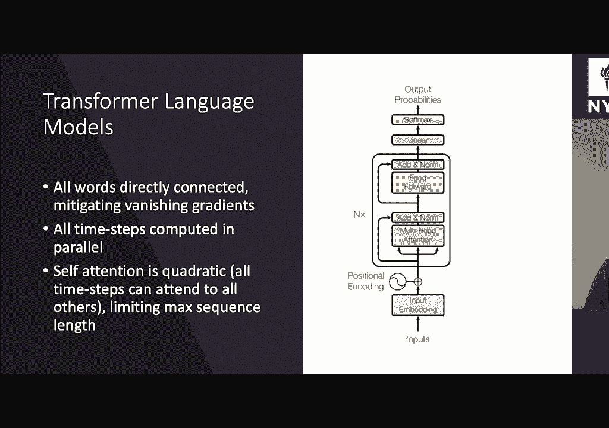

此外，还有残差连接和层归一化，这些技术对于稳定训练深度模型至关重要。

**为什么使用多头注意力而不是单头？**
预测下一个单词需要同时关注上下文中的多种不同信息。多头注意力允许模型并行地关注来自不同表示子空间的信息。例如，一个头可能关注句法信息（如之前的形容词），另一个头可能关注语义信息（如主题）。

**为什么需要掩码？**
在训练语言模型时，我们使用自回归分解，即单词只能基于之前的单词进行预测。为了防止模型在训练时“偷看”未来的单词，我们使用上三角掩码矩阵（将未来位置的注意力分数设为负无穷大），确保每个位置只关注它之前的输出。

**位置编码：**
自注意力机制本身对输入顺序不敏感。为了注入序列的顺序信息，我们在输入词向量中添加了位置编码向量。这可以是学习得到的嵌入，也可以是使用正弦和余弦函数生成的固定编码。

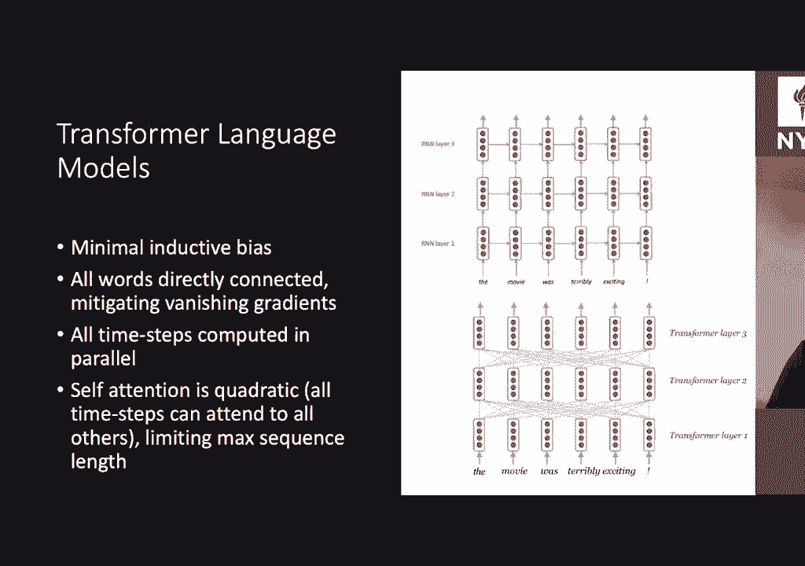

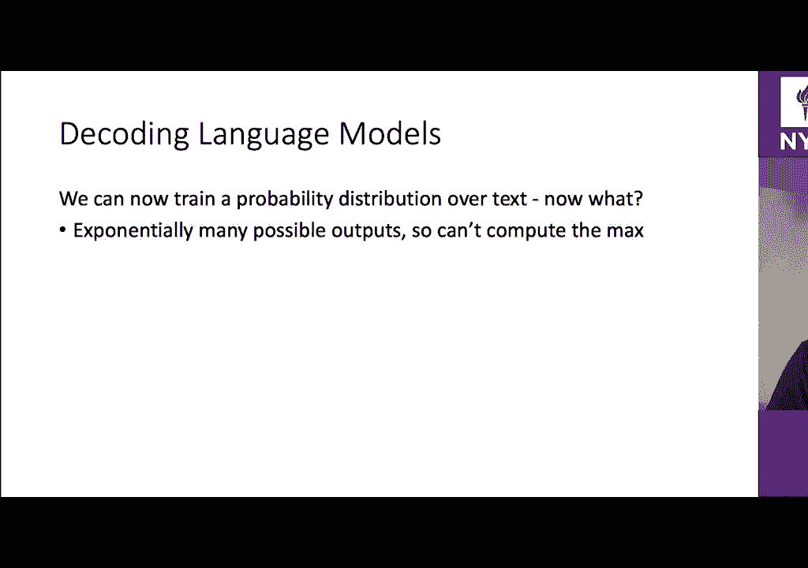

**Transformer的优势：**
1.  **强大的建模能力：** 每个单词可以直接访问所有先前单词的表示，避免了RNN的信息压缩瓶颈和梯度消失问题。
2.  **高度并行化：** 自注意力操作可以同时计算所有时间步，充分利用现代硬件。
3.  **优秀的扩展性：** 模型性能随着参数规模和数据量的增加而持续提升。

> **局限性：** 自注意力的计算复杂度是序列长度的二次方，这限制了其直接处理超长文档（如整本书）的能力。目前有大量研究致力于开发高效的Transformer变体来解决这个问题。

---

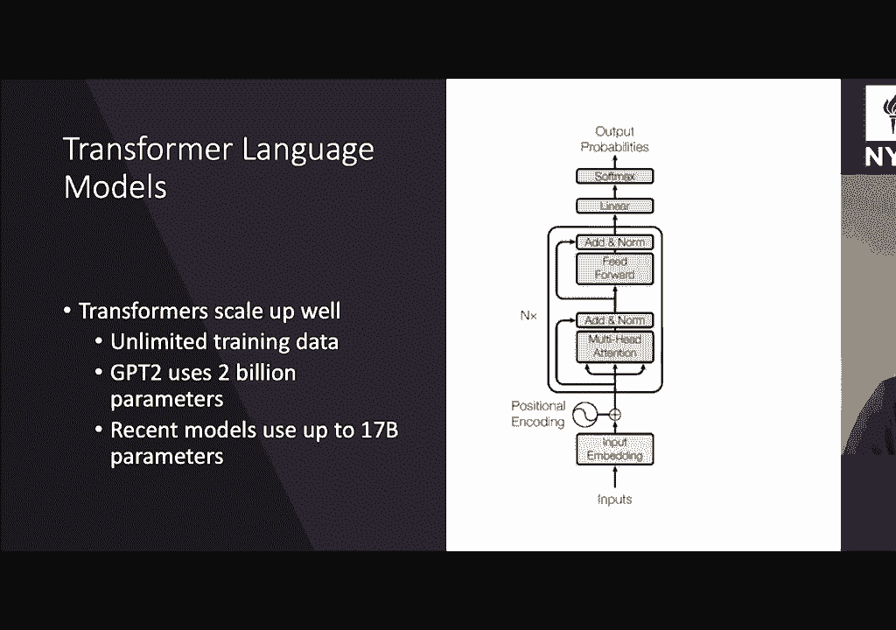

## 解码与生成：从贪婪搜索到Top-k采样 🎲

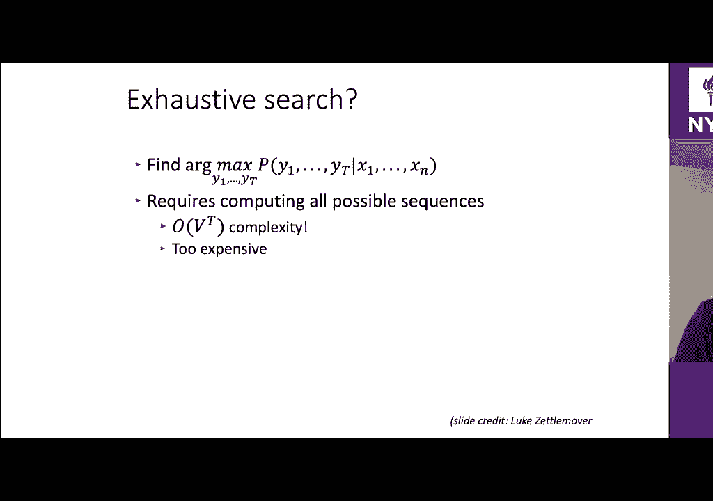

上一节我们了解了如何训练一个强大的语言模型，本节中我们来看看如何从训练好的模型中生成文本。我们不仅想要模型给出概率，还想让它创造出像样的句子。

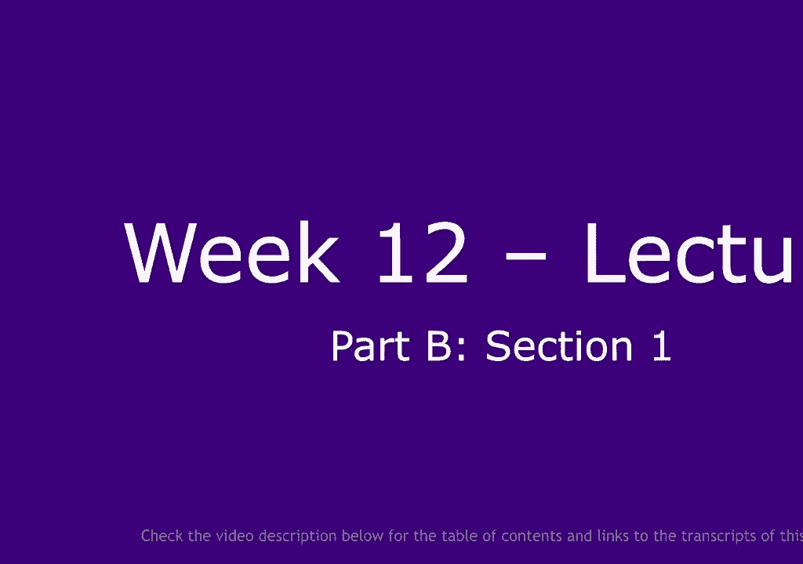

简单地找到全局概率最高的序列是计算不可行的。常见的解码策略包括：

### 贪婪解码
每一步都选择当前概率最高的单词。这种方法不能保证得到全局最优序列，且无法回溯。

### 集束搜索
集束搜索尝试跟踪一个大小为k的最佳假设列表。在每一步，它为列表中的每个假设扩展所有可能的下一单词，然后只保留总得分最高的k个新假设。

**算法步骤：**
1.  初始化集束，包含一个空的起始假设。
2.  对于每个生成步骤：
    *   为当前集束中的每个假设计算下一个单词的概率分布。
    *   从所有扩展假设中选出总对数概率最高的k个。
    *   用这k个新假设更新集束。
3.  当假设生成结束标记（如`<EOS>`）时，将其移出集束并放入“已完成”列表。
4.  重复步骤2-3，直到生成了足够数量的完整假设或达到最大长度。
5.  从“已完成”列表中选择得分最高的假设作为输出。

**存在的问题：**
*   **暴露偏差：** 模型在训练时只见过真实的前缀，而在集束搜索时可能会遇到自己生成的错误前缀，导致性能下降。
*   **退化与重复：** 集束搜索有时会陷入重复循环或生成通用、乏味的文本。

### 采样与Top-k采样
另一种思路是从模型的概率分布中随机采样下一个单词，这能增加多样性。但纯随机采样容易产生不连贯的文本。

**Top-k采样**是一种改进方法：在每一步，只从概率最高的k个候选词中采样。这既保持了随机性带来的多样性，又避免了选择长尾分布中那些奇怪的低概率词。

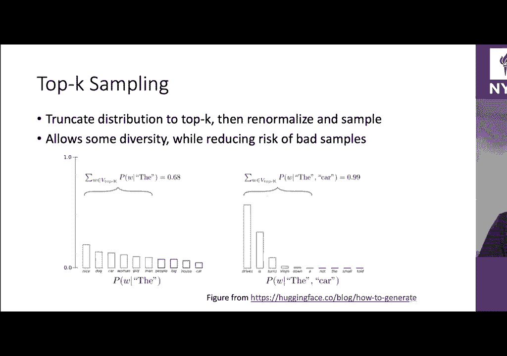

> 许多令人印象深刻的文本生成示例（如GPT-2的新闻文章）都使用了类似Top-k采样的技术。这是一种经验上有效但理论不尽完美的解码方法。

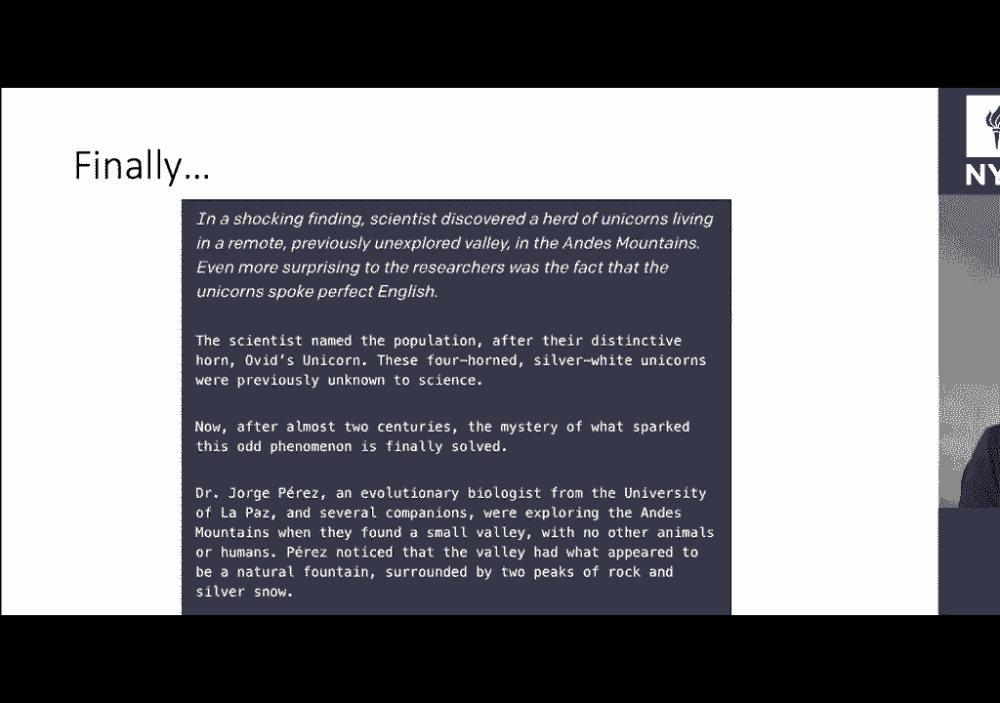

---

## 序列到序列模型与条件生成 🌉

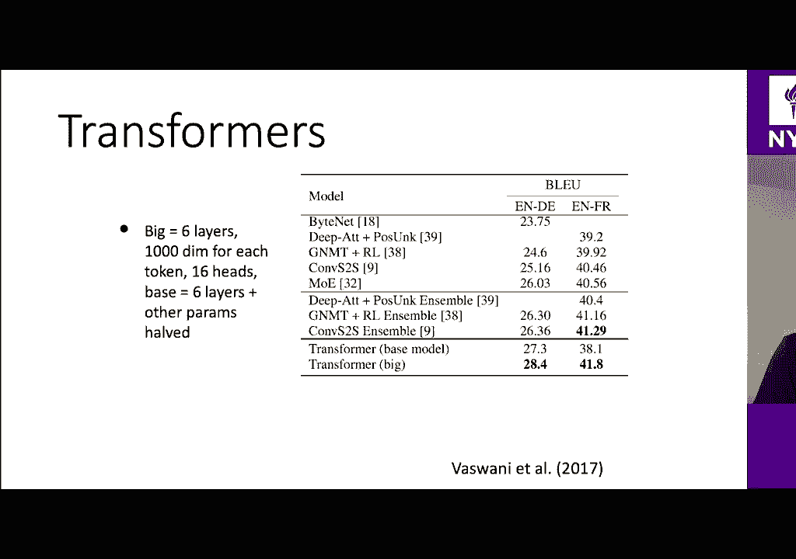

上一节我们讨论了无条件语言模型的解码，本节中我们来看看更有用的条件语言模型，即序列到序列模型。这类模型接收一个输入序列（如法语句子），并生成一个输出序列（如英语翻译）。

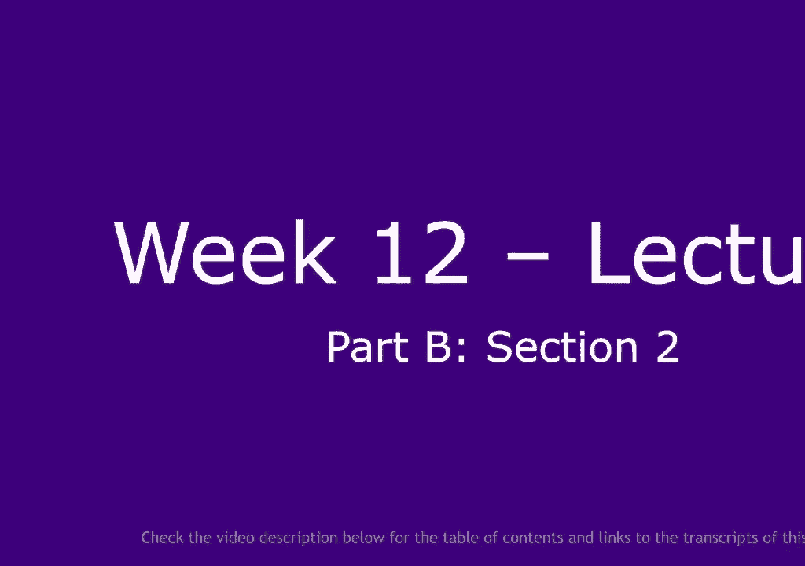

早期的Seq2Seq模型使用编码器-解码器架构，编码器将输入压缩为一个“思想向量”，解码器再用它来初始化并生成输出。这种架构存在信息瓶颈。

现代的Seq2Seq模型使用**Transformer编码器-解码器**架构：
*   **编码器堆栈：** 处理输入序列，其自注意力层可以查看输入中的所有单词（双向）。
*   **解码器堆栈：** 生成输出序列。除了自注意力层（需使用掩码确保自回归属性），还增加了一个**交叉注意力层**，用于关注编码器的最终输出。这使得输出中的每个单词都能直接与输入中的所有单词交互。

### 利用单语数据：反向翻译
对于像机器翻译这样的任务，高质量的平行语料（双语对照文本）是稀缺的。反向翻译是一种利用大量单语数据的技术。

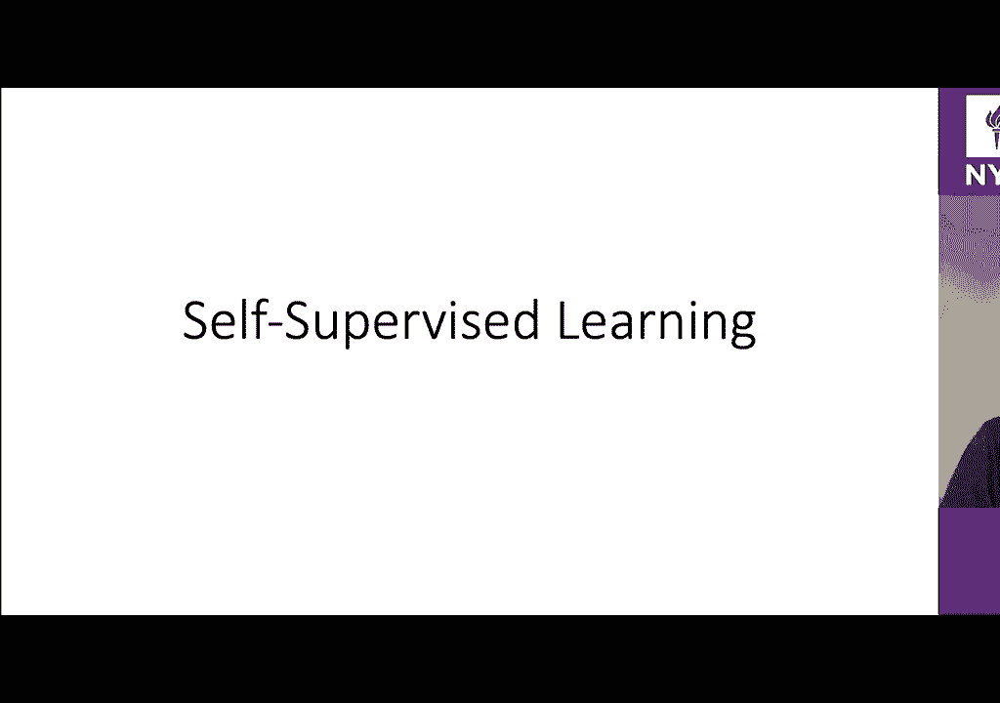

**步骤：**
1.  训练一个反向翻译模型（如英语->德语）。
2.  用这个模型将大量的单语英语文本翻译成德语，得到“合成”的平行语料（可能包含噪音的德语句子 + 干净的英语句子）。
3.  用这些合成数据，连同原有的真实平行语料，一起训练正向翻译模型（德语->英语）。

这种方法可以显著提升翻译质量，尤其是在低资源语言对上。

---

## 自监督学习：从Word2Vec到BERT 🎯

上一节我们介绍了需要平行数据的条件生成任务，本节中我们来看看如何利用海量的无标签文本进行自监督学习。这是近年来NLP取得突破的关键。

自监督学习的核心思想是：从数据本身构造监督信号。在NLP中，这意味着设计一个预训练任务，让模型通过完成这个任务来学习语言的通用知识。

### Word2Vec：上下文无关的词嵌入
Word2Vec通过“完形填空”任务学习词向量：给定一个句子和其中一个被掩码的词，模型根据周围上下文预测该词。这使语义相近的词在向量空间中位置接近。

**局限性：** 每个词只有一个静态向量，无法根据上下文区分多义词。

### ELMo：基于双向LSTM的上下文词嵌入
ELMo分别训练一个前向和一个后向的语言模型，然后将两个方向的表示拼接起来作为词的最终表示。这样，词的表示就依赖于其上下文了。

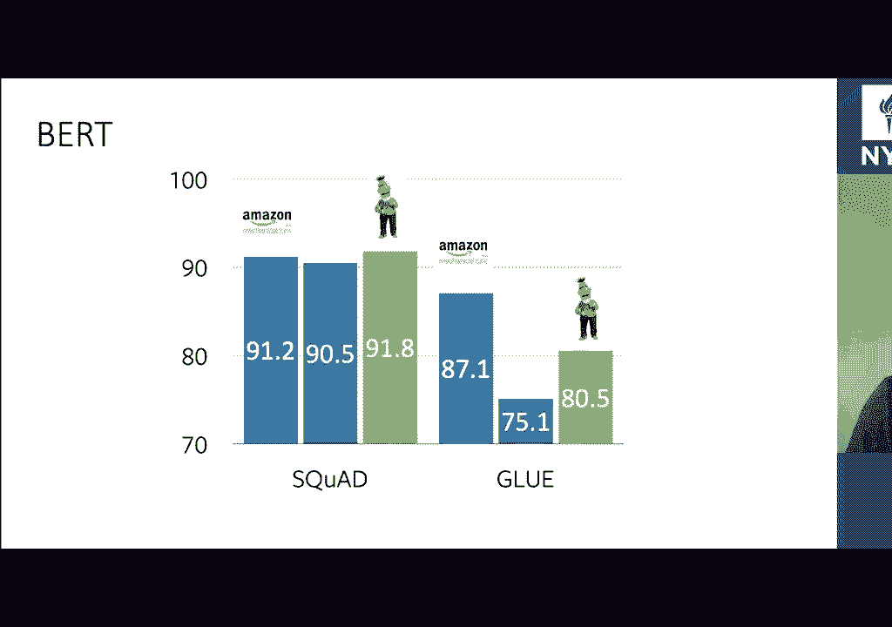

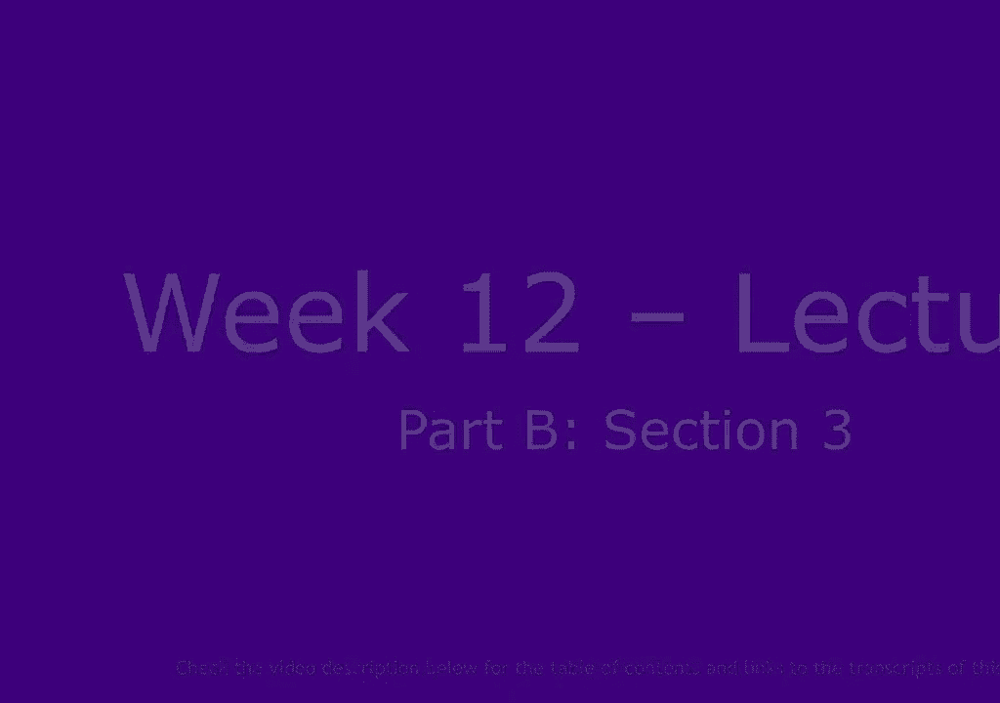

**局限性：** 表示是左右语境表示的浅层拼接，缺乏深层次交互。

### BERT：基于Transformer的双向编码器
BERT采用了**掩码语言模型**作为预训练任务：随机掩码输入句子中15%的单词，然后让模型预测这些被掩码的词。关键的是，BERT使用**Transformer编码器**，使得每个被掩码的词在预测时都能看到句子中所有其他单词（双向上下文），实现了深层次的交互。

**微调：** 预训练后，只需在BERT的顶部添加一个简单的输出层（如用于分类的线性层），就可以在下游任务（如情感分析、问答）上进行微调。这消除了为每个任务设计特定架构的需要。

**核心优势：** BERT及其后续模型（如RoBERTa, T5）证明了，使用一个简单的预训练目标（如掩码预测），配合巨大的模型容量和海量数据，可以让模型学到极其丰富的语言知识，并在众多NLP基准测试上达到接近人类的水平。

---

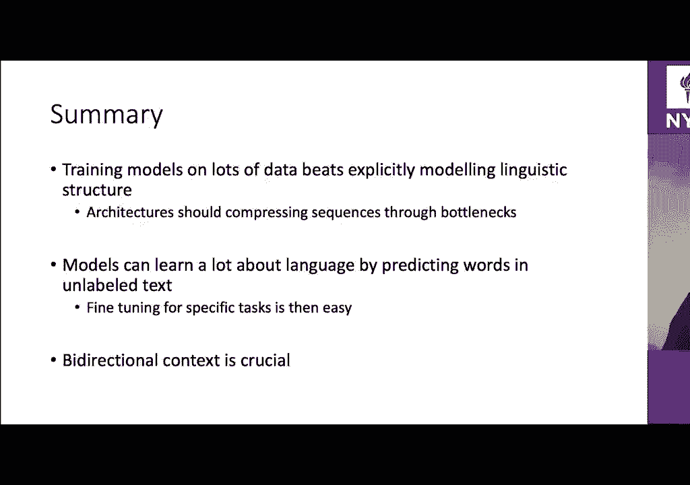

## 总结与展望 🚀

在本节课中，我们一起学习了深度学习在NLP中的核心进展。

我们从**语言建模**这一基础任务出发，探讨了如何构建上下文表示，并回顾了从**CNN、RNN到Transformer**的演进历程。Transformer凭借其强大的多头自注意力机制和并行计算能力，已成为当前的主流架构。

接着，我们学习了如何从训练好的模型中进行**解码与生成**，比较了贪婪搜索、集束搜索和Top-k采样等策略。然后，我们将模型扩展到了**序列到序列**的条件生成任务，并介绍了利用单语数据的**反向翻译**技术。

最后，我们深入探讨了推动这一切进步的引擎：**自监督学习**。从Word2Vec到BERT，我们看到了如何通过设计巧妙的预训练任务，让模型从海量无标签文本中学习通用语言表示，再通过微调轻松适应各种下游任务。

尽管取得了巨大成功，NLP领域仍面临许多开放性问题，例如：如何将外部知识或常识有效地整合到模型中？如何建模超长文档？如何让一个模型解决多种任务而无需针对每个任务单独微调？如何实现真正的少样本或零样本学习？

未来的研究将继续探索这些方向，而Transformer架构和自监督学习范式无疑将是这一探索旅程中的重要基石。