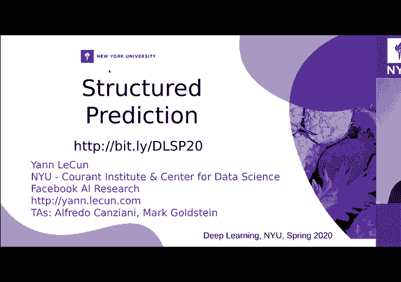
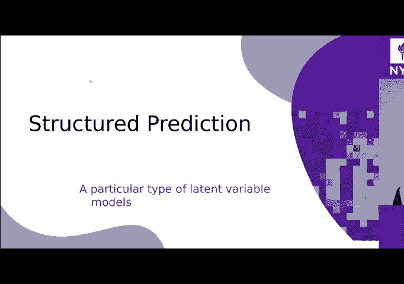
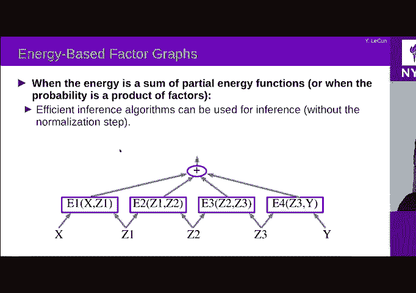
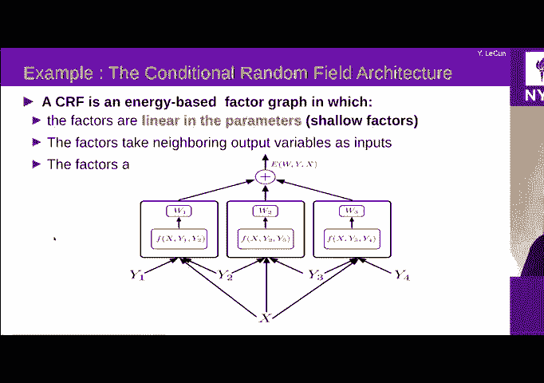
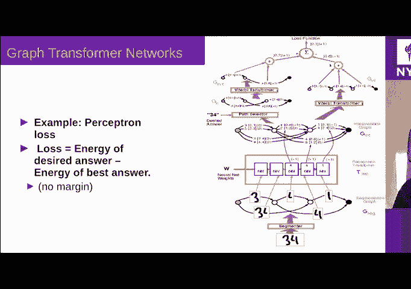
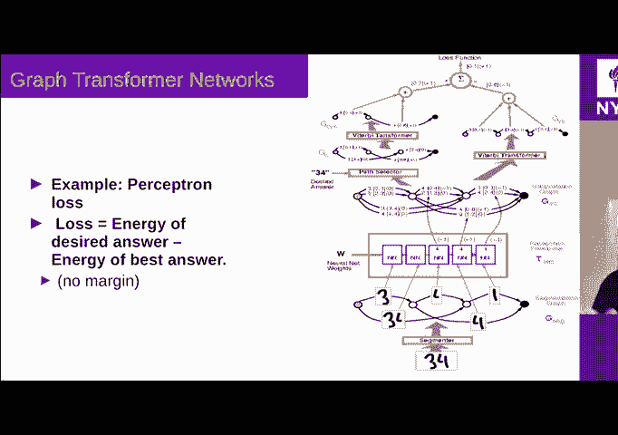
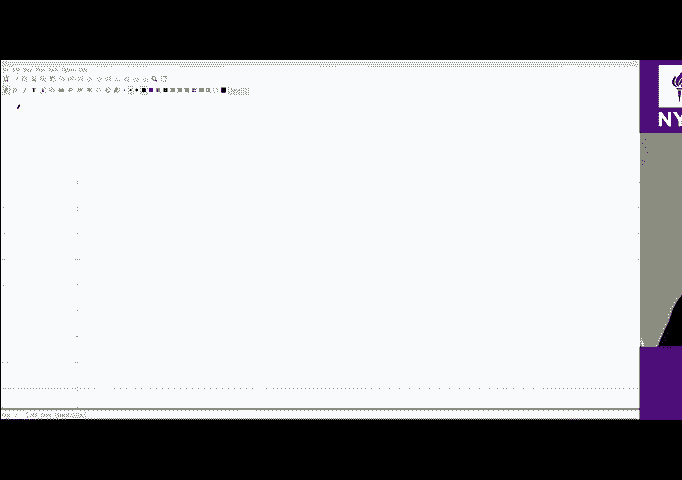
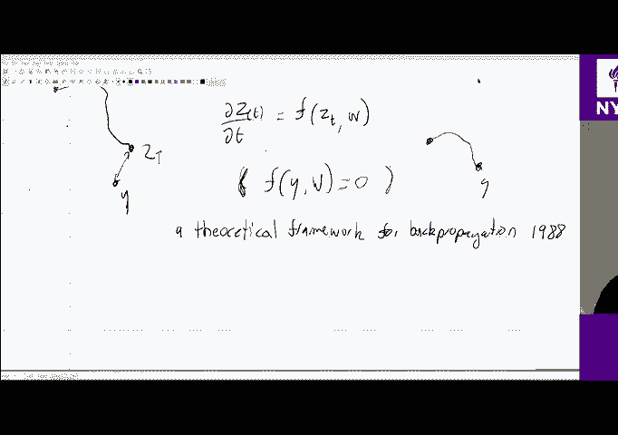
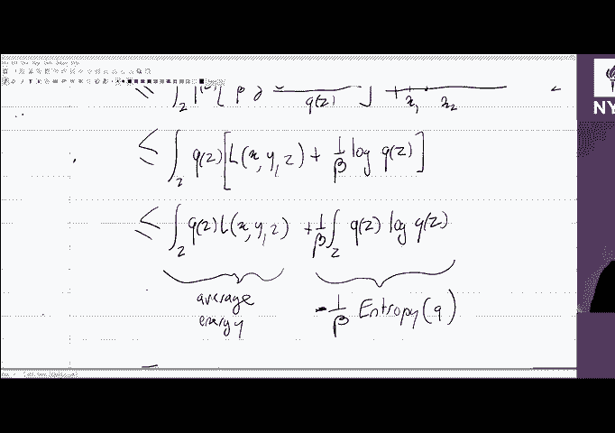
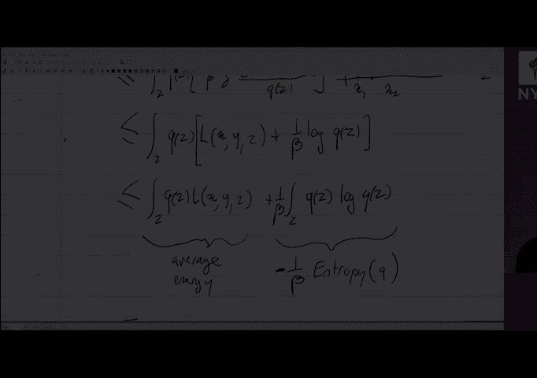

# 26：第14周 - 结构化预测 🧩






在本节课中，我们将要学习结构化预测的基本概念。结构化预测是机器学习中的一个重要领域，它涉及预测那些本身具有复杂结构的输出，例如句子、序列或图。我们将从历史背景入手，通过一个简单的语音识别例子来理解其核心思想，并探讨如何利用能量模型和动态规划进行高效的推理与训练。

---

## 历史背景与动机

上一节我们介绍了结构化预测的目标。本节中，我们来看看它的历史起源。

结构化预测并非一个新问题。早在20世纪90年代初，研究者们就开始探索将神经网络与判别式训练结合，用于解决需要输出序列的任务，例如语音识别。

一个早期的代表性工作是Javier de la Cruz II在1991年提出的四词语音识别模型。该模型使用了一个时域卷积神经网络来处理语音信号，其输出是一系列特征向量。由于不同人说话速度不同，系统需要将输入的特征向量序列与预存的单词模板序列进行对齐，这个过程被称为**动态时间规整**。

## 动态时间规整详解

上一节提到了动态时间规整。本节中我们来详细看看它是如何工作的。

假设我们有一个语音信号，它被切分成一系列短时片段，并转换为特征向量。同时，我们为每个待识别的单词（例如数字0-9）预先存储了一个模板，它也是一个特征向量序列。

核心问题在于：输入序列的长度和模板序列的长度可能不同。动态时间规整的目标是找到一种最优的“弯曲”方式，将输入序列映射到模板序列上，使得两者的总体差异最小。

我们可以将两个序列的特征向量排列成一个矩阵。矩阵中的每个元素 `(i, j)` 代表输入序列第 `i` 个向量与模板序列第 `j` 个向量之间的距离（例如欧氏距离）。

寻找最优对齐路径就转化为在这个矩阵中，从左上角到右下角找一条路径，使得路径上所有点的距离之和最小。这条路径允许水平、垂直和对角线移动，分别对应着重复、跳过和匹配操作。

**公式表示**： 设输入序列为 `X = [x1, x2, ..., xT]`，模板序列为 `Y = [y1, y2, ..., yS]`。距离矩阵 `D` 中 `D[i,j] = dist(xi, yj)`。动态时间规整寻找路径 `P` 以最小化总代价：
`总代价 = Σ_{(i,j) in P} D[i,j]`

## 作为能量模型的结构化预测

理解了序列对齐后，我们可以将结构化预测问题形式化为一个更通用的框架：**能量模型**。

在能量模型中，系统为每一个可能的输入 `X` 和输出结构 `Y` 的配对赋予一个标量值 `E(X, Y)`，称为能量。我们的目标是找到使能量最低的输出 `Y`。

在语音识别的例子里：
*   `X` 是输入的语音特征序列。
*   `Y` 是输出的单词类别（例如，“三”）。
*   计算 `E(X, Y)` 的过程包含了动态时间规整：即找到最优对齐路径 `Z`（一个潜在变量），并计算该路径下的累积距离。因此，能量可以写为：
    `E(X, Y) = min_{Z in 对齐路径} [ Σ_{对齐点} 距离(x_i, y_j) ]`
*   推理时，我们计算所有候选 `Y`（所有单词）的能量，并选择能量最低的那个作为预测结果。

## 因子图与高效推理




当输出结构更复杂时（例如一个句子中的多个词），直接枚举所有可能组合在计算上是不可行的。幸运的是，许多问题的能量函数可以分解为局部项之和，这可以通过**因子图**来表示。

考虑一个简单的因子图模型，其能量是几个局部能量项的和，每项只依赖于输出变量的一小部分（例如，相邻的两个词）。这种分解特性使得我们可以利用动态规划等算法进行高效的最优解搜索，而无需遍历指数级数量的所有组合。

一个经典的高效算法是将搜索过程转化为在一个**篱笆网络**中寻找最短路径的问题。网络中的每个节点代表某个变量在某个时刻的取值状态，每条边代表一个局部能量项的代价。寻找全局能量最小的配置，等价于在这个网络中寻找从起点到终点的最短路径。

**代码概念描述（伪代码）**：
```python
# 假设我们有一个篱笆网络，nodes[t][k] 表示第t步第k个状态的累积最小能量
dp = initialize_with_infinity()
dp[start_node] = 0

for step in range(1, total_steps):
    for current_state in states_at_step[step]:
        # 从前一步的所有可能状态转移过来
        for prev_state in states_at_step[step-1]:
            cost = local_energy(prev_state, current_state, input_X)
            dp[current_state] = min(dp[current_state], dp[prev_state] + cost)

# 回溯找到最优路径
best_path = backtrack(dp)
```

## 模型的训练

上一节我们讨论了如何进行推理。本节中我们来看看如何训练这样的模型。

训练的目标是调整模型的参数（例如，神经网络权重、模板向量），使得：
1.  对于训练样本 `(X, Y*)`（`Y*` 是正确答案），其能量 `E(X, Y*)` 尽可能低。
2.  对于其他错误的输出 `Y`（`Y ≠ Y*`），其能量 `E(X, Y)` 应该比正确答案的能量更高。

这本质上是一个**判别式训练**准则。训练过程通常涉及以下步骤：
*   **前向传播**：对于给定的 `X` 和 `Y*`，运行推理算法（如动态时间规整或篱笆网络搜索），找到使能量最小的潜在变量配置 `Z*`，并计算出 `E(X, Y*)`。
*   **对比采样**：通常也需要为一些错误的 `Y` 计算能量（或估计其下界）。
*   **损失计算与反向传播**：定义一个损失函数（例如，间隔损失），它惩罚正确答案能量过高或错误答案能量过低。然后通过反向传播算法，计算损失函数对模型所有可训练参数的梯度。
*   **参数更新**：使用梯度下降法更新参数。

关键点在于，即使推理过程涉及离散搜索（如动态规划），训练时的梯度仍然可以通过这些算法“传播”回来，调整那些连续可微的参数（如定义距离的神经网络）。

---




















本节课中我们一起学习了结构化预测的核心思想。我们从语音识别中的动态时间规整这一具体实例出发，理解了将序列对齐问题形式化为能量最小化过程。进而，我们看到了如何利用能量模型和因子图的分解特性，通过动态规划等算法高效解决复杂的结构化预测问题。最后，我们探讨了如何通过判别式训练准则来训练这类模型，即使推理包含离散步骤，梯度仍能通过系统进行反向传播。结构化预测为处理序列、树、图等复杂输出提供了强大的理论框架和实用工具。