# 27：过拟合与正则化 🧠

在本节课中，我们将学习深度学习中的两个核心概念：**过拟合**与**正则化**。我们将探讨它们之间的联系，理解为什么过拟合会发生，以及如何使用正则化技术来缓解过拟合，从而提升模型的泛化能力。

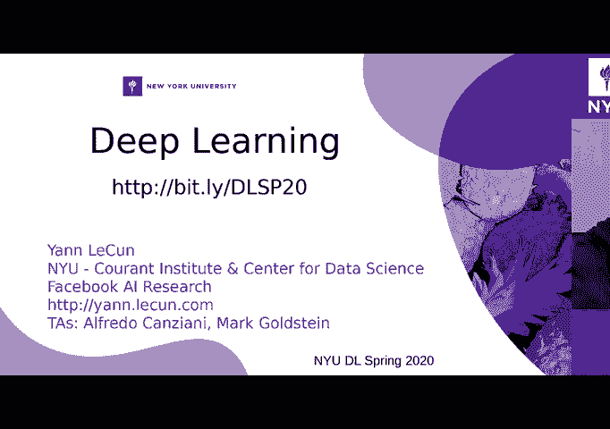

---

## 过拟合现象 🔍

上一节我们介绍了课程概述，本节中我们来看看什么是过拟合。

过拟合是指模型在训练数据上表现很好，但在未见过的测试数据上表现较差的现象。这通常发生在模型过于复杂，以至于“记住”了训练数据中的噪声和细节，而非学习数据背后的通用规律。

以下是三种拟合情况的对比：

*   **欠拟合**：模型复杂度低于数据复杂度。例如，试图用一条直线去拟合抛物线形状的数据点，效果不佳。
*   **恰当拟合**：模型复杂度与数据复杂度匹配。模型能够很好地捕捉数据的主要趋势。
*   **过拟合**：模型复杂度高于数据复杂度。模型不仅学习了数据的真实规律，还拟合了数据中的随机噪声，导致在训练集上误差为零，但泛化能力差。

一个关键问题是：如果数据点来自一个完美的抛物线，即使模型能力很强，它也应该学出一个平滑的抛物线。为什么过拟合模型会产生“抖动”的曲线呢？原因在于现实数据总存在**噪声**。为了完美地穿过每一个带有轻微偏移的训练点，模型不得不产生复杂、古怪的函数形状。

在深度学习中，我们使用的模型通常**参数过多、能力过强**，它们甚至能够完美记忆带有随机标签的数据。这表明我们的模型是**过参数化**的。

---

## 为何需要过参数化模型？ 🤔

既然过参数化会导致过拟合，为什么我们还要使用这样的模型呢？主要有两个原因：

1.  **优化更容易**：在高维、过参数化的空间中，损失函数的景观通常更平滑，更容易找到好的解，训练过程更稳定。
2.  **便于调试**：在开始正式训练前，一个重要的调试步骤是检查模型是否具备基本的学习能力。我们可以用一小批随机数据（甚至是随机标签）来训练模型几个周期。如果模型能够快速地将训练误差降到接近零（即“记住”这批数据），说明模型结构和训练流程在技术上是可行的。这被称为“记忆化测试”。

此外，在参数空间中，存在许多不同的参数配置（例如，通过置换神经网络某一层的神经元顺序）可以映射到完全相同的输入输出函数。这意味着在庞大的参数空间中，存在大量功能等价的解。我们倾向于过参数化，是因为它提供了更多容易到达的“好解”的路径。

---

## 正则化：对抗过拟合的武器 🛡️

我们已经了解了过拟合及其原因，那么如何解决它呢？本节我们将介绍正则化的核心思想。

正则化是一类用于防止过拟合、提高模型泛化能力的技术。它的核心思想是为模型添加一些约束或先验知识，限制其学习能力，使其更倾向于学习简单、平滑的模式，而不是复杂的噪声。

可以从几个角度理解正则化：

1.  **参数空间视角**：为模型参数引入**先验分布**。例如，假设参数应该较小（服从高斯分布）或稀疏（服从拉普拉斯分布）。这相当于在训练时，不仅要求模型拟合数据，还要求参数符合我们预设的分布。
    *   **公式**：带有L2正则化的损失函数可写为：`L_total = L_data + λ * ||w||^2`，其中 `λ` 是控制正则化强度的超参数。
2.  **函数空间视角**：对模型可以表示的函数集合进行**限制**。正则化使得模型只能学习那些不那么“极端”或“振荡”的函数，例如更平滑的函数。
3.  **算法修改视角**：任何旨在**降低泛化误差**而非训练误差的算法修改，都可以视为正则化。这是深度学习中最实用的定义。

用一个比喻来理解不同强度的正则化：
*   **无正则化**：模型可以自由学习，可能产生复杂、带尖刺的边界（对应过拟合）。
*   **弱正则化**：对模型能力稍加限制，边界变得稍平滑一些。
*   **强正则化**：严格限制模型能力，可能迫使模型学习过于简单的模式（如将复杂边界平滑为圆形），可能导致欠拟合。

我们的目标是找到合适的正则化强度，在欠拟合和过拟合之间取得最佳平衡，达到“恰当拟合”的状态。

---

## 总结 📚

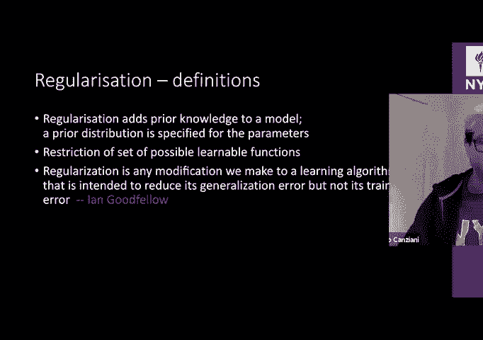

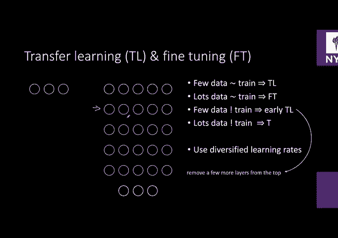

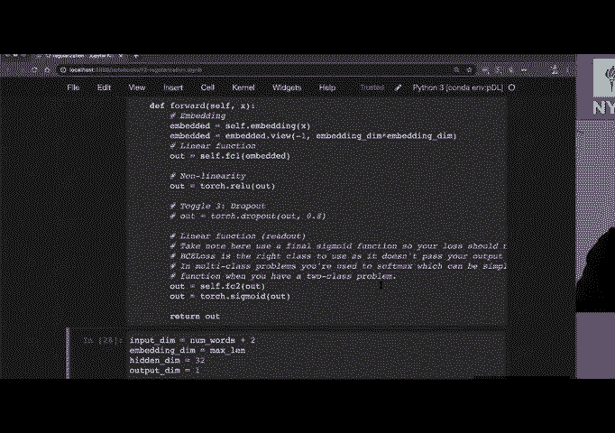

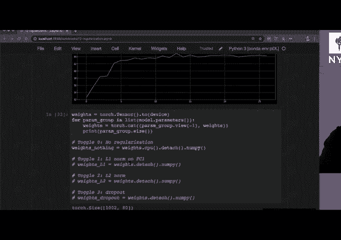

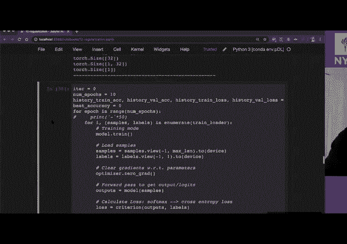

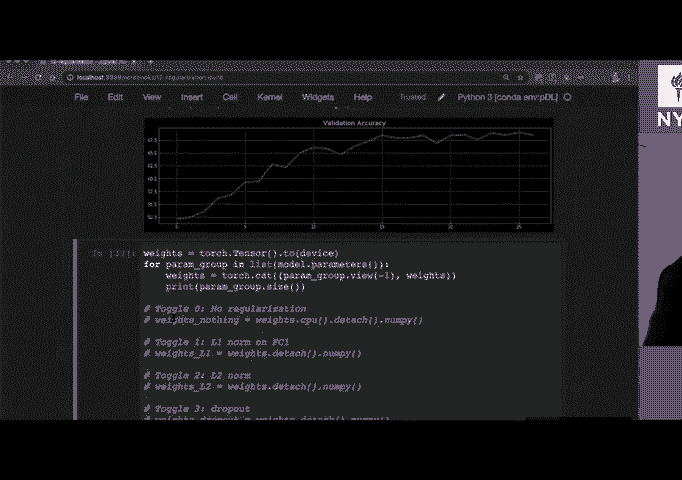

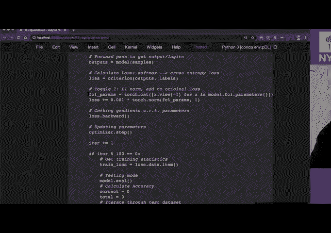

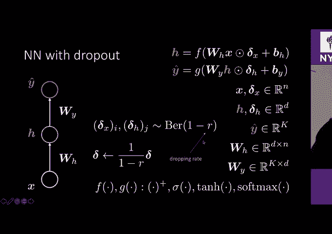

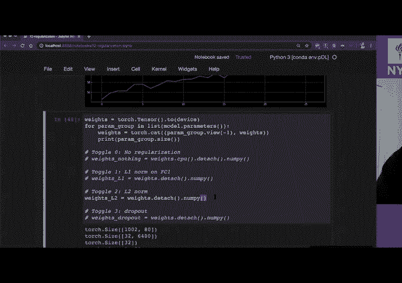

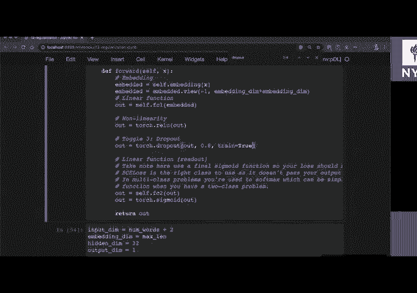

本节课中我们一起学习了：
1.  **过拟合**：模型过度复杂，完美拟合训练数据（包括噪声），导致泛化性能下降。
2.  **过参数化的价值**：尽管可能导致过拟合，但过参数化模型更易于优化和调试。
3.  **正则化**：通过为参数添加先验、限制函数空间或修改学习算法，来约束模型复杂度，从而对抗过拟合、提升泛化能力的核心技术。

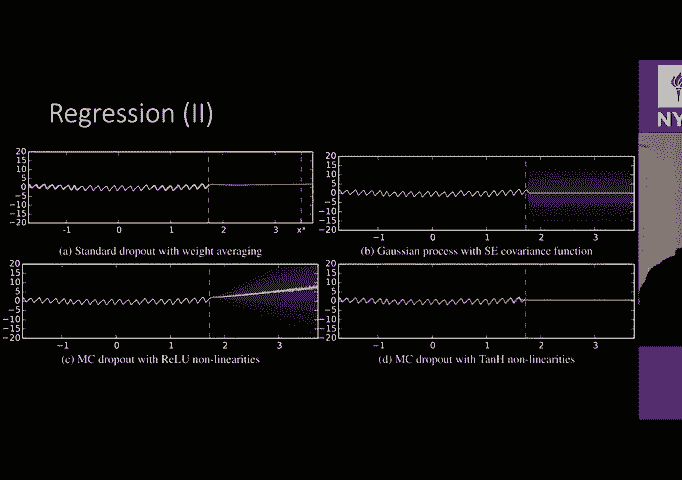

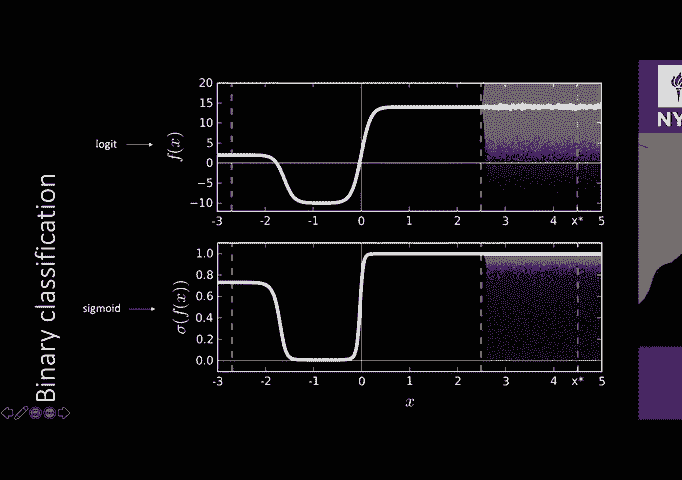

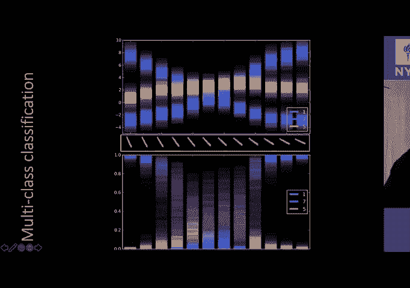

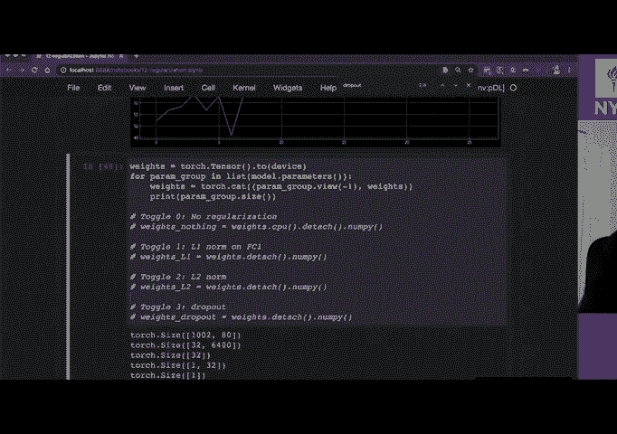

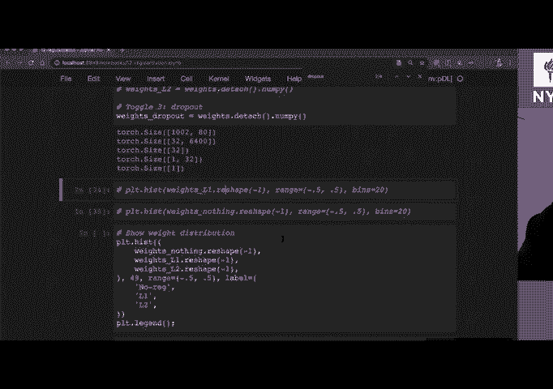

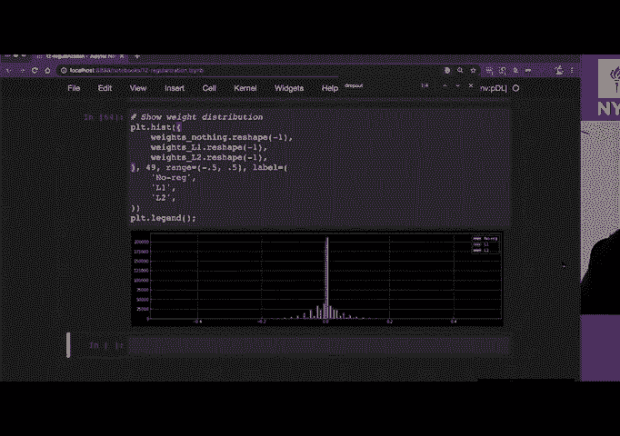

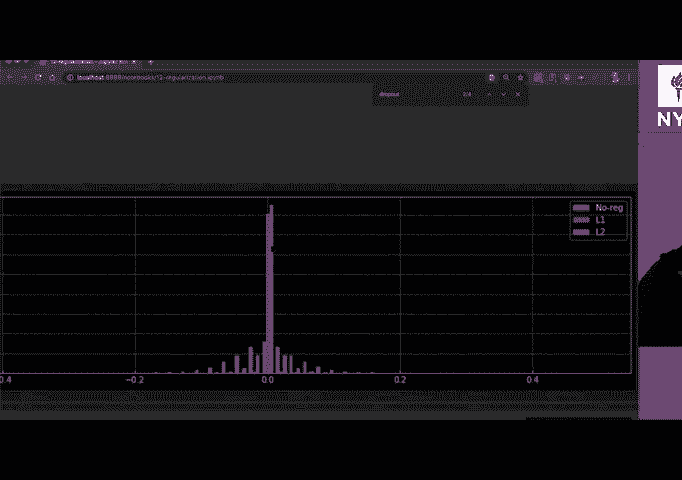

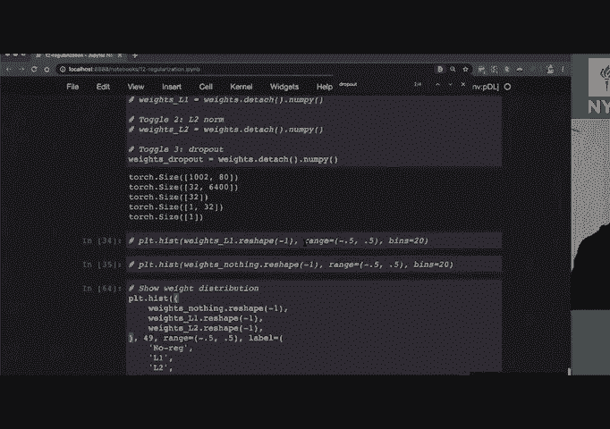

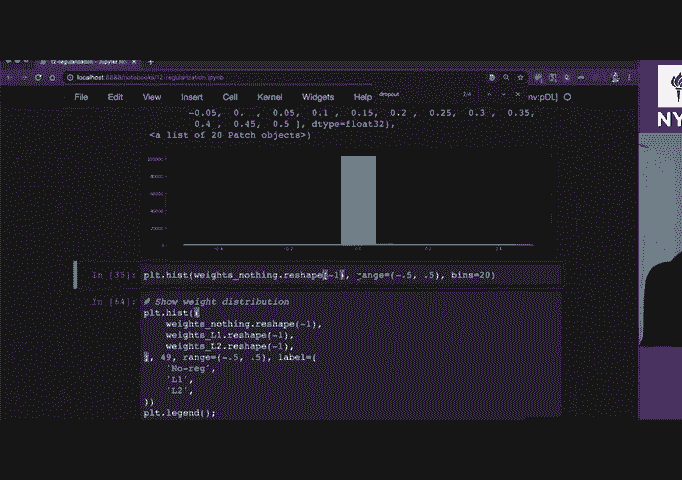

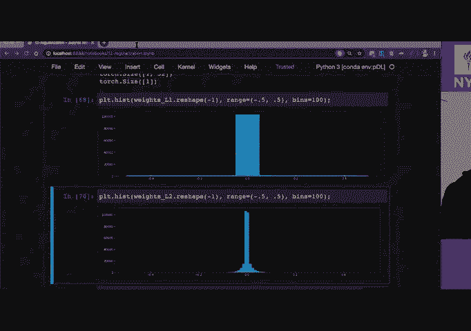

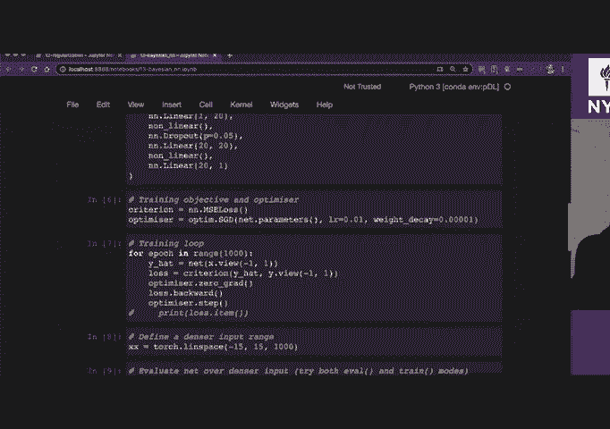

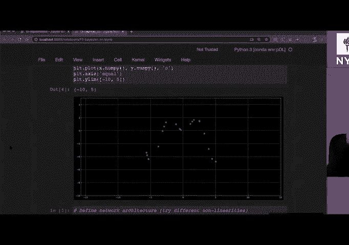

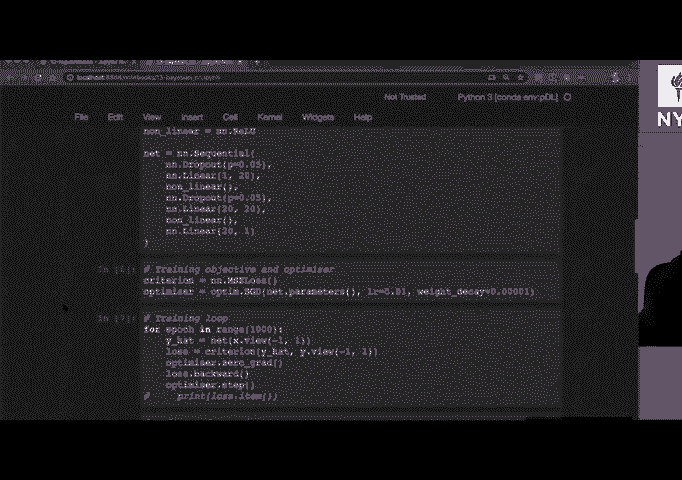

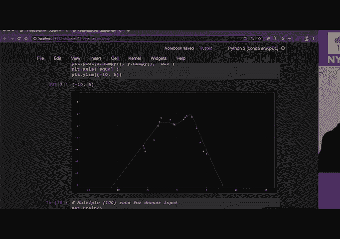

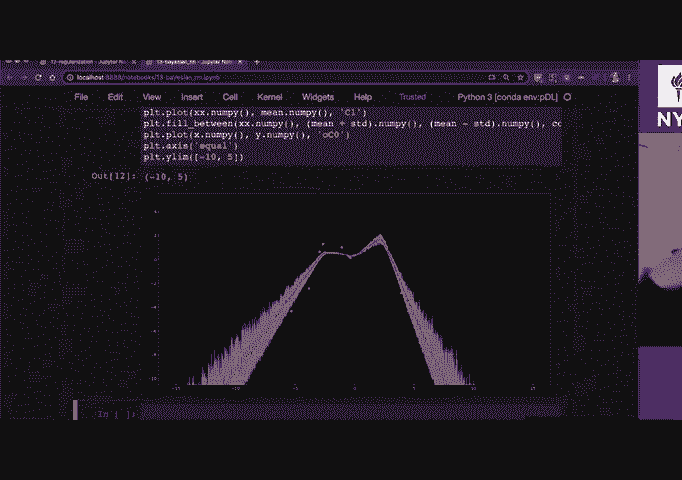

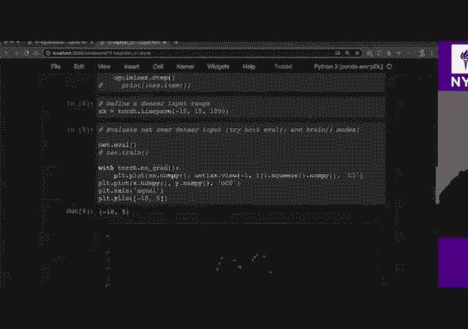

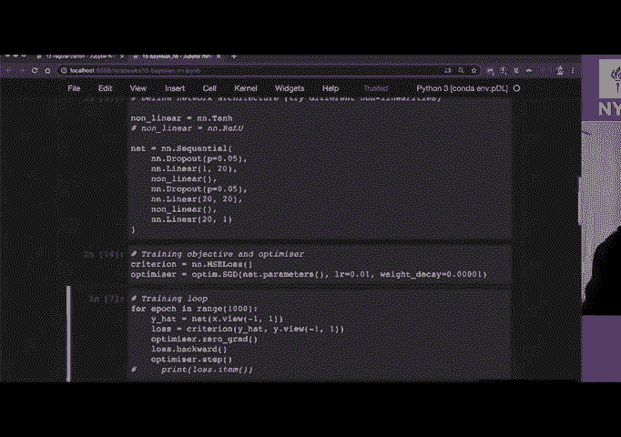

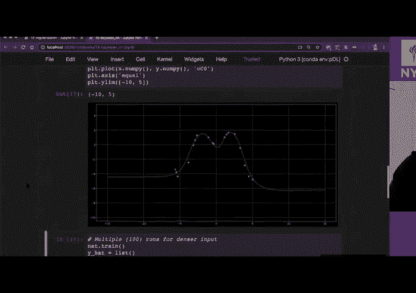

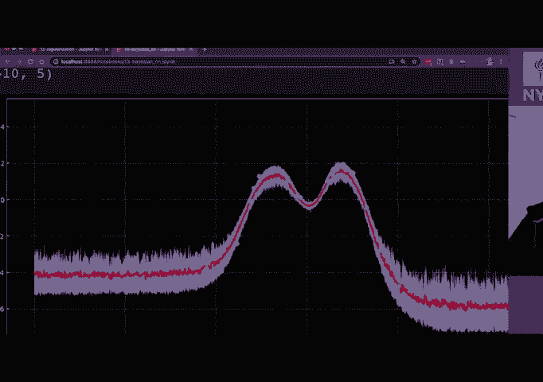

理解过拟合与正则化是构建高效、鲁棒深度学习模型的关键。在实践中，我们需要根据具体任务和数据，灵活选择和调整正则化方法及其强度。