# 29：第15周 - 实践课 B - 训练隐变量能量模型 (EBM) 🧠

在本节课中，我们将学习如何训练隐变量能量模型。我们将从回顾上节课的“零温极限”自由能开始，然后引入一个更平滑的“松弛”版本的自由能，并理解其物理意义和计算方法。

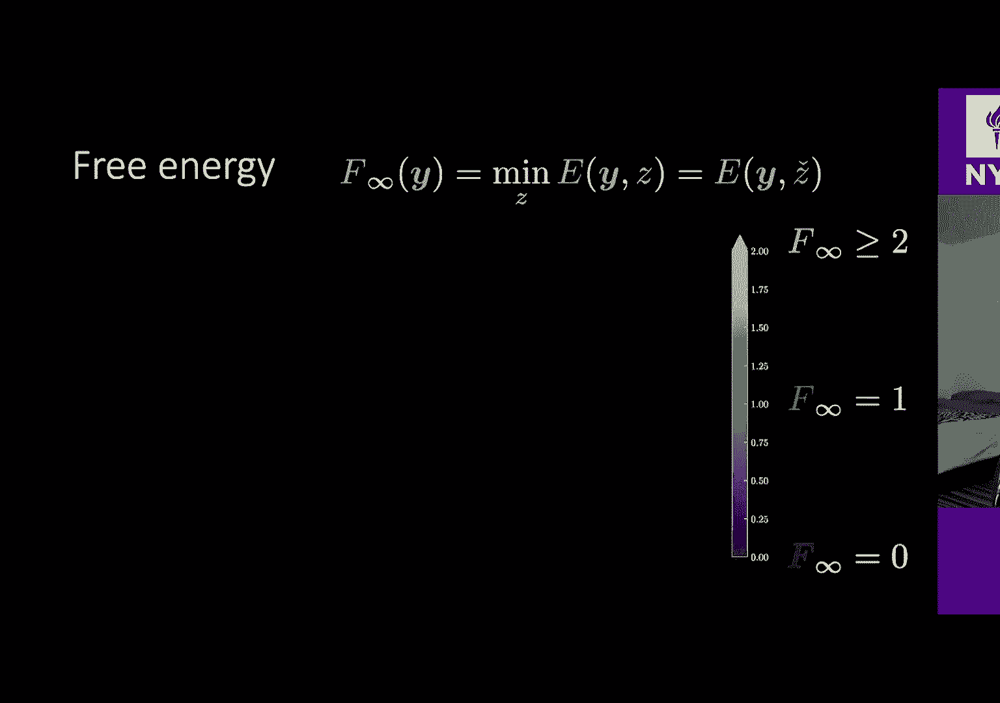

---

## 回顾：零温极限自由能 🥶

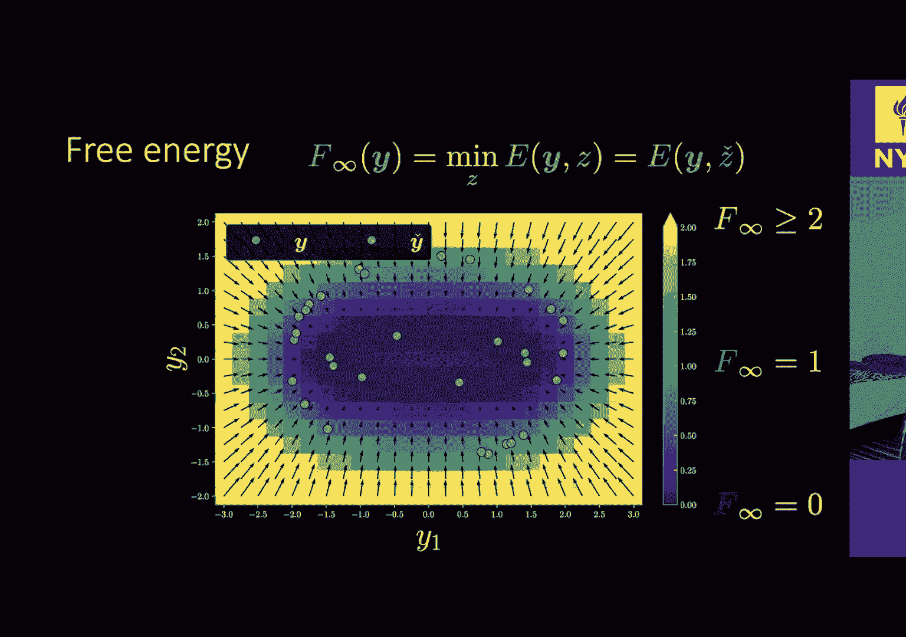

上一节我们介绍了能量模型中的推理问题，即如何找到给定观测变量 `y` 时，隐变量 `z` 的最优值，并计算相应的能量 `E` 和自由能 `F`。

我们计算了所谓的“零温极限”自由能 `F∞(y)`。在我们的例子中，`y` 是一个二维向量，因此 `F∞(y)` 是一个标量场，可以想象成一个二维区域上的高度图。

*   紫色区域表示自由能 `F∞ = 0`。
*   绿色区域表示自由能 `F∞ = 1`。
*   黄色区域表示自由能 `F∞ > 1`。

这个自由能本质上是给定点 `y` 到模型流形（一个椭圆）的欧几里得距离的平方。因此，位于流形上的点距离为零，自由能也为零。随着点远离流形，自由能呈二次增长。

观察图像，我们注意到在椭圆内部的中心区域，自由能形成了一个“峰值”，而不是平滑的谷底。本节课，我们将学习如何松弛这个零温极限自由能，使其更加平滑，消除这些局部极小值（峰值）。

为了更清楚地观察，我们来看一个截面图（取 `y1 = 0`）。这个截面显示，在流形外部，自由能呈抛物线形上升；而在流形内部中心，自由能形成了一个高峰。

---

## 引入松弛自由能：温度的作用 🌡️

本节中，我们来看看如何通过引入“温度”的概念来平滑自由能景观。

我们已知的自由能 `F∞` 是能量 `E(y, z)` 在 `z` 上的最小值：
`F∞(y) = min_z E(y, z)`

现在，我们引入一个参数化的松弛版本自由能 `F(y; β)`：
`F(y; β) = -1/β * log( ∫ exp(-β E(y, z)) dz )`

**核心概念解析**：
*   **`β` (Beta)**： 称为逆温度，`β = 1/(k_B T)`，其中 `k_B` 是玻尔兹曼常数，`T` 是温度。
    *   当温度 `T` 极高时（如太阳表面），`β → 0`。
    *   当温度 `T` 极低时（如绝对零度），`β → +∞`。
*   **零温极限**： 当 `β → ∞`（极冷）时，`F(y; β)` 就退化为我们之前的 `F∞(y)`，即取最小值。
*   **高温极限**： 当 `β → 0`（极热）时，`F(y; β)` 趋近于能量 `E` 在 `z` 上的平均值。

这个松弛自由能 `F(y; β)` 被称为能量的 **“软最小值”**。与直接取最小值（硬最小值）不同，它考虑了所有可能 `z` 值的能量贡献，但通过指数加权让低能量区域贡献更大。

---

## 计算松弛自由能：离散化方法 🧮

为了实际计算积分 `∫ exp(-β E(y, z)) dz`，我们采用简单的离散化方法。

我们将连续的积分近似为离散的和：
`F(y; β) ≈ -1/β * log( ∑_i exp(-β E(y, z_i)) Δz )`

在我们的例子中，隐变量 `z` 的定义域是 `[0, 2π]`，因此积分测度 `dz` 对应总长度 `2π`。离散化时，`Δz` 是采样间隔。

让我们对一个具体点 `y’ = [2, 3]`（图中右侧的绿叉）计算其松弛自由能。我们设定 `β = 1`。

以下是计算过程的直观展示：
1.  对于流形（椭圆）上的每个点（由不同的 `z` 生成），计算其到目标点 `y’` 的距离平方，即能量 `E`。
2.  计算 `exp(-β * E)`，即 `exp(-距离平方)`。距离越近，此项值越大。
3.  将所有 `exp(-β * E)` 的值求和（并考虑 `Δz`），然后取对数并乘以 `-1/β`，得到最终的松弛自由能 `F`。

通过这种计算，原来在零温下只考虑最近点的“硬”距离，现在被“软化”为考虑所有点的加权平均距离，从而平滑了自由能曲面。

---

## 总结 📚

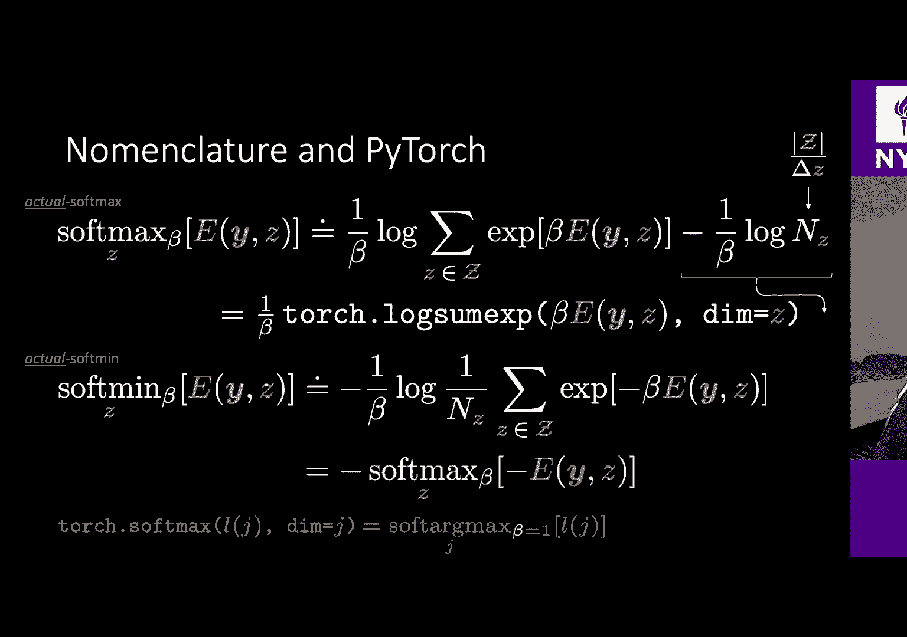

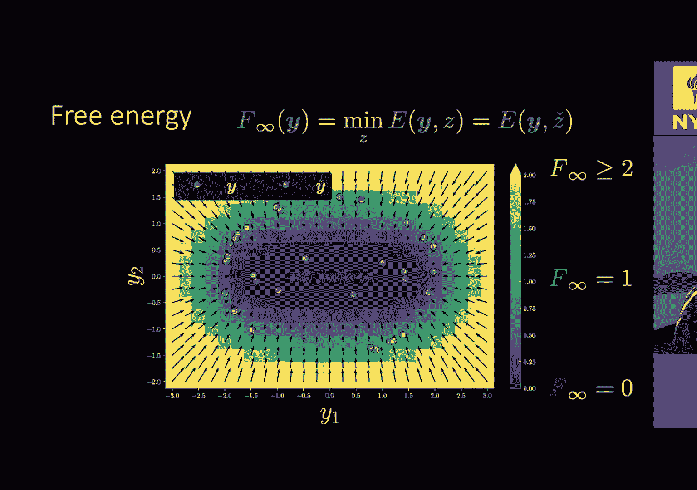

本节课中我们一起学习了：
1.  **回顾了零温自由能** `F∞`，它计算点到模型流形的最小平方距离，但可能产生非平滑的景观（如内部峰值）。
2.  **引入了松弛自由能** `F(y; β)`，它通过逆温度参数 `β` 引入物理中的“温度”概念，将硬最小值操作转化为软最小值操作。
3.  **理解了其物理意义**：`β → ∞` 对应零温极限，恢复为硬最小值；`β → 0` 对应高温极限，趋近于平均值。
4.  **掌握了计算方法**：通过离散化积分，我们可以实际计算给定观测 `y` 时的松弛自由能，这为后续训练能量模型提供了更平滑、更易优化的目标函数。

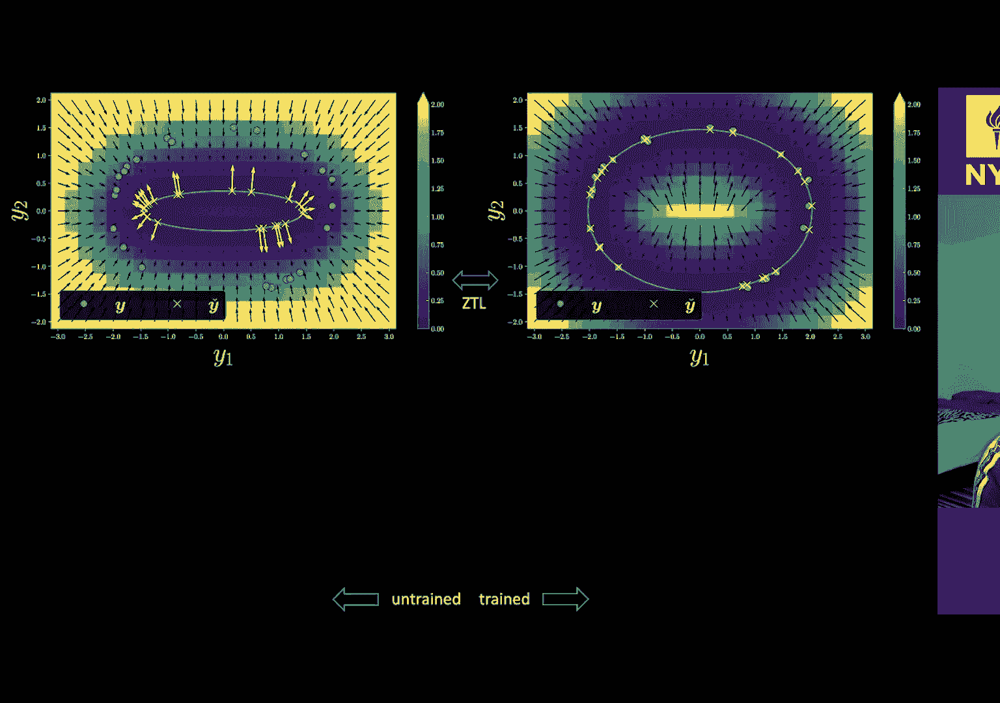

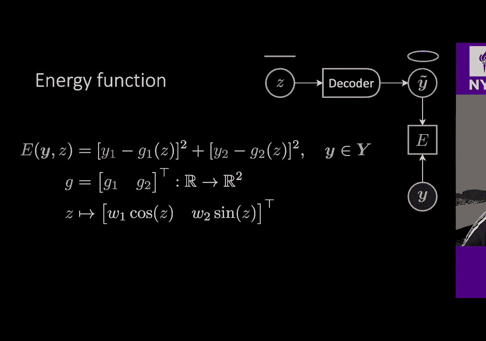

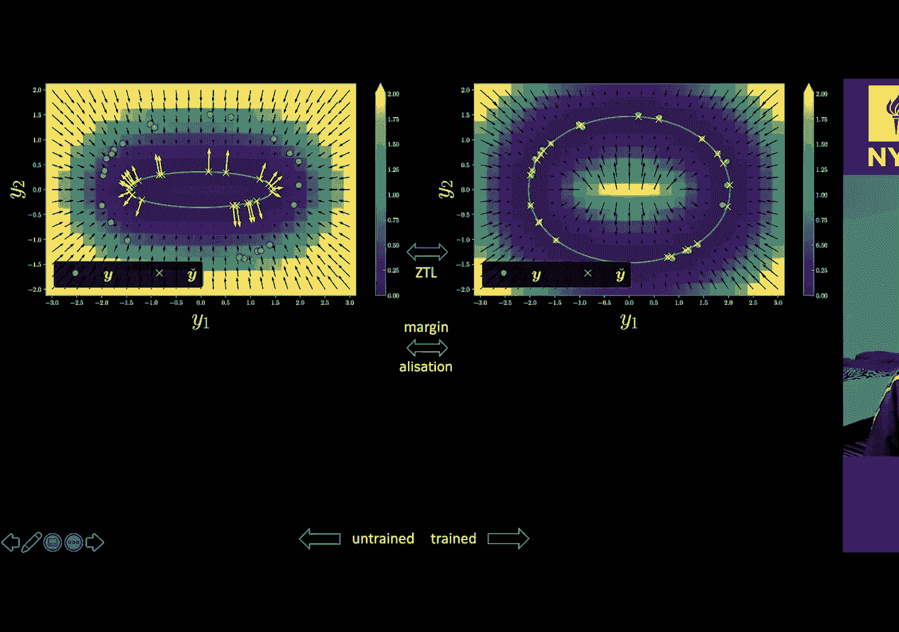

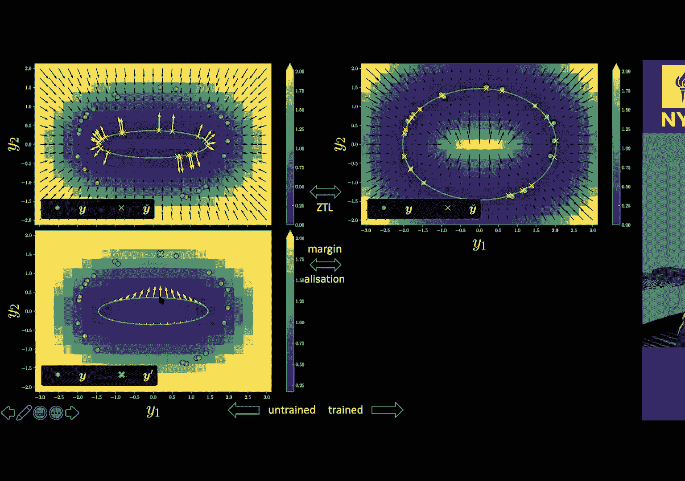

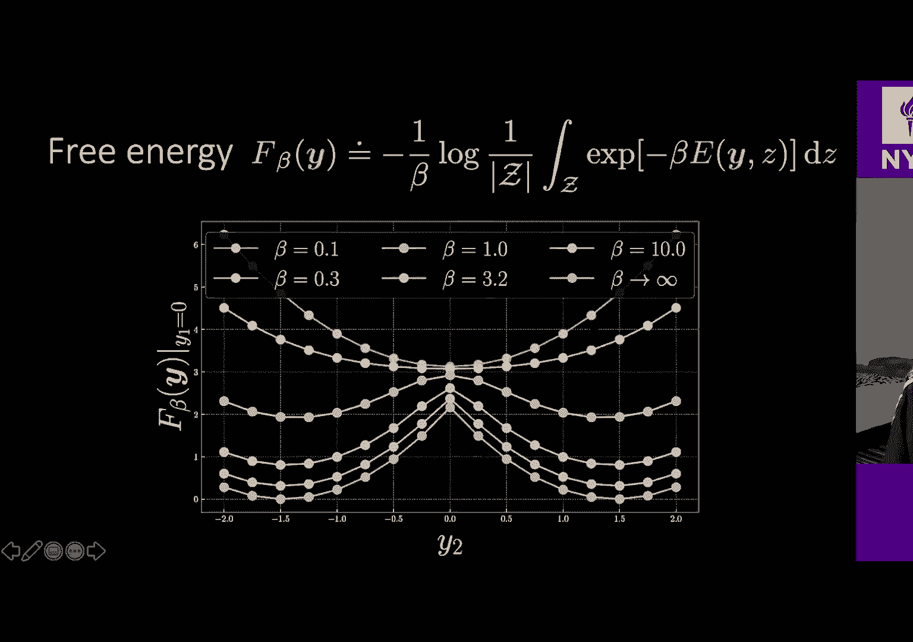

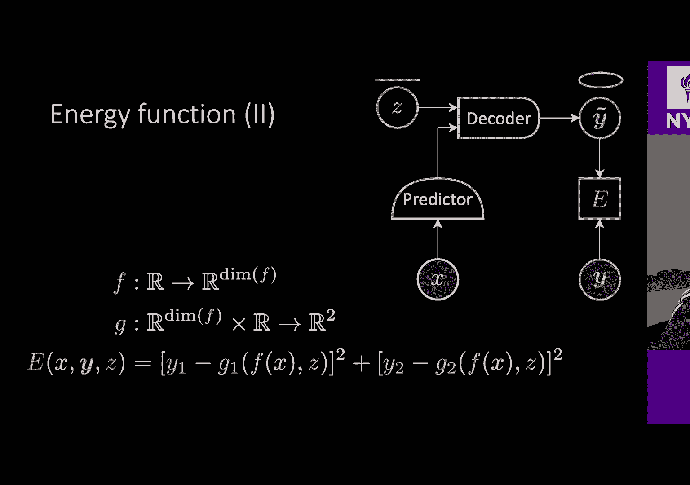

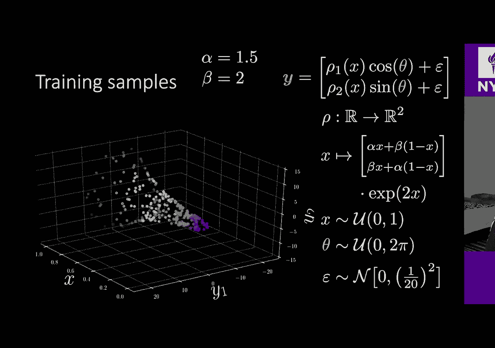

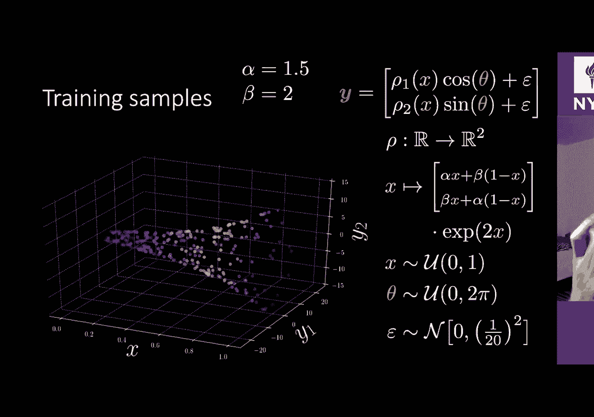

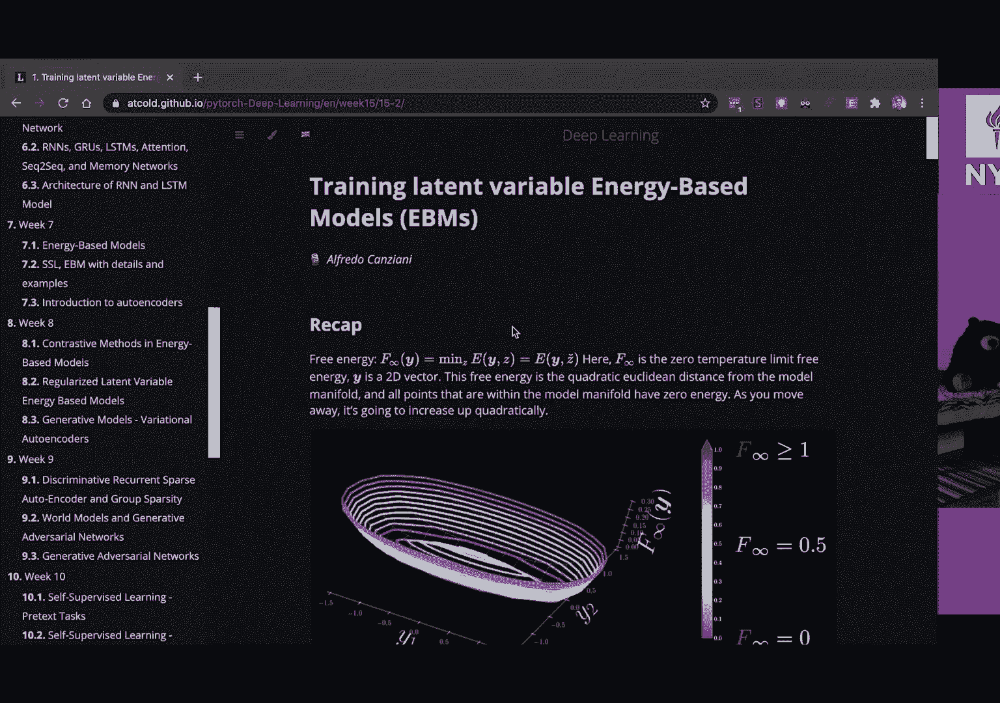

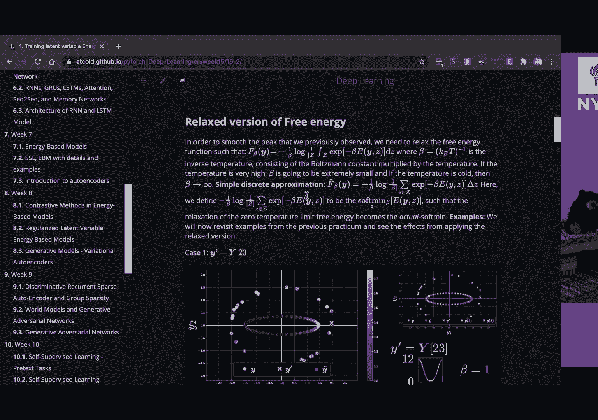

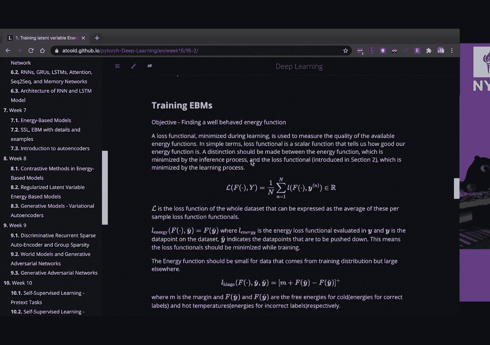

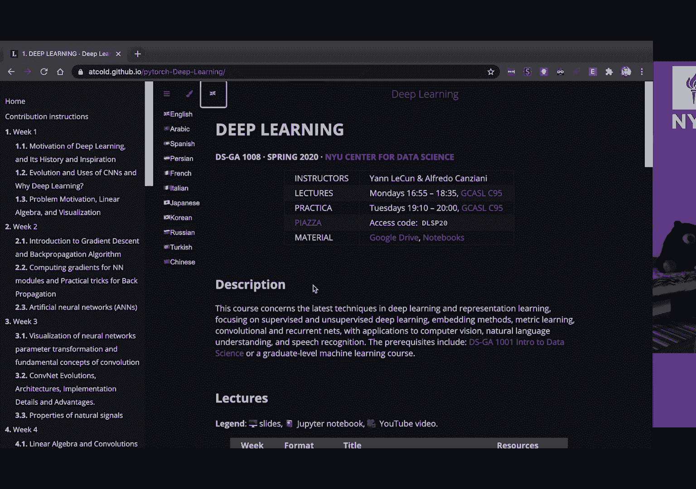

这种松弛技术对于训练复杂的隐变量能量模型至关重要，因为它能帮助优化过程避免陷入不良的局部极小值。