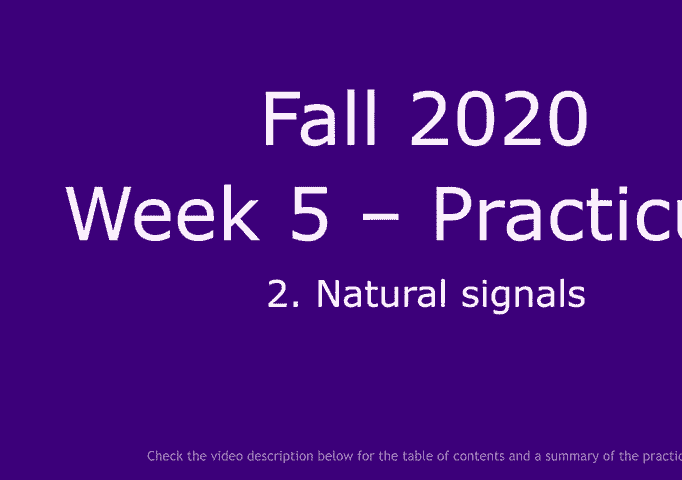
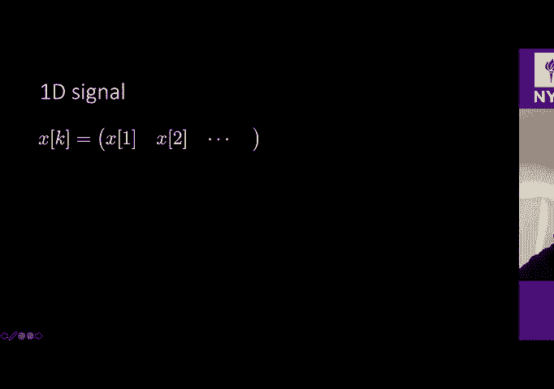
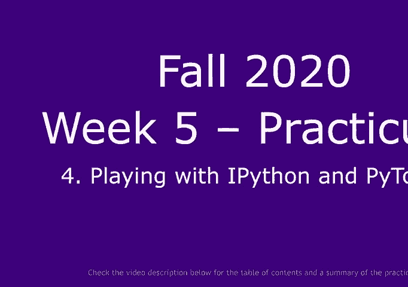
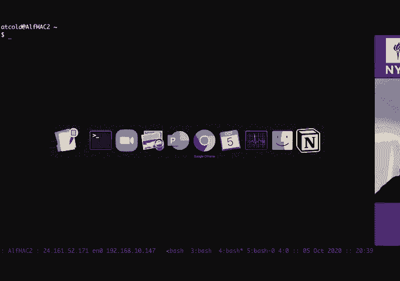
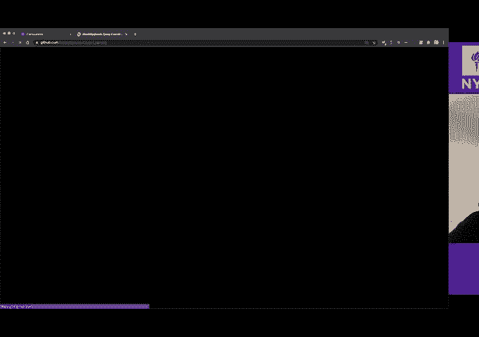
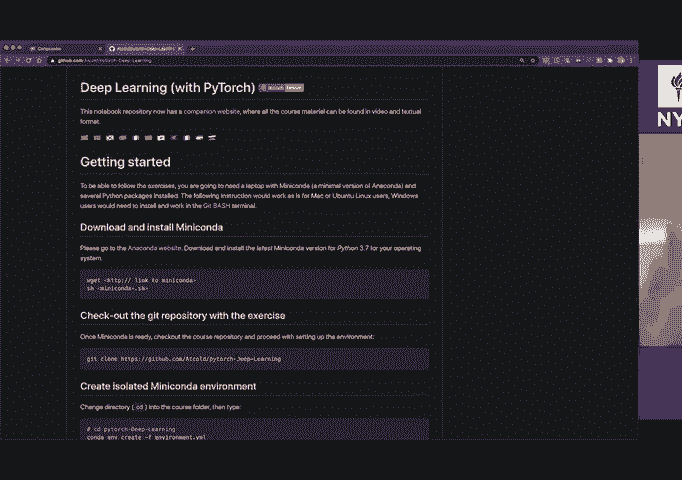
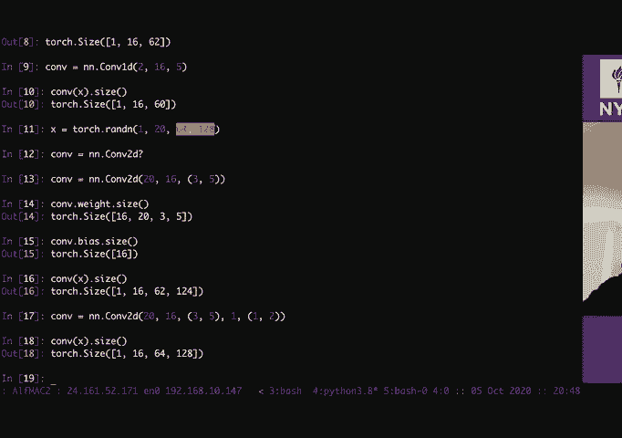

# 30：矩阵乘法、信号与卷积 🧮➡️📡➡️🌀


在本节课中，我们将学习矩阵乘法的不同视角，并将其应用于信号处理，最终引出卷积的概念。课程将从线性代数的回顾开始，逐步扩展到信号处理，最后通过Python代码进行实践。


---

## 线性代数回顾 📚

在神经网络中，我们通常可以这样表示一个隐藏层：

**h = f(z)**

其中，**h** 是隐藏层向量，**f** 是一个非线性激活函数，**z** 是输入的线性变换结果。

**z** 可以表示为矩阵 **A** 与输入向量 **x** 的乘积：

**z = A x**

假设 **x** 的维度是 **n**，**z** 的维度是 **m**，那么矩阵 **A** 的维度就是 **m × n**。这是因为矩阵的行数对应输出维度 **m**，列数对应输入维度 **n**。

我们可以将矩阵 **A** 展开为：

```
A = [ a11, a12, ..., a1n
      a21, a22, ..., a2n
      ...
      am1, am2, ..., amn ]
```

当矩阵 **A** 乘以列向量 **x** 时，通常的运算方式是“行乘以列”。结果向量 **z** 的每个元素 **z_i** 是矩阵 **A** 的第 **i** 行与向量 **x** 的点积。

因此，我们可以将矩阵 **A** 视为由行向量 **a_i** 组成：

**A = [ a1; a2; ...; am ]**

那么，乘法运算可以写为：

**z = [ a1·x; a2·x; ...; am·x ]**

每个 **z_i** 都是一个标量。

---

### 几何解释与模板匹配 🧩

现在，让我们深入理解每个元素 **z_i = a_i · x** 的含义。以二维空间为例（n=2），这个点积可以展开为：

**z_i = a_i1 * x1 + a_i2 * x2**

从几何角度看，点积 **a_i · x** 等于两个向量模长的乘积乘以它们之间夹角的余弦值：

**a_i · x = ||a_i|| * ||x|| * cos(θ)**

其中，**θ** 是向量 **a_i** 和 **x** 之间的夹角。

这个公式揭示了点积的核心意义：
*   当两个向量方向相同时（θ=0），cos(0)=1，点积值最大（正值）。
*   当两个向量垂直时（θ=90°），cos(90°)=0，点积为零。
*   当两个向量方向相反时（θ=180°），cos(180°)=-1，点积值最小（负值）。

因此，在矩阵乘法中，**每一行向量 a_i 都可以看作一个“模板”或“核（kernel）”。** 计算 **a_i · x** 的过程，实质上是在衡量输入向量 **x** 与模板 **a_i** 的匹配程度。这被称为**模板匹配（Template Matching）**。

---

### 列视角：线性组合 🔢

除了行视角，矩阵乘法还有另一个重要的解释：列视角。

回顾 **z = A x** 的运算，结果 **z** 也可以看作是矩阵 **A** 的各列向量的线性组合，组合系数就是输入向量 **x** 的各个元素。

具体来说，设矩阵 **A** 的列向量为 **A1, A2, ..., An**，那么：

**z = x1 * A1 + x2 * A2 + ... + xn * An**

这意味着，输出向量 **z** 是输入向量 **x** 的每个分量，对其对应的矩阵列向量进行缩放后，再相加的结果。

---

上一节我们回顾了矩阵乘法的两种核心视角：行视角（模板匹配）和列视角（线性组合）。接下来，我们将把这些概念应用到信号处理中。

---

## 将矩阵乘法应用于信号 📡

现在，我们考虑输入数据是信号的情况。假设我们有一个离散信号，表示为一个序列 **x[0], x[1], ..., x[N-1]**。

在传统的全连接层中，一个神经元（对应矩阵的一行）会与整个输入信号的所有点做点积。这要求矩阵 **A** 的列数 **n** 等于信号长度 **N**。

然而，对于像音频、图像这样的自然信号，相邻的数据点之间通常具有强相关性（例如，图像中相邻的像素颜色相似）。全连接层忽略了这种局部相关性，并且参数量巨大（**m × N**）。

为了更有效地处理信号，我们可以利用其局部特性。这就引出了**局部连接**的思想：让一个神经元（或滤波器）只与输入信号的一小段局部区域进行连接和计算。

---

### 从局部连接到卷积 🌀

假设我们设计一个小的“核（Kernel）” **w**，其长度为 **K**（例如 K=3）。我们让这个核在输入信号 **x** 上滑动。

在每一个位置 **t**，我们计算核 **w** 与信号局部片段 **x[t : t+K-1]** 的点积，得到一个输出值 **y[t]**：

**y[t] = w[0]*x[t] + w[1]*x[t+1] + ... + w[K-1]*x[t+K-1]**

这个操作就是**一维离散卷积（Discrete Convolution）** 的严格定义（在深度学习中通常指互相关）。

通过让同一个核 **w** 滑过整个信号，我们生成了输出信号 **y**。这个过程极大地减少了参数量（我们只需要学习 **K** 个参数，而不是 **N** 个），并且强制模型学习输入信号的局部特征。

**卷积的本质是共享参数的局部模板匹配。** 同一个核（模板）被重复用于检测输入信号中不同位置是否出现相同的局部模式。

---

### 扩展到多维与多个核 🧠

上述概念可以轻松扩展到多维信号（如图像，使用2D卷积）和使用多个核的情况。每个不同的核 **w_i** 学习检测一种不同的局部特征（如边缘、纹理）。所有核的输出堆叠起来，就形成了下一层的输入特征图。

---

上一节我们介绍了卷积如何作为共享参数的局部模板匹配来处理信号。现在，让我们通过代码来直观地理解这些操作。

---

## 使用 PyTorch 进行交互式实践 🐍

以下是使用 PyTorch 演示矩阵乘法和卷积操作的示例代码。

首先，我们模拟一个简单的矩阵乘法（全连接层）：

```python
import torch

# 定义输入信号 (长度为5)
x = torch.tensor([1.0, 2.0, 3.0, 4.0, 5.0])
print("输入信号 x:", x)

# 定义一个全连接层 (3个神经元，每个接收全部5个输入)
# 权重矩阵 A 的维度为 3x5
A = torch.tensor([[0.1, 0.2, 0.3, 0.4, 0.5],
                  [0.5, 0.4, 0.3, 0.2, 0.1],
                  [-0.1, 0.2, -0.3, 0.4, -0.5]])
print("\n权重矩阵 A (3个模板):\n", A)

# 矩阵乘法：模板匹配视角
z = torch.matmul(A, x) # 或者 A @ x
print("\n全连接层输出 z = A @ x:")
print("z[0] = A[0]·x =", z[0].item())
print("z[1] = A[1]·x =", z[1].item())
print("z[2] = A[2]·x =", z[2].item())
print("这衡量了信号 x 与每个模板行 A[i] 的匹配程度。")
```

接下来，我们演示卷积操作：

```python
# 使用一维卷积实现局部连接和参数共享
print("\n" + "="*50)
print("一维卷积演示")

# 将输入 reshape 为适合卷积的格式: (batch_size, channels, length)
# 这里 batch_size=1, channel=1, signal_length=5
x_conv = x.view(1, 1, -1)
print("输入信号 x (卷积格式):", x_conv)

# 定义一个1D卷积核 (滤波器)
# 这里使用一个简单的边缘检测核 [-1, 0, 1]
conv_kernel = torch.tensor([[[-1.0, 0.0, 1.0]]]) # 格式: (out_channels, in_channels, kernel_size)
print("卷积核 w (边缘检测器):", conv_kernel)

# 执行卷积操作 (PyTorch 的 conv1d 实现互相关)
import torch.nn.functional as F
y = F.conv1d(x_conv, conv_kernel, padding=1) # padding=1 保持输出长度
print("\n卷积输出 y:")
print("原始信号 x:", x.tolist())
print("卷积核 w: [-1, 0, 1]")
print("输出 y (近似导数):", y.squeeze().tolist())
print("\n解释：")
print("y[0] ≈ -1*x[0] + 0*x[1] + 1*x[2] = ", -1*x[0] + 1*x[2])
print("这检测了信号在位置 t 附近的‘变化’或‘边缘’。")
print("同一个核 w 滑过整个信号，实现了参数共享。")
```

---

## 总结 🎯

在本节课中，我们一起学习了：

1.  **矩阵乘法的双重视角**：
    *   **行视角（模板匹配）**：将矩阵的每一行视为一个模板，输出是输入向量与每个模板的匹配得分（点积）。
    *   **列视角（线性组合）**：将输出视为矩阵各列向量的线性组合，系数由输入向量提供。

2.  **信号处理与局部性**：自然信号（如音频、图像）具有局部相关性。全连接层参数量大且忽略局部结构。

3.  **卷积的引出**：为了解决上述问题，我们引入**卷积**操作。它本质上是**共享参数的局部模板匹配**。
    *   使用一个小的**核（Kernel）** 作为局部模板。
    *   核在输入信号上滑动，在每个局部位置计算点积，生成输出。
    *   这显著减少了参数量，并让模型专注于学习有意义的局部特征。







4.  **实践验证**：通过 PyTorch 代码，我们直观地对比了全连接层的全局模板匹配与卷积层的局部、参数共享的模板匹配。









核心在于理解：**卷积是矩阵乘法在利用信号局部性和平移不变性特性后的一种高效、特化的形式**。它是深度学习处理图像、语音等空间或时序数据的基石。