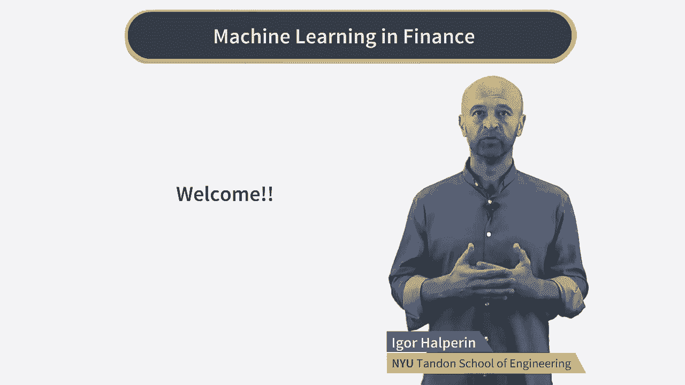
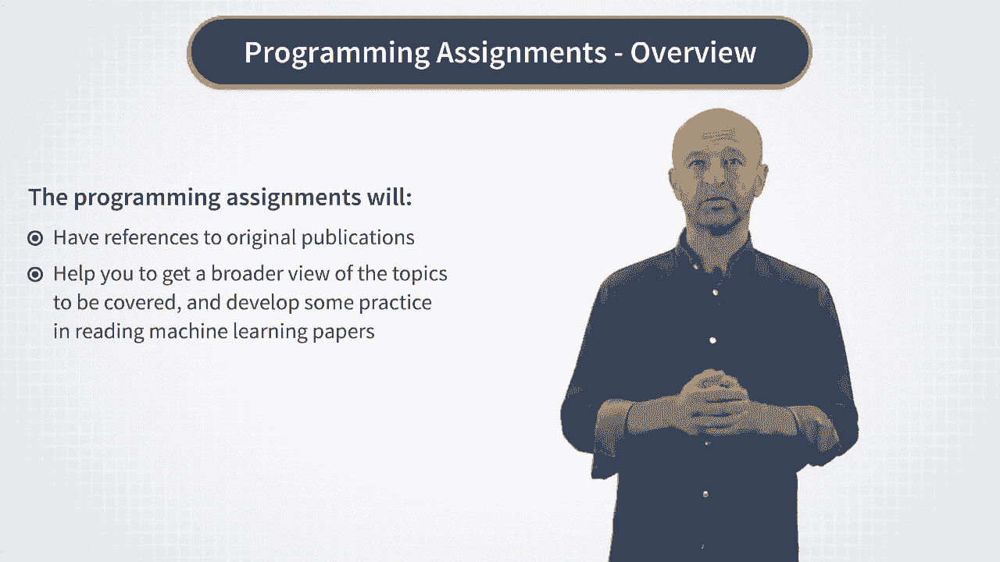

# 1：金融机器学习专业介绍 📚

在本节课中，我们将了解“金融机器学习”专业课程的核心内容、目标受众以及您将从中获得的主要技能与知识。

## 概述

这个专业课程是Coursera平台上关于机器学习的一个专项课程，其独特之处在于专注于探讨机器学习在实际应用中的局限性。这与通常广泛使用工业案例来教授机器学习的其他课程有所不同。

## 课程目标受众 👥

本课程主要面向两类人群。

以下是具体描述：

*   您目前是一名金融专业人士。
*   您计划在不久的将来成为一名金融专业人士。

因此，本课程专为从业者或未来计划从事金融工作的人员设计。课程目标不是从零开始学习机器学习，而是利用金融领域的实际问题来发展和提升您的机器学习技能。金融本身涉及大量数字与预测，我们为何不直接使用金融数据来学习机器学习，而要使用与金融无关的示例呢？

## 课程案例与作业设计 💡

由于这是面向从业者的专业课程，我尽力避免设计与现实生活无关的无意义练习。

以下是课程案例的特点：

*   我们不会进行诸如预测股票价格或股票指数之类的练习。
*   原因是，即使您可能见过许多讨论机器学习在此类问题上应用的博客或研究论文，这些问题本身并没有确切的答案。
*   为了最大化课程对您的实用价值，本专业课程将只探讨那些实际有用的案例。

## 您将学到什么 🎯

完成本专业课程后，您将获得以下三方面的主要收获。

第一，您将对机器学习的核心概念以及最重要的算法有深入的理解。第二，您不会以抽象的方式学习这些知识，而是通过非常实际的方式。我们将处理多种不同类型的金融数据，并运用多种机器学习算法来处理相同的数据。您不仅会学习经典的机器学习算法，还将对神经网络（特别是近年来风靡业界的深度神经网络）有扎实的理解和实战经验。

因此，您将对金融数据以及不同算法在这些数据上的表现形成良好的直觉。您将知道如何应用Python机器学习库（例如 **`scikit-learn`** 或 **`TensorFlow`**）来构建机器学习模型，应用于量化交易、资产管理、银行及其他金融领域。

您将能够通过一系列有趣且相关的项目作品集给潜在雇主留下深刻印象，这些项目展示了机器学习在实际问题中的应用。更重要的是，您将能够利用所学的知识，使用掌握的库来构建新的机器学习模型，以满足您企业的需求。

## 培养持续学习的能力 📖

最后一点，也是本课程学习内容的重要组成部分。机器学习是一个快速发展的领域，今天在学校教授的前沿方法明天可能就会过时。因此，行业从业者应该能够理解面向从业者的机器学习论文，并能够实现其中的方法。学习它的最佳途径就是阅读机器学习论文。

我们的编程作业通常会引用相关的原始出版物，供您深入挖掘所涵盖的主题。此外，我将提供原始出版物的参考文献以及每周的阅读材料，这两者都应有助于您更广泛地了解要涵盖的主题，并培养阅读机器学习论文的实践能力。

## 总结

本节课我们一起了解了“金融机器学习”专业课程的定位、目标学员、教学案例的设计思路，以及完成课程后您将在**算法理解**、**实战应用**和**论文研读能力**这三个方面获得的主要收获。