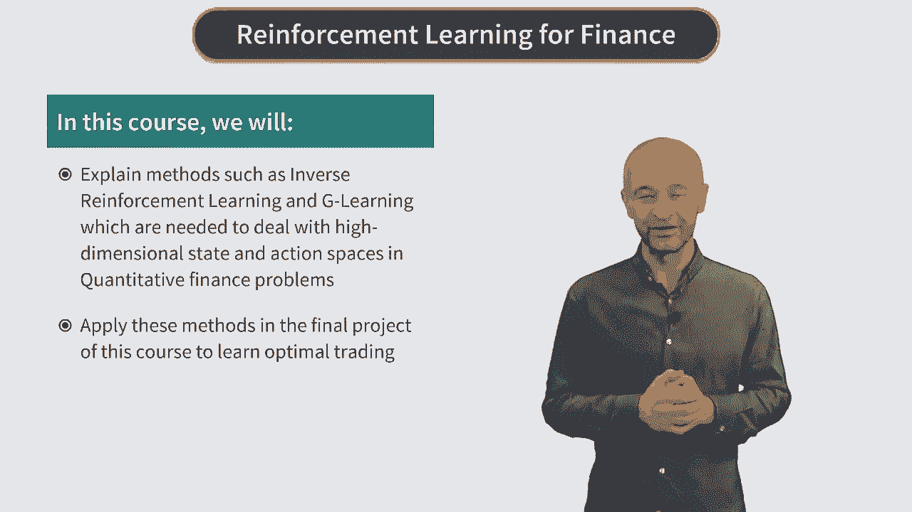

# 3：强化学习在金融中的应用介绍 📈

在本节课中，我们将要学习“强化学习在金融中的应用”这门课程的整体框架、学习目标以及主要内容安排。我们将了解为何选择金融作为强化学习的应用场景，以及课程将如何从期权定价逐步深入到更复杂的投资组合管理问题。

---

## 课程概述

欢迎来到Coursera“机器学习在金融中的应用”系列课程的第三门课。这门课程将专注于讲解强化学习，这是机器学习中最令人兴奋的领域之一。本课程将从头开始，完全聚焦于强化学习在金融领域的应用。

我们不会花费时间解释金融领域之外的任何强化学习例子。许多其他强化学习课程是为机器人领域设计的，因此常使用井字棋游戏、迷宫问题等作为示例。由于时间有限，我们将跳过这些例子，直接从金融问题中学习强化学习。这能让我们更快地达到学习目标。

如果你对其他应用场景感兴趣，例如如何用强化学习解决迷宫问题，在学习完本课程后，你也能理解其原理。本课程将衔接上一门课程的末尾，但内容会更加深入且节奏更快，因为我们将学习强化学习算法的具体细节。课程中会使用更多的数学工具。

---

## 课程内容与结构

上一节我们介绍了本课程的专注领域和特点，本节中我们来看看课程的具体内容安排。

以下是本课程为期四周的主要内容：

1.  **第一周：期权定价与马尔可夫决策过程**
    我们将探讨量化金融中的经典问题——期权定价。如果你对期权不熟悉，课程会提供背景材料。我们选择从期权而非股票开始，是因为从强化学习的视角看，第一周要解决的期权问题相对更简单。我们将把布莱克-斯科尔斯模型转化为离散时间问题，并展示如何将其转化为一个具有特定奖励函数的**马尔可夫决策过程**。我们将讲解如何用此模型进行期权定价和风险管理，这与原始BS模型不同。

2.  **第二周：动态规划求解MDP**
    我们将使用动态规划方法来解决第一周建立的MDP问题，并建立数值求解方法。你将在作业中对比BS模型的解析解与此数值解。

3.  **第三周：强化学习核心算法**
    我们将学习强化学习的重要算法，首先是**Q-learning**，这是最重要的算法之一。接着会介绍其延伸算法——**Fitted Q Iteration**。在第三周的作业中，你将应用这些算法，并理解它们如何用于期权定价。

4.  **第四周：股票投资组合管理**
    我们将研究强化学习在股票投资组合管理中的应用。这里涉及的不再是单一问题，而是多个经典量化金融问题，例如马科维茨最优投资组合或最优交易执行问题。这些问题比期权定价更复杂，需要引入新方法，例如**逆向强化学习**和**G-learning**等，以处理高维度问题。你将在最终的课程项目“最优股票交易”中应用这些方法。

---

## 学习建议

课程中会用到较多的数学知识。如果遇到难以理解的部分，请随时暂停视频进行思考，或尝试推导黑板上的公式。我也会提供相关的文献链接，这些资料可能对理解课程、完成作业和编程项目有所帮助。

---

## 总结

本节课中，我们一起学习了“强化学习在金融中的应用”这门课程的整体介绍。我们明确了课程将完全专注于金融领域，并了解了从期权定价到投资组合管理的四周学习路径。课程将结合理论算法与金融实践，帮助你掌握将强化学习应用于核心金融问题的能力。