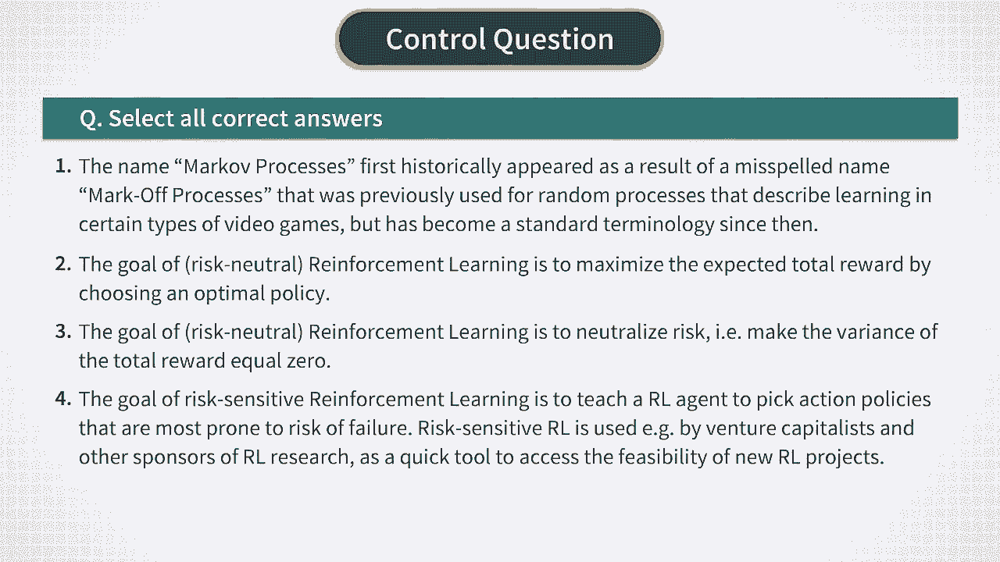

# 4：MDP - 马尔可夫决策过程与强化学习简介 📚

在本节课中，我们将学习马尔可夫决策过程（MDP）的基本概念、贝尔曼方程，以及它们与强化学习的关系。我们将回顾这些核心主题，为后续课程中将经典金融问题转化为MDP问题并测试不同强化学习算法打下基础。

## 强化学习概述 🤖

上一节我们介绍了机器学习的不同范式。本节中，我们来看看强化学习的独特之处。

强化学习处理的是智能体与环境交互的问题。智能体通过一系列顺序决策，在过程的每一步从众多可能的行动中选择最优行动。我们在第一门课程中将此类任务称为“动作任务”。

智能体通过感知环境状态 **St** 的信息来了解环境。环境可能具有复杂的动态，因此强化学习任务通常涉及对未来进行规划和预测。此外，智能体在每一步选择的动作 **At** 旨在优化其长期目标，而这个动作本身可能会影响环境的状态。

这就形成了一个反馈循环：当前智能体的动作 **At** 可能会改变下一个状态 **St+1**，进而可能影响智能体在下一时间步需要选择的动作。这种反馈循环的存在是强化学习独有的，在有监督或无监督学习中不会出现，因为后两者的任务中不存在需要优化操作的问题。

## 强化学习的两种设置 ⚙️

上一节我们了解了强化学习的核心交互模式。本节中，我们来看看其两种主要的实施设置。

以下是两种可能的强化学习设置：

1.  **在线强化学习**：实时进行。智能体直接与环境交互，并在每个时间步获取环境新状态信息后立即选择动作。例如，真空清洁机器人就是在线强化学习的一个实例。
2.  **批处理/离线强化学习**：智能体不能按需访问环境，只能访问一些存储的数据，这些数据记录了其他代理或人类与该环境交互的历史。数据应包含环境状态、采取的行动以及每个时间步所获奖励的记录。

## 环境建模：完全可观察与部分可观察 🔍

在以上两种设置中，我们讨论了两种对环境建模的方法。

如果环境是完全可观察的，且其动态可以建模为马尔可夫过程，则可以使用马尔可夫决策过程。马尔可夫过程的特点是“记忆”时间短，其未来仅取决于当前状态，而非整个历史。

第二种情况是部分可观察的环境，其中一些对动态很重要的变量是不可见的。正如我们在上一门课程中讨论的，这可以使用动态潜变量模型（如隐马尔可夫模型）进行建模。在本课程中，我们将主要关注完全可观察的系统，因此暂时使用马尔可夫过程。

## 马尔可夫决策过程（MDP）框架 🧩

上一节我们区分了环境类型。本节中，我们深入探讨完全可观察环境下的标准数学框架——马尔可夫决策过程。

马尔可夫决策过程是纳入智能体行动的环境马尔可夫动力学模型的恰当数学形式。一个MDP包含以下要素：

*   **状态空间 S**：每个观察到的状态 **St** 都属于这个空间。S可以是离散的或连续的。
*   **动作空间 A**：智能体采取的动作 **At** 属于这个空间。
*   **状态转移概率 P**：定义了在给定前一状态 **St** 和在该状态下采取的动作 **At** 时，下一状态 **St+1** 的概率。公式表示为：`P(St+1 | St, At)`。
*   **奖励函数 R**：给出了在给定状态 **St** 下采取给定动作 **At** 后所获得的奖励 **Rt**。它将状态和动作的笛卡尔积映射到实数：`R: S × A → ℝ`。
*   **折扣因子 γ**：一个介于0和1之间的数字，用于计算总累积奖励。

我们需要折扣因子 **γ** 来计算由整个单步奖励之和给出的总累积奖励 **Gt**，其中未来奖励会按指数衰减：
`Gt = Rt + γ * Rt+1 + γ² * Rt+2 + ...`
在MDP中，折扣因子的作用类似于金融中的贴现因子，反映了奖励的时间价值（即通常认为即时奖励比延迟奖励更有价值）。

## MDP的目标与策略 🎯

上一节我们定义了MDP的组成部分。本节中，我们明确MDP要解决的核心问题。

马尔可夫决策过程（或强化学习）的目标是**最大化期望的总累积奖励**。这是通过正确选择**策略 π** 来实现的，策略规定了智能体在每种可能的环境状态下应如何行动。

然而，这个任务具有挑战性，因为我们通常只知道系统的当前状态，而非其未来。这意味着我们必须现在就决定在未来所有可能的环境情景下如何行动，以确保期望的累积奖励最大化。

需要注意的是，标准方法优化的是期望值（平均值），这意味着策略在平均意义上可能是好的，但可能存在高风险，偶尔会产生极差的结果。因此，标准强化学习常被称为**风险中性强化学习**，因为它不考虑策略的方差风险。

也存在**风险敏感强化学习**，它会关注累积奖励分布的更高阶矩（如方差），而不仅仅是均值。这在某些注重风险控制的场景中可能很有用。但在本课程的其余部分，我们将处理标准的、专注于最大化平均累积回报的强化学习设定。

## 总结 📝

本节课我们一起学习了强化学习的基础框架——马尔可夫决策过程。我们回顾了强化学习智能体与环境的交互、在线与离线两种学习设置，并重点阐述了完全可观察环境下MDP的五大核心要素：状态空间、动作空间、转移概率、奖励函数和折扣因子。最后，我们明确了强化学习的目标是寻找最优策略以最大化期望累积奖励，并指出了标准风险中性方法与风险敏感方法的区别。理解MDP是掌握后续各类强化学习算法的关键。