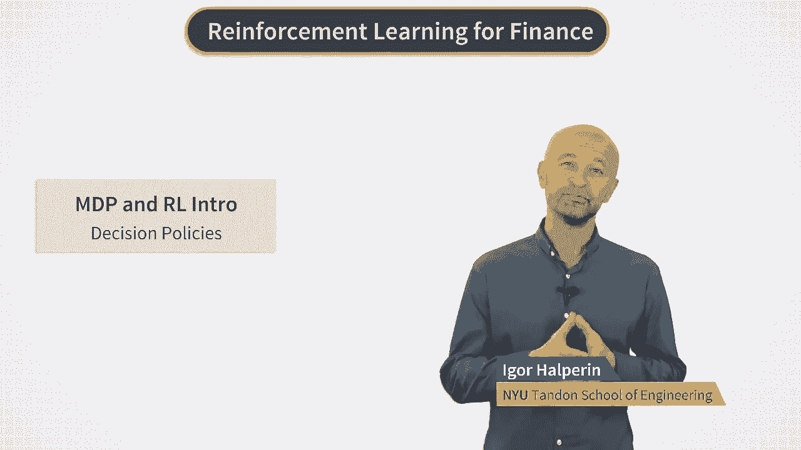
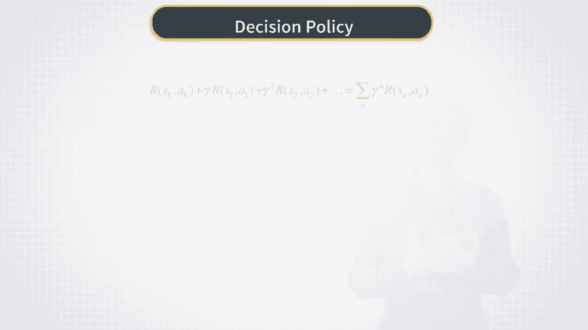
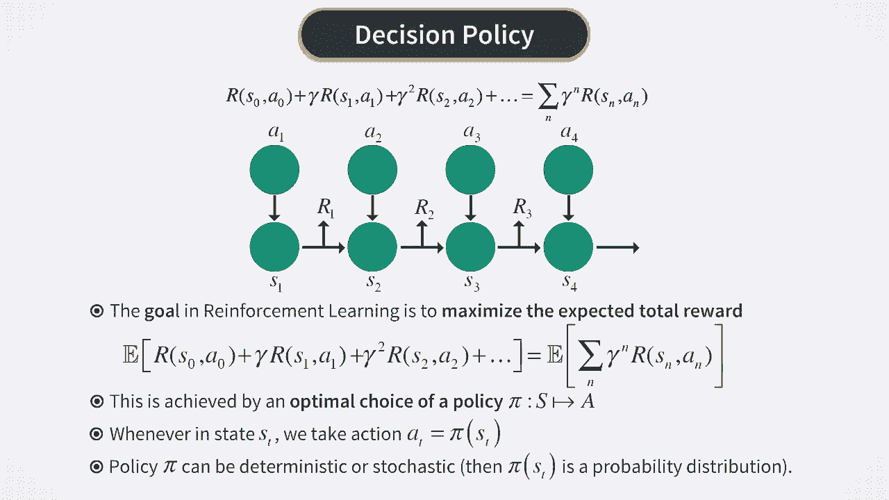
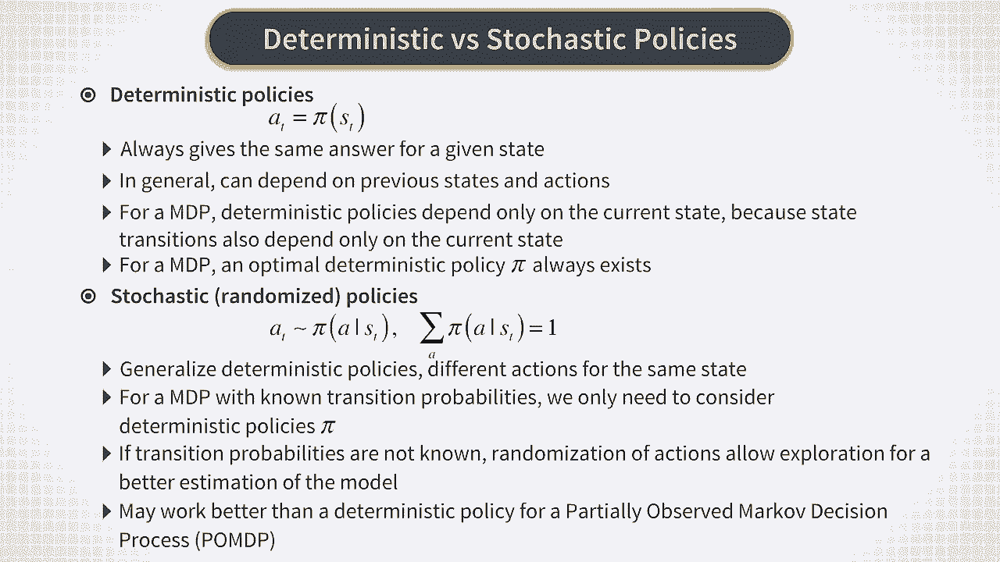
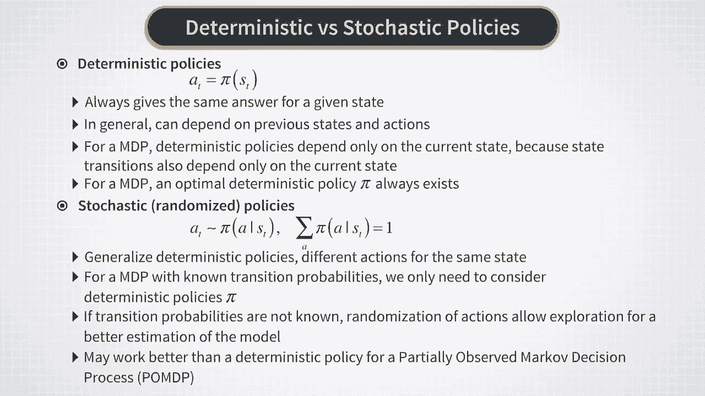
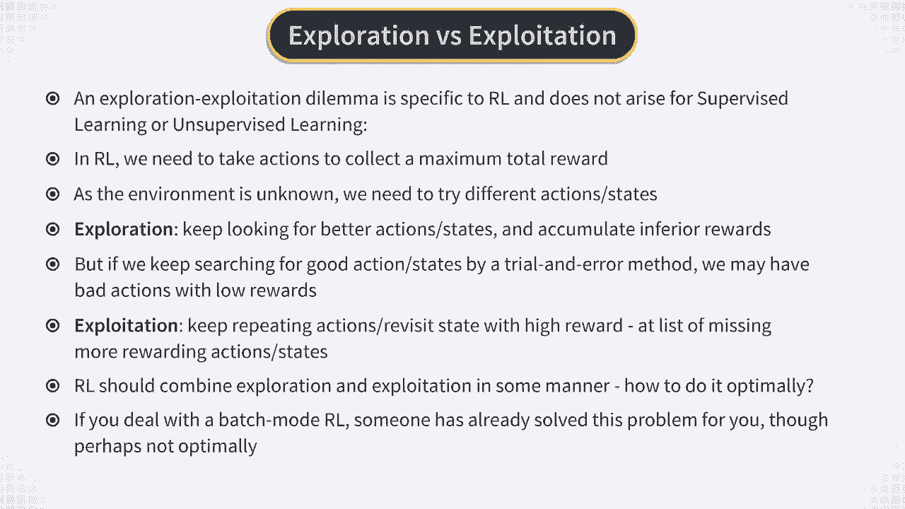
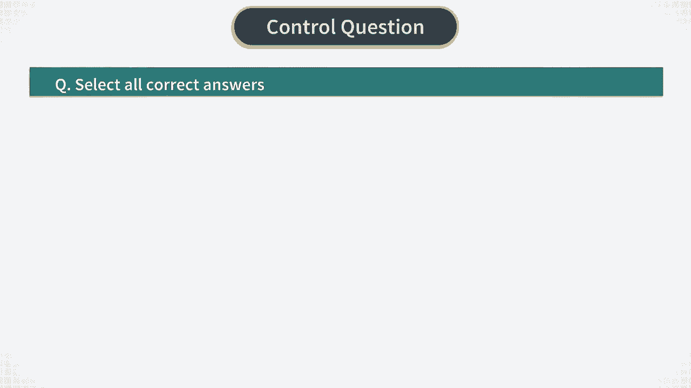

# 5：MDP 与 RL - 决策策略 🧭

在本节课中，我们将学习强化学习中的核心概念——决策策略。我们将探讨策略的定义、不同类型（确定性与随机性），并深入分析强化学习特有的“探索与利用”困境。

---

## 策略的定义与目标

上一节我们介绍了马尔可夫决策过程（MDP）的基本框架，本节中我们来看看如何在该框架下做出决策以实现目标。

强化学习的目标是最大化未来所有操作带来的预期总回报。由于决策需要在当前做出，但影响的是未来，因此我们必须定义一个称为“策略”的函数来指导行动。

策略是一个函数，它根据当前状态 **S_t** 输出一个动作 **A_t**。该函数将状态空间映射到动作空间。其数学表达为：

**A_t = π(S_t)**

如果策略函数 **π** 是状态 **S_t** 的常规函数，那么其输出 **A_t** 就是一个确定的数值或动作。例如，一个线性策略可以表示为 **π(S) = S/2**。这种策略被称为确定性策略。

---

## 确定性策略与随机策略

我们已经了解了确定性策略，它意味着在相同状态下总会采取相同的行动。然而，策略并非只有这一种形式。

以下是策略的两种主要类型：

1.  **确定性策略**：行动 **A_t** 完全由当前状态 **S_t** 通过函数 **π** 决定。其公式为 **A_t = π(S_t)**。对于MDP，理论上总存在一个最优的确定性策略。
2.  **随机策略**：策略 **π** 定义为一个概率分布，用于描述在给定状态 **S_t** 下采取各个可能动作 **A_t** 的概率。其公式为 **A_t ~ π(· | S_t)**。这意味着即使处于相同状态，代理也可能采取不同的行动。

那么，为什么需要考虑随机策略呢？主要有两个原因：
*   **促进探索**：当环境模型（如转移概率）未知时，随机化动作有助于收集更多样化的数据，从而更好地学习环境。
*   **处理部分可观察环境（POMDP）**：在现实问题（如许多金融场景）中，代理可能无法完全观测到环境状态，随机策略在这种情况下可能更鲁棒。本课程将主要关注完全可观察的MDP。

---

## 探索与利用的困境

在讨论随机策略时，我们提到了“探索”的概念。这引出了强化学习中的一个核心挑战。

“探索与利用的困境”是指在每一步决策时，代理需要在两种选择间权衡：
*   **探索**：尝试新的、未经充分测试的动作，以发现可能带来更高长期回报的策略。
*   **利用**：执行当前已知能带来较好回报的动作，以最大化短期收益。

这个困境之所以存在，是因为如果只专注于利用，代理可能会陷入局部最优，错过更好的策略；如果过度探索，则会在试错过程中累积大量低回报。在在线强化学习中，代理必须动态地平衡这两者。

值得注意的是，这个困境主要存在于**在线强化学习**中，即代理与环境实时交互并学习。而在**批量强化学习**中，代理从一个固定的、预先收集的数据集中学习，无法进行主动探索，因此其性能受限于数据集的质量和探索程度。

---

## 总结

本节课中我们一起学习了强化学习的决策核心——策略。我们明确了策略是连接状态与行动的桥梁，并区分了确定性策略与随机策略的异同与适用场景。最后，我们深入探讨了强化学习特有的“探索与利用的困境”，理解了在未知环境中平衡尝试新行动与利用已知好行动的重要性。掌握这些概念是理解后续更复杂强化学习算法的基础。