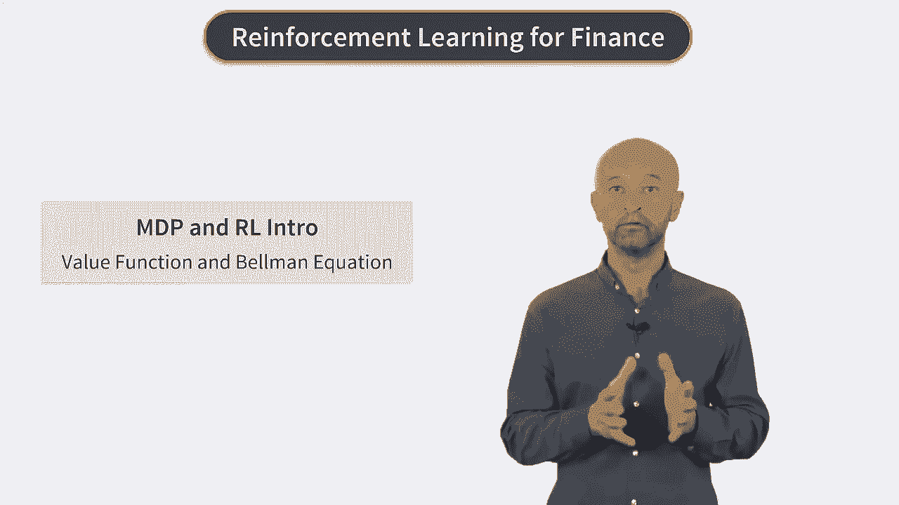
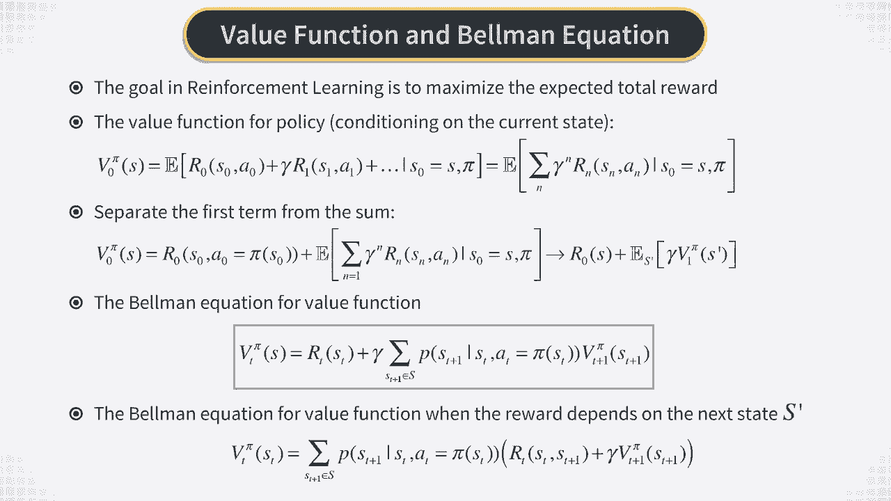
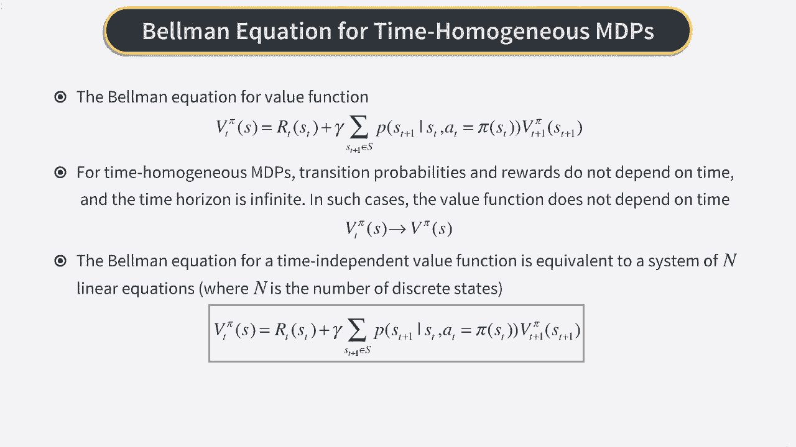
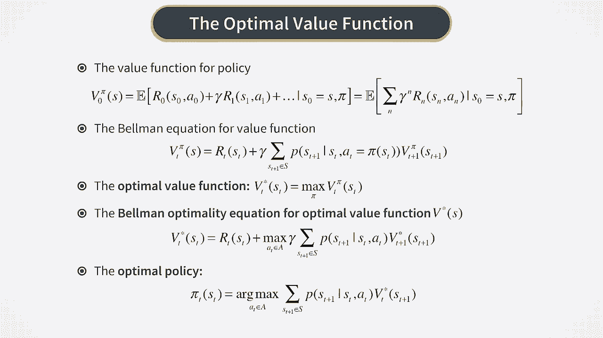
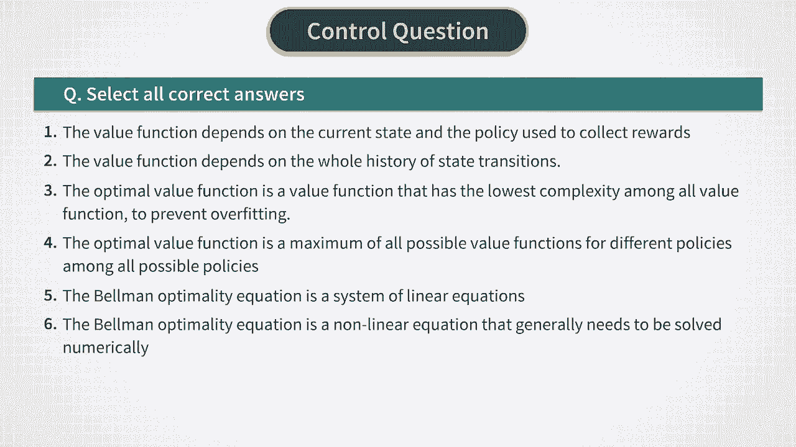

# 6：MDP与RL - 价值函数与贝尔曼方程 🧠

在本节课中，我们将要学习马尔可夫决策过程（MDP）的核心定量工具：价值函数与贝尔曼方程。我们将理解如何通过价值函数来评估和比较不同策略的优劣，并掌握贝尔曼方程这一关键递归关系，它是求解最优策略的数学基础。

## 目标与价值函数

我们之前提到，马尔可夫决策过程的目标是最大化预期的总累积奖励。由于奖励在未来获得，而决策需要在当下做出，因此我们通过策略来解决问题。策略规定了在任意可能的世界状态下应该采取的行动规则。

那么，如何定量地比较同一个MDP问题下的不同策略呢？

我们计算预期的总累积奖励，但有一个重要补充：我们需要对当前系统状态 `S_t` 进行条件化处理。这是因为从不同的初始状态出发，会得到不同的总奖励。这种条件期望的总累积框架被称为**价值函数**。

对于每一个可能的状态 `S_t`，价值函数 `V` 给出了在该状态下，遵循特定策略 `π` 所能获得的预期总奖励。因此，价值函数依赖于所选策略 `π`，我们将其记为上标：`V^π`。同时，它也与时间 `t` 和状态向量 `S` 相关，在离散时间下我们使用下标表示时间，例如在时间 `0` 定义的价值函数为 `V_0^π(S_0)`。

价值函数的定义公式如下：
`V_t^π(s) = E[ Σ_{k=t}^{T} γ^{k-t} R_k | S_t = s ]`
其中，`E` 表示期望，`γ` 是折扣因子（0 ≤ γ ≤ 1），`R_k` 是在时间 `k` 获得的即时奖励，`T` 是终止时间。

## 贝尔曼方程的推导

上一节我们介绍了价值函数的概念，本节中我们来看看如何具体计算它，这将引出一个重要的递归关系。

让我们看看如何评估价值函数的表达式。我们将求和式中的第一项分离出来，写成第一项加上从第二项开始的剩余和式。然后，我们将期望的和式替换为和式的期望。

现在，第一项仅仅是当前时间步的即时奖励 `R_t`。第二项则是从下一时间步开始的、相同的价值函数（但以新状态为参数），并乘以折扣因子 `γ`。接下来，我们可以将这个第二项的期望符号展开，明确写出从当前状态 `s` 转移到所有可能下一个状态 `s‘` 的概率求和。

这就得到了一个关于价值函数的递归关系，这个关系被称为**贝尔曼方程**。它由理查德·贝尔曼在20世纪50年代提出，是其动态规划开创性工作的一部分。

对于奖励 `R` 可能依赖于下一个状态 `s‘` 的更一般情况，只需将奖励项放入期望中，贝尔曼方程变为如下形式：
`V_t^π(s) = E_{a ~ π(·|s), s‘ ~ P(·|s,a)} [ R(s, a, s‘) + γ * V_{t+1}^π(s‘) ]`

## 稳态MDP与贝尔曼方程

当马尔可夫决策过程是稳态的，即转移概率和奖励不显式依赖于时间，并且时间范围 `T` 趋于无限时，情况会得到简化。

在这种情况下，价值函数也将不依赖于时间，我们可以去掉时间下标 `t`。此时，贝尔曼方程简化为一个更简单的形式，对于每个可能的状态 `s`，都有一个方程。

如果离散状态集有 `N` 个状态，我们将得到 `N` 个这样的线性方程。在已知转移概率和奖励函数的情况下，我们可以使用线性代数的方法求解这个线性方程组，从而得到在给定策略 `π` 下的状态价值。

稳态MDP的贝尔曼方程公式如下：
`V^π(s) = Σ_{a} π(a|s) Σ_{s‘} P(s‘|s, a) [ R(s, a, s‘) + γ * V^π(s‘) ]`

## 最优价值函数与贝尔曼最优性方程

我们定义了价值函数来评估给定策略的好坏。那么，如何找到最好的策略呢？这就引出了最优价值函数的概念。

一个状态的最优价值函数 `V*`，简单来说，就是所有可能策略中，该状态能获得的最大价值。即：
`V*(s) = max_{π} V^π(s)`
最优价值函数对应着一个最优策略 `π*`，该策略对于系统的所有状态都是最优的。

我们可以为最优价值函数推导一个类似的递归方程，即**贝尔曼最优性方程**。形式上，可以通过在标准贝尔曼方程两边对策略取最大值来得到。

这表达了著名的**贝尔曼最优性原理**：最优的累积奖励可以通过在当前时刻采取最优行动，并在后续所有时刻遵循最优策略来获得。因此，`V*` 的贝尔曼最优性方程如下：
`V*(s) = max_{a} Σ_{s‘} P(s‘|s, a) [ R(s, a, s‘) + γ * V*(s‘) ]`

由于方程右边有一个 `max` 运算符，这通常是一个需要通过数值迭代方法求解的非线性方程。

## 从最优价值函数到最优策略

如果我们已经知道了最优价值函数 `V*`，如何找到最优策略 `π*` 呢？

这一部分很直接。回顾贝尔曼最优性方程，其第二项涉及在所有可能的动作 `a` 中取最大值。而能给出这个最大值的动作，正是在状态 `s` 下的最优动作。

因此，最优策略 `π*` 可以通过以下方式确定：在状态 `s` 下，选择能使贝尔曼最优性方程右边项达到最大的动作 `a`。
`π*(s) = argmax_{a} Σ_{s‘} P(s‘|s, a) [ R(s, a, s‘) + γ * V*(s‘) ]`

---

本节课中我们一起学习了马尔可夫决策过程的核心数学工具。我们首先定义了**价值函数**，用于定量评估策略。然后，我们推导了**贝尔曼方程**，它建立了价值函数在不同时间步之间的递归关系，是动态规划的基础。接着，我们引入了**最优价值函数** 和 **贝尔曼最优性方程**，它们描述了最优策略应满足的条件。最后，我们看到了如何从最优价值函数中提取出**最优策略**。理解这些概念是掌握后续强化学习算法（如价值迭代、策略迭代）的关键。