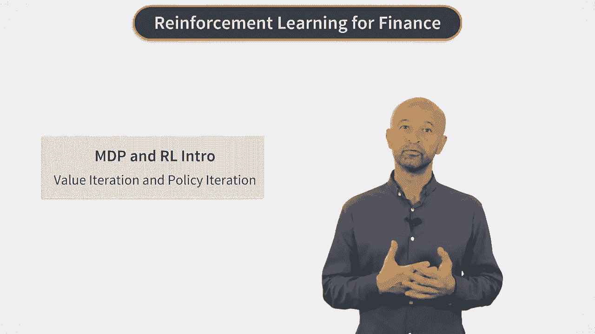
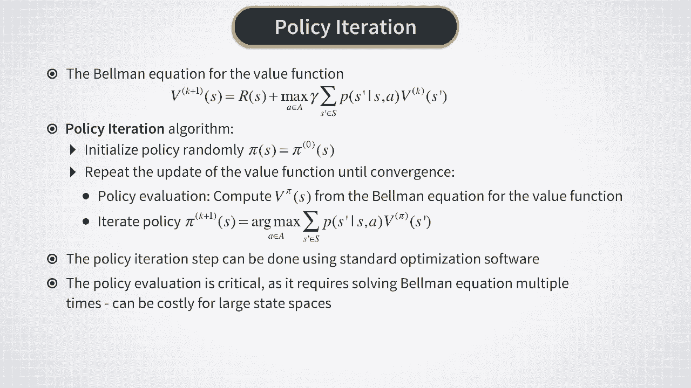
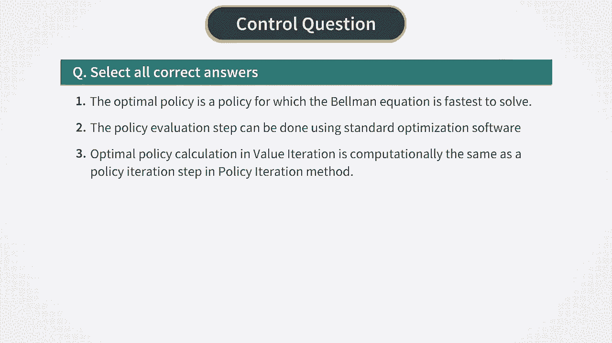

# 7：MDP & RL - 值迭代与策略迭代 🧠

在本节课中，我们将学习求解马尔可夫决策过程（MDP）的两种经典算法：值迭代和策略迭代。我们将了解它们的基本原理、计算步骤以及各自的适用场景。

---

## 回顾与引言

上一节我们介绍了贝尔曼最优方程。本节中，我们来看看求解该方程的两种经典方法：值迭代和策略迭代。这两种方法可应用于时间均匀的马尔可夫决策过程。对于此类过程，价值函数与时间无关，因此贝尔曼最优方程简化为单一函数的非线性方程，可通过数值方法求解。

---

## 值迭代 🔄

值迭代是一种简单快速的数值求解方法，适用于状态-动作空间离散且规模较小的问题。

它的工作原理如下：我们首先初始化所有状态的价值函数，通常将所有状态的值设为零。然后，我们反复迭代，使用贝尔曼方程本身来更新价值函数。在每次迭代中，我们利用上一次迭代的结果计算方程右侧的值。

以下是值迭代中更新价值函数的两种主要方式：

*   **同步更新**：遍历状态空间中的所有状态，计算每个状态的新价值函数，然后一次性更新所有状态的值。
*   **异步更新**：每计算出一个状态的新价值函数后，立即更新该状态的值。

无论采用哪种更新方式，算法最终都能收敛到最优价值函数。收敛后，我们可以利用最优价值函数，通过公式 **π*(s) = arg maxₐ [ R(s, a) + γ Σₛ‘ P(s'|s, a) V*(s') ]** 推导出最优策略。

因此，只要状态-动作空间是离散且规模不大，值迭代算法就非常直接有效。

---

## 策略迭代 🔁

上一节我们提到了值迭代，本节我们介绍另一种经典方法：策略迭代。

在策略迭代中，我们从某个初始策略 **π₀**（通常是随机策略）开始，然后重复执行一个包含两个步骤的循环，直至收敛。

以下是策略迭代循环的两个核心步骤：

1.  **策略评估**：为当前策略 **π** 计算其价值函数 **V^π**。这一步通过求解 **V** 的贝尔曼方程（一个线性方程）来完成，相对直接。
2.  **策略改进**：基于上一步计算出的价值函数，通过应用贝尔曼最优方程右侧的 `arg max` 算子来更新策略，即 **π_{new}(s) = arg maxₐ [ R(s, a) + γ Σₛ‘ P(s'|s, a) V^{π}(s') ]**。

需要注意的是，策略迭代中这两个步骤的计算负担不同。策略改进步骤是直接的，可通过标准优化完成。然而，策略评估步骤涉及求解贝尔曼方程，当状态空间维度很大时，反复进行策略评估的计算成本可能非常高。

---

## 从动态规划到强化学习 🚀

另一方面，对于许多实际的最优控制问题，尤其是当状态-动作空间很大（甚至是连续的）时，动态规划方法（如值迭代或策略迭代）可能不再适用。

在这些情况下，强化学习成为了解决问题的关键工具。我们将在后续课程中详细探讨强化学习的工作原理。

---

## 总结 📝

本节课我们一起学习了求解MDP的两种核心算法：
*   **值迭代**通过不断迭代更新价值函数直接逼近最优解，适用于中小型离散问题。
*   **策略迭代**则在策略评估与策略改进的交替循环中寻找最优策略，其策略评估步骤在状态空间大时可能计算昂贵。

当问题规模过大或状态连续时，我们需要转向强化学习等更高级的方法。