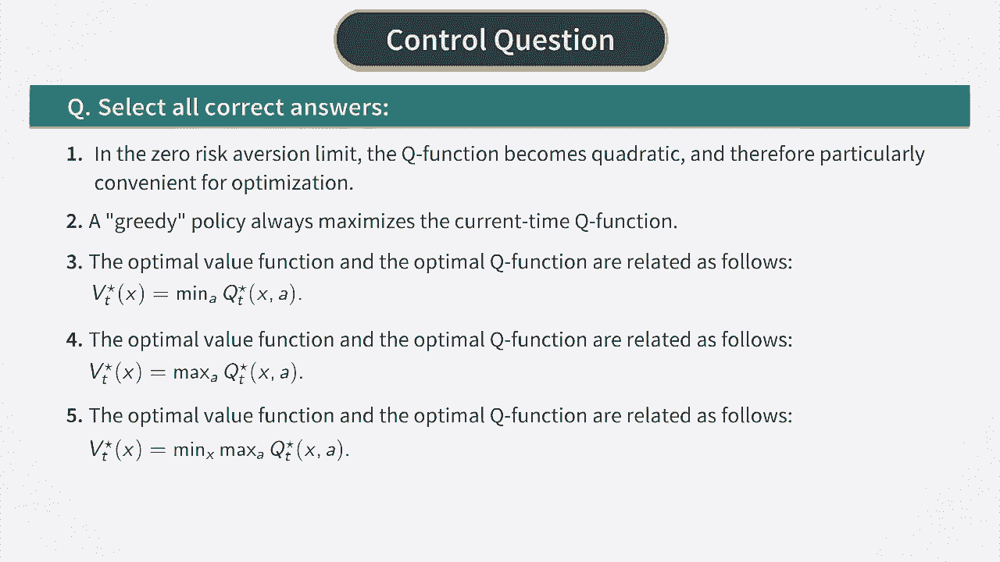

# 16：MDP for BSM - 动作值函数 🧠

在本节课中，我们将学习马尔可夫决策过程在布莱克-斯科尔斯模型中的应用，并重点介绍一个核心概念——动作值函数。我们将探讨如何利用它来寻找最优交易策略，特别是在系统动态未知的情况下。

---

## 概述

我们已经知道，最优策略 **π*** 是使值函数 **V_t** 最大化的策略。最优值函数 **V*** 满足贝尔曼最优性方程。当系统动态已知时，我们可以使用值迭代等方法求解此方程。

上一节我们回顾了值函数的基本方程。本节中，我们将看看当系统动态未知时，一个更强大的工具——动作值函数。

---

## 动作值函数的定义

动作值函数，通常记作 **Q**，是值函数的一个扩展版本。与值函数 **V(x_t)** 仅依赖于状态 **x_t** 不同，Q函数同时依赖于状态 **x_t** 和在该状态下采取的动作 **a_t**。

其数学定义如下：

```
Q^π(x_t, a_t) = E[ R_t + γ * V^π(x_{t+1}) | x_t, a_t ]
```

其中，**R_t** 是即时奖励，**γ** 是折扣因子，期望值是在给定当前状态 **x_t** 和动作 **a_t**，并遵循策略 **π** 的条件下计算的。

---

## 动作值函数的贝尔曼方程

通过将未来回报的期望进行分解，我们可以为任何策略 **π** 的Q函数推导出贝尔曼方程。

以下是Q函数的贝尔曼方程：

```
Q^π(x_t, a_t) = E[ R_t + γ * Q^π(x_{t+1}, π(x_{t+1})) | x_t, a_t ]
```

这个方程建立了当前Q值与下一状态Q值之间的联系。

然而，我们最终的目标是找到最优策略 **π***，它应该最大化动作值函数。

---

## 最优动作值函数与贝尔曼最优性方程

最优策略 **π*** 满足以下条件：

```
π*(x_t) = argmax_{a_t} Q*(x_t, a_t)
```

最优动作值函数 **Q*** 则满足一个更简洁、只涉及自身的方程——贝尔曼最优性方程：

```
Q*(x_t, a_t) = E[ R_t + γ * max_{a_{t+1}} Q*(x_{t+1}, a_{t+1}) | x_t, a_t ]
```

这个方程是强化学习中的核心，它表明最优的长期价值等于即时奖励加上下一状态最优价值的折扣期望。

贝尔曼最优性方程是一个反向方程，应从最终时间 **T** 开始逆向求解。

---

## 在BSM模型中的应用

现在，让我们将上述理论应用到布莱克-斯科尔斯期权定价的背景下。这里，动作 **a_t** 通常代表投资组合的持仓调整。

如果我们把奖励函数 **R** 的具体形式（例如，与对冲误差和风险惩罚相关）代入贝尔曼最优性方程，会发现Q函数关于动作 **a_t** 是二次的。

```
Q*(x_t, a_t) ≈ -λ * Var[Π_T] + E[Π_T]
```
（其中 **Π_T** 是投资组合的终端价值，**λ** 是风险厌恶系数）

这使得相对于动作 **a_t** 的最大化问题变得非常简单直接。

---

## 与经典模型的联系

一个特别有趣的情况是当风险厌恶系数 **λ** 趋近于0时。在这个极限下，最大化Q函数就等价于最大化投资组合的期望终端价值。

此时，最优Q函数的递归关系可以简化为：

```
Ĉ_t = E[ Ĉ_{t+1} | x_t ]
```

这正是计算风险中性期望下平均期权价格 **Ĉ**（即布莱克-斯科尔斯价格）的递归关系。当时间步长 **ΔT** 也非常小时，我们的公式就收敛于经典的布莱克-斯科尔斯偏微分方程。

这证明了我们的MDP框架在连续时间、风险中性极限下与经典理论的一致性。

---



## 总结


本节课中，我们一起学习了：
1.  **动作值函数（Q函数）** 的定义，它同时评估状态和动作的价值。
2.  Q函数的**贝尔曼方程**以及最优Q函数满足的**贝尔曼最优性方程**。
3.  如何利用贝尔曼最优性方程**逆向求解**最优策略。
4.  在BSM模型中，Q函数表现为**二次形式**，便于优化。
5.  当风险厌恶趋于零且时间步长无限细分时，我们的MDP框架**收敛于经典的布莱克-斯科尔斯模型**。

理解动作值函数是掌握现代强化学习和其在金融中应用的关键一步，它为我们处理模型不确定性的问题提供了强大的工具。