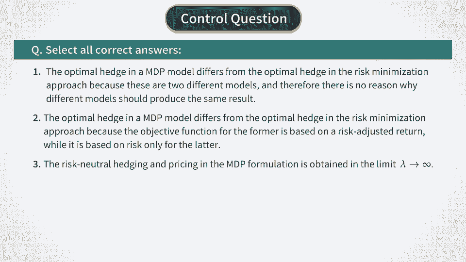

# 17：MDP for BSM - 最优行动来自Q函数 🧠

在本节课中，我们将学习如何从Q函数中推导出最优对冲策略。我们将看到，在更一般的情况下，最优行动可以通过解析方式求解，并理解其与经典离散时间布莱克-斯科尔斯模型的联系与区别。

---

上一节我们验证了公式在极限情况下能重现布莱克-斯科尔斯模型。本节中，我们来看看当λ和时间步长Δt都不为零的更一般情况。让我们再次审视贝尔曼最优方程。

由于回报R_t是关于行动a_t的二次函数，Q函数同样也是关于a_t的二次函数。这意味着我们可以通过解析方法最大化Q函数。

以下是具体步骤：我们只需计算Q函数关于a_t的导数，并令其为零以求解最优行动a_t*。这很容易做到，因为整个表达式是二次的。

对其求导后，我们得到以下表达式：
```
∂Q/∂a_t = 0
```
通过求解这个方程，我们得到了最优对冲的表达式。

这个表达式应该看起来很熟悉。最优对冲由两个条件期望的比率给出：一个涉及下一时间步的投资组合价值π_{t+1}，另一个涉及股票价格增量平方(ΔS_t)^2。

我们在离散时间布莱克-斯科尔斯模型中有一个非常相似的表达式。回顾一下，该表达式可以写成条件协方差与条件方差的比率，也可以重写为两个条件期望的比率。

这两个表达式之间的唯一区别在于，我们新公式的分子中多出了一项。关于这项，有几个有趣的观察点。

首先，从数学角度看，如果我们取小的时间步长，那么ΔS_t的期望将与(μ - r)成正比。这意味着，如果我们令μ = r，或者在此表达式中令λ趋于无穷大，分子中的第二项就会消失。

在这种情况下，通过最大化Q函数得到的最优对冲，将与我们在离散时间布莱克-斯科尔斯模型中得到的对冲策略一致。这是一个正式的数学陈述。

但这些结果的金融解释是什么呢？为了回答这个问题，我们可以回顾模型的设定。

我们将价值函数V_t定义为投资组合价值的期望与对冲投资组合在再平衡时折现方差的总和。因此，我们公式中的期望回报包含两项，分别与对冲投资组合的期望漂移和方差成正比。

当我们最大化这个关于a_t的表达式时，从数学上讲，这与马科维茨投资组合分析的设置相同，后者旨在最大化风险调整后的投资组合回报。所以，这里的目标函数同时考虑了对冲组合的风险和回报。

显然，这与离散时间的布莱克-斯科尔斯模型不同。在那个模型中，我们只关注对冲投资组合的风险。

如果我们想将我们的模型与离散时间布莱克-斯科尔斯模型进行基准比较，可以通过设定μ = r，或者取λ趋于无穷大的极限来简单地消除这个附加项。这两个极限都将强制执行纯粹基于风险的对冲视角，从而与我们之前的模型一致。

因此，我们的对冲公式不仅能再现经典布莱克-斯科尔斯模型中的纯风险对冲，还可以在更一般的场景下应用。例如，当期权被用作投资工具时，我们需要同时考虑其风险和回报。

经典的布莱克-斯科尔斯模型无法直接处理这种情况，因为它直接进入了连续时间极限，并假设所有资产具有相同的风险调整后回报r。因此，当人们试图为期权投机建立框架时，通常需要对原始模型进行各种临时性修改。

但在这里，我们不需要任何此类临时修改，因为我们的设定更为一般化。在一般情况下，它优化的是对冲投资组合的风险调整后回报，而不仅仅是风险。

所以，经典布莱克-斯科尔斯模型的纯对冲策略，只是这里的一个特例，可以通过在最优对冲公式中设定μ = r来重现。



---


本节课中，我们一起学习了如何从Q函数解析求解最优对冲行动。我们看到了新公式与经典离散时间布莱克-斯科尔斯模型的联系，并理解了通过调整参数（如令μ = r），我们的通用模型可以退化为经典的风险对冲模型。这为我们提供了一个同时考虑风险与回报的更灵活的对冲框架。