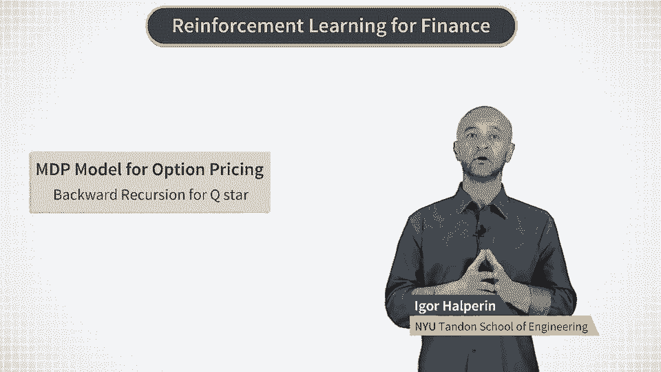
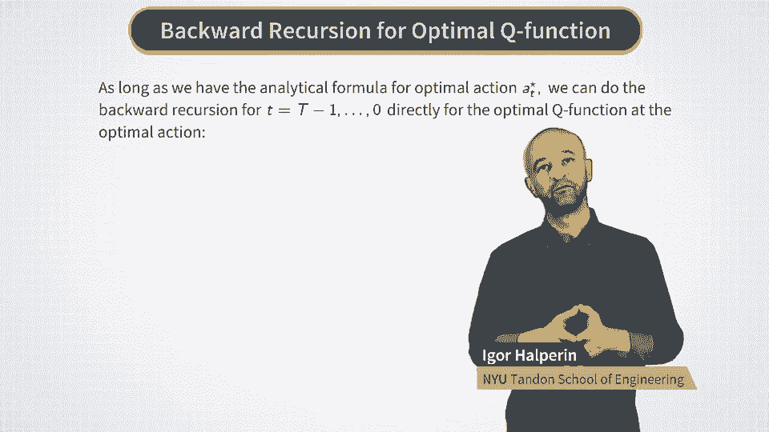
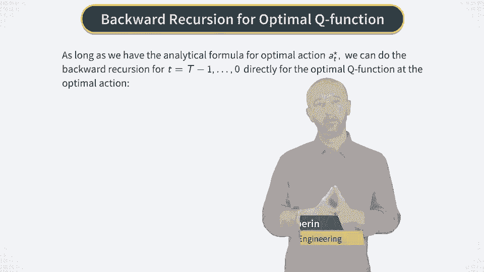
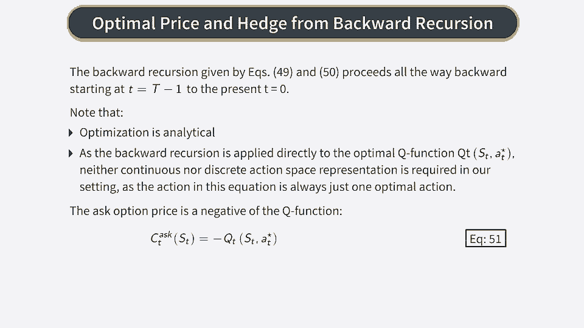
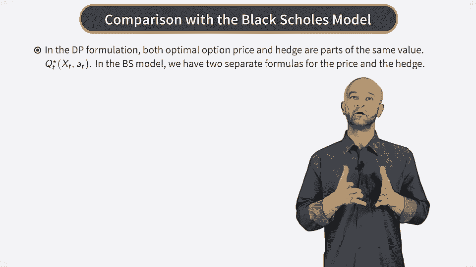
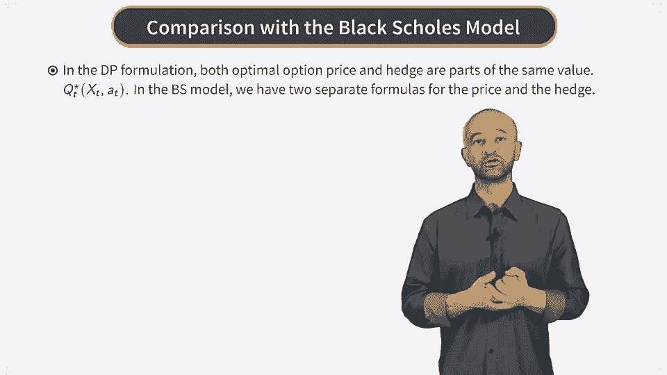
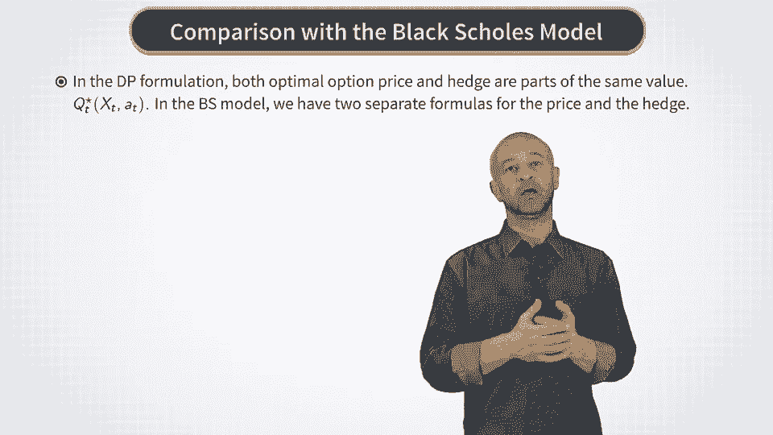
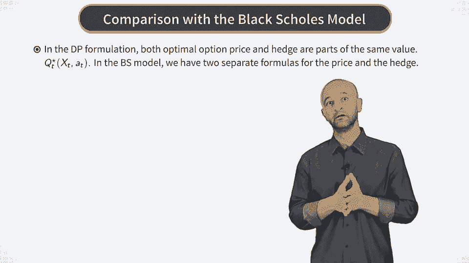
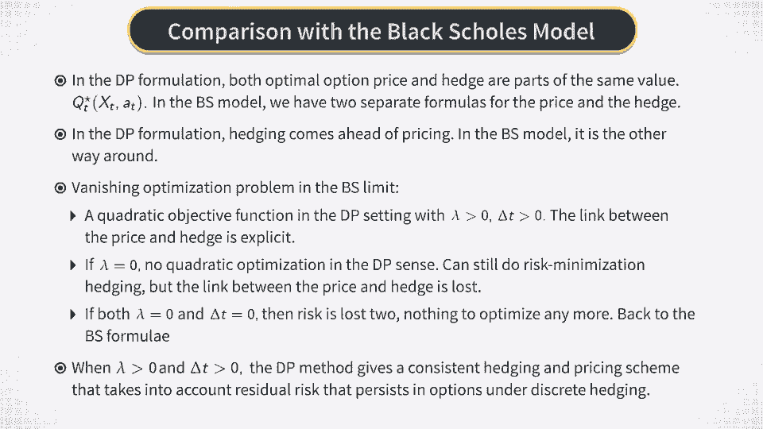
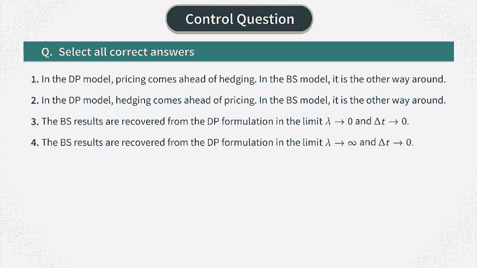

# 18：BSM的MDP模型 - Q*函数的向后递归 🧮

在本节课中，我们将学习如何将最优对冲与最优Q函数相结合，从而为期权定价和对冲问题提供一个完整的算法解决方案。我们将推导出关键的递归公式，并将其与经典的黑-舒尔斯模型进行对比，理解离散时间模型的优势。

---

上一节我们介绍了如何计算最优对冲动作。本节中，我们将把最优对冲公式与Q函数的贝尔曼方程结合起来。

结合以下两个核心公式，我们可以为期权对冲和定价提供一个算法解。

1.  **最优Q函数的贝尔曼方程**（适用于任何动作a）：
    `Q*(S_t, a_t) = E_t[ R_{t+1} + γ * max_{a_{t+1}} Q*(S_{t+1}, a_{t+1}) ]`
2.  **最优对冲动作A*** 的解析解（在上一节已推导）：
    `A*_t = (E_t[ΔS_{t+1} * Q*_{t+1}] + λ * E_t[Q*_{t+1}]) / (Var_t(ΔS_{t+1}) + λ)`

由于我们已经知道当前时间步t的最优动作`A*_t`，我们可以将其代入第一个方程。这样，我们得到的是在最优动作`A*`处求值的`Q*`函数的递归关系，即`Q*(S_t, A*_t)`。

这种方法非常方便，因为它不需要额外存储其他非最优动作的Q值。如果我们最终目标是在初始时刻`t=0`评估`Q*`，那么直接沿着最优路径`A*`进行计算即可。

---

上一节我们建立了递归关系，现在我们来明确这个算法的目标。

我们之所以需要逼近`Q*`和`A*`，是因为在最优动作`A*`处评估的`Q*`函数值，恰好等于最优价值函数`V*`，即`Q*(S_t, A*_t) = V*(S_t)`。

而根据定义，最优价值函数`V*`是期权最优价格的负值。因此，通过计算`Q*(S_0, A*_0)`并取负号，我们就能得到期权的价格。

以下是算法的具体步骤：
我们从到期日`T`开始，向后递归计算到初始时刻`t=0`。
1.  在每个时间步`t`，首先利用第二个公式计算该时刻的最优对冲`A*_t`。
2.  然后，将这个`A*_t`代入第一个公式的右侧，计算`Q*(S_t, A*_t)`。
3.  将计算出的`Q*`值作为前一个时间步计算的输入，重复此过程。

这个过程形成了一个简单的向后递归算法，最终计算出初始时刻的最优对冲`A*_0`和在`A*_0`处评估的最优Q值`Q*_0`。对`Q*_0`取负号即得到期权价格。

---

总结一下，我们从到期日开始，通过向后递归，同步计算出期权的最优对冲和价格。整个计算是半解析的，因为每个时间步需要解决的优化问题（求`A*`）是二次型问题，可以像我们刚才那样解析求解。

另一个要点是：在标准的动态规划或强化学习中，算法通常需要对整个动作空间进行建模或搜索。但在我们的设定中，由于可以直接获得最优对冲`A*`的解析公式，我们可以应用向后递归直接计算在`A*`处评估的`Q*`函数。因为计算中只用到最优动作这一个值，所以在这种设定下，我们不需要对动作空间进行显式建模。

---

我们已经得到了离散时间MDP模型下期权定价和对冲的算法解。现在，让我们将其与经典的黑-舒尔斯模型进行比较。

首先，在我们的MDP公式中，对冲和价格是**统一**在`Q*`函数的表达式中的。这与黑-舒尔斯模型有本质不同。

以下是黑-舒尔斯模型与MDP方法的关键区别：

*   **计算顺序**：在黑-舒尔斯模型中，我们首先通过求解偏微分方程（黑-舒尔斯方程）得到期权价格，然后再通过对价格求关于股票价格的导数（即求Delta）来得到对冲策略。而在我们的MDP公式中，顺序恰好相反：在每个时间步，我们先计算最优对冲`A*`，然后将其代入`Q*`函数并向后滚动。
*   **风险处理**：MDP方法的顺序更符合市场实践。对于无法频繁调整（例如每月一次）的期权，风险是真实存在的。期权价格正是基于对此类剩余风险的分析来确定的。黑-舒尔斯模型则假设可以连续对冲，理论上可以每分每秒调整头寸以完全消除风险。在连续时间的极限下，对冲变得微不足道，问题的核心只剩下通过黑-舒尔斯方程定价。

我们可以将风险消失的过程分为两步来看：
1.  当风险厌恶系数`λ`和时间步长`Δt`都大于零时，我们面对的是一个有二次风险的MDP问题，期权价格与最优对冲通过目标函数直接关联。
2.  如果令`λ = 0`但`Δt`仍为有限值，价格与对冲之间失去了目标函数的直接联系，但风险依然存在，我们仍可进行最小方差对冲。
3.  当`λ`和`Δt`都趋于零时，我们就回到了黑-舒尔斯模型，该模型声称期权没有风险。

黑-舒尔斯模型的“完美”源于其忽略了现实中的风险。相比之下，这里展示的离散时间MDP模型虽然没有期权价格的闭式解，但更加现实，因为它明确地对期权中的剩余风险进行了建模。当`λ`和`Δt`都大于零时，MDP模型提供了一个**一致**的对冲和定价公式，将剩余风险考虑在内。

---

本节课中，我们一起学习了如何构建用于BSM期权定价的MDP向后递归算法。我们推导了结合最优对冲与Q函数的递归公式，明确了从到期日向后计算至初始时刻的步骤，从而同步得到期权价格与对冲策略。最后，我们通过对比黑-舒尔斯模型，理解了MDP方法在建模现实风险方面的优势。

接下来，我们将在后续课程中看到如何具体实现这个算法。